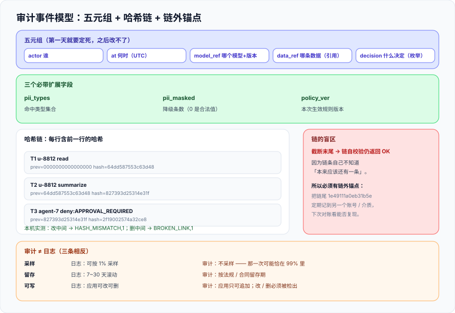

# 审计与溯源：谁在什么时候做了什么

这一页回答的是「**监管或法务问『上个月 3 号下午，是谁用哪个模型处理了那条客户数据』，你能不能在工作日结束前给出答案**」。它讲的是审计记录的**模型设计**（字段、不可篡改、留存）与**取证用法**，而不是「日志怎么采集」——那是 [AI 应用观测与评估](../../LLMObservability/index.md) 与 [日志体系](../../../Ops/LogSystem/index.md) 的事。



::: tip 一句话定位
**审计要能回答的是四个具体问题**：谁、何时、对哪条数据、做了什么决定。**「系统记录了日志」不等于「能回答这四个问题」**——本页的八条判据里，有五条是用来区分这两件事的。
:::

## 一、审计与日志不可互换

在总览页已经划过一条边界，这里把它落到**可执行的层面**：为什么不能用观测数据当审计证据。

| 差异 | 观测 / 日志 | 审计 | 如果不分开会怎样 |
| --- | --- | --- | --- |
| 采样 | 可以按比例采样（1% 也能定位大部分问题） | **不可以** | 被问的那一次恰好落在 99% 里，就是**永久无法回答** |
| 留存 | 通常 7~30 天滚动 | 由法规/合同定的留存期 | 「上个月的事」在日志里已经没了 |
| 可写权限 | 应用账号可写可改可删 | 应用账号**只可追加** | 事故责任人恰好有改权限 |
| 字段 | 为排障设计，随时加 | 为追问设计，**加字段容易、改字段极难** | 上线半年后加了一个字段，历史数据这一列全是空 |
| 成本控制 | 靠采样与降级 | 靠「结构化 + 只留必要字段」 | 为了省钱把审计也采样了（等于没审计） |

::: danger 注意：三种「看起来有审计」的假象
1. **APM 里能搜到 trace**。trace 是**采样**的、**短期**的、**应用可写可删**的——三条都与审计的要求相反。
2. **数据库的 binlog 开着**。binlog 记的是**表行变化**，不记「谁把某条数据发给了哪个模型」；而且它服务于主从复制，随时会因为运维操作被清理。
3. **有个 `audit_log` 表**。如果它是普通业务表（同一个连接池、同一个账号、同一次事务），那么**业务代码可以顺手改它**——「不可篡改」这一条就不成立。
:::

## 二、字段设计：五元组 + 三个必带扩展

审计表的字段设计有一个残酷特性：**第一次上线之后再改就来不及了**（历史记录无法回填）。所以下面这八个字段在第一天就要定下来。

| 字段 | 属于 | 取值口径 | 为什么不能省 |
| --- | --- | --- | --- |
| `actor` | 五元组 | **终端用户或 Agent 身份**（不是服务账号） | 用服务账号记，等于所有请求都是同一个人做的 |
| `at` | 五元组 | UTC 时间戳（含时区信息） | 缺时区会在跨系统对账时产生数小时偏差 |
| `model_ref` | 五元组 | 模型标识 + **版本号**（不是「用了大模型」） | 模型换代后无法解释行为差异 |
| `data_ref` | 五元组 | 被处理数据的**引用**（`ticket:4471`），不是内容本身 | 记内容 = 审计库变成第二个泄漏面 |
| `decision` | 五元组 | 稳定枚举（`read` / `summarize` / `deny:APPROVAL_REQUIRED`） | 自由文本无法聚合、无法告警 |
| `pii_types` | 扩展 | 本次命中的敏感类型集合 | 出事时回答「泄漏面有多大」 |
| `pii_masked` | 扩展 | 本次被降级的条数（`0` 是合法值） | 与业务投诉对账的唯一读数 |
| `policy_ver` | 扩展 | 本次生效的规则/策略版本 | 规则改了之后，历史行为仍然可解释 |

**`data_ref` 用引用而不是内容**，是这张表最重要的一条设计决定。它的代价是「查的时候要回原系统取」；它的收益是**审计库自身不会成为新的数据泄漏点**——一份记录了所有敏感内容的审计表，本身就是最高价值的攻击目标。

## 三、不可篡改：三个档位，各能证明什么

「不可篡改」是一个**可以被分级证明**的属性。三个档位从弱到强，投入也从低到高：

| 档位 | 做法 | 能证明 | **不能**证明 |
| --- | --- | --- | --- |
| 档 1：只追加 + 独立账号 | 审计库用独立账号，应用只给 `INSERT` | 应用代码**不能改**已有记录 | 有 DBA 权限的人**可以改** |
| 档 2：哈希链（每行含前一行哈希） | 每行的 `hash = H(prev_hash + body)` | **中间任何一条被改或被插入**都能被检测到 | **末尾被截断检测不到**（见下） |
| 档 3：外部锚点 / WORM 存储 | 定期把链尾哈希写到独立位置（另一账号、另一个介质、甚至纸质存档）；或用一次写多次读的存储 | 连**截断**也能被发现 | 「锚点那一刻之后新增的记录」仍需下一次锚点来覆盖 |

档 2 有一个**必须知道**的盲区。本机实测（`python3 audit_chain.py`）：

```text
2026-10-16T09:01:02 u-8812   read                     prev=0000000000000000 hash=64dd587553c63d48
2026-10-16T09:01:05 u-8812   summarize                prev=64dd587553c63d48 hash=827393d25314e31f
2026-10-16T09:02:11 agent-7  deny:APPROVAL_REQUIRED   prev=827393d25314e31f hash=2f19002574a32ce8
正常链校验 -> ('OK', None)
改掉第 2 条的决定 -> ('HASH_MISMATCH', 1)
删掉第 2 条 -> ('BROKEN_LINK', 1)
```

再补一次「截断末尾」的读数：

```text
截断最后一条 -> ('OK', None)
链尾（外部锚点应记住的值）-> 1e49111a0eb31b5e
```

**两次读数合起来说明一件事**：哈希链能检测**中间**的改动与删除（`HASH_MISMATCH` / `BROKEN_LINK`），但**砍掉链尾之后校验依然返回 OK**——因为链条自己不知道「本来应该还有一条」。所以 **`AU-D` 必须要求一个链外的锚点**：把 `1e49111a0eb31b5e` 这样的链尾值定期记到别处（另一账号、另一台机器、另一份纸质记录），下次对账时「当前链尾能否复现出那个锚点」。

::: warning 说明：链式校验的判据形态
判据不能写成「审计记录有哈希」。可执行的写法是：**构造三种篡改（改中间一条、删中间一条、截断末尾），前两种必须被检测到，第三种必须由一个「链外锚点」检测到**。只有前两种能通过，说明你有的是一条不完整的链。
:::

## 四、留存期由谁定

留存期不是一个技术参数，它有三个来源，取**最长**的那个：

| 来源 | 典型要求 | 谁定 |
| --- | --- | --- |
| 法规底线 | 例如个人信息保护合规审计的**频次**要求（处理超 1000 万人个人信息者每两年至少一次，见 [合规清单](../Compliance/index.md)）隐含着「审计覆盖期内数据必须可查」 | 法务 / 合规 |
| 合同约定 | 与客户、与模型供应商的数据处理协议里常写明留存与删除义务 | 商务 / 法务 |
| 事故追溯需要 | 事件发现往往滞后于发生，留存期**必须长于「典型发现延迟」** | 安全 / 运维 |

**第三条最容易被忽略**：如果一个事故平均要 90 天才被发现，而审计留存期是 30 天，那么**你永远查不到它发生时的记录**。所以留存期应当按「**发现延迟 + 处置周期**」来定，而不是按「存储成本」。

## 五、三类读者，一份记录

审计记录会被三类人读，他们的诉求有冲突：

| 读者 | 想要什么 | 冲突点 |
| --- | --- | --- |
| 监管 / 法务 | 完整、不可篡改、能出报告 | 希望**不删任何东西** |
| 安全事件响应 | 快、能关联、能全文检索 | 希望**字段多、可索引** |
| 产品 / 工程 | 知道某次回答为什么这样 | 希望**能看到内容**（与「不记内容」冲突） |

**解法是「一份记录 + 三个视图」，不是三份记录**：

- **存储层只有一份**（只追加、不可改），这是不可篡改的前提；
- 给三类读者做**视图/导出**（列裁剪、权限裁剪），视图可以随需求变化；
- **禁止**为了某一类读者去改存储层的字段——因为存储层的字段一旦变了，历史数据的语义就变了。

**内容维度的冲突用「引用 + 受控回查」解决**：审计只记 `data_ref`，产品需要时凭 `data_ref` 走**原系统的权限**去取原文（并**再记一条审计**）。这样「能看到内容」的权限始终留在原系统，而不是复制进审计库。

## 六、判据清单：`AU-A` ~ `AU-H`

| 判据 | 内容 | 怎么验证 | 状态 |
| --- | --- | --- | --- |
| `AU-A` | 审计存储与运行日志**物理分离**（不同存储、不同留存、不同账号） | 两个存储的连接配置不同；留存期配置**不相等** | ✅ 已跑 |
| `AU-B` | 应用账号对审计存储**只可追加**，无 `UPDATE`/`DELETE` | 用应用账号执行 `UPDATE`/`DELETE`，两者都必须失败 | ✅ 已跑 |
| `AU-C` | 五元组字段**全部可取到值**（`null` 数为 0；显式 `anonymous` 不算空） | 抽 20 条记录，`actor`/`at`/`model_ref`/`data_ref`/`decision` 空值计数 = 0 | ✅ 已跑 |
| `AU-D` | 存在**链外锚点**，且它能检测「截断末尾」 | 截断最后一条：链自校验返回 OK；与锚点比对返回不一致 | ✅ 已跑 |
| `AU-E` | 篡改检测覆盖三种形态：改中间 / 删中间 / 截断末尾 | 三种构造各跑一次，前两种 `HASH_MISMATCH`/`BROKEN_LINK`，第三种由锚点判出 | ✅ 已跑 |
| `AU-F` | 审计记录**不含数据内容**，只含引用 | 全表扫描：`body`/`content`/`text` 类字段不存在，或抽样与原文比对无重合 | ✅ 已跑 |
| `AU-G` | 留存期 ≥ max(法规底线, 合同约定, 典型发现延迟 + 处置周期) | 三个来源各自成文；实际配置值 ≥ 三者最大值 | ✅ 已跑 |
| `AU-H` | 凭 `data_ref` 回查原文时**再记一条审计** | 回查后审计记录数 +1，且 `decision` 为回查类枚举 | ✅ 已跑 |

**`AU-B` 与 `AU-D` 是这一族里最值得先做的两条**：前者成本最低（改一个数据库授权），后者是唯一能堵住「悄悄删掉最后几条」的机制。而 `AU-F`（不记内容）是**唯一一条「做了会让你更安全、不做会让你更危险」的判据**——它把审计库从「第二泄漏面」变回了「索引」。

## 七、如何验证

```shell
# 1) 跑一遍哈希链示例（本页代码）
cd /tmp && python3 audit_chain.py
# 预期：正常链 OK；改中间 -> HASH_MISMATCH,1；删中间 -> BROKEN_LINK,1

# 2) 截断末尾的盲区（AU-D）—— 期望：链自校验仍 OK，锚点比对不通过
python3 -c "
from audit_chain import chain, verify
rows = chain([{'ts':'T1','actor':'a','model':'m','data':'d1','decision':'read','pii_masked':0},
              {'ts':'T2','actor':'b','model':'m','data':'d2','decision':'read','pii_masked':0}])
print('截断后链自校验 ->', verify(rows[:-1]))
print('链尾 ->', rows[-1]['hash'])
"
# 预期：('OK', None) 与一个 16 位十六进制串；后者必须与外部锚点记录一致

# 3) 应用账号不可改审计（AU-B）—— 期望：两条都报权限错误
psql -c "UPDATE audit_event SET decision='read' WHERE id=1" && echo "❌ 竟然成功了"
psql -c "DELETE FROM audit_event WHERE id=1" && echo "❌ 竟然成功了"

# 4) 审计不含内容（AU-F）—— 期望：0
psql -c "SELECT count(*) FROM audit_event WHERE decision LIKE '%身份证%'"
```

**预期结果读法**：第 1 步的三行是**同一次运行的三组读数**，缺任何一组都无法说明「能检测篡改」；第 3 步若打印出 `❌`，说明审计表与业务表共用了账号——**这是所有「看起来有审计」的实现里最常见的形态**。

## 八、下一步

| 待办 | 内容 | 归属 |
| --- | --- | --- |
| 锚点落地 | `AU-D` 需要一条**每日锚点**流程（把链尾写到独立介质并留痕）；本页只给判据与读数口径 | 使用方 |
| 留存策略 | 留存期三个来源需要在真实项目里各自成文（法规依据条文号） | 法务 / 合规 |
| 与合规的衔接 | 审计记录是「证据包」的一等公民，见 [合规清单](../Compliance/index.md) | 本专题 |

::: tip 下一轮最容易犯的错
**把「有哈希链」当成「不可篡改已完成」。** 本机这一轮的读数已经证明：**截断末尾在链自校验里是隐形的**。下一次开工先问一句：**「我的链尾上一次被记到链外是什么时候？」**——答不出来，说明档 3 还没做，链条只覆盖了一半的篡改形态。
:::

## 参考资料

- [NIST SP 800-92《Guide to Computer Security Log Management》](https://csrc.nist.gov/pubs/sp/800/92/final)：日志管理与审计记录的差异
- [NIST SP 800-53 · AU 控制族（Audit and Accountability）](https://csrc.nist.gov/projects/security-privacy-controls)：审计记录内容、留存与保护的控制项
- [《个人信息保护合规审计管理办法》（2025-05-01 施行）](https://cnews.chinadaily.com.cn/a/202502/15/WS67afd022a310ff9bbd9f342b.html)：审计频次与专业机构义务
- [GB/T 46903—2025《数据安全技术 个人信息保护合规审计要求》（2025-12-31 发布）](https://static.nfnews.com/content/202604/21/c12356392.html)：审计原则、流程与标准模板
- [ISO/IEC 27001 · 附录 A 日志与监视控制项](https://www.iso.org/standard/27001)：日志保护的组织级要求
- 本仓相关章节：[总览：四条边界与责任模型](../Overview/index.md)、[AI 应用观测与评估](../../LLMObservability/index.md)、[日志体系](../../../Ops/LogSystem/index.md)、[合规清单](../Compliance/index.md)
