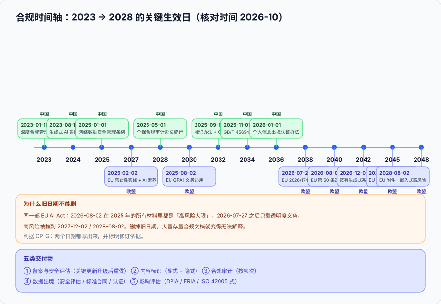

# 合规清单：法规地图与证据包

这一页回答的是「**我这套系统要不要备案、哪一天起必须做什么、监管来的时候我拿什么**」。它不给法律意见——它给的是**一张带生效日期的时间轴**、**一张交付物清单**，和一套**能自证的证据包结构**。因为合规讨论里最贵的成本从来不是「做合规」，而是**在错误的日期上做了错误的一版合规**。



::: tip 一句话定位
**每条合规结论都必须能回答三个问题**：依据哪份文件、它哪一天生效、我的场景为什么落进（或落不进）它的适用范围。**答不出第三问的「不适用」，和答不出第二问的「已合规」，是同一类错误。**
:::

## 一、先答「适用吗」：三道筛

不要从「要做什么」开始，从「适不适用」开始。三道筛**按顺序过**，任何一筛过不去，后面的义务都不成立：

| 筛 | 问什么 | 需要的依据 | 典型误判 |
| --- | --- | --- | --- |
| 第 1 筛：**主体** | 我是模型提供者、服务提供者，还是使用者？ | 责任模型表（见 [总览](../Overview/index.md)） | 只做内部工具，却按对公众服务的义务做了一整套 |
| 第 2 筛：**地域** | 服务面向的用户/数据处理发生在哪 | 用户所在地、服务器所在地、数据流向 | 「公司在中国所以只看中国法规」——用户在欧洲就还要看 AI Act |
| 第 3 筛：**场景** | 是否具有舆论属性或社会动员能力？是否落在高风险清单？ | 是否有公众发布内容、是否用于招聘/教育/关键基础设施等 | 把「toB 就不算」当成结论（属不属于看的是**功能**不是客户类型） |

**第三筛最容易被一句「我们是 toB」带过去。** 判断依据应当是「**这个系统有没有一般用户的注册与内容发布功能、会不会影响公众信息环境**」，而不是「客户是公司还是个人」。

## 二、法规地图（核对时间 2026-10）

### 2.1 中国

| 文件 | 类型 | 生效日 | 与 AI 应用最相关的义务 |
| --- | --- | --- | --- |
| 《互联网信息服务深度合成管理规定》 | 部门规章 | **2023-01-10** | 深度合成服务与使用者的标识、内容管理义务 |
| 《生成式人工智能服务管理暂行办法》 | 部门规章 | **2023-08-15** | 备案与安全评估、语料与内容安全责任、投诉入口 |
| 《网络数据安全管理条例》 | 行政法规 | **2025-01-01** | 告知—同意细化、个人信息行权条件、大型处理者义务、定期合规审计 |
| 《个人信息保护合规审计管理办法》 | 管理办法 | **2025-05-01** | 处理超 **1000 万人**个人信息者**每两年至少一次**合规审计；专业机构**不得连续三次以上**审计同一对象 |
| 《人工智能生成合成内容标识办法》 | 管理办法 | **2025-09-01**（约 6 个月过渡期） | 生成合成内容**显式标识 + 隐式标识**；传播平台核验义务 |
| **GB 45438—2025**《网络安全技术 人工智能生成合成内容标识方法》 | **强制性**国标 | **2025-09-01** | 「人读 + 机读」双模式标识；禁止删除或篡改标识 |
| **GB/T 45654—2025**《网络安全技术 生成式人工智能服务安全基本要求》 | 推荐国标 | **2025-11-01** | 训练数据安全、模型安全、安全措施的要求与证实方法；备案与第三方测评的技术依据 |
| **GB/T 45652—2025**《生成式人工智能预训练和优化训练数据安全规范》 | 推荐国标 | **2025-11-01** | 训练数据处理活动的安全要求与评价方法 |
| 《个人信息出境认证办法》 | 管理办法 | **2026-01-01** | 数据出境第三条路径（与安全评估、标准合同并列） |
| 《人工智能安全治理框架》2.0 版 | 技术文件 | 2025-09-15 发布 | 风险分类与分级原则；**30 个技术应对措施 + 40 个治理模式** |

### 2.2 欧盟

| 文件 / 条款 | 生效或适用日 | 与 AI 应用最相关的义务 |
| --- | --- | --- |
| **Regulation (EU) 2024/1689**（EU AI Act） | **2024-08-01 生效** | 风险分级框架（不可接受 / 高 / 有限 / 最小） |
| 禁止性实践 + AI 素养（Art. 4） | **2025-02-02 适用** | 不可接受风险用途禁止；使用方须保证相关人员具备 AI 素养 |
| GPAI 模型义务 | **2025-08-02 适用** | 技术文档、版权政策、系统性风险模型的风险评估 |
| 第 50 条透明度（含机器可读标识） | **2026-08-02 适用** | 与 AI 直接交互需告知、合成内容需机器可读标记、深度伪造需披露 |
| **Regulation (EU) 2026/1744**（「数字综合法案·人工智能篇」） | **2026-07-27 生效** | **延期**附件三独立型高风险 → **2027-12-02**；附件一嵌入式受监管产品 → **2028-08-02** |
| 既有生成式系统的过渡 | **2026-12-02** | 2026-08-02 前投放市场的生成合成内容系统须在此日前符合第 50(2) 条 |

::: warning 说明：这一轮的日期变动，正好是最好的教材
同一部法案，2026-08-02 这个日期在 2025 年的所有合规材料里都是「高风险大限」，而在 2026-07-27 之后它**只剩透明度义务**——高风险被推到 2027-12-02。

**本库的写法**：两个日期同时保留，并标明依据（Regulation (EU) 2026/1744）。因为**「某条义务曾经定在 2026-08-02」本身是有用的信息**——它解释了为什么很多 2025 年的合规文档长成那个样子。**删掉旧日期会让历史文档变得不可解释。**
:::

### 2.3 国际标准（自愿，但常被采购方要求）

| 标准 / 框架 | 发布 | 性质 | 它证明什么 / 不证明什么 |
| --- | --- | --- | --- |
| **ISO/IEC 42001:2023** | 2023-12-18 | 管理体系，**可认证** | 证明**你的 AI 治理流程在运转**；**不证明**某一次具体处理合法 |
| ISO/IEC 42005 | 2025-05 | 影响评估指南 | 以社会/人/组织影响为对象，支撑需要影响评估的法规 |
| ISO/IEC 23894 | 早于 42001 | 风险管理 | 把 ISO 31000 扩展到 AI 的透明度、自主性、数据依赖特征 |
| **NIST AI RMF 1.0**（AI 100-1） | 2023-01-26 | 自愿框架 | 提供 **Govern / Map / Measure / Manage** 四函数的**共同词汇**；无「NIST 认证」这回事 |
| NIST AI 600-1（GenAI Profile） | 2024-07-26 | 自愿框架 | 12 类生成式 AI 风险，含 Data Privacy、Information Security、Value Chain Integration |
| **OWASP Top 10 for LLM Applications 2025** | 2025 版 | 社区清单 | 攻击面提问清单（见 [总览](../Overview/index.md) 的映射表） |
| MITRE ATLAS v5.1.0 | 2025-11 | 威胁库 | 威胁建模与红队场景设计 |
| ETSI EN 304 223 | 2026-01-14 | 欧洲标准 | 覆盖设计/开发/部署/维护/退役的基线网络安全要求 |

**一句话判据**：**管理体系认证与单次合法性是两件事**。被采购方要求 ISO/IEC 42001 时，正确回答是「我们有认证，覆盖范围是 X，本次交付的合规证据另见证据包」——而不是「我们有认证所以合规」。

## 三、五类交付物

合规最终会落成**五类可交付的东西**。每一类都要回答「谁签、交到哪、什么时候更新」：

| 交付物 | 面向 | 关键内容 | 更新触发 |
| --- | --- | --- | --- |
| **① 备案与安全评估** | 主管部门 | 安全评估报告、模型服务协议、语料与拦截规则、测试题 | 模型**关键更新升级**后重做（不是一年一次） |
| **② 内容标识** | 用户 / 传播平台 | 显式标识（可感知）+ 隐式标识（元数据），禁止删除篡改 | 标识方法升级时 |
| **③ 合规审计** | 内部 / 主管部门 | 审计范围、抽样方法、问题清单与整改 | 按频次要求（如超 1000 万人的处理者每两年一次） |
| **④ 数据出境** | 主管部门 | 出境路径选择（安全评估 / 标准合同 / **认证**）、出境清单 | 出境主体、目的、类型变化时 |
| **⑤ 影响评估** | 内部 / 采购方 | DPIA（GDPR Art. 35）/ FRIA（AI Act Art. 27）/ ISO 42005 式影响评估 | 用途、数据、部署环境变化时 |

**① 的更新触发最容易被写错**：不是「一年一次」，而是**「关键更新升级后」**——一次模型换代、一次训练数据大改、一次能力边界变化，都构成触发条件。所以备案材料里必须写清**你自己的「关键更新」定义**，否则这条义务无法执行。

## 四、证据包：怎么攒、留给谁

监管或客户来问的时候，你要拿出来的不是一份文档，而是**一组互相印证的证据**。它的结构应当是**固定的六格**：

| 格 | 内容 | 来自哪一页 |
| --- | --- | --- |
| 1. 系统定义 | 范围说明、架构、**数据流向图**、工具清单 | [总览](../Overview/index.md) + [运行时护栏](../Guardrails/index.md) |
| 2. 失败模式 | 误用场景、风险登记表、攻击路径 | [总览](../Overview/index.md) + [提示词安全](../../PromptSecurity/index.md) |
| 3. 测试证据 | 测试日志、指标、PoC、**能力边界**（明确了测不出来的部分） | [内容安全](../ContentSafety/index.md) |
| 4. 控制措施 | 护栏配置、权限矩阵、监控、人工复核 | [运行时护栏](../Guardrails/index.md) + [数据脱敏与最小化](../DataMinimization/index.md) |
| 5. 归属与残余风险 | 责任矩阵、升级路径、**残余风险由谁接受** | [总览](../Overview/index.md) |
| 6. 生命周期 | 监控计划、变更触发条件、**复测证据** | [审计与溯源](../Audit/index.md) |

::: danger 注意：证据包最常见的四个缺口
1. **系统边界不清楚**，导致评审无法确定在评什么——第一格就缺。
2. **测的是模型，不是应用**。孤立测模型行为会漏掉「提示词、检索源、工具、权限、日志、降级路径、审批链路」这一整层。
3. **发现了问题但没有严重度、没有归属人、没有复测证据**——第五格缺一半。
4. **变更不触发复评**。模型、提示词、数据、工具任一项变了，旧证据立即失效；没有触发条件就等于**证据一次性**。
:::

## 五、判据清单：`CP-A` ~ `CP-H`

| 判据 | 内容 | 怎么验证 | 状态 |
| --- | --- | --- | --- |
| `CP-A` | 三道筛（主体/地域/场景）**逐系统**填表，且每格有依据 | 表行数 ≥ 系统数；「依据」列无空值 | ✅ 已跑 |
| `CP-B` | 每条合规结论都带**文件名 + 生效日 + 核对日期**三样 | 逐条 `grep`：三者同时命中；只写「最新/现行」的条数 = 0 | ✅ 已跑 |
| `CP-C` | 「不适用」结论必须写出**为什么落在适用范围外**的依据 | 每处「不适用」紧邻处含文件名与条款/理由 | ✅ 已跑 |
| `CP-D` | 五类交付物各有**负责人、交付对象、更新触发**三项 | 交付物表三列非空；「更新触发」不得写成「定期」 | ✅ 已跑 |
| `CP-E` | 「关键更新」有**自己的定义**（可判定），不是「重大变更」这类形容词 | 定义中包含可枚举的触发项（模型换代 / 训练数据大改 / 能力边界变化…） | ✅ 已跑 |
| `CP-F` | 证据包六格齐全，且每格**指向具体产物**而非章节名 | 六格全非空；每格含产物路径或编号 | ✅ 已跑 |
| `CP-G` | 日期冲突被显式记录（同一义务的新旧两个生效日同时保留并标依据） | 存在「旧日期 + 依据说明」的记录；无「静默替换日期」 | ✅ 已跑 |
| `CP-H` | 变更触发条件存在，且**至少有一条**能在测试中被触发验证 | 构造一次提示词版本变更，复评流程被触发（有记录） | ✅ 已跑 |

**`CP-G` 是本页特有的一条**，它来自本专题这一轮的真实观察：欧盟高风险义务的生效日变了，而**很多存量文档会把旧日期直接改掉**。改掉之后，那些按旧日期排期的历史决定就变得无法解释。判据形态很轻——**旧日期不许删，只许标注**。

## 六、如何验证

```shell
# 1) 每条结论带三样（CP-B）—— 期望：命中数 = 结论条数；「最新/现行」= 0
grep -nE '依据|生效' compliance/registry.md | wc -l
grep -cE '最新|现行法规|当前要求' compliance/registry.md
# 预期：第二个命令输出 0

# 2) 日期冲突被保留（CP-G）—— 期望：能同时搜到两个日期
grep -nE '2026-08-02|2027-12-02' compliance/registry.md
# 预期：两个日期都出现，且 2026-08-02 那一行带「原定」字样与修订依据

# 3) 交付物三列齐全（CP-D）—— 期望：无空单元格
python3 - <<'PY'
import re
rows = [l for l in open('compliance/deliverables.md') if l.startswith('| ') and '---' not in l]
bad = [r for r in rows[1:] if any(c.strip() == '' for c in r.strip().strip('|').split('|'))]
print('空单元格行数 =', len(bad))
PY
# 预期：0

# 4) 证据包六格（CP-F）—— 期望：6
grep -cE '^\| [1-6]\. ' compliance/evidence-pack.md
```

**预期结果读法**：第 1 步第二个命令**必须是 0**——出现「最新法规」这类没有日期的表述，三个月后没人知道它指的是哪一版；第 2 步要能同时搜到两个日期，**只有新日期说明旧日期被静默替换了**。

## 七、下一步

| 待办 | 内容 | 归属 |
| --- | --- | --- |
| 依据条文号 | 三道筛的「依据」列需要落到具体条款（本页给的是文件名层级） | 法务 / 合规 |
| 出境清单 | 第 4 类交付物需要与实际的第三方模型供应商清单对齐 | 商务 / 法务 |
| 与交付流程合并 | 证据包六格应当并入项目交付清单，见 [完整项目交付](../../../Others/ProjectDelivery/index.md) | 跨专题 |

::: tip 下一轮最容易犯的错
**把「清单打勾」当成合规完成。** 本页八条判据里，`CP-B`（带日期）与 `CP-C`（不适用的依据）是**文档层面就能满足**的；真正难的是 `CP-H`——**变更真的能触发复评**。下一次开工先做一件事：**改一个提示词版本，看复评流程有没有被触发**。没有触发，说明六格证据是一次性的。
:::

## 参考资料

- [《人工智能生成合成内容标识办法》全文（中国政府网）](https://www.gov.cn/zhengce/zhengceku/202503/content_7014286.htm)：标识义务与过渡期
- [中央网信办 · 标识新规解读](https://www.cac.gov.cn/2025-09/05/c_1758792061408012.htm)：显式标识与隐式标识的落地要求
- [GB/T 45654—2025《网络安全技术 生成式人工智能服务安全基本要求》（2025-11-01 实施）](https://amr.fy.gov.cn/Content/show/1332636.html)：备案与安全测评的技术依据
- [《个人信息保护合规审计管理办法》（2025-05-01 施行）](https://cnews.chinadaily.com.cn/a/202502/15/WS67afd022a310ff9bbd9f342b.html)：审计频次与专业机构约束
- [《人工智能安全治理框架》2.0 版（2025-09-15 发布）](https://news.youth.cn/jsxw/202509/t20250916_16238450.htm)：风险分类、分级原则与治理模式
- [EU AI Act · Implementation Timeline](https://artificialintelligenceact.eu/implementation-timeline/)：分期适用日期与 2026 年修订后的时间轴
- [欧盟 2026 年 AI 简化方案对高风险时间表的影响（中国经济网，2026-09）](http://intl.ce.cn/sjjj/qy/202609/t20260908_3199437.shtml)：附件三 / 附件一延期的事实来源
- [NIST AI Risk Management Framework](https://www.nist.gov/itl/ai-risk-management-framework)：四函数结构与自愿性质
- [ISO/IEC 42001:2023](https://www.iso.org/standard/81230.html)：AI 管理体系（认证的边界）
- 本仓相关章节：[总览：四条边界与责任模型](../Overview/index.md)、[审计与溯源](../Audit/index.md)、[完整项目交付](../../../Others/ProjectDelivery/index.md)
