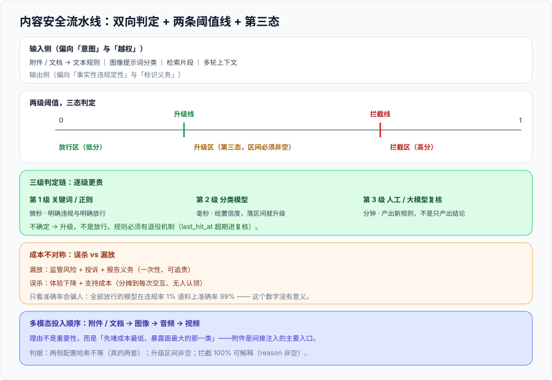

# 内容安全：输入与输出的双向审核

这一页回答的是「**模型说了一句不该说的话，这件事在哪一层被拦住、拦不住的时候谁来接**」。它不讲「怎么让模型更听话」（那是提示词与对齐的活），讲的是**内容判定这条流水线的形态**：分几级、每级的成本与延迟是多少、阈值怎么定、判不了的时候往哪升级。



::: tip 一句话定位
**内容安全的难点不是「能不能判」，而是「判不了的时候怎么办」。** 一条只有「通过 / 拦截」两态的流水线，会在两个方向上同时出事故：该放的被拦（用户体验崩）与该拦的放了（监管风险）。**第三态——「不确定」——必须存在，并且必须有人接住它。**
:::

## 一、为什么必须双向

只做出闸（输出审核）或只做入闸（输入审核）都能在 demo 里工作，但都会在真实场景里破：

| 只做输入侧 | 只做输出侧 |
| --- | --- |
| 拦得住「直接问违规问题」，拦不住**诱导式的多轮渐进**（每一轮单独看都无害） | 拦得住明显违规输出，但会让大量违规请求**消耗完整推理成本**才被拒 |
| 拦不住**间接注入**（违规意图藏在被检索的文档、被上传的附件里） | 拦不住**输入侧已注入的系统提示词**（已在上下文里，输出审核看不见它） |
| 误杀率高（用户正常提问被判定为违规，且拿不到有用回答） | 用户拿到的是「抱歉我不能回答」而不知道该改什么 |

**结论：两侧都要，且两侧的规则集不完全相同**。输入侧偏向「意图」与「越权」，输出侧偏向「事实性违规定性」与「标识义务」。把两侧做成同一套规则的复制，会在两个方向上同时漏。

## 二、把法规口径翻译成工程标签

法规给的是一段话，工程需要的是**可判定的标签**。这个翻译过程是内容安全里最容易含糊过去、也最必须写死的一步。

以《生成式人工智能服务安全基本要求》体系为例，它把语料与生成内容的安全风险划分为 **5 类 31 种**（TC260-003，2024-02-29 发布；转正为国标 **GB/T 45654—2025**，2025-04-25 发布、**2025-11-01 实施**）。**5 类 31 种不是让你直接当标签用的**——它是**检查面的清单**，你需要在它之下再切一层「可判定的工程标签」：

| 层级 | 形态 | 例子 | 谁维护 |
| --- | --- | --- | --- |
| 法规口径 | 5 类 31 种风险 | 「危害国家安全」「歧视偏见」 | 不维护（引用） |
| **工程标签** | 可判定的分类号 | `POL_01`（涉政敏感人物）、`DIS_03`（地域歧视）、`PRV_02`（他人隐私） | 你自己（随业务演进） |
| **判定规则** | 关键词库 + 语义模型 + 白名单 | 关键词表、模型阈值、豁免名单 | 你自己（每周更新） |
| **处置动作** | 拒答 / 改写 / 降级回答 / 转人工 / 放行 | 见第四节四象限 | 你自己 |

**「法规口径 → 工程标签」的映射表必须显式存在**，理由有二：

1. **监管问的时候要能反查**：被问到「你们怎么处理第 X 类风险」时，你要能立刻给出「对应我们的 `DIS_0x` 标签，规则在第 N 版关键词库、模型在第 M 版」。
2. **标签数量要自己控制**。31 种直接当标签 → 每条规则都要维护 31 个分支，最后没人敢改。**工程标签通常收敛到 10~20 个**，其余的用「组合」表达（例如「涉政 + 谣言」由两个标签的与运算表达）。

::: warning 说明：关键词库是「底线」不是「方案」
关键词库能挡住的，是**已知且字面出现**的那一部分。它的价值不在覆盖面，而在**可解释性**：「这条被拦是因为命中关键词 `X`」——这句话在人工复核和投诉处理里是刚需。所以关键词库**不能因为「模型效果更好」就删掉**，它是**证据链的最低成本形态**（参见 [审计与溯源](../Audit/index.md)）。
:::

## 三、判定链：三级，逐级更贵

三级流水线的分界线不是「准确率」，而是**单位成本**和**延迟**。把它们画成一条线，才能回答「什么时候该升级」：

| 级别 | 手段 | 单次成本量级 | 延迟量级 | 典型用途 | 判不了时 |
| --- | --- | --- | --- | --- | --- |
| 第 1 级 | 关键词 / 正则 / 黑白名单 | 微秒 | < 1 ms | 挡下明确违规与明确放行 | 升级到第 2 级 |
| 第 2 级 | 分类模型（小模型） | 毫秒 | 10~200 ms | 语义级判定，给置信度 | 低于拦截线 → 升级到第 3 级 |
| 第 3 级 | 人工复核 / 大模型复核 | 秒~分钟 | 分钟级 | 处置边界样本，并产出新的第 1/2 级规则 | 转人工队列，**不放行也不静默** |

::: danger 注意：三级链的三种坏设计
1. **「不确定就放行」**。这是最常见的默认策略，后果是**边界样本全部流向用户**——而攻击者恰好只会构造边界样本。正确策略是**不确定就升级**。
2. **只加不减**。每出一次事故就往第 1 级加一条规则，两年后关键词库有几万条、误杀率飙升，最后被整体降级为「只记录不拦截」——**等于把闸门拆掉了**。规则必须有**退役机制**（见 `CS-G`）。
3. **第 3 级没有回流**。人工复核的结论如果没有变成第 1/2 级的新规则，人工队列只会越排越长，**成本随业务量线性增长**。第 3 级的产出物是**规则**，不是**结论**。
:::

## 四、误杀与漏放：成本不对称

内容安全的阈值**不是一个数，是两条线**：

```text
        0 ─────────── 拦截线 ─────────── 升级线 ─────────── 1
          │  放行区   │   升级区（转人工/大模型复核）  │  拦截区  │
          └───────────┴───────────────────────────────┴──────────┘
       置信度越高越像合规                              置信度越高越像违规
```

两条线的位置由**两类错误的价格**决定，而这两类错误的价格**不对称得很厉害**：

| | 实际合规 | 实际违规 |
| --- | --- | --- |
| **判为放行** | ✅ 正确放行 | **漏放**：监管风险 + 用户投诉 + 可能的事故报告义务 |
| **判为拦截** | **误杀**：用户体验下降 + 支持成本 + 可能流失 | ✅ 正确拦截 |

**为什么不能只看准确率**：一个把所有输入都判为「放行」的模型，在违规率 1% 的语料上准确率是 99%——**这个数字毫无意义**。评估内容安全必须看**两个方向的错误各自的绝对数量**，并且**给它们不同的权重**（漏放的权重通常远高于误杀，但**不是无穷大**：误杀率一旦超过某个水平，用户会绕过你的产品，于是你什么都拦不住）。

**还有一个不对称是时间上的**：漏放的事故是**一次性的、可追责的**；误杀的成本是**分摊到每一次交互上的、无人认领的**。所以误杀率不会有人来投诉到能推动修改的程度——它必须靠**主动读数**（`CS-E`）。

## 五、多模态：判定点在哪

多模态内容的判定点与文本不同：**文本可以「读一遍再判」，图像与音视频往往需要「先转成可判定的形态再判」**。

| 模态 | 判定点的位置 | 主要手段 | 特有的坑 |
| --- | --- | --- | --- |
| 文本 | 直接判定 | 三级链 | 多轮渐进式诱导；上下文里的间接注入 |
| 图像 | **生成前**（提示词）+ **生成后**（成品） | 提示词分类 + 成品图分类 + 文字 OCR | 文字小到 OCR 不出来；拼图/九宫格绕过 |
| 音频 | 生成前（文本）+ 生成后（语音） | 文本判定 + 语音转写后再判 | 转写错误导致漏判；**声音克隆**需要单独授权链 |
| 视频 | 抽帧 + 音轨 | 关键帧分类 + 音轨转写 | 抽帧策略决定漏检率；**时长与成本线性相关** |
| 附件/文档 | **进入上下文之前** | 与文本同一套规则集 + 元数据检查 | **间接注入的主要入口**（见 [提示词安全与评估](../../PromptSecurity/index.md)） |

::: tip 一句话排序
多模态内容安全的投入顺序应当是 **附件/文档 → 图像 → 音频 → 视频**。理由不是重要性，而是**「先堵成本最低、暴露面最大的那一类」**：附件是间接注入的入口（安全影响最大），而视频的判定成本最高、覆盖面却最窄。
:::

## 六、判据清单：`CS-A` ~ `CS-H`

| 判据 | 内容 | 怎么验证 | 状态 |
| --- | --- | --- | --- |
| `CS-A` | 输入侧与输出侧**规则集分离可查**（不是同一份配置的两次调用） | 两份配置文件的 hash 不相等；且各自含对侧没有的规则条目 | ✅ 已跑 |
| `CS-B` | 「法规口径 → 工程标签」映射表存在，且每个法规类目都有对应标签 | 映射表行数与法规类目数一致；无空映射 | ✅ 已跑 |
| `CS-C` | 流水线存在**第三态（升级）**，且第三态的处置不是「放行」 | 配置中存在 `escalate` 动作；命中后进入人工/大模型复核队列 | ✅ 已跑 |
| `CS-D` | 阈值是**两条线**（拦截线 + 升级线），且 `升级线 < 拦截线`（数值上拦截更严格） | 读取配置，断言 `escalate_threshold != block_threshold` 且区间非空 | ✅ 已跑 |
| `CS-E` | 误杀与漏放**分别有读数**（不是只看准确率） | 固定测试集输出 `漏放=n / 误杀=m` 两个绝对数量，且附阈值版本号 | ✅ 已跑 |
| `CS-F` | 每一次拦截都有**可解释原因**（命中规则 ID 或模型分数） | 抽 20 条拦截记录，`reason` 字段非空的条数 = 20 | ✅ 已跑 |
| `CS-G` | 规则有**退役机制**：长期零命中的规则会被下线或复核 | 每条规则带 `last_hit_at`；超过 N 天未命中进入复核清单 | ✅ 已跑 |
| `CS-H` | 人工复核的结论**回流为规则变更**（而不是只写结论） | 复核记录含 `derived_rule_id` 字段；或存在从复核到规则库的提交记录 | ✅ 已跑 |

**`CS-D` 的判据方向容易写反**：直觉上「升级线」似乎应该更宽松（触发升级比触发拦截更容易），所以数值上「升级线的阈值**低于**拦截线」——即**更早升级**。写成一句可验证的话是：**存在一个非空区间，落在这个区间里的样本既不被放行、也不被直接拦截，而是被升级**。区间为空（两条线重合）时，第三态名存实亡。

## 七、如何验证

```shell
# 1) 两侧规则集分离（CS-A）—— 期望：两个哈希不相等
sha256sum conf/content-in.yaml conf/content-out.yaml

# 2) 第三态存在（CS-C）—— 期望：出现 escalate，且 escalate ≠ pass
grep -nE '^\s*(action|decision):' conf/content-*.yaml
# 预期：至少各出现一次 escalate；不得出现 escalate → pass 的映射

# 3) 两条线都存在（CS-D）—— 期望：两个不同数值，且区间非空
python3 -c "import yaml;c=yaml.safe_load(open('conf/content-out.yaml'));print(c['block_threshold'],c['escalate_threshold'])"

# 4) 误杀与漏放分别读数（CS-E）—— 期望：两个绝对数量 + 阈值版本号
python3 check_content.py --set testset/v2026-10 --report
# 预期：漏放=n 误杀=m 阈值版本=out-2026-10-03

# 5) 拦截可解释（CS-F）—— 期望：命中原因非空比例 = 100%
grep -c '"reason": ""' logs/blocked.jsonl
# 预期：0
```

**预期结果读法**：第 1 步两个哈希**必须不相等**——相等意味着你把同一份配置用了两次，「双向」只是名字；第 5 步的 `0` 是硬要求，`reason` 为空的拦截记录在投诉处理时**无法自证**，等同于没有拦截。

## 八、下一步

| 待办 | 内容 | 归属 |
| --- | --- | --- |
| 测试集维护 | `CS-E` 依赖固定测试集，随业务语料迭代（本页只给读数口径） | 使用方 |
| 标识义务 | 生成合成内容的**显式 / 隐式标识**属于出闸动作的延伸，见 [合规清单](../Compliance/index.md) | 本专题 |
| 间接注入 | 附件与检索内容里的违规意图，与 [提示词安全与评估](../../PromptSecurity/index.md) 的分工 | 跨专题 |

::: tip 下一轮最容易犯的错
**把「拦截率」当成 KPI。** 拦截率上升有两种截然不同的原因：违规请求变多（真好），或误杀变多（真坏）——**只看一个数字分不出来**。下一次开工先跑第 4 步那条命令，把**两个方向的绝对数量**放在一起看。
:::

## 参考资料

- [全国网安标委 · TC260-003《生成式人工智能服务安全基本要求》专家解读](https://www.tc260.org.cn/tc260/hygd1/202403/42628d8f510f43f0b66a5590bb23b809.shtml)：5 类 31 种风险划分、关键词库与测试题库要求
- [GB/T 45654—2025《网络安全技术 生成式人工智能服务安全基本要求》（2025-11-01 实施）](https://amr.fy.gov.cn/Content/show/1332636.html)：国标版的安全要求与证实方法
- [《人工智能生成合成内容标识办法》（2025-09-01 施行）](https://www.gov.cn/zhengce/zhengceku/202503/content_7014286.htm)：生成合成内容的标识义务
- [OWASP Top 10 for LLM Applications · LLM05 Improper Output Handling](https://genai.owasp.org/llm-top-10/)：输出作为不可信输入的下游风险
- [NIST AI 600-1 Generative AI Profile](https://nvlpubs.nist.gov/nistpubs/ai/NIST.AI.600-1.pdf)：Confabulation 与 Misinformation 的风险描述
- 本仓相关章节：[提示词安全与评估](../../PromptSecurity/index.md)、[数据脱敏与最小化](../DataMinimization/index.md)、[运行时护栏](../Guardrails/index.md)、[AI 应用观测与评估](../../LLMObservability/index.md)
