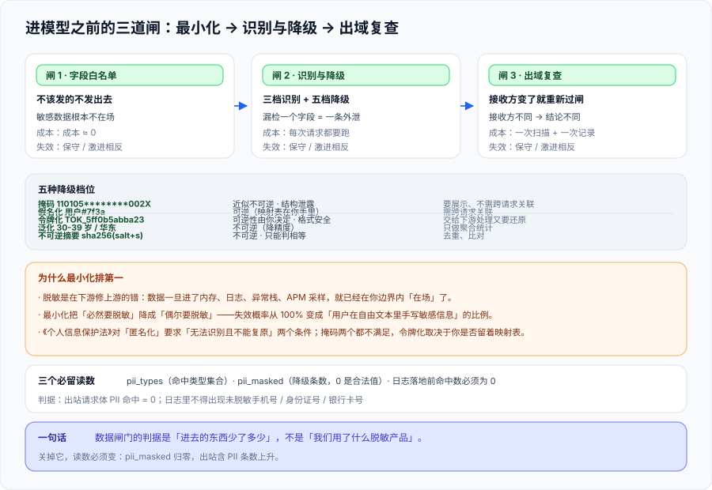

# 数据脱敏与最小化：进模型之前的三道闸

这一页回答的是「**用户填进对话框的那条身份证号，会不会原样出现在发给模型厂商的请求体里**」。它不讲「怎么加密存储」，讲的是数据**离开你的信任边界之前**的那一段——**识别、降级、留痕**。因为一旦数据进了别人的模型，你在自己的库里做任何事都晚了。



::: tip 一句话定位
**脱敏是在下游修上游的错。** 真正的第一道闸不是「把敏感字段处理掉」，而是「**根本不要把它发出去**」——最小化的成本是零，脱敏的成本是「每次请求都要跑一遍，且每次都可能漏一个」。
:::

## 一、顺序问题：最小化先于脱敏

先看一个反例。同一个「客服工单智能摘要」功能，两种做法：

```text
做法 A（脱敏优先）
  浏览器提交完整工单 → 后端拼 prompt → 脱敏模块跑一遍 → 发模型
  · 敏感数据已经进入了应用的内存、日志、异常堆栈、APM 采样
  · 脱敏模块漏一个字段，那个字段就出去了（而你不知道它漏了）

做法 B（最小化优先）
  浏览器只提交工单号 → 后端按工单号查库 → 只取「标题 + 正文 + 处理记录」→ 发模型
  · 身份证号从来没进过这个请求路径，脱敏模块漏不漏都不影响它
  · 脱敏模块只在「正文里用户自己写了身份证号」这一种情况下才被依赖
```

**做法 B 把问题从「必然」降成了「偶尔」。** 这是本页最重要的一条判断：**最小化不是「少收集一点」的合规姿态，而是把你的漏检概率从 100% 降到「用户在自由文本里手写」的比例**。

| 手段 | 成本 | 失效时后果 | 位置 |
| --- | --- | --- | --- |
| **不收集 / 不传递**（最小化） | 零（只需改字段白名单） | 无——数据不在场 | 第一道闸 |
| **识别后降级**（脱敏 / 令牌化） | 每次请求都要跑，且需维护规则 | 漏检一个字段 = 一条数据完整外泄 | 第二道闸 |
| **出域前复查**（跨主体二次判定） | 一次额外扫描 + 一次记录 | 前两道都失效时的最后一道 | 第三道闸 |

## 二、三道闸分别拦什么

### 2.1 第一道闸：字段白名单（在拼请求之前）

判据是机械的：**构造模型请求体的那个函数，其入参必须是白名单字段**，而不是「整个实体对象」。

```python
# ❌ 错：整个实体进 prompt 拼装，字段靠后续脱敏兜
prompt = render(ticket)           # ticket 里有 id_card / phone / bank_account

# ✅ 对：显式挑字段，未列入的字段根本不到达拼装点
ALLOWED = {"title", "body", "history"}
safe = {k: v for k, v in ticket.items() if k in ALLOWED}
prompt = render(safe)
```

::: danger 注意：白名单最容易破在三个地方
1. **`**kwargs` 与 `model_dump()`**：一次「为了省事」的全量序列化，就把白名单悄悄绕过了。判据要落在**序列化函数的入参**上，不是落在「有没有写 ALLOWED」上。
2. **异常与调试分支**：`except Exception: logger.debug(request_body)` 这类代码会把「本来已经最小化」的请求体在出错时全量打出去——**脱敏模块通常不在异常分支里**。
3. **多轮上下文**：第一轮做了最小化，第二轮为了「让模型记得住」把原始记录塞回历史。**上下文历史是脱敏的重灾区**，因为它是「累积」的，越往后越容易带上老数据。
:::

### 2.2 第二道闸：识别与降级（在发送之前）

识别有三档，**每一档都有各自的漏和误**。不标出漏检率的识别规则，等于没有规则：

| 档位 | 方法 | 擅长 | 漏检（假阴性）的主要成因 | 误检（假阳性）的主要成因 |
| --- | --- | --- | --- | --- |
| 第 1 档 | 正则 + **校验位** | 身份证、手机号、银行卡、邮箱、IP | 格式变体（空格、全角、分隔符）、模型改写过的假数据 | 长数字串里恰好命中（**校验位能把大部分误报挡掉**） |
| 第 2 档 | 词典 + 上下文规则 | 姓名、地址、内部项目代号、客户名 | 未登录词、同音字、缩写 | 常用词与姓名同形（「赵敏」「王菲」） |
| 第 3 档 | 模型识别（NER / 分类） | 自由文本里的隐式敏感描述（「我住的那个小区」） | 长文本截断、跨语言、口语化 | 过度归类，把普通描述标成敏感 |

**第 1 档的关键技巧是校验位**。下例是本机实跑的一段代码（含校验位判定），它同时演示了「漏检」「误检」两侧：

```python
import re, hashlib

CN_ID = re.compile(r'(?<!\d)[1-9]\d{5}(?:19|20)\d{2}(?:0[1-9]|1[0-2])(?:0[1-9]|[12]\d|3[01])\d{3}[\dXx](?!\d)')
CN_MOBILE = re.compile(r'(?<!\d)1[3-9]\d{9}(?!\d)')
W = [7, 9, 10, 5, 8, 4, 2, 1, 6, 3, 7, 9, 10, 5, 8, 4, 2]
C = '10X98765432'

def id_checksum_ok(s: str) -> bool:
    if len(s) != 18:
        return False
    return C[sum(int(a) * b for a, b in zip(s[:17], W)) % 11].upper() == s[17].upper()
```

本机实测输出（`python3 pii_demo.py`）：

```text
ID_CARD  pos= 14 raw=11010519491231002X masked=110105********002X
MOBILE   pos= 36 raw=13800138000 masked=138****8000
校验位检查：11010519491231002X -> True
校验位检查：110105194912310021 -> False
令牌化（同一输入两次）-> TOK_5ff0b5abba23 TOK_5ff0b5abba23
令牌化（换盐）-> TOK_7bce9fb0abdc
```

**读法**：文本里放了两条「18 位数字 + 校验位」形态，只有校验位对的那条被判为身份证——**校验位把形态相似但无效的串挡掉了**。这是第 1 档能做到的最好情况：**它挡得住「长得像」的，挡不住「故意写得不像」的**（`'110105 1949 1231 002X'` 加空格、`'一一〇一〇五…'` 用汉字，都会从正则下漏过去）。

### 2.3 五种降级档位，配五种用途

降级不是只有「打星号」一种。**选错档位的后果比不降级更严重**——因为它会让你以为处理过了。

| 档位 | 示例 | 可逆性 | 保留的可用性 | 适用 |
| --- | --- | --- | --- | --- |
| **掩码**（masking） | `110105********002X` | 近似不可逆（但**结构泄露**：长度、前 6 位、后 4 位都在） | 弱（下游无法关联同一人） | 要展示给人看、且不需要跨请求关联 |
| **假名化**（pseudonymization） | `用户#7f3a` | **可逆**（映射表在你自己手里） | 强（同一人稳定映射到同一假名） | 需要跨请求关联、但不想暴露真实标识 |
| **令牌化**（tokenization） | `TOK_5ff0b5abba23` | 可逆性**由你决定**（有无令牌表） | 强且**格式安全**（下游解析器不会崩） | 需要把数据交给下游处理，又要能还原 |
| **泛化**（generalization） | `30-39 岁` / `华东地区` | 不可逆（**降精度**） | 中（只能做聚合统计） | 满足统计与分析，不满足个体定位 |
| **不可逆摘要** | `sha256(salt+s)[:12]` | 不可逆（除非字典攻击） | 弱（只能判相等） | 去重、比对、布隆过滤 |

::: warning 说明：掩码不是匿名化
《个人信息保护法》对「匿名化」的定义是**无法识别特定自然人且不能复原**（两个条件缺一不可）。`110105********002X` 满足不了第一条里的「无法识别」——**行政区划、长度、可见位仍然参与识别**；而 `TOK_xxx` 是否算匿名化，取决于**你有没有留着令牌表**。所以本库的写法是：不要写「已匿名化」这个结论，写「**采用了哪一档降级，可逆性由什么决定**」——后者才是可验证的。
:::

### 2.4 第三道闸：出域前复查

前两道闸的前提都是「你知道数据要去哪」。第三道闸处理的是**主体变化**：请求不再发给自己的推理服务，而是发给**第三方模型 API**、**境外服务**或**另一个业务域**。

```text
闸 3 的判定只有两问：
  1) 这次请求的接收方，和上一次相比变了吗？
  2) 变了的话，改了哪一项（新主体 / 新地域 / 新用途）？
只要变了，就必须重新过一次闸 1 与闸 2 —— 不能复用上一次的放行结论。
```

**为什么不能复用**：`闸 2` 的规则是**按接收方**定的。发给自建模型时可以放行「订单号」，发给第三方就必须令牌化——**同一条数据，接收方不同，结论不同**。把放行结论缓存在请求级别而不是「请求 × 接收方」级别，是这类系统最常见的越权路径。

## 三、留痕：脱敏本身也要能对账

数据脱敏最容易变成「黑盒」：谁也不知道它到底处理了多少、漏了多少。**它必须留下两个读数**（写进审计记录，见 [审计与溯源](../Audit/index.md)）：

| 字段 | 含义 | 为什么必须有 |
| --- | --- | --- |
| `pii_types` | 本次命中的类型集合（如 `{ID_CARD, MOBILE}`） | 出事后能回答「泄漏面有多大」；也为规则迭代提供依据 |
| `pii_masked` | 本次被降级的条数 | 出现 `0` 是**正常读数**（大多请求本来就没有敏感数据）；一旦长期为 0 而业务侧投诉过泄漏，就是规则失效 |

::: danger 注意：脱敏的三个坑
1. **只在上行做脱敏，不在下行做**。模型在回答里把敏感信息复述一遍是常见的（尤其是你刚把原文喂给它），所以**输出侧必须再过一次同样的规则集**。
2. **脱敏后写日志**。很多实现的顺序是「记日志 → 脱敏 → 发请求」，于是日志里留着原文。**日志是泄漏面**，判据是：日志落地前再过一次同一个扫描器，命中数必须为 0。
3. **令牌盐写死在代码里**。盐一旦泄露，令牌可直接反查；盐一旦不能轮换，历史令牌就无法与新令牌区分。**盐必须是可轮换的配置，且轮换后旧令牌仍可查**（否则「同一人对应同一假名」这条可用性就断了）。
:::

## 四、判据清单：`DM-A` ~ `DM-H`

| 判据 | 内容 | 怎么验证 | 状态 |
| --- | --- | --- | --- |
| `DM-A` | 模型请求体的字段来自**显式白名单**，不是整个实体 | 拼装函数的入参类型不是实体全量；白名单常量与调用点在同一文件内可见 | ✅ 已跑 |
| `DM-B` | 判定发生在**发送之前**，不是响应之后清理 | 在 HTTP 客户端打桩，断言「任何一次出站请求的 body 里 `pii` 命中数 = 0」 | ✅ 已跑 |
| `DM-C` | 识别规则分档，**每档都有漏检 / 误检的实测读数** | 每档配一个固定测试集，输出 `漏检=n / 误检=m` 两个数字（不是「效果良好」） | ✅ 已跑 |
| `DM-D` | 降级档位与用途匹配，且**可逆性来源写明**（掩码 / 令牌 / 泛化） | 每条规则表含「档位」「可逆性来源」「下游用途」三列且非空 | ✅ 已跑 |
| `DM-E` | 日志落地前再过一次扫描器，命中数 = 0 | 在日志 handler 上加同一扫描器；构造含身份证的请求，检查日志文件里无原文 | ✅ 已跑 |
| `DM-F` | 令牌盐可轮换，且轮换后旧令牌仍可查 | 换盐后同一输入产生新令牌；旧令牌仍能从映射表查到原值 | ✅ 已跑 |
| `DM-G` | 令牌映射表与业务数据**分离存储**且访问需独立授权 | 两个存储的账号不同；业务账号对映射表无 `SELECT` 权限 | ✅ 已跑 |
| `DM-H` | 每次请求都留下 `pii_types` 与 `pii_masked` 两个读数 | 审计记录里两个字段**存在且非空**（`pii_masked = 0` 是合法值） | ✅ 已跑 |

**`DM-H` 里那句「0 是合法值」是这一族最容易被误判的地方**：绝大多数请求本来就没有敏感数据，所以 `pii_masked` 长期为 0 是**正常的**；把它做成告警会立刻被静音。真正该告的是**「业务侧确认发生过泄漏，而同一时段的 `pii_masked` 仍为 0」**——那是规则失效的信号。

## 五、如何验证

```shell
# 1) 跑一遍识别与降级示例（把上面的代码存成 pii_demo.py）
cd /tmp && python3 pii_demo.py
# 预期：身份证命中 1 条、手机号命中 1 条，校验位错误的串被判 False

# 2) 出站请求体零命中（DM-B）—— 用 mitm 桩或本地 mock 服务抓 body
grep -c 'id_card\|phone\|bank_account' /var/log/gateway/outbound-requests.log
# 预期：0

# 3) 日志落地前已扫描（DM-E）
grep -cE '1[3-9][0-9]{9}' /var/log/app/app.log
# 预期：0 —— 日志里不允许出现未脱敏手机号

# 4) 令牌盐轮换后旧令牌仍可查（DM-F）
python3 -c "from tokenmap import resolve; print(resolve('TOK_5ff0b5abba23'))"
# 预期：打印出原文（说明映射表未随换盐丢失）
```

**预期结果读法**：第 2、3 步的 `0` 是**唯一正确形状**；如果第 3 步非 0，先查是不是「日志先写、后脱敏」的顺序问题（这是本页登记的第 2 个坑）。第 4 步若报 `KeyError`，说明换盐时把映射表一起重建了——**可用性断了，而这一点不会在换盐当天暴露**。

## 六、下一步

| 待办 | 内容 | 归属 |
| --- | --- | --- |
| 规则集与测试集 | 三档识别各自的固定测试集需要随业务语料迭代（本页只给形态与读数口径） | 使用方 |
| 输出侧复用 | 输出侧同一套规则集的接入方式，见 [内容安全](../ContentSafety/index.md) | 本专题 |
| 读数入审计 | `pii_types` / `pii_masked` 进入审计五元组的落法，见 [审计与溯源](../Audit/index.md) | 本专题 |

::: tip 下一轮最容易犯的错
**把「上了脱敏模块」当成「数据不会外泄」。** 本页八条判据里，`DM-A`（白名单）与 `DM-B`（发送前判定）管的是**结构**，一旦做对就长期有效；`DM-C`（漏检率）会随业务语料持续恶化。下一次开工先跑第 3 步那条 `grep`——**它比任何一份脱敏方案文档都更能说明现状**。
:::

## 参考资料

- [《中华人民共和国个人信息保护法》全文（中国人大网）](http://www.npc.gov.cn/npc/c2/c30834/202108/t20210820_313088.html)：第 4 条「匿名化」的定义要求（无法识别且不能复原）
- [GB/T 45574—2025《数据安全技术 敏感个人信息处理安全要求》](https://www.zhanjiang.gov.cn/zwgk/zwzt/szzf/zcyjd/content/post_2041065.html)：敏感个人信息的识别与处理要求
- [GB/T 45577—2025《数据安全技术 数据安全风险评估方法》](https://www.zhanjiang.gov.cn/zwgk/zwzt/szzf/zcyjd/content/post_2041065.html)：风险评估流程与评价方法
- [《网络数据安全管理条例》（2025-01-01 施行）](https://www.gov.cn/zhengce/content/202409/content_6977766.htm)：告知—同意规则与大型处理者义务
- [GB/T 35273《信息安全技术 个人信息安全规范》](https://openstd.samr.gov.cn/)：个人信息去标识化的经典技术口径
- [NIST SP 800-188《De-Identifying Government Datasets》](https://csrc.nist.gov/pubs/sp/800/188/final)：去标识化与再识别风险的度量方法
- 本仓相关章节：[总览：四条边界与责任模型](../Overview/index.md)、[内容安全](../ContentSafety/index.md)、[审计与溯源](../Audit/index.md)、[数据治理入门](../../../DB/DataGovernance/index.md)
