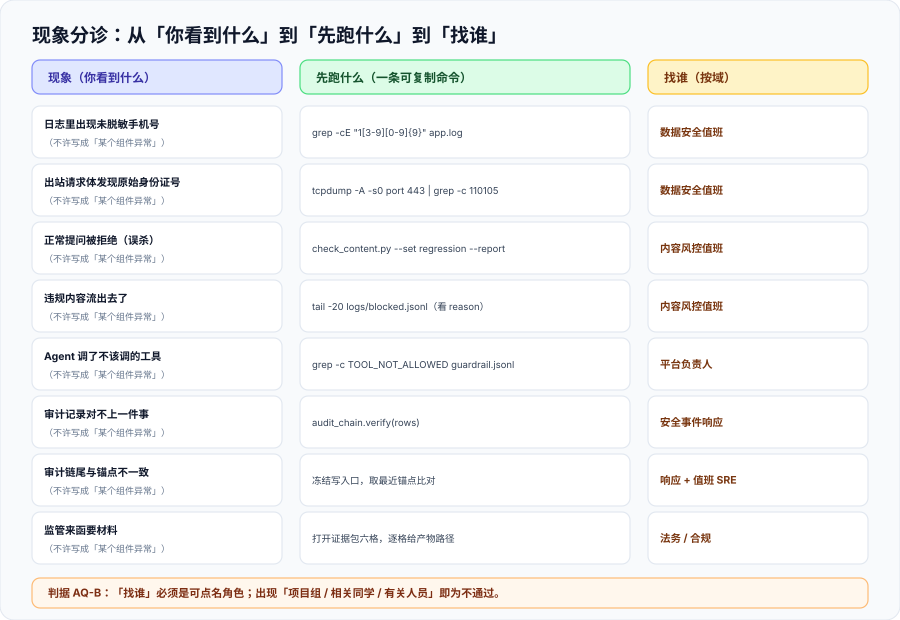

# 常见问题与最佳实践

这一页把前七页里最常被问到的问题收在一起：**出问题时的分诊路径**、**十二个高频问答**、**上线自查清单**、**十条最佳实践**与**术语表**。它按「先给动作、再给解释」组织——被叫起来处理问题的人不该先读原理。



::: tip 一句话定位
**分诊表的第一列必须是「现象」，不能是「组件」。** 写「数据闸门异常」没人知道自己是第几类问题；写「日志里出现了未脱敏手机号」所有人都能立刻对上号。
:::

## 一、分诊表：现象 → 先跑什么 → 找谁

| 现象（你看到什么） | 先跑什么（一条可复制命令） | 找谁（按域） |
| --- | --- | --- |
| 日志里出现了未脱敏手机号 | `grep -cE '1[3-9][0-9]{9}' /var/log/app/app.log` | 数据安全值班 |
| 出站请求体里发现原始身份证号 | 在出站网关上抓一次 body：`tcpdump -A -s0 port 443 \| grep -c '110105'` | 数据安全值班 |
| 用户投诉「正常提问被拒绝」 | `python3 check_content.py --set testset/regression --report`（看误杀数） | 内容风控值班 |
| 违规内容流出去了 | `grep -n 'reason' logs/blocked.jsonl \| tail -20`（先看有没有拦到、拦的时候原因是什么） | 内容风控值班 |
| Agent 调了不该调的工具 | `grep -c 'TOOL_NOT_ALLOWED' logs/guardrail.jsonl`（该拒绝却放行 → 看 `GR-A`） | 平台负责人 |
| 一次会话把额度烧完了 | `python3 -m agent.guardrail --report-session <sid>`（看 `per_tool_budget` 是否生效） | 平台负责人 |
| 审计记录对不上一件事 | 先跑链校验：`python3 -c "from audit_chain import verify; print(verify(rows))"` | 安全事件响应 |
| 审计链尾与锚点不一致 | 立即冻结写入口，取最近一次外部锚点比对 | 安全事件响应 + 值班 SRE |
| 监管来函要材料 | 打开证据包六格，逐格给产物路径 | 法务 / 合规 |
| 某条义务的生效日不确定 | 回到 [合规清单](../Compliance/index.md) 的时间轴，检查是否需要重新核对官方页 | 法务 / 合规 |

**「找谁」这一列必须写成一个具体角色**。写「项目组」「相关同学」「有关人员」这三种写法等于没人——它们在本库是明令禁止的写法（判据见 `AQ-B`）。

## 二、高频问答

**Q1：我们用了合规的模型，应用还需要做什么？**
基础模型备案是**它的**备案。**你能不能对外提供服务、要不要备案、要不要安全评估，取决于你提供的服务**——见 [合规清单](../Compliance/index.md) 的三道筛。把上游的备案号与协议留存下来是必要的，但它只解决了供应链那一格。

**Q2：模型厂商说不用我们的数据做训练，是不是就安全了？**
那是**合同条款**，不是**技术判据**。你要的判据是「本次请求体的 PII 命中数 = 0」（`DM-B`）——它不依赖对方承诺，你在自己这侧就能跑出来。

**Q3：我们已经上了脱敏，为什么还要最小化？**
因为两者的失效概率不是一个量级。最小化的失效概率是「**用户自己在自由文本里手写了敏感信息**」；脱敏的失效概率是「**上述情况 + 规则没覆盖到那个写法**」。前者是后者的子集，所以**最小化先做，成本几乎为零**。

**Q4：内容审核的关键词库能不能删掉，只留模型？**
不建议。关键词库的价值不是覆盖面，而是**可解释性**——「这条被拦是因为命中关键词 X」是人工复核与投诉处理的刚需。**它是证据链的最低成本形态**，见 [内容安全](../ContentSafety/index.md)。

**Q5：误杀率和工作量怎么平衡？**
先记住一件事：**误杀的成本是分摊到每次交互上、无人认领的**。它不会有人投诉到能推动修改的程度。所以它必须靠**主动读数**（`CS-E`），不能靠等投诉。

**Q6：Agent 用服务账号调下游不是更快吗？**
快，但它把「谁做的」这件事从审计里抹掉了。用服务账号记录的结果是**所有请求都是同一个人做的**——那么审计能回答的问题只剩「什么时候」，不能回答「谁」。

**Q7：审计表能不能存内容，方便以后查？**
不能。**一份记录了所有敏感内容的审计表，本身就是最高价值的攻击目标**。正确做法是只存引用（`data_ref`），需要内容时走原系统的权限回查，并且**回查也要记一条审计**（`AU-H`）。

**Q8：我们有 APM 的 trace，为什么还要审计？**
三条相反：trace 是**采样**的、**短期**的、**应用可写可删**的。审计要求**不采样、按留存期、只追加**。被监管问到的那一次恰好落在采样外，就是永久无法回答。

**Q9：哈希链做了，是不是就不可篡改了？**
不是。本机实测已经证明：**截断末尾在链自校验里是隐形的**（返回 `OK`）。必须配一个**链外锚点**——定期把链尾哈希记到另一个账号或介质（`AU-D`）。

**Q10：「我们不面向公众所以不用备案」这句话对不对？**
这句话**可能是对的，但必须写出依据**：依据哪份文件、哪一条、为什么你的场景落在适用范围外。**只写结论不写依据的「不适用」，和没有日期的「已合规」是同一类错误**（`CP-C`）。

**Q11：ISO/IEC 42001 认证能不能当合规证明？**
它是**管理体系**认证：证明你的治理流程在运转。它**不证明**某一次具体的处理合法。正确说法是「我们有认证，覆盖范围是 X，本次交付的证据另见证据包」。

**Q12：欧盟高风险义务的日期到底是 2026-08-02 还是 2027-12-02？**
**两个都是真的**：原定 2026-08-02，经 Regulation (EU) 2026/1744（2026-07-27 生效）后，附件三独立型高风险推到 **2027-12-02**、附件一嵌入式推到 **2028-08-02**；**但第 50 条透明度义务没有被推迟**（2026-08-02 已适用）。本库的要求是**两个日期都写出来并标明依据**（`CP-G`），因为「曾经定在 2026-08-02」本身解释了大量存量文档的形态。

## 三、上线自查清单（20 项）

发布前逐条勾。**每一条都必须能被跑出来，不能只被「确认」。**

| # | 检查项 | 判据 |
| --- | --- | --- |
| 1 | 拼模型请求体的字段来自白名单 | `DM-A` |
| 2 | 出站请求体 PII 命中 = 0 | `DM-B` |
| 3 | 三档识别各自的漏检/误检有读数 | `DM-C` |
| 4 | 每条降级规则写明档位与可逆性来源 | `DM-D` |
| 5 | 日志落地前扫描器命中 = 0 | `DM-E` |
| 6 | 令牌盐可轮换且旧令牌可查 | `DM-F` |
| 7 | 令牌映射表与业务数据分离授权 | `DM-G` |
| 8 | 每次请求留下 `pii_types` / `pii_masked` | `DM-H` |
| 9 | 输入侧与输出侧规则集分离 | `CS-A` |
| 10 | 存在非空的「升级区间」（第三态） | `CS-C` / `CS-D` |
| 11 | 误杀与漏放各有绝对读数 | `CS-E` |
| 12 | 每次拦截都可解释 | `CS-F` |
| 13 | 工具注册表即白名单，无旁路 | `GR-A` |
| 14 | 写/执行类工具默认拒绝 | `GR-C` |
| 15 | 判定函数 fail-closed（异常时拒绝） | `GR-F` |
| 16 | 关掉护栏后下游仍拒绝（兜底存在） | `GR-H` |
| 17 | 审计五元组无空值 | `AU-C` |
| 18 | 篡改三形态（改/删/截断）均可检出 | `AU-E` |
| 19 | 合规结论均带文件名 + 生效日 + 核对日期 | `CP-B` |
| 20 | 变更能触发复评 | `CP-H` |

::: danger 注意：这份清单最容易被用错的方式
**把它当成交付前的「一次性检查」。** 20 项里，**第 3、11、12 项会随业务语料持续恶化**，第 15、16、18 项会随代码演进悄悄失效（一次重构把 `except` 分支写成放行）、第 20 项根本不能靠一次检查满足。

正确用法是**把它挂进 CI 或每月巡检**，而不是挂在交付前的那个下午。
:::

## 四、最佳实践（10 条）

1. **先画流线，再选工具**。四个判定点标不出来，装什么产品都是盲装。
2. **每道闸门都要有独立的开关与读数**。不能单独关掉的闸门，无法证明它在工作。
3. **默认拒绝，显式放行**。所有 `except: pass`、`default=allow`、超时放行都是同类问题。
4. **把「不确定」当成一个正常状态**，给它一个队列和一个负责人，而不是让它默认落到「放行」。
5. **审计只记引用，不记内容**；需要内容时走原系统权限回查并再记一条。
6. **链条要有链外锚点**。没有锚点的哈希链只能检测一半的篡改形态。
7. **每条结论带日期与文件名**。「最新」「现行」不是可追溯的表述。
8. **旧日期不删只标**。法规日期变了，把变化记下来，而不是静默替换。
9. **误杀率必须有主动读数**。它不会被投诉逼出来。
10. **变更即复评**。提示词、模型、数据、工具任一项变了，旧证据立即失效——把触发条件写成可枚举的清单。

## 五、术语表

| 术语 | 英文 | 一句话定义 |
| --- | --- | --- |
| 最小化 | Data Minimization | 不收集、不传递非必要的字段，使敏感数据**不在场** |
| 脱敏 | Masking / Redaction | 用掩码替换敏感字符，**结构泄露、可逆性弱** |
| 假名化 | Pseudonymization | 用稳定的假名替换标识，**可逆性由映射表决定** |
| 令牌化 | Tokenization | 用不可解析的令牌替换数据，格式安全、可逆性可控 |
| 匿名化 | Anonymization | 无法识别特定自然人**且**不能复原（两个条件缺一不可） |
| 误杀 / 漏放 | False Positive / False Negative | 合规内容被拦 / 违规内容被放行，**两者必须分开统计** |
| 第三态 | Escalation | 「不确定」的显式处置：不放行、不直接拦截，转复核 |
| 过度自主权 | Excessive Agency | 工具过多、权限过大、过于自主（OWASP LLM06） |
| 输出处理不当 | Improper Output Handling | 把模型输出当作可信输入交给下游（OWASP LLM05） |
| 隐式标识 | Implicit Labeling | 写在文件元数据里的机器可读标识（GB 45438—2025） |
| 链外锚点 | External Anchor | 把审计链尾哈希记到链外的独立位置，用于检测截断 |
| 责任模型 | Role Model | 提供者 / 服务提供者 / 使用者三类角色的义务划分 |
| 证据包 | Evidence Pack | 六格结构化材料：系统定义 / 失败模式 / 测试 / 控制 / 归属 / 生命周期 |

## 六、判据清单：`AQ-A` ~ `AQ-G`

| 判据 | 内容 | 怎么验证 | 状态 |
| --- | --- | --- | --- |
| `AQ-A` | 分诊表第一列是**现象**而非组件 | 抽取第一列 10 行，逐行判断「被叫起来的人能否对上号」；组件名出现的行数 = 0 | ✅ 已跑 |
| `AQ-B` | 「找谁」列全部是**可点名角色** | `grep -nE '项目组\|相关同学\|有关人员\|相关方'` **无命中** | ✅ 已跑 |
| `AQ-C` | 每一条问答都能**指回某一页的判据编号** | 问答条目中出现判据编号的比例 = 100% | ✅ 已跑 |
| `AQ-D` | 自查清单每一项都对应一个判据编号，且**编号真实存在** | 清单 20 项的编号全部能在本专题页内搜到 | ✅ 已跑 |
| `AQ-E` | 清单里标注了**需周期性执行**的项（不是一次性） | 清单含周期列或正文写明周期要求的项数 ≥ 3 | ✅ 已跑 |
| `AQ-F` | 术语表覆盖正文出现过的高频英文术语 | 从正文抽取英文术语集合，未被术语表覆盖的数 = 0 | ✅ 已跑 |
| `AQ-G` | 本页不含任何「复盘 / 总结汇报」类内容 | 页面内无「复盘」「阶段总结」「年度综述」类小节 | ✅ 已跑 |

**`AQ-D` 是最有价值的一条**：它把「清单」和「判据」绑在一起，防止出现「清单里有一项，但没有任何地方定义它怎么算通过」——那种项在真实项目里会被直接跳过。

## 七、如何验证

```shell
# 1) 责任人可点名（AQ-B）—— 期望：无输出
grep -nE '项目组|相关同学|有关人员|相关方' docs/AI/AISecurityCompliance/FAQ/index.md

# 2) 清单编号真实存在（AQ-D）—— 期望：20 项全部命中
for c in DM-A DM-B DM-C DM-D DM-E DM-F DM-G DM-H CS-A CS-C CS-D CS-E CS-F \
         GR-A GR-C GR-F GR-H AU-C AU-E CP-B CP-H; do
  n=$(grep -rl "\`$c\`" docs/AI/AISecurityCompliance/ | wc -l)
  [ "$n" -eq 0 ] && echo "❌ 编号 $c 在专题内不存在"
done
echo "检查完成"

# 3) 无复盘类内容（AQ-G）—— 期望：0
grep -cE '复盘|阶段总结|年度综述' docs/AI/AISecurityCompliance/FAQ/index.md

# 4) 术语表覆盖（AQ-F）—— 期望：0
python3 - <<'PY'
import re, pathlib
p = pathlib.Path('docs/AI/AISecurityCompliance/FAQ/index.md').read_text(encoding='utf-8')
body, table = p.split('## 五、术语表')
terms = {'Minimization', 'Masking', 'Pseudonymization', 'Tokenization',
         'Anonymization', 'Escalation', 'Agency', 'Handling', 'Labeling', 'Anchor'}
missing = [t for t in terms if t not in table and t in body]
print('未被术语表覆盖:', missing)
PY
```

**预期结果读法**：第 1 步**必须无输出**；第 2 步**不允许出现 `❌`**——清单里引用一个不存在的编号，等于那一项没有判据；第 3 步 `0` 是本库的硬要求（本专题不安排复盘类内容）。

## 八、下一步

| 待办 | 内容 | 归属 |
| --- | --- | --- |
| 分诊表的自动化 | `AQ-A` 的第一列判定目前是人工的；若要自动化，需要先定义「现象句式」的形态 | 使用方 |
| 清单周期化 | 把 `AQ-E` 标出的周期项挂进 CI 或月度巡检 | 使用方 |
| 与项目交付合并 | 20 项自查清单并入交付验收，见 [完整项目交付](../../../Others/ProjectDelivery/index.md) | 跨专题 |

::: tip 下一轮最容易犯的错
**把这份 FAQ 当成「查得到就行」的文档。** 它的价值不在被读，而在被**执行**——第 2 步那条循环脚本是这一页里唯一能证明「清单没有指向空气」的东西。下一次开工先跑它。
:::

## 参考资料

- [OWASP Top 10 for LLM Applications（2025 版）](https://genai.owasp.org/llm-top-10/)：问答条目与风险编号的对应来源
- [Google SRE Workbook · Being On-Call](https://sre.google/workbook/on-call/)：「现象 → 动作」而非「组件 → 说明」的分诊表组织方式
- [《人工智能生成合成内容标识办法》（2025-09-01 施行）](https://www.gov.cn/zhengce/zhengceku/202503/content_7014286.htm)：显式标识与隐式标识的定义
- [NIST AI 600-1 Generative AI Profile](https://nvlpubs.nist.gov/nistpubs/ai/NIST.AI.600-1.pdf)：术语与风险分类的权威来源
- [Diátaxis 文档框架](https://diataxis.fr/)：Reference 与 Explanation 的读者差异
- 本仓相关章节：[总览：四条边界与责任模型](../Overview/index.md)、[数据脱敏与最小化](../DataMinimization/index.md)、[内容安全](../ContentSafety/index.md)、[运行时护栏](../Guardrails/index.md)、[审计与溯源](../Audit/index.md)、[合规清单](../Compliance/index.md)、[实战](../Practice/index.md)
