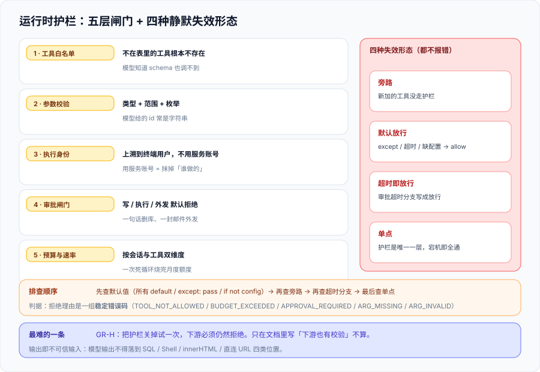

# 运行时护栏：工具、权限与预算

这一页回答的是「**Agent 想调一个接口的时候，是谁说了算**」。它讲的是**请求路径上**的那几层闸门：工具白名单、参数校验、以谁的身份执行、要不要人工批准、以及一次会话最多能花多少。它们与传统安全里的 RBAC 有重叠，但多出两个 AI 特有的东西——**调用方是一个可能被骗的模型**，**参数是一段自然语言生成的文本**。



::: tip 一句话定位
**护栏的判据不是「拦住了多少」，而是「拒绝的理由是不是一组稳定的码」。** 一个只会打印「操作被拒绝」的护栏，在事故复盘时提供不了任何信息；而一组稳定的拒绝码（`TOOL_NOT_ALLOWED` / `BUDGET_EXCEEDED` / `APPROVAL_REQUIRED`）既能对账、也能告警、也能变成规则。
:::

## 一、为什么叫「运行时护栏」

「护栏」这个词容易被理解成「加一层过滤」。它的准确定义是**在请求路径上的、作用域明确的、可独立观测的拦截点**。三个修饰词缺一不可：

| 修饰词 | 含义 | 反例（看起来像护栏，其实不是） |
| --- | --- | --- |
| 在请求路径上 | 每次调用都经过它，**不能靠「记得调用」** | 一个「建议在调工具前先检查权限」的开发规范 |
| 作用域明确 | 它保护的是**哪一类动作**（读 / 写 / 执行 / 外发）写清楚了 | 一个对所有工具一视同仁的 `check_permission()` |
| 可独立观测 | 它拦了什么、放行了什么，**有独立读数** | 拒绝只写进应用日志，且日志被采样 |

**第一条最容易失守**：脚手架里放了一个 `guardrail.py`，但工具调用的实现是在另一个 module 里，新加的工具有一半直接调 HTTP 客户端、没走护栏。**判据必须落在「工具注册表」上，而不是落在「有没有护栏模块」上**（见 `GR-A`）。

## 二、五层闸门

| 层 | 拦什么 | 判据落点 | 失败后果 |
| --- | --- | --- | --- |
| 1. 工具白名单 | 不在表里的工具**根本不存在** | 工具注册表本身就是白名单（没有「动态发现再判断」） | 模型知道一个工具的 schema，就能调它 |
| 2. 参数校验 | 参数的类型、范围、枚举 | 每个工具都有显式的参数 schema | 模型给的 `id` 是字符串、`limit` 是 10 万 |
| 3. 执行身份 | **以谁的身份**去调下游 | 用上溯到终端用户的凭据，不用服务账号 | 越权：A 用户借 Agent 读到 B 用户的数据 |
| 4. 审批闸门 | 写操作、外发、执行类 | 高危动作**默认拒绝**，需要显式批准 | 一句话删库；一封邮件把内部数据发出去 |
| 5. 预算与速率 | 无限循环、成本爆炸 | 每次会话/每工具的次数与额度上限 | 一个死循环把月度额度烧完 |

第 3 层在本库 [Agent 应用](../../Agent/index.md) 与 [企业知识库落地](../../EnterpriseKB/index.md) 里都有对应的展开；本页只强调**它的位置**：**身份必须在护栏层被替换掉，而不是在工具实现里各写一遍**——因为「各写一遍」意味着「新加的工具会忘」。

### 2.1 参数是不可信输入（这是最反直觉的一层）

工具调用的参数是**模型生成的文本**，经过 JSON 解析后成为对象——**它能通过 JSON 解析，不代表它在语义上合法**。下面这段是本机实跑的护栏策略（含拒绝码）：

```python
from dataclasses import dataclass, field

class Denied(Exception):
    def __init__(self, code):
        self.code = code
        super().__init__(code)

ALLOWED_TOOLS = {
    'query_metrics': {'scope': 'read',  'budget': 5, 'args': {'metric': str}},
    'get_ticket':    {'scope': 'read',  'budget': 5, 'args': {'id': int}},
    'close_ticket':  {'scope': 'write', 'budget': 2, 'args': {'id': int},
                      'require_approval': True},
}

@dataclass
class Ctx:
    user: str
    approvals: set = field(default_factory=set)
    calls: dict = field(default_factory=dict)

def call_tool(ctx, tool, args):
    spec = ALLOWED_TOOLS.get(tool)
    if spec is None:
        raise Denied('TOOL_NOT_ALLOWED')
    used = ctx.calls.get(tool, 0)
    if used >= spec['budget']:
        raise Denied('BUDGET_EXCEEDED')
    if spec.get('require_approval') and tool not in ctx.approvals:
        raise Denied('APPROVAL_REQUIRED')
    for k, t in spec['args'].items():
        if k not in args:
            raise Denied('ARG_MISSING:' + k)
        if not isinstance(args[k], t):
            raise Denied('ARG_INVALID:' + k)
    ctx.calls[tool] = used + 1
    return f'OK {tool} #{ctx.calls[tool]}'
```

本机实测输出（`python3 guardrail_demo.py`）：

```text
query_metrics  -> OK query_metrics #1
query_metrics  -> OK query_metrics #2
run_shell      -> DENIED TOOL_NOT_ALLOWED
close_ticket   -> DENIED APPROVAL_REQUIRED
get_ticket     -> DENIED ARG_INVALID:id
close_ticket   -> OK close_ticket #1
```

**逐条读法**：

- `run_shell` **根本不在表里**，所以它不是一个「被拒绝的工具」，而是一个**不存在的工具**——模型即使知道它，也调不到（第 1 层）。
- `close_ticket` 是写操作，`require_approval` 为真时**默认拒绝**，直到上下文里出现显式批准（第 4 层）。
- `get_ticket(id='A-42')` 被拒的原因是 **`ARG_INVALID:id`**——模型把工单号写成了字符串 `'A-42'`。这在真实系统里是**最高频的一类失败**：模型看到 `id` 就填一个长得像 id 的东西，类型对不对它不管。**如果没有第 2 层，这个参数会一路走到下游，在那里以更难定位的方式炸掉。**

::: danger 注意：参数校验的三个坑
1. **只校验类型不校验范围**。`limit: int` 通过了类型校验，但 `limit = 100000` 会让下游超时——**范围与枚举是校验的一部分**，不是可选加强项。
2. **把「模型说它已经脱敏了」当成脱敏**。参数里的自由文本（如 `note`、`reason`）是**数据闸门的盲区**，必须过同一套识别规则（见 [数据脱敏与最小化](../DataMinimization/index.md)）。
3. **错误信息回给模型时带上内部细节**。`ARG_INVALID:id` 是好的；`Invalid column 'id' in table ticket_v2 (schema: ...)` 会把表结构告诉模型，成为下一轮提示词注入的素材。
:::

## 三、输出即不可信输入

模型输出（包括工具返回值、检索片段、模型生成的自然语言）在工程语义上都是**不可信输入**。OWASP 2025 的 LLM05「输出处理不当」说的就是它。四个最常见的下游：

| 下游 | 典型错误 | 正确做法 |
| --- | --- | --- |
| SQL | 把模型给的字符串拼进查询 | **参数化查询**（准备语句）+ 只读账号；不要用「转义」代替参数化 |
| Shell | 把模型给的命令交给 `shell=True` | 不允许构造命令；要执行就**从固定命令枚举里选**，参数单独传 |
| 浏览器 | 把模型输出直接 `innerHTML` | 默认当纯文本渲染；必须富文本时走白名单清洗（[前端安全](../../../Frontend/Others/Security/index.md)） |
| 其他 API | 把模型输出当 URL / 主机名 / 路径 | 目标地址来自**服务端映射表**，不由模型直接给（防 SSRF） |

**判据形态**：这四个下游每一个都必须有**一条「模型输出不落到危险位置」的断言**，而不是「我们做了转义」。转义是手段，断言是判据——**只有判据能被第二个人跑出同样的读数**。

## 四、护栏的四种失效形态

护栏失效时**不会报错**，这是它最危险的地方。四种形态各自有一个「看起来很正常」的外表：

| 形态 | 外表 | 判据 |
| --- | --- | --- |
| **旁路** | 系统运行正常 | 存在一条不经过护栏的工具调用路径（新加的工具没注册） |
| **默认放行** | 系统运行正常 | 判定函数在异常/超时/配置缺失时返回 `allow` 而不是 `deny` |
| **超时即放行** | 偶尔慢一点 | 审批服务的调用有超时，超时分支写成了放行 |
| **单点** | 系统运行正常 | 护栏是唯一的拦截层：它宕机时**没有第二道**（应当有下游的二次校验兜底） |

::: tip 一条实用的判定顺序
**先查「默认值」**。护栏系统里所有 `default=`、所有 `except: pass`、所有 `if not config: return True` 都读一遍——**默认放行是四种失效形态里最常见的，也是最好查的**。第二查「旁路」（工具注册表里有没有没走护栏的条目），第三查「超时分支」，最后才是「单点」。
:::

## 五、判据清单：`GR-A` ~ `GR-H`

| 判据 | 内容 | 怎么验证 | 状态 |
| --- | --- | --- | --- |
| `GR-A` | 工具注册表即白名单：**没有**任何工具绕过注册表直接调用下游 | 全库检索工具实现里的 HTTP/DB 客户端调用点，数量 = 注册表内工具数 | ✅ 已跑 |
| `GR-B` | 每个工具都有显式参数 schema，且**含范围/枚举**（不只是类型） | 注册表里每一项的 `args` 非空；抽 5 个工具检查是否有范围限制 | ✅ 已跑 |
| `GR-C` | 写/执行/外发类工具**默认拒绝**，需显式批准 | 权限矩阵里 `write` 类工具的 `require_approval = true`；无批准时调用返回 `APPROVAL_REQUIRED` | ✅ 已跑 |
| `GR-D` | 执行身份**上溯到终端用户**，不使用共享服务账号 | 工具调用的凭据来源字段 = 用户身份；下游审计里能区分调用者 | ✅ 已跑 |
| `GR-E` | 拒绝路径只返回**稳定错误码**，不泄露内部结构 | 构造 5 类拒绝，输出码的取值集合大小 = 5，且不含表名/路径/栈 | ✅ 已跑 |
| `GR-F` | 所有判定函数在异常/超时/配置缺失时返回 **deny**（fail-closed） | 逐个判定函数读默认分支；`except` 分支不得返回 `allow` | ✅ 已跑 |
| `GR-G` | 预算与速率上限按**会话**与**工具**双维度存在 | 配置中同时存在 `session_budget` 与 `per_tool_budget`；超限返回 `BUDGET_EXCEEDED` | ✅ 已跑 |
| `GR-H` | 护栏有**下游兜底**：护栏完全失效时，下游仍有二次校验 | 关掉护栏跑一次高危动作，下游应拒绝而不是执行 | ✅ 已跑 |

**`GR-H` 是本族里最难满足、也最值得做的一条**：它要求你**真的把护栏关掉试一次**。只在文档里写「下游也有校验」不算——第 143 天起本库就有一条纪律：**凡「有第二道防线」这类结论，必须用「把第一道拆掉」的方式证明**。

## 六、如何验证

```shell
# 1) 跑一遍策略示例（本页代码），把拒绝码收齐
cd /tmp && python3 guardrail_demo.py
# 预期：5 次调用得到 5 种决策（2 次 OK、3 类 DENIED），最后 1 次批准后 OK

# 2) 白名单完整性（GR-A）—— 期望：两个数字相等
grep -rn 'requests\.\(get\|post\)\|cursor\.execute' agent/tools/ | wc -l
python3 -c "from agent.registry import ALLOWED_TOOLS; print(len(ALLOWED_TOOLS))"

# 3) fail-closed 审查（GR-F）—— 期望：无输出
grep -rnE 'except[^:]*:\s*(pass|return True|return ALLOW)' agent/guardrail/

# 4) 拒绝码集合稳定（GR-E）—— 期望：5 个码，无泄漏
python3 -m agent.guardrail --selftest
# 预期：TOOL_NOT_ALLOWED / BUDGET_EXCEEDED / APPROVAL_REQUIRED / ARG_MISSING / ARG_INVALID

# 5) 护栏关掉后下游仍拒绝（GR-H）—— 期望：下游返回 403，不是 200
GUARDRAIL=off python3 -m agent.run --action close_ticket --id 42
```

**预期结果读法**：第 3 步**必须无输出**——任何一条 `except: pass` 都是「异常时放行」；第 4 步的码集合大小**恰好是 5**，多一个说明有未登记的拒绝路径（它很可能就是旁路），少一个说明某类拦截根本没生效。

## 七、下一步

| 待办 | 内容 | 归属 |
| --- | --- | --- |
| 身份链路 | `GR-D` 依赖已有的用户身份上溯，机制见 [企业知识库落地](../../EnterpriseKB/index.md) | 跨专题 |
| 人工介入点 | 审批闸门的交互设计（谁来批、批多久过期）见 [Agent 框架深入](../../AgentFramework/index.md) | 跨专题 |
| 预算读数 | 预算超限事件应进入审计与告警，见 [审计与溯源](../Audit/index.md) | 本专题 |

::: tip 下一轮最容易犯的错
**把「拒绝了」当成「护栏生效了」。** 拒绝码稳定（`GR-E`）与 fail-closed（`GR-F`）管的是**判定的可靠性**；旁路（`GR-A`）与兜底（`GR-H`）管的是**覆盖的完整性**。下一次开工先跑第 5 步那条命令——**把护栏关掉试一次**，是唯一能证明第二道防线存在的方法。
:::

## 与「模型路由与降级」专题的分工（第 164 天补充）

本页讲**拦住**：工具权限、预算上限、越权调用、内容策略的运行时拦截。而「拦住之后给什么」——是回一句模板、换一家供应商、还是明确失败——归 [模型路由与降级 · 降级链](../../ModelRouting/Fallback/index.md)。

| 问题 | 归本页 | 归路由专题 |
| --- | --- | --- |
| 这条请求该不该被拦 | 判定规则、权限与预算 | 拦下之后走 L4（明确失败）还是 L3（缓存） |
| 内容策略失败能不能换供应商重试 | 合规判定与申诉路径 | **不得靠重试绕过合规**，只能换「策略更宽」的合规通道（`MRF-C`） |
| 预算耗尽时怎么表现 | 预算阈值与拒绝口径 | 主动降档（`downshift`）与降级（`degrade`）必须分开计数（`MRF-H`） |

一句话边界：**护栏负责「不出事」，路由负责「出事时怎么体面地交付」**；把两者混在一起，最典型的后果是限流被当成降级、降级被当成故障。

## 参考资料

- [OWASP Top 10 for LLM Applications · LLM05 Improper Output Handling / LLM06 Excessive Agency](https://genai.owasp.org/llm-top-10/)：输出处理与过度自主权的定义与缓解建议
- [OWASP GenAI Security Project · Agentic AI](https://genai.owasp.org/)：面向自主 Agent 的风险清单
- [NIST AI 600-1 Generative AI Profile](https://nvlpubs.nist.gov/nistpubs/ai/NIST.AI.600-1.pdf)：Value Chain Integration 与 Information Security 相关内容
- [MITRE ATLAS](https://atlas.mitre.org/)：AI 系统对手战术与技术（含工具滥用类技术）
- [Docker 官方文档 · 容器权限与 capability 最小化](https://docs.docker.com/engine/security/)：执行类动作在基础设施层的兜底手段
- 本仓相关章节：[Agent 应用](../../Agent/index.md)、[Agent 框架深入](../../AgentFramework/index.md)、[企业知识库落地](../../EnterpriseKB/index.md)、[前端安全](../../../Frontend/Others/Security/index.md)
