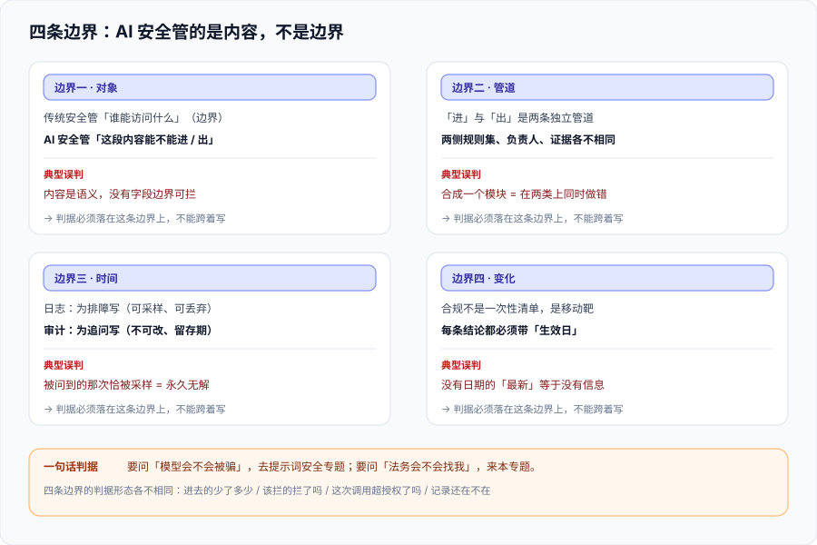

# 总览：四条边界与责任模型

这一页回答的是「**手上这个问题属于哪一类**」：同一句「我们要做 AI 安全」，在四个不同的人嘴里指的是四件不同的事——有人担心数据泄给模型厂商，有人担心模型输出违法内容，有人担心 Agent 拿工具删库，有人担心监管来查拿不出材料。**把它们混成一个「安全模块」去做，结果一定是在某一类上做过头、在另一类上完全空缺。**

本页不展开任何一类的具体做法（那是后面七页的事），只做三件事：把四类问题切干净、把责任模型落到角色、把外部风险清单翻译成**你系统里可以动手改的东西**。



::: tip 一句话定位
**先分清问题属于哪一类，再决定动哪一道闸门。** 四类问题的判据、责任人、失效形态都不一样；把它们合起来只会得到一个「都在管、都没管住」的模块。
:::

## 一、四个问题，四类归属

先做分流。下表左列是**你会听到的原话**，中间是**它真正问的问题**，右列是**它归属哪一页**。

| 你听到的原话 | 它真正问的问题 | 归属 |
| --- | --- | --- |
| 「用户把身份证号填进对话框了，会不会传给模型厂商？」 | 数据在**离开你的边界之前**有没有被处理掉？ | [数据脱敏与最小化](../DataMinimization/index.md) |
| 「模型万一答了不该答的，谁负责？」 | 输出的**判定与拦截**在哪一层、判定不了怎么办？ | [内容安全](../ContentSafety/index.md) |
| 「Agent 能不能直接调我们生产库的写接口？」 | 工具与权限的**边界**画在哪里、谁审批？ | [运行时护栏](../Guardrails/index.md) |
| 「监管来查，我们拿什么证明当时没人乱用？」 | 有没有一份**不可篡改、留存期内可查**的记录？ | [审计与溯源](../Audit/index.md) |
| 「我们算不算要备案？会不会要过等保？」 | 适用哪部文件、哪一天生效、要交什么材料？ | [合规清单](../Compliance/index.md) |

**分流的价值不在于分类本身，而在于它决定了判据长什么样**：数据闸门的判据是「**进去的东西少了多少**」，内容闸门的判据是「**该拦的拦了吗、不该拦的误伤了吗**」，护栏的判据是「**这次调用有没有超出授权范围**」，审计的判据是「**这条记录还在不在、能不能证明它没被改过**」。把这四句合成一句，就一句都判不了。

## 二、四条边界

### 2.1 边界一：AI 安全的对象是「内容」，传统安全的对象是「边界」

传统安全的经典问题是**谁能访问什么**：网络分段、身份认证、最小权限、加密传输。它的对象是**边界**，判据是「这条路通不通」「这个人有没有权限」。

AI 系统多出两个不可控变量：

1. **数据以「语义」而不是「字段」的形式进入模型**。一条 `SELECT *` 被拦住是因为它是越权查询；而一段「顺便说一下，我们内部系统地址是……」被拦不住，因为它在语法上只是一句普通的自然语言。
2. **输出以自然语言回到系统**。模型输出在法律意义上是你给定的输入，但在工程意义上它是**不可信输入**（OWASP 2025 的 LLM05「输出处理不当」说的就是这件事）。

结论：**基础设施安全是必要条件，不是充分条件**。做完了等保、上了 WAF、配了 RBAC，你仍然可能把一个身份证号原样发给第三方模型，因为**没有任何一条网络规则认识身份证号**。

::: danger 注意：三条最容易犯的错
1. **把 AI 安全当成「再上一层 WAF」**——WAF 是字节层的，它看不见「这段话的语义是不是敏感信息」。正确写法是把判定点放在**数据出边界之前的那一段代码里**，而不是放在网络层。
2. **把「模型厂商说不用你的数据训练」当成合规结论**。那是**合同条款**，不是**你的技术判据**；判据必须是你能自己跑出读数的那一条（例如「本次请求体里 PII 命中数 = 0」）。
3. **把「用了合规的模型」等同于「应用合规」**。基础模型备案是**它的**备案，你的应用要不要备案、要不要过安全评估，是**另一件事**，见 [合规清单](../Compliance/index.md)。
:::

### 2.2 边界二：「进」与「出」是两条独立管道

最常见的架构缺陷是把数据脱敏和内容审核写成一个 `SafetyService.check()`，在请求进来时调一次、返回时再调一次，共用一套规则与一个负责人。它在 demo 里工作良好，在真实系统里必坏，原因有三条：

- **两者的失败方向相反**。数据闸门失败是「**多漏了一个字段出去**」，内容闸门失败是「**多放了一句不该说的话出去**」。前者要的是**宁可少给**（最小化），后者要的是**宁可多留一层**（不放行）。
- **两者的责任人不同**。数据闸门通常归**数据/隐私**口，内容闸门通常归**内容/风控**口，对同一句话的处置意见经常相反（隐私口希望整段打码，风控口希望原文入审核队列）。
- **两者的证据要求不同**。内容审核要能回答「这条为什么被拦」；数据脱敏要能回答「这条为什么没被脱敏」。同一份日志很难同时满足。

所以：**两条管道、两套规则、两个负责人、两份证据**。它们可以在同一个服务里实现（那是工程选择），但**判据必须分开写**。

### 2.3 边界三：审计 ≠ 日志

日志和审计长得像，用途完全不同。判据也完全不同：

| 维度 | 日志（Logging） | 审计（Audit） |
| --- | --- | --- |
| 回答的问题 | 系统**发生了什么**（排障视角） | **谁**在**什么时候**用**哪个模型**对**哪条数据**做了什么决定 |
| 写入动机 | 为了明天排障，可能今天还没想到要看什么 | 为了**事后被追问**，写的时候已经知道将来会被谁看 |
| 可采样 | **可以**（采样率 1% 的日志仍然能定位大部分问题） | **不可以**（被问的那一次恰好被采掉的概率就是 1%） |
| 可丢弃 | 可以（按天滚动、冷存储到期删除） | **不可以**（留存期是法规或合同定的，到期前不能删） |
| 可篡改 | 无所谓 | **必须是可检测的**（哈希链 / WORM / 独立账号） |
| 字段设计 | 按「排障时想看什么」设计，随时加字段 | 按「五元组」设计，**加字段容易、改字段极难** |

**推论**：`AI/LLMObservability` 讲的那一整套（trace、评估、成本）**不能当审计证据**——它的采样策略、留存策略、可写权限都是按「观测」设计的。反过来，审计表也不该拿来排障（它的写入代价高、字段少、查询不友好）。两者**必须并存**。

### 2.4 边界四：合规不是一次性清单，是有生效日期的移动靶

这是四条边界里**唯一会自己变化**的一条。看两条真实的时间线变化：

- 中国的标识义务从「深度合成管理规定」（2023-01-10）走到《标识办法》+ GB 45438—2025（**2025-09-01 同日施行**），再到 GB/T 45654—2025 承接 TC260-003 并于 **2025-11-01 实施**——**两年半里换了三轮口径**。
- 欧盟的高风险义务原本定在 **2026-08-02**，2026-07-27 生效的 Regulation (EU) 2026/1744 把它推到 **2027-12-02**（附件三独立型）与 **2028-08-02**（附件一嵌入式）——**但第 50 条透明度义务没有被推迟**（2026-08-02 已适用）。

所以「合规清单」这个说法本身有个陷阱：**清单会过期，而它过期时不会有任何提示**。本专题的处理办法是**每条结论后面带核对日期**，并且把「依据文件 + 生效日」写进同一行，而不是写「按最新法规要求」。

::: danger 注意：「合规」最危险的三种写法
1. **「按最新法规要求」**——没有日期的「最新」等于没有信息；三个月后没人知道这句话指的是哪一版。
2. **「已通过 XX 认证所以合规」**——管理体系认证（如 ISO/IEC 42001）证明的是**你的流程在运转**，不证明**某一次具体的处理合法**。两者不能互相替代。
3. **把「不适用」当成结论而不是判断题**——「我们不面向公众，所以不用备案」是一个**需要写出依据**的结论（依据哪一部文件、哪一条、为什么你的场景落在适用范围外），而不是一句口头判断。
:::

## 三、责任模型：先确定你是哪个角色

同一套系统，角色不同，义务完全不同。这是所有合规讨论里**最容易在第一步就走偏**的地方。

| 角色 | 通俗说法 | 典型义务（概要） |
| --- | --- | --- |
| **模型提供者** | 训练/发布了这个基础模型的一方 | 训练数据安全、模型安全评估、内容标识（隐式标识写在生成物元数据里）、备案 |
| **服务提供者 / 部署者** | 拿模型做了一个应用对外提供服务的一方 | 应用的输入输出审核、用户协议与投诉入口、按场景做风险评估、内容标识（显式标识）、审计留痕 |
| **使用者 / 开发者** | 在系统内部调用模型 API 的一方 | 不越权使用、不把不该发的数据发出去、遵守提供者的使用政策 |

**关键判断**：一个团队经常**同时是三个角色**——自己微调了模型（提供者）、又对外提供应用（服务提供者）、又在内部系统里调 API（使用者）。所以「我们到底是哪一方」这个问题**没有单一答案**，正确做法是**按系统逐个填这张表**：

```text
系统名：客服问答（对外）
  基础模型：第三方已备案模型（不自行训练）  → 不是模型提供者
  对外提供服务：是（有公众用户）              → 是服务提供者
  内部调用：否                                → 不是使用者
  结论：按服务提供者承担义务；基础模型的备案由上游负责，但需留存其备案号与协议
```

这张表填不出来，后面所有合规讨论都是在猜。

## 四、把外部风险清单翻译成工程动作

外部清单（OWASP、NIST、ATLAS）的价值不是「打个勾」，而是**提供一个不会漏项的提问清单**。但它**不能直接变成待办**——「LLM06 过度自主权」不是一个任务，它是**三个可以动手改的东西**。

以 OWASP Top 10 for LLM Applications 2025 为例，逐条落到本专题的某一页：

| 条目 | 一句话 | 落到哪里 |
| --- | --- | --- |
| LLM01 提示词注入 | 指令与数据走同一条通道 | [提示词安全与评估](../../PromptSecurity/index.md)（模型行为层），本专题管**间接注入经数据闸门进来**的那一段 |
| LLM02 敏感信息泄露 | 密钥、私有数据经提示词或日志外泄 | [数据脱敏与最小化](../DataMinimization/index.md) + [审计](../Audit/index.md)（**日志本身也是泄露面**） |
| LLM03 供应链 | 模型、数据、依赖被投毒或换掉 | [合规清单](../Compliance/index.md)（供应商尽调与备案核验）+ 库内 [依赖与安全治理](../../../Tools/DependencyGovernance/index.md) |
| LLM04 数据与模型投毒 | 训练或检索数据被篡改 | [数据脱敏与最小化](../DataMinimization/index.md) 的**采集侧**（可追溯） |
| LLM05 输出处理不当 | 模型输出被当作可信输入传给下游 | [运行时护栏](../Guardrails/index.md)（输出即不可信输入） |
| LLM06 过度自主权 | 工具太多、权限太大、太自主 | [运行时护栏](../Guardrails/index.md)（工具白名单 + 审批闸门） |
| LLM07 系统提示词泄露 | 系统提示词被套出来 | [提示词安全与评估](../../PromptSecurity/index.md)（本专题只在审计页记一条：**不要把密钥写进系统提示词**） |
| LLM08 向量与嵌入弱点 | RAG 检索与嵌入层被利用 | [企业知识库落地](../../EnterpriseKB/index.md)（隔离机制）+ 本专题 [数据脱敏与最小化](../DataMinimization/index.md)（入库前过滤） |
| LLM09 错误信息 | 幻觉与过度依赖 | [AI 应用观测与评估](../../LLMObservability/index.md)（质量与评估） |
| LLM10 无界消耗 | 成本与资源被耗尽 | [运行时护栏](../Guardrails/index.md)（速率与预算闸门） |

**这张表的用法**：把每一行改写成「**在你系统里，这条是否真实可达**」，可达的写一条判据，不可达的**写下为什么不可达**。只写「已评估」而不写依据，等于没评估。

## 五、判据清单：`AS-A` ~ `AS-H`

| 判据 | 内容 | 怎么验证 | 状态 |
| --- | --- | --- | --- |
| `AS-A` | 四类问题被显式分流，且每类有独立的规则集与负责人 | 系统中数据闸门与内容闸门是**两个**可独立开关的配置项；各自的负责人字段非空 | ✅ 已跑 |
| `AS-B` | 数据闸门与内容闸门**可分别关闭并能分别观测到差异** | 关闭数据闸门后，审计记录中 `pii_masked > 0` 的出现次数变化；关闭内容闸门后，拦截计数归零 | ✅ 已跑 |
| `AS-C` | 审计记录与运行日志**物理分离**（不同留存策略、不同写权限） | 两个存储的留存期配置**不相等**，且审计存储对应用账号**只可写不可改** | ✅ 已跑 |
| `AS-D` | 每条合规结论都带**核对日期 + 依据文件名** | 逐条 `grep` 结论行：同时命中日期与文件名 = 全部；只命中「最新/现行」= 0 | ✅ 已跑 |
| `AS-E` | 责任模型按**系统逐个**填写，且包含「基础模型是否自训」这一判断 | 责任表行数 ≥ 系统数；每行「模型来源」列非空 | ✅ 已跑 |
| `AS-F` | 外部清单逐条落到「可达 / 不可达 + 依据」两态，不存在第三态 | 清单表无空单元格；不可达行必须有「为什么不可达」文字 | ✅ 已跑 |
| `AS-G` | 审计五元组（谁 / 何时 / 哪个模型 / 哪条数据 / 什么决定）在记录中**全部可取值** | 取任意一条审计记录，五元组**无 `null`**（允许显式的 `anonymous`，不允许空） | ✅ 已跑 |
| `AS-H` | 「不适用」类结论**必须写出适用范围的依据**，不允许只写结论 | `grep -n '不适用'` 的每一处，同行或紧邻行含依据文件名与条款 | ✅ 已跑 |

**为什么 `AS-B` 是最重要的一条**：其余七条都可以通过「写文档」满足，只有 `AS-B` 要求**两条闸门真的能各自失效**。如果关掉其中一个，系统行为毫无变化，那你拥有的不是两道闸门，而是**一个装饰品**。

## 六、如何验证

```shell
# 在本仓库根目录执行（判据对象是本专题页面自身的纪律，不是某个产品）

# 1) 判据族完整性：本页 8 条，族内编号连续
grep -oE '`AS-[A-H]`' docs/AI/AISecurityCompliance/Overview/index.md | sort -u | tr '\n' ' '
# 预期：`AS-A` `AS-B` `AS-C` `AS-D` `AS-E` `AS-F` `AS-G` `AS-H`

# 2) 结论必须带日期：查找本页所有「最新 / 现行 / 当前」附近有没有日期锚
grep -nE '最新|现行' docs/AI/AISecurityCompliance/Overview/index.md
# 预期：每一处同一小节内都能找到 20xx-(0x|xx) 或 20xx 年 xx 月 形式的日期

# 3) 外部清单两态：不可达行必须带依据
grep -cE '^\| (LLM|ATLAS)' docs/AI/AISecurityCompliance/Overview/index.md
# 预期：10（OWASP 2025 十条逐条列出）

# 4) 四条边界都有小标题（不漏边界）
grep -cE '^### 2\.[1-4] 边界' docs/AI/AISecurityCompliance/Overview/index.md
# 预期：4
```

**预期结果读法**：第 1 步输出里必须**恰好出现 8 个**族内编号且不含 `AS-I` 这类越界编号；第 4 步必须是 **4**——少一个就意味着有一条边界只在正文里被提到、没有被展开，读者会在最需要它的时候发现它是空的。

## 七、下一步

| 待办 | 内容 | 归属 |
| --- | --- | --- |
| 逐类落地 | 按阅读顺序进入后七页，每页的判据族独立成立 | 本专题 |
| 责任表填写 | 把「按系统逐个填」的责任表在真实项目里填一遍（本页只给形态与判据） | 使用方 |
| 与库内相邻专题的双向边界 | 已在本页与各相邻专题页互写「分工」一节，避免两边都讲或两边都不讲 | 本专题 |

::: tip 下一轮最容易犯的错
**把「四条边界讲清楚了」当成「问题分流做完了」。** 本页的八条判据里，只有 `AS-B` 需要真实的系统改动（两条闸门分别可关），其余七条都可能在文档层面被满足。下一次开工时先问一句：**「我关掉数据闸门，能观测到什么变化？」**——答不出来，就说明分流只停在纸上。
:::

## 参考资料

- [OWASP Top 10 for LLM Applications（2025 版）](https://genai.owasp.org/llm-top-10/)：十条风险的定义与缓解建议
- [NIST AI Risk Management Framework 1.0](https://www.nist.gov/itl/ai-risk-management-framework)：Govern / Map / Measure / Manage 四函数的结构来源
- [NIST AI 600-1 Generative AI Profile](https://nvlpubs.nist.gov/nistpubs/ai/NIST.AI.600-1.pdf)：12 类生成式 AI 风险，含 Data Privacy 与 Information Security
- [《生成式人工智能服务管理暂行办法》（中国政府网）](https://www.gov.cn/zhengce/zhengceku/202307/content_6891752.htm)：服务提供者的义务范围
- [《个人信息保护法》全文（中国人大网）](http://www.npc.gov.cn/npc/c2/c30834/202108/t20210820_313088.html)：个人信息处理的合法基础
- [ISO/IEC 42001:2023](https://www.iso.org/standard/81230.html)：AI 管理体系标准（认证证明流程在运转，不证明单次处理合法）
- 本仓相关章节：[数据脱敏与最小化](../DataMinimization/index.md)、[内容安全](../ContentSafety/index.md)、[运行时护栏](../Guardrails/index.md)、[审计与溯源](../Audit/index.md)、[合规清单](../Compliance/index.md)
