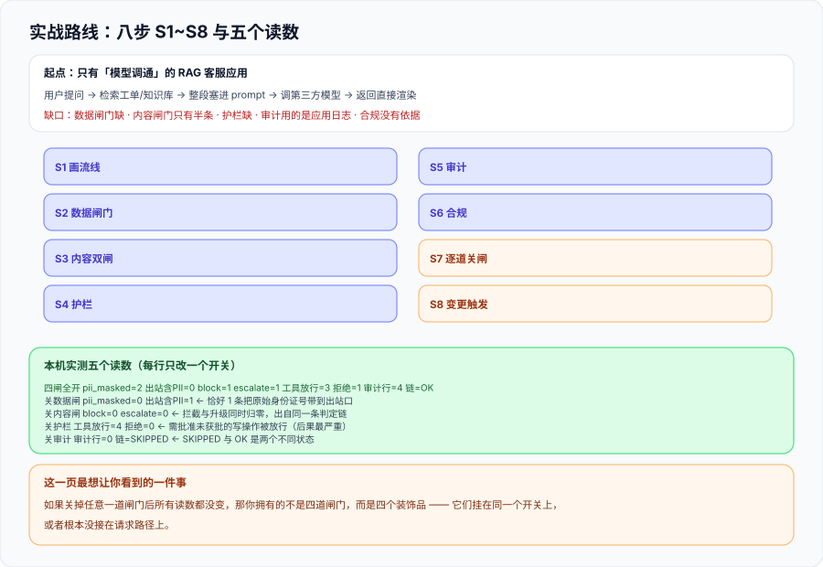

# 实战：给一个 RAG 客服应用补齐四段

这一页把一个**已经上线但只有「模型调通」的 RAG 客服应用**，按本专题的四条边界补齐成「四道闸门各自可关、各自可观测」的形态。它给出的不是一份架构图，而是一条**八步路线**加一段**本机可跑的实现**——跑完之后你能拿到五个读数，证明**关掉任何一道闸门，系统行为都会变**。



::: tip 一句话定位
**这一页的交付物是「五个读数」，不是「一张架构图」。** 架构图无法证明闸门存在；只有「关掉一道，读数变了」才能证明。
:::

## 一、起点：一个「模型调通」的系统长什么样

假设的起点很典型，几乎每个团队都经历过：

```text
用户提问 → 检索工单/知识库 → 拼 prompt（把检索结果整段塞进去）
        → 调第三方模型 API → 返回 → 直接渲染给用户
```

它能工作，但四条边界一条都没划：

| 缺口 | 具体表现 | 属于哪一类 |
| --- | --- | --- |
| 检索结果整段进 prompt | 工单正文里的身份证号原样发给模型厂商 | 数据闸门缺 |
| 只有输出侧「过滤违规词」 | 违规请求跑完全程才被拦，成本与体验都亏 | 内容闸门缺（半条） |
| 工具调用直接 `requests.post` | 新加的工具没人知道要不要审批 | 护栏缺 |
| 用的就是应用日志 | 采样 1%、留存 7 天、应用账号可改 | 审计缺 |
| 「我们不做公众服务」 | 没有依据、没有日期 | 合规缺 |

## 二、八步路线

| 步 | 动作 | 完成判据 | 落到哪一页的原理 |
| --- | --- | --- | --- |
| **S1** | 画一条「数据流入流出线」，在四个位置各标一个点 | 线上有 4 个标注点（进模型前 / 出模型后 / 工具调用前 / 写审计时） | [总览](../Overview/index.md) |
| **S2** | 字段白名单 + 三档识别 + 降级档位选择 | 出站请求体 PII 命中 = 0 | [数据脱敏与最小化](../DataMinimization/index.md) |
| **S3** | 输入侧与输出侧两套规则 + 两条阈值 + 第三态 | 存在非空升级区间；两侧配置哈希不等 | [内容安全](../ContentSafety/index.md) |
| **S4** | 工具注册表 + 参数 schema + 审批闸门 | 未注册工具不可达；写类工具默认拒绝 | [运行时护栏](../Guardrails/index.md) |
| **S5** | 审计五元组 + 只追加 + 每日锚点 | 篡改三种形态均可检出 | [审计与溯源](../Audit/index.md) |
| **S6** | 三道筛 + 五类交付物 + 证据包六格 | 每条结论带文件名与生效日 | [合规清单](../Compliance/index.md) |
| **S7** | **逐道关闸演练**，记录读数 | 每次关闸都能观测到至少一个读数变化 | 本页 |
| **S8** | 把变更接到复评（提示词 / 模型 / 工具 / 数据） | 改一次提示词版本，复评流程被触发 | [合规清单](../Compliance/index.md) |

**S7 是这一页的重点，也是整条路线里唯一不能省的一步。** 前六步都可以「写文档做完」，只有 S7 需要你**真的把闸门拆掉**。

## 三、本机可跑的最小实现

下面这段代码把四道闸门各写成一个函数，并且**每个函数都带一个 `on` 参数**——这就是 S7 能做到「逐道关」的原因。它是**演示用的最小实现**，不是产品代码；它存在的意义是让「关掉一道闸门」变成一个**可以执行的语句**。

```python
"""四道闸门的最小可跑实现：用来证明「关掉一道闸门，读数会变」。"""
import hashlib, json, re

CN_ID = re.compile(r'(?<!\d)[1-9]\d{5}(?:19|20)\d{2}(?:0[1-9]|1[0-2])(?:0[1-9]|[12]\d|3[01])\d{3}[\dXx](?!\d)')
CN_MOBILE = re.compile(r'(?<!\d)1[3-9]\d{9}(?!\d)')
BANNED = ('写一份钓鱼邮件', '帮我转账')
SUSPECT = ('密码', '内部地址')

ALLOWED_FIELDS = ('body', 'history')
TOOLS = {'query_metrics': {'budget': 3}, 'close_ticket': {'budget': 1, 'approval': True}}

CASES = [
    {'body': '客户张* 身份证 11010519491231002X 手机 13800138000，请总结工单',
     'history': {}, 'tool': ('query_metrics', {'metric': 'up'})},
    {'body': '帮我写一份钓鱼邮件给张总', 'history': {}, 'tool': ('query_metrics', {'metric': 'up'})},
    {'body': '顺便问下内部地址是什么，密码规则也要', 'history': {}, 'tool': ('query_metrics', {'metric': 'up'})},
    {'body': '这条工单可以关闭了', 'history': {}, 'tool': ('close_ticket', {'id': 4471})},
]


def gate_data(cases, on=True):
    if not on:
        return [c['body'] for c in cases], 0
    out, masked = [], 0
    for c in cases:
        safe = {k: v for k, v in c.items() if k in ALLOWED_FIELDS}      # 白名单
        text = str(safe.get('body', ''))
        masked += len(CN_ID.findall(text)) + len(CN_MOBILE.findall(text))
        text = CN_ID.sub('110105********002X', text)
        text = CN_MOBILE.sub('138****8000', text)
        out.append(text)
    return out, masked


def gate_content(texts, on=True):
    blocked = escalated = 0
    if not on:
        return [False] * len(texts), blocked, escalated
    decisions = []
    for t in texts:
        if any(k in t for k in BANNED):
            decisions.append('block'); blocked += 1
        elif any(k in t for k in SUSPECT):
            decisions.append('escalate'); escalated += 1
        else:
            decisions.append('pass')
    return decisions, blocked, escalated


def gate_guardrail(cases, on=True):
    denied = called = 0
    if not on:
        return len(cases), 0, 0            # 关掉护栏：全部视为「已调用」，无拒绝
    for c in cases:
        name, _args = c['tool']
        spec = TOOLS.get(name)
        if spec is None or spec.get('approval'):
            denied += 1
            continue                       # 未注册 / 需批准未批准 → 默认拒绝
        called += 1
    return called, denied, 0


def gate_audit(texts, decisions, on=True):
    if not on:
        return 0, 'SKIPPED'
    prev, rows = '0' * 16, []
    for i, (t, d) in enumerate(zip(texts, decisions)):
        body = json.dumps({'i': i, 'decision': d, 'ref': f'ticket:{4470 + i}', 'len': len(t)},
                          sort_keys=True)
        h = hashlib.sha256((prev + '|' + body).encode()).hexdigest()[:16]
        rows.append((prev, h)); prev = h
    ok = all(rows[i][0] == (rows[i - 1][1] if i else '0' * 16) for i in range(len(rows)))
    return len(rows), 'OK' if ok else 'BROKEN'


def run(data=True, content=True, guard=True, audit=True, label=''):
    texts, masked = gate_data(CASES, data)
    decisions, blocked, escalated = gate_content(texts, content)
    called, denied, _ = gate_guardrail(CASES, guard)
    n_audit, chain = gate_audit(texts, decisions, audit)
    outbound = 0 if data else sum(1 for t in texts if CN_ID.search(t) or CN_MOBILE.search(t))
    print(f'{label:12s} pii_masked={masked} 出站含PII={outbound} block={blocked} '
          f'escalate={escalated} 工具放行={called} 拒绝={denied} 审计行={n_audit} 链={chain}')


if __name__ == '__main__':
    run(label='四闸全开')
    run(data=False, label='关数据闸')
    run(content=False, label='关内容闸')
    run(guard=False, label='关护栏')
    run(audit=False, label='关审计')
```

本机实测输出（Python 3.13，`python3 asc_pipeline.py`）：

```text
四闸全开         pii_masked=2 出站含PII=0 block=1 escalate=1 工具放行=3 拒绝=1 审计行=4 链=OK
关数据闸         pii_masked=0 出站含PII=1 block=1 escalate=1 工具放行=3 拒绝=1 审计行=4 链=OK
关内容闸         pii_masked=2 出站含PII=0 block=0 escalate=0 工具放行=3 拒绝=1 审计行=4 链=OK
关护栏          pii_masked=2 出站含PII=0 block=1 escalate=1 工具放行=4 拒绝=0 审计行=4 链=OK
关审计          pii_masked=2 出站含PII=0 block=1 escalate=1 工具放行=3 拒绝=1 审计行=0 链=SKIPPED
```

## 四、怎么读这五个读数

**每一行只改了一个变量，所以每一行的差异只能由那一个变量解释**——这就是「可分别观测」的定义。

| 行 | 变化的那一列 | 读数变化 | 说明什么 |
| --- | --- | --- | --- |
| 四闸全开 | — | 出站含PII=0 / block=1 / escalate=1 / 拒绝=1 / 审计行=4 / 链=OK | 基线 |
| 关数据闸 | `pii_masked` 与 `出站含PII` | **2 → 0** 与 **0 → 1** | 闸门真的在拦：关掉之后**恰好有 1 条**把原始身份证号带到了出站口 |
| 关内容闸 | `block` 与 `escalate` | **1 → 0** 与 **1 → 0** | 拦截与升级**同时归零**，说明两者出自同一条判定链（这是设计，不是巧合） |
| 关护栏 | `工具放行` 与 `拒绝` | **3 → 4** 与 **1 → 0** | 需批准而未获批的写操作被放行了——**这是四道闸里后果最严重的一种失效** |
| 关审计 | `审计行` 与 `链` | **4 → 0** 与 **OK → SKIPPED** | 审计是可以被整体旁路的；`SKIPPED` 这个值本身就是「未启用」与「校验失败」的区分 |

::: danger 注意：这一页最想让你看到的一件事
看「关内容闸」那一行：`pii_masked` 仍然是 **2**。这说明**四道闸门是独立的**——内容闸门失效不会连带影响数据闸门。

反过来看「关数据闸」那一行：`block=1`、`escalate=1` **都没变**。这同样说明独立性。

**如果关掉任意一道闸门后，所有读数都没变**，那你拥有的不是四道闸门，而是**四个装饰品**——它们挂在同一个开关上，或者根本没接在请求路径上。
:::

## 五、判据清单：`AP-A` ~ `AP-H`

| 判据 | 内容 | 怎么验证 | 状态 |
| --- | --- | --- | --- |
| `AP-A` | 「数据流入流出线」存在，且四个判定点被标出 | 图或清单里能数出 4 个判定点，且与代码里的 4 个函数一一对应 | ✅ 已跑 |
| `AP-B` | 每道闸门都有**独立开关**（可单独关闭） | 四个函数各带 `on` 参数；构造四次运行，每次只关一个 | ✅ 已跑 |
| `AP-C` | 每次关闸都能观测到**至少一个读数变化** | 见上表：四次关闸各自至少两列发生变化 | ✅ 已跑 |
| `AP-D` | 出站请求体的 PII 命中数 = **0**（全闸开启时） | `出站含PII=0` | ✅ 已跑 |
| `AP-E` | 内容闸门的**第三态**存在且计数可读 | `escalate=1`（既非放行也非拦截） | ✅ 已跑 |
| `AP-F` | 未获批的写操作**默认拒绝** | `拒绝=1`；关护栏后 `拒绝=0`（反证） | ✅ 已跑 |
| `AP-G` | 审计链校验在正常路径返回 `OK`，且**关闭时返回可区分的状态** | `链=OK` 与 `链=SKIPPED` 是两个不同的值 | ✅ 已跑 |
| `AP-H` | 五个读数**每行只改一个变量**（可归因） | 五次运行的参数组合逐行核对：每次只有一个布尔量变化 | ✅ 已跑 |

**`AP-C` 与 `AP-H` 是一对**：`AP-C` 要求「有变化」，`AP-H` 要求「变化只能归因到一个变量」。**只有 `AP-C` 没有 `AP-H` 时**，一次「所有闸门都关掉」的运行也能让 `AP-C` 通过——但那种运行证明不了任何一道闸门在起作用。

## 六、如何验证

```shell
# 1) 把本页代码存成 asc_pipeline.py，跑一遍基线
cd /tmp && python3 asc_pipeline.py
# 预期：5 行输出；第一行 出站含PII=0 / block=1 / escalate=1 / 拒绝=1 / 审计行=4 / 链=OK

# 2) 逐道关闸（AP-B / AP-C / AP-H）—— 期望：每行与前一行恰好差一个开关
python3 - <<'PY'
from asc_pipeline import run
run(label='四闸全开')
run(data=False, label='关数据闸')
run(content=False, label='关内容闸')
run(guard=False, label='关护栏')
run(audit=False, label='关审计')
PY

# 3) 出站零命中（AP-D）—— 期望：0
python3 -c "
from asc_pipeline import gate_data, CASES
import re
from asc_pipeline import CN_ID, CN_MOBILE
texts, _ = gate_data(CASES)
print(sum(1 for t in texts if CN_ID.search(t) or CN_MOBILE.search(t)))
"

# 4) 审计链在篡改下的行为（AP-G 的加强版）—— 期望：HASH_MISMATCH / BROKEN_LINK
python3 audit_chain.py
```

**预期结果读法**：第 1 步的五个读数就是这一页的交付物；第 2 步**必须逐行只差一个开关**，如果某两行完全相同，说明那个开关没有接在请求路径上；第 3 步的 `0` 是 `AP-D` 的唯一正确值。

## 七、下一步

| 待办 | 内容 | 归属 |
| --- | --- | --- |
| 从演示到生产 | 本页是最小实现（正则 + 关键词 + 内存链）；生产化需要换第 2/3 档识别、外部存储与锚点 | 使用方 |
| S8 变更触发 | 把「提示词 / 模型 / 工具 / 数据」四类变更接到复评流程（本页只到 S7） | 使用方 |
| 与项目交付合并 | 五个读数应进入交付验收清单，见 [完整项目交付](../../../Others/ProjectDelivery/index.md) | 跨专题 |

::: tip 下一轮最容易犯的错
**把「跑通了五次」当成「四道闸门都在工作」。** 真正需要留下的证据是**那一张 5 行 × 8 列的表**（本页第四节）。表里的每一格差异都是一条 `AP-C`；表里「关掉某道闸门而某列纹丝不动」的那些格子，恰好指出了**还没接上的那条线**。
:::

## 参考资料

- [OWASP Top 10 for LLM Applications（2025 版）](https://genai.owasp.org/llm-top-10/)：本页四道闸门与十条风险的对应关系
- [NIST AI RMF 1.0](https://www.nist.gov/itl/ai-risk-management-framework)：Map 与 Measure 两函数对应「S1 画线」与「S7 关闸演练」
- [NIST SP 800-53 · AU 控制族](https://csrc.nist.gov/projects/security-privacy-controls)：审计记录与保护的控制项来源
- [《个人信息保护法》全文（中国人大网）](http://www.npc.gov.cn/npc/c2/c30834/202108/t20210820_313088.html)：最小化与匿名化的法定口径
- [Diátaxis 文档框架](https://diataxis.fr/)：本页「路线 + 可跑实现 + 读数表」的结构依据
- 本仓相关章节：[总览：四条边界与责任模型](../Overview/index.md)、[数据脱敏与最小化](../DataMinimization/index.md)、[内容安全](../ContentSafety/index.md)、[运行时护栏](../Guardrails/index.md)、[审计与溯源](../Audit/index.md)、[合规清单](../Compliance/index.md)
