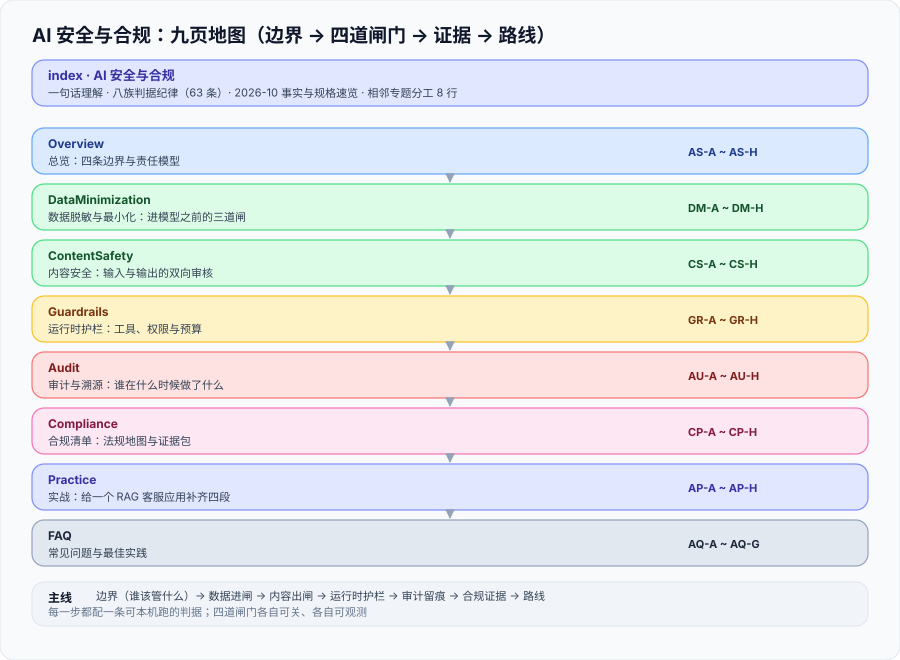

# AI 安全与合规

<p style="text-align:center;"></p>



这一页讲的是**一份数据能不能进模型、一句话能不能出模型、出了事能不能说清楚、监管问起来能不能拿得出证据**。它不讲「怎么防提示词注入」——那是攻击面视角；它讲的是**企业把一个 AI 应用交出去之前，必须回答的那四个问题**。

本专题的主线是 **边界（谁该管什么）→ 数据进闸（脱敏与最小化）→ 内容出闸（审核）→ 运行时护栏（工具与预算）→ 审计留痕（谁做了什么）→ 合规证据（拿得出来）→ 落地路线**，每一步都配一条可本机跑的判据。

::: tip 一句话理解
**AI 安全与合规的产出不是「一个安全模块」，而是「四道各自能独立失败的闸门」。** 判据不是「有没有做安全」，而是「把这四道闸门中的一个拆掉，你能不能看出系统变了」。
:::

- [总览：四条边界与责任模型](Overview/index.md)
- [数据脱敏与最小化：进模型之前的三道闸](DataMinimization/index.md)
- [内容安全：输入与输出的双向审核](ContentSafety/index.md)
- [运行时护栏：工具、权限与预算](Guardrails/index.md)
- [审计与溯源：谁在什么时候做了什么](Audit/index.md)
- [合规清单：法规地图与证据包](Compliance/index.md)
- [实战：给一个 RAG 客服应用补齐四段](Practice/index.md)
- [常见问题与最佳实践](FAQ/index.md)

## 本专题的判据纪律

本专题每一页都配一张「判据定义表」：每条设计决定都要能回答三件事——**约定是什么、定错会怎样、怎么验证它没被破坏**。判据族前缀与数量如下，便于逐页对照。

| 页面 | 判据族 | 数量 |
| --- | --- | --- |
| 总览：四条边界 | `AS-A` | 8 |
| 数据脱敏与最小化 | `DM-A` | 8 |
| 内容安全 | `CS-A` | 8 |
| 运行时护栏 | `GR-A` | 8 |
| 审计与溯源 | `AU-A` | 8 |
| 合规清单 | `CP-A` | 8 |
| 实战 | `AP-A` | 8 |
| 常见问题 | `AQ-A` | 7 |

合计 **63 条**判据。它们**逐页独立**（同一族内编号连续、跨族不复用前缀），不做「总判据表」——因为「把 63 条汇总成一张表」的结果是没人会读它，而每一页的读者只关心自己这一页的判据。

## 2026-10 事实与规格速览（核对时间 2026-10）

下表按 **2026-10** 的官方发布页核对。**这张表会过期，而且比你想象的快**——本专题管的领域里，一条法规的生效日期改一次，整个时间轴就换一版。所以每一页的结论后面都带日期，而不是写「当前最新」；本库的硬纪律是：**没有日期的「最新」等于没有信息**。

| 归属 | 文件 / 标准 | 版本与日期（核对时间 2026-10） | 状态与要点 |
| --- | --- | --- | --- |
| 中国 · 部门规章 | 《生成式人工智能服务管理暂行办法》 | 2023-07-13 公布，**2023-08-15 施行** | 中国生成式 AI 服务的基础性规章；确立备案、安全评估、语料与内容安全责任 |
| 中国 · 部门规章 | 《互联网信息服务深度合成管理规定》 | **2023-01-10 施行** | 深度合成服务与使用者的标识、内容管理义务；早于大模型专项规章 |
| 中国 · 行政法规 | 《网络数据安全管理条例》 | 国务院令第 790 号，**2025-01-01 施行** | 细化「告知—同意」、个人信息行权条件、大型处理者安全义务；其第 27 条把「定期合规审计」写实 |
| 中国 · 管理办法 | 《个人信息保护合规审计管理办法》 | **2025-05-01 施行** | 处理超 **1000 万人**个人信息的处理者**每两年至少一次**合规审计；同一专业机构及其关联机构、同一负责人**不得连续三次以上**审计同一对象 |
| 中国 · 管理办法 | 《人工智能生成合成内容标识办法》 | 2025-03-07 印发，**2025-09-01 施行**（约 6 个月过渡期） | 生成合成内容需**显式标识 + 隐式标识**（文件元数据）；传播平台有核验义务 |
| 中国 · 强制国标 | **GB 45438—2025**《网络安全技术 人工智能生成合成内容标识方法》 | 2025-02-28 发布，**2025-09-01 实施** | 配套上述标识办法；「人读」与「机读」双模式，禁止删除或篡改标识 |
| 中国 · 推荐国标 | **GB/T 45654—2025**《生成式人工智能服务安全基本要求》 | 2025-04-25 发布，**2025-11-01 实施** | TC260-003（2024-02-29）转正为国标；备案与第三方安全测评的技术依据 |
| 中国 · 推荐国标 | **GB/T 45652—2025**《生成式人工智能预训练和优化训练数据安全规范》 | 2025-04-25 发布，**2025-11-01 实施** | 训练数据处理活动的安全要求与评价方法 |
| 中国 · 推荐国标 | GB/T 45574—2025《数据安全技术 敏感个人信息处理安全要求》、GB/T 45577—2025《数据安全技术 数据安全风险评估方法》 | 2025 年第 10 号国标公告发布 | 敏感个人信息识别与处理；风险评估流程与评价方法 |
| 中国 · 管理办法 | 《个人信息出境认证办法》 | 2025-10 公布，**2026-01-01 施行** | 补齐数据出境制度拼图；与安全评估、标准合同并列为出境路径之一 |
| 中国 · 技术文件 | 《人工智能安全治理框架》2.0 版 | **2025-09-15 发布**（1.0 版为 2024-09） | 全国网安标委技术文件；**30 个技术应对措施 + 40 个治理模式**，新增基于应用场景与智能化水平的分级原则 |
| 欧盟 · 条例 | **Regulation (EU) 2024/1689**（EU AI Act） | **2024-08-01 生效** | 风险分级：不可接受 / 高 / 有限 / 最小 |
| 欧盟 · 条例 | 同上，分期适用 | 禁止性实践 + AI 素养 **2025-02-02**；GPAI 义务 **2025-08-02**；第 50 条透明度（含机器可读标识）**2026-08-02** | 关注点：角色（提供者 / 部署者 / 进口商 / 分销商）决定义务 |
| 欧盟 · 修订 | **Regulation (EU) 2026/1744**（「数字综合法案·人工智能篇」） | **2026-07-27 生效** | **延期**：附件三独立型高风险 → **2027-12-02**；附件一嵌入式受监管产品 → **2028-08-02**。**不是整部法案延期** |
| 欧盟 · 时间点 | 既有生成式系统的过渡 | **2026-12-02** | 2026-08-02 之前投放市场的生成合成内容系统，须在此日前符合第 50(2) 条 |
| 国际标准 | ISO/IEC 42001:2023 | **2023-12-18 发布** | 首个 **AI 管理体系**标准，可认证；要求 AI 系统清单、影响评估、成文控制、供应商监督 |
| 国际标准 | ISO/IEC 42005（AI 影响评估）、ISO/IEC 23894（AI 风险管理） | 42005 **2025-05 发布**；23894 在 42001 之前发布 | 42005 以「社会 / 人 / 组织影响」为对象；23894 把 ISO 31000 扩展到 AI 特性 |
| 国际框架 | NIST AI RMF 1.0（NIST AI 100-1） | **2023-01-26 发布** | **Govern / Map / Measure / Manage** 四函数；Govern 跨组织，其余三函数按系统迭代 |
| 国际框架 | NIST AI 600-1（Generative AI Profile） | **2024-07-26 发布** | 12 类生成式 AI 风险；含 Confabulation、Data Privacy、Information Security、Value Chain Integration |
| 国际框架 | OWASP Top 10 for LLM Applications **2025** | 2025 版（年度更新） | LLM01 提示词注入 / LLM02 敏感信息泄露 / LLM03 供应链 / LLM04 数据与模型投毒 / LLM05 输出处理不当 / LLM06 过度自主权 / **LLM07 系统提示词泄露（新增）** / **LLM08 向量与嵌入弱点（新增）** / LLM09 错误信息 / LLM10 无界消耗 |
| 威胁库 | MITRE ATLAS **v5.1.0** | **2025-11** | 16 战术 / 84 技术 / 56 子技术；2025 春季扩充加入 RAG 投毒、AI 供应链攻陷等生成式技术 |
| 欧洲标准 | **ETSI EN 304 223** | **2026-01-14 公布** | 覆盖安全设计、开发、部署、维护、退役的基线网络安全要求，点名数据投毒、模型混淆、间接提示词注入 |

::: warning 说明：三条时间线互不同步
**法规生效 ≠ 标准实施 ≠ 认证可用**。GB 45438—2025 与《标识办法》同日（2025-09-01）生效实施，但 GB/T 45654—2025 是 2025-11-01 才实施；EU AI Act 的高风险义务已经从 2026-08-02 推到 2027-12-02，而**第 50 条透明度义务并没有被推迟**。页面里凡出现日期，都写明**它属于哪条线**（哪个文件、哪一版、哪个生效日）。
:::

## 版本组织说明：为什么本专题不建版本目录

本库对**大版本差异**的处理办法是建版本目录（`docs/Backend/Java/Frame/Spring/Spring5/` 与 `Spring6/`、`docs/Backend/Java/Frame/SpringBoot/v2/`、`v3/`、`v4/`、`docs/Backend/Java/Frame/SpringSecurity/v5/`～`v7/`、`docs/Backend/Java/Frame/SpringCloud/SpringCloud2020/` 与 `SpringCloud2022/`、`docs/Frontend/Frame/Vue/Vue2/` 与 `Vue3/`），旧版本目录**保留并在页首标注维护状态，不覆盖旧内容**。

「AI 安全与合规」**不按这个办法组织**，理由有三条：

1. **它不是某个产品的名字，没有「第 5 版 / 第 6 版」两条内容线**。对比：`Spring5` 与 `Spring6` 是两条需要长期并存的技术线，因为存量系统还在跑；而本专题的「版本」是它**管的那些文件**的版本（法规号、标准号），不是它自己的版本。
2. **法规的旧版本没有服务对象**。这一点与其他主题根本不同：Spring 5 的文档要保留，因为**还有人在用它**；而《生成式人工智能服务管理暂行办法》2023 版不会因为 2025 年的新标准出台而「还有人按它做」——生效日期一过，旧口径就**不能再用**。给法规建「旧版本目录」等于给一个已失效的口径提供入口。
3. **它管的是「谁在什么时间点必须做什么」，天然是时间轴而不是版本树**。所以本专题的承载形式是**时间轴表**（见上表与合规页）而不是版本目录；每条结论后面带日期，过期就改这一行的日期，不另开目录。

::: info 旧版本内容怎么保留
本专题**不删除、不改写**库内任何既有的大版本目录内容（`Spring5`～`SpringCloud2022` 等一律原样保留）。本专题自身也不「覆盖」任何历史口径：凡有实质变化处（例如 EU AI Act 高风险义务的生效日由 2026-08-02 改为 2027-12-02），在页面内**新旧两个日期同时写出来并标明依据**，而不是把旧日期删掉——因为**「某条义务曾经定在 2026-08-02」本身是一条有用的信息**（它解释了很多存量合规文档为什么长成那样）。
:::

## 相关专题与分工

本专题与库内八个相邻专题存在明确边界，**互不替代**：

| 相邻专题 | 它讲什么 | 本专题讲什么 |
| --- | --- | --- |
| [提示词安全与评估](../../AI/PromptSecurity/index.md) | 模型行为层的攻防：注入为什么无法根治、纵深防御怎么落、红队怎么打、评估集与回归门禁 | **数据能不能进、输出能不能出、谁做了什么、拿不拿得出证据**；提示词层怎么防归那边 |
| [企业知识库落地](../EnterpriseKB/index.md) | 知识库的权限隔离、身份链路、采集与生命周期 | 知识库里的**个人数据与合规留痕**；隔离机制本身归那边 |
| [AI 应用观测与评估](../LLMObservability/index.md) | 观测的是「语义层系统是不是好的」：质量、成本、时延、评估 | 审计回答的是「**谁**在什么时候做了什么决定」；观测数据**不能当审计证据** |
| [大模型应用开发](../LLMApp/index.md) | API 调用、上下文与记忆、成本与限流、应用架构 | 这些能力**上闸门**：工具白名单、输出校验、速率与预算 |
| [安全加固](../../Ops/SecurityHardening/index.md) | 主机、容器、网络、凭据、审计检测等**基础设施**安全 | 基础设施安全是**必要条件**；本专题管模型与内容的特有面 |
| [数据治理入门](../../DB/DataGovernance/index.md) | 元数据、血缘、质量规则、组织与流程 | 治理管「这份数据**可不可信**」，本专题管「这份数据**能不能进模型**」 |
| [完整项目交付](../../Others/ProjectDelivery/index.md) | 需求到上线的项目流程方法论 | 交付清单里**合规交付物**那一行：证据包怎么攒、留给谁 |
| [Agent 应用](../Agent/index.md) | Agent 原理、工具调用、编排、记忆 | Agent 的**权限与审批闸门**：最小权限、写操作拦截、人工介入点 |

一句话判据：**要问「模型会不会被骗」，去提示词安全；要问「法务会不会找我」，来本专题。**

## 建议阅读顺序

```text
Overview（四条边界：先分清是哪一类问题）
  → DataMinimization（数据进闸：识别、降级、留痕）
  → ContentSafety（内容出闸：双向审核与误杀成本）
  → Guardrails（运行时护栏：工具、权限、预算）
  → Audit（审计留痕：五元组与不可篡改）
  → Compliance（合规证据：法规地图、时间轴、证据包）
  → Practice（照着走一遍，跑通 AP-A~AP-H）
  → FAQ（分诊树）
```

## 参考资料

- [中国政府网 · 关于印发《人工智能生成合成内容标识办法》的通知](https://www.gov.cn/zhengce/zhengceku/202503/content_7014286.htm)：标识办法原文与施行日期
- [中央网信办 · 专家解读《标识办法》与 GB 45438—2025](https://www.cac.gov.cn/2025-09/05/c_1758792061408012.htm)：显式标识与隐式标识的落地口径
- [全国网络安全标准化技术委员会 · TC260-003《生成式人工智能服务安全基本要求》专家解读](https://www.tc260.org.cn/tc260/hygd1/202403/42628d8f510f43f0b66a5590bb23b809.shtml)：语料安全、模型安全、安全评估的原始口径
- [国家互联网信息办公室 · 《个人信息保护合规审计管理办法》](https://cnews.chinadaily.com.cn/a/202502/15/WS67afd022a310ff9bbd9f342b.html)：审计频次与专业机构义务
- [《人工智能安全治理框架》2.0 版发布（国家网络安全宣传周，2025-09-15）](https://news.youth.cn/jsxw/202509/t20250916_16238450.htm)：风险分类与治理模式
- [EU AI Act · Implementation Timeline](https://artificialintelligenceact.eu/implementation-timeline/)：分期适用与 2026 年修订后的日期
- [NIST AI Risk Management Framework（AI RMF 1.0）](https://www.nist.gov/itl/ai-risk-management-framework)：Govern / Map / Measure / Manage 四函数
- [NIST AI 600-1 · Generative AI Profile](https://nvlpubs.nist.gov/nistpubs/ai/NIST.AI.600-1.pdf)：生成式 AI 的 12 类风险
- [ISO/IEC 42001:2023 · Information technology — Artificial intelligence — Management system](https://www.iso.org/standard/81230.html)：AI 管理体系要求
- [OWASP Top 10 for LLM Applications](https://genai.owasp.org/llm-top-10/)：2025 版风险清单与条目定义
- [MITRE ATLAS](https://atlas.mitre.org/)：AI 系统的对手战术与技术库
- [《个人信息保护法》全文（中国人大网）](http://www.npc.gov.cn/npc/c2/c30834/202108/t20210820_313088.html)：个人信息处理的合法基础与审计条款
