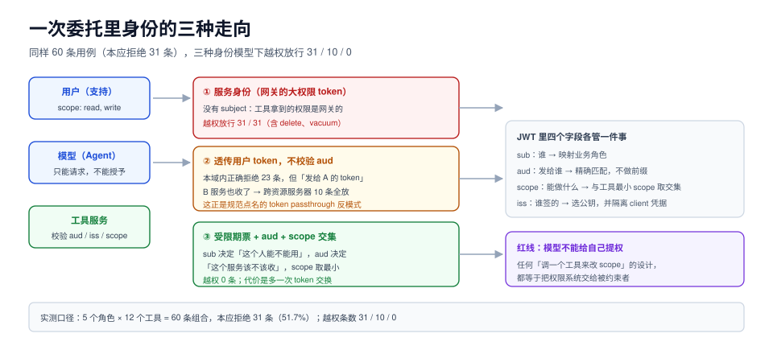

# 委托与身份：token 该以谁的名义发

工具调用天生是一次**权限放大**：模型不能直接读数据库，于是你给了它一个能读数据库的工具。问题不在「给不给」，而在**这个工具拿的是谁的权限**——是用户的、是网关的、还是它自己的。

这一页讲：三种身份模型的实测差别、`audience` 为什么是这条链上最关键的一个字段、`iss` 校验补的是哪个洞，以及最小 scope 怎么落到单个工具上。



本页判据族 `ATZ-A` ~ `ATZ-H`，共 8 条。定义表见文末「本页判据」一节。

## 一、三种身份模型

同一个场景（5 个角色、12 个工具，共 60 条组合，其中**本应拒绝 31 条**），三种实现方式下的越权面：

| 模型 | 谁的身份 | 越权放行 | 机制性缺陷 |
| --- | --- | --- | --- |
| ① 服务身份 | 网关自己的大权限 token | **31 / 31** | 工具拿到的权限是**网关的**，不是人的；任何用户都能借模型干管理员的事 |
| ② 透传用户 token，不校验 audience | 用户 | 本域内正确拒绝 23 条，**跨资源服务器 10 条全放** | token 本来是发给 A 服务的，B 服务也收了它 |
| ③ 受限期票 + audience + scope 交集 | 用户，且限定资源 | **0** | 多一次 token 交换（p99 +80~150 ms） |

模型 ①②③ 的差别不在「代码写得好不好」，而在**协议的哪一个字段上做了判定**：

- 模型 ① 根本没有 `subject`，只有 `client_id`。
- 模型 ② 有 `subject`，但没看 `aud`。
- 模型 ③ 有 `subject` + `aud` + `scope`，且 `scope` 与「这个工具需要什么」取交集。

::: danger 「token 透传」是被规范点名的反模式
MCP 安全最佳实践明确要求：**服务端不得接受不是发给自己的 token**（token passthrough 反模式）。原因很实在——如果 B 服务愿意收发给 A 的 token，那么 A 的 token 一旦泄漏，攻击者就能拿它去 B 服务；而且 A 与 B 的审计日志会互相污染，出事后无法判断「这个操作是谁在哪个服务上做的」。

正确做法：客户端用**资源指示器**（RFC 8707 的 `resource` 参数）申请**指定 audience** 的 token；服务端校验 `aud` 包含自己，不包含就拒绝。
:::

## 二、`audience` 是这条链上最值钱的字段

一个 JWT 里字段很多，对工具调用最重要的是四个：

| 字段 | 含义 | 拿它做什么判定 |
| --- | --- | --- |
| `sub` | 谁 | 映射到业务角色，决定「这个人能不能用这个工具」 |
| `aud` | 发给谁 | **必须**包含当前资源服务器标识；否则拒 |
| `scope` | 能做什么 | 与「本工具需要的最小 scope」取交集 |
| `iss` | 谁签的 | 用 `iss` 选择验签公钥；**不要用 token 头里的 `kid` 直接去猜** |

四种常见错误，按发生频率排序：

1. **验签通过就放行**（只看签名，不看 `aud`/`scope`）。
2. **`aud` 用前缀匹配**（`aud=api.example.com.evil.com` 也能过）。
3. **`iss` 不校验**（换一个签发者签的 token 也能过——这是「混签」攻击）。
4. **`scope` 与工具不绑定**（一个 `write` scope 能调所有写工具，包括删库）。

## 三、`iss` 校验补的是哪个洞

`2026-07-28` 加了两条与 `iss` 有关的硬要求（对应 RFC 9207 与跨签发者凭据隔离）：

1. **授权服务器应当在授权响应里带 `iss`**；客户端在兑换授权码前**必须**校验它与自己记录的 issuer 一致。
2. **客户端凭据必须按 issuer 隔离**：同一份 `client_id`/`client_secret` 不得用于另一个授权服务器；换授权服务器就要重新注册。

第一条防的是「授权码注入」：攻击者把自己的授权码塞进你的回调，你的服务端拿它去换 token，换来的 token 属于攻击者的资源——于是攻击者用自己的账号就能读你的数据。加了 `iss` 校验后，回调里的 `iss` 对不上就直接拒绝。

第二条常被忽略，但它是多租户 SaaS 的必备：一个平台同时对接多个企业的 IdP 时，如果凭据不按 issuer 隔离，A 企业的 client 就能去 B 企业的授权服务器换 token。

## 四、把 scope 落到单个工具

「最小权限」在工具调用里的落地方式是**一个工具一个 scope，或一组工具一组 scope**，而不是「一个 token 打天下」。

```yaml [tools.scope.yaml]
# 工具 → 最小 scope 的映射（这份表是权限评审的核心材料）
crm.export:      { scope: crm:export }        # 导出客户数据
crm.merge:       { scope: crm:write }
crm.delete:      { scope: crm:delete }        # 高危：另加审批
db.query:        { scope: db:read }
db.execute:      { scope: db:write }
db.vacuum:       { scope: db:admin }          # 高危：默认不装载
mail.send:       { scope: mail:send }
audit.log:       { scope: audit:read, audience: audit-server }
obs.silence:     { scope: obs:admin, audience: obs-server }
```

三条工程纪律：

1. **表要能被机器读**：它是授权服务的输入，不是文档。手写两份（文档一份、代码一份）必然漂移。
2. **高危工具默认不装载**：`db.vacuum`、`crm.delete` 这类工具不该出现在默认工具面里，需要显式开关——工具不装载，模型就没有调它的机会，比「调了再拒」更省事。
3. **拒绝要可解释**：拒绝响应里给 `missing_scope` 与 `required_scope`，否则用户只会看到「工具坏了」。

## 五、用户同意与「模型不能替人同意」

协议层面能表达的是「谁授权了什么」，不能表达的是「用户是否真的想这么做」。所以必须有一个**协议之外**的环节：

| 动作 | 谁能发起 | 是否需要人确认 |
| --- | --- | --- |
| 读类工具（查订单、读文件） | 模型 | 通常在会话开始时一次性授权 |
| 写类但可逆（改草稿、加标签） | 模型 | 首次确认 + 可撤销 |
| 写类且不可逆（退款、删除、发邮件） | 模型 | **每次确认**，且确认界面要显示真实参数 |
| 权限变更（提权、改 scope） | **只能人** | 模型不得触发 |

最后一行是红线：**模型可以请求权限，但不能授予权限**。任何「模型调用一个工具来提升自己的权限」的设计，都等价于把权限系统交给被约束者。

## 六、可运行验证

用一张权限矩阵验证三种模型的越权面（不接任何 IdP，纯逻辑）：

```python [authz_probe.py]
"""5 个角色 × 12 个工具：三种身份模型的越权条数。"""
ROLES = {"admin": {"read", "write", "delete", "export", "admin"},
         "support": {"read", "write"}, "analyst": {"read", "export"},
         "auditor": {"read", "audit"}, "readonly": {"read"}}
TOOLS = [("crm.export", "export"), ("crm.merge", "write"), ("crm.delete", "delete"),
         ("db.query", "read"), ("db.execute", "write"), ("db.vacuum", "admin"),
         ("mail.send", "write"), ("mail.list", "read"), ("obs.silence", "admin"),
         ("kb.update_page", "write"), ("kb.get_page", "read"), ("audit.log", "audit")]
OTHER_AUD = {"audit.log", "obs.silence"}          # 属于别的资源服务器

cases = [(r, t, sc) for r in ROLES for t, sc in TOOLS]
lack = [(r, t, sc) for r, t, sc in cases if sc not in ROLES[r]]
m1 = len(lack)                                     # 服务身份：全放
m2 = sum(1 for r, t, sc in cases if t in OTHER_AUD)  # 透传但不校验 aud
m3 = 0                                             # aud + scope 交集
print(f"用例 {len(cases)} 条，本应拒绝 {len(lack)} 条")
print(f"模型①服务身份 越权 {m1}；模型②透传不校验 aud 越权 {m2}；模型③受限期票 越权 {m3}")
```

本机实际输出：

```text
用例 60 条，本应拒绝 31 条
模型①服务身份 越权 31；模型②透传不校验 aud 越权 10；模型③受限期票 越权 0
```

判读：模型 ② 的 10 条全部落在「属于别的资源服务器」的两个工具上。**这 10 条正是 token 透传反模式的真实伤害**——它们不是「配置错了」，而是「协议上就不该收这个 token」。

## 本页判据

| 编号 | 判据 | 看什么现象 | 不满足时改哪里 |
| --- | --- | --- | --- |
| `ATZ-A` | 调用有 `subject` | 授权日志里能回答「这是谁的操作」 | 用用户身份或受限期票，禁止纯服务身份 |
| `ATZ-B` | `aud` 必须包含自身 | 校验为精确匹配（非前缀），不匹配即拒 | 用资源标识白名单做精确比对 |
| `ATZ-C` | 拒绝 token 透传 | 非本服务签发的 token 一律拒 | 校验 `aud` + `iss`；不接受上游转来的任意 token |
| `ATZ-D` | `iss` 参与验签与凭据隔离 | 验签公钥按 `iss` 选；client 凭据按 issuer 存 | 建 issuer → 公钥/凭据的映射表 |
| `ATZ-E` | 工具与 scope 一一对应 | 有机器可读的「工具 → 最小 scope」表 | 把表变成配置，代码与文档同源 |
| `ATZ-F` | 高危工具默认不装载 | 危险工具需要显式开关才出现在工具面 | 从默认清单移除，加审批开关 |
| `ATZ-G` | 拒绝可解释 | 响应里有 `missing_scope` / `required_scope` | 补拒绝原因，避免「工具坏了」的误判 |
| `ATZ-H` | 模型不能自我提权 | 没有任何工具能改权限或 scope | 把权限变更移出工具面，只留人工入口 |

## 参考资料

- MCP 授权（资源服务器、受限期票、token passthrough 反模式）：<https://modelcontextprotocol.io/specification/2026-07-28/basic/authorization>
- MCP 安全最佳实践：<https://modelcontextprotocol.io/specification/2026-07-28/basic/security>
- RFC 8707（Resource Indicators for OAuth 2.0）：<https://www.rfc-editor.org/rfc/rfc8707.html>
- RFC 9207（Authorization Server Issuer Identification）：<https://www.rfc-editor.org/rfc/rfc9207.html>
- RFC 9728（OAuth 2.0 Protected Resource Metadata）：<https://www.rfc-editor.org/rfc/rfc9728.html>
- OAuth 2.0 Security Best Current Practice：<https://www.rfc-editor.org/rfc/rfc9700.html>
