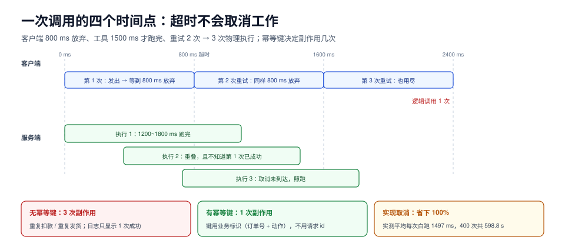

# 调用生命周期：超时、取消、重试与幂等

一次工具调用从发出到作废，中间有四个时间点：**发出、超时、放弃、真正结束**。协议层能做的是让这四个点各自可表达；做不到这四件事，工程层就只能靠「等」——而等，是重复执行的第一步。

这一页讲：请求 id 到底标识什么、三层超时怎么设、取消为什么经常无效、重试与幂等键的关系（有一组实测读数），以及 `traceparent` 跨进程后 trace 为什么还是断的。



本页判据族 `ATV-A` ~ `ATV-H`，共 8 条。定义表见文末「本页判据」一节。

## 一、请求 id 标识「这一帧」，不标识「这次操作」

JSON-RPC 的 `id` 只有一个职责：**把响应配给请求**。它不承担幂等、不承担去重、不承担审计。

| 用途 | 该用什么 | 为什么不能用请求 id |
| --- | --- | --- |
| 响应配对 | 请求 `id` | —— |
| 去重 / 幂等 | **业务键**（订单号、文件路径+哈希、显式幂等键） | 每次重试都是新 id，拿它去重等于没去重 |
| 审计与追踪 | trace/span id + 业务键 | id 只在一次连接内有意义 |
| 用户可见的操作编号 | 服务端返回的句柄 | id 由客户端生成，可被伪造 |

id 生成有三条纪律：

1. **同一连接内不复用**。复用 id 会让「迟到的旧响应」被误配给新请求——这是最难查的一类串包。
2. **不要用 `0` 或空字符串**。部分实现把 `0`、`""` 当假值处理，直接判成「没有 id」。
3. **不要用自增计数器跨进程共享**。两个进程各自从 1 开始，合并日志时无法区分。

## 二、三层超时

| 层 | 量的是什么 | 典型值 | 设错的后果 |
| --- | --- | --- | --- |
| 连接超时 | TCP/握手 | 1~3 s | 设太长会把「连不上」拖成「整体超时」 |
| 首字节超时（TTFB） | 请求发出到收到第一个字节 | 与工具 p99 对齐 | 设太短会把慢工具全判成故障 |
| 总时长超时 | 整次调用 | 业务 SLA | **设得比工具执行时间短 = 制造重复执行** |

第三层是本节的重点。它有一个很反直觉的性质：**超时不取消服务端的工作**。客户端在 800 ms 放弃，服务端的工具还在跑，跑完还会写库。于是：

| 客户端超时 | 工具执行时间 | 重试次数 | 实际执行次数 | 放大倍数 |
| --- | --- | --- | --- | --- |
| 5000 ms | 1200~1800 ms | 0 | 400 | 1.00× |
| 1500 ms | 1200~1800 ms | 2 | **814** | **2.04×** |
| 800 ms | 1200~1800 ms | 2 | **1200** | **3.00×** |

400 次逻辑调用，超时 800 ms、重试 2 次，物理执行 **1200 次**——正好是 (1+2)×400。放大倍数由 `ceil(执行时间/超时) × (1+重试次数)` 决定，**跟工具多快没关系，只跟两个参数的比例有关**。

同一组数据，副作用次数取决于服务端有没有幂等键：

| 配置 | 无幂等键的副作用次数 | 有幂等键的副作用次数 |
| --- | --- | --- |
| 5000 ms / 无重试 | 400 | 400 |
| 1500 ms / 重试 2 次 | 814 | **400** |
| 800 ms / 重试 2 次 | 1200 | **400** |

::: tip 一句话理解
**重试次数不产生重复副作用，幂等键才产生（或者说，才阻止）重复副作用。** 超时是「我不管了」，重试是「我再来一次」，幂等键是「你只能生效一次」——三件事必须分开设计。
:::

## 三、取消经常无效，原因在服务端不在协议

协议给了取消通道：`notifications/cancelled`，带 `requestId` 与 `reason`，**没有响应**（它是通知）。

但大量工具实现根本不检查取消。实测口径：客户端 800 ms 放弃、服务端不实现取消，**400/400 次（100%）的算力都在无人等待后继续跑完，平均浪费 1497 ms/次、合计 598.8 s**。

要让取消真的生效，服务端必须做三件事：

1. **在检查点轮询**：长任务（批量写、逐条 HTTP 调用）每处理 N 条检查一次「本请求是否已取消」。
2. **把取消变成幂等的「已取消」结局**：取消到达时可能已经写了一半，必须定义「取消后世界长什么样」（部分成功？回滚？留待补偿？）。
3. **区分「取消」与「超时」**：取消是客户端主动不要了，超时是客户端不知道结果。前者可以丢弃，后者**必须能查**——因为对端可能已经成功。

::: danger 三个会把「一次调用」变成「三次扣款」的写法
1. **超时后重试写接口**。超时 800 ms、工具 1200 ms 起，一次逻辑调用物理执行 3 次。正确做法：写接口带幂等键，或干脆**不在超时后重试写操作**，改为「查询结果」。
2. **把「请求 id」当幂等键**。重试生成新 id，服务端认为是新请求。正确做法：幂等键由业务生成（订单号 + 动作），随每次重试原样带上。
3. **取消只在前端做**。前端不再显示，服务端照跑。正确做法：取消必须走 `notifications/cancelled`，且服务端要有检查点。
:::

## 四、进度与并发

长时间工具（跑一个 SQL、抓一个网页）会让模型侧看起来像卡死。协议给了 `progressToken`（客户端在 `_meta` 里给）与 `notifications/progress`（服务端按 token 回报）：

```json [客户端：在 _meta 里给一个 token]
{"jsonrpc":"2.0","id":42,"method":"tools/call",
 "params":{"name":"db.query","arguments":{"sql":"select ..."},
           "_meta":{"progressToken":"q-42"}}}
```

```json [服务端：按 token 回报，不占用请求的响应]
{"jsonrpc":"2.0","method":"notifications/progress",
 "params":{"progressToken":"q-42","progress":60,"total":100,"message":"已扫描 6/10 张表"}}
```

两条容易忽略的约定：`progress` 应当**单调不减**（回退会让客户端进度条倒退）；进度通知**不保证到达**（它是通知，丢了不重发），所以它不能承担「任务完成」的语义——完成只有一条路，就是那条响应。

并发方面，工具调用最容易出现的是 **fan-out 爆炸**：模型一次要求调 12 个工具，客户端并行发出，服务端的连接池瞬间被打满，然后所有调用一起超时，然后一起重试。两条护栏：

1. **客户端信号量**：同时在途的工具调用数设上限（按服务端连接池大小反推，通常 4~8）。
2. **服务端按方法限流**：结合 `Mcp-Method`/`Mcp-Name` 头做，不必解 body。

## 五、trace 断在进程边界

`2026-07-28` 把 OpenTelemetry 的传播约定写进了协议：`traceparent`、`tracestate`、`baggage` 三个键放在 `_meta` 里跟着请求走。

在此之前，跨进程追踪是断的：宿主应用有自己的 trace，工具服务有自己的 trace，中间靠日志时间戳对齐。接入之后要检查三件事（详见[Trace 模型与会话](../../LLMObservability/Tracing/index.md)）：

| 检查 | 期望 |
| --- | --- |
| 子进程/子服务是否继续同一个 trace | `traceparent` 的 trace-id 与父 span 相同 |
| 工具 span 的父节点 | 指向发起调用的那个 span，而不是新建根 |
| span 属性 | 至少 `gen_ai.tool.name`、`gen_ai.tool.call.id`，且 call id 与日志里的一致 |

## 六、可运行验证

不接真实服务，验证「超时 × 重试 × 幂等键」三者的乘积关系：

```python [retry_probe.py]
"""验证：物理执行次数由「超时/执行时间」决定，副作用次数由幂等键决定。"""
import random

random.seed(20261024)
N = 400
exec_ms = [random.uniform(1200, 1800) for _ in range(N)]

for timeout, retries in ((5000, 0), (1500, 2), (800, 2)):
    execs = side_key = side_nokey = 0
    seen = set()
    for i, e in enumerate(exec_ms):
        key = f"order-{i}"                     # 业务键，重试时不变
        attempt = 0
        while True:
            execs += 1
            side_nokey += 1
            if key not in seen:
                seen.add(key)
                side_key += 1
            if e <= timeout or attempt >= retries:
                break
            attempt += 1
    print(f"超时 {timeout:>4}ms 重试{retries} → 执行 {execs:>4}（{execs/N:.2f}×）"
          f" 副作用 无键 {side_nokey:>4} / 有键 {side_key:>3}")
```

本机实际输出：

```text
超时 5000ms 重试0 → 执行  400（1.00×） 副作用 无键  400 / 有键 400
超时 1500ms 重试2 → 执行  814（2.04×） 副作用 无键  814 / 有键 400
超时  800ms 重试2 → 执行 1200（3.00×） 副作用 无键 1200 / 有键 400
```

判读：第三行数字整齐得可疑——`1200 = 400 × 3`，正因为 800 ms 一定短于最短执行时间 1200 ms，所以**每次调用都必然耗尽重试**。这提醒一件事：**当超时小于工具的最短执行时间时，重试次数就是放大倍数**，这是一个可以手算的结论，不需要压测。

## 本页判据

| 编号 | 判据 | 看什么现象 | 不满足时改哪里 |
| --- | --- | --- | --- |
| `ATV-A` | 请求 id 不复用 | 同一连接内 id 单调或随机且不重复 | 用 UUIDv7/单调计数器，避免 `0` 与空串 |
| `ATV-B` | 幂等键与请求 id 解耦 | 重试时业务键不变、id 变 | 幂等键由业务生成并随请求携带 |
| `ATV-C` | 总超时不短于工具 p99 | 配置里的超时 ≥ 工具 p99 的 1.5 倍 | 要么调大超时，要么缩短工具，别靠重试兜 |
| `ATV-D` | 写操作不在超时后盲重试 | 写接口的重试策略是「查询后决定」 | 改为状态查询 + 幂等键重试 |
| `ATV-E` | 取消有服务端检查点 | 取消后能在 N 秒内看到任务终止 | 在长循环里加取消检查；定义取消后的世界状态 |
| `ATV-F` | 进度单调且不承担完成语义 | `progress` 不减；完成只由响应表达 | 修正回报逻辑；别用进度通知当完成信号 |
| `ATV-G` | 在途并发有上限 | 客户端信号量或服务端限流存在 | 按连接池反推上限，通常 4~8 |
| `ATV-H` | 跨进程 trace 不断 | `_meta.traceparent` 透传，工具 span 有父节点 | 在传输层注入 `traceparent`，不要业务手抄 |

## 参考资料

- JSON-RPC 2.0 `id` 与响应对应关系：<https://www.jsonrpc.org/specification#request_object>
- MCP 取消与进度（`notifications/cancelled`、`progressToken`）：<https://modelcontextprotocol.io/specification/2026-07-28/basic/utilities/cancellation>
- MCP `_meta` 中的 OpenTelemetry 传播字段：<https://modelcontextprotocol.io/specification/2026-07-28/changelog>
- OpenTelemetry `traceparent` 格式（W3C Trace Context）：<https://www.w3.org/TR/trace-context/>
- Google SRE Book, *Addressing Cascading Failures*（重试放大的经典分析）：<https://sre.google/sre-book/addressing-cascading-failures/>
