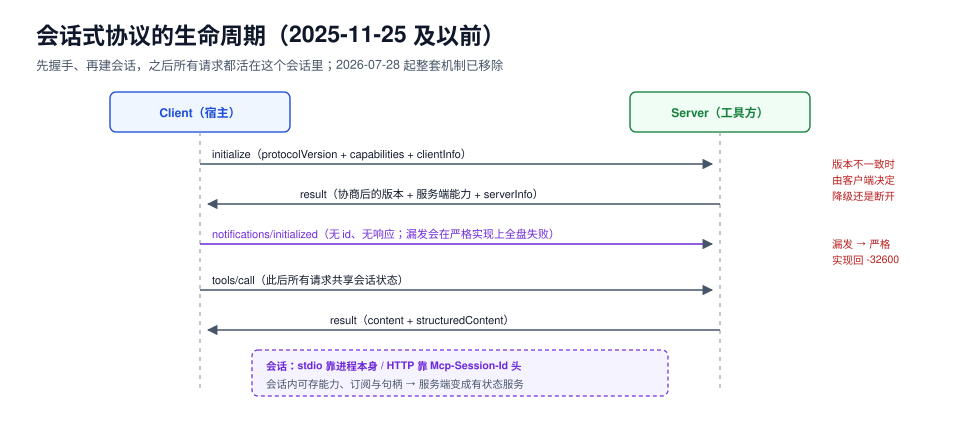

# 会话式协议（2025-11-25 及以前，存量）

::: warning 版本状态：存量，维护中
本页对应 `2024-11-05` ~ `2025-11-25` 五个修订版的**会话式**设计：先握手、再建会话、会话里带连接状态。`2026-07-28` 起这套机制**已从规范中移除**，由[无状态协议](../MCP2026/index.md)取代。

为什么保留这一页：现存 SDK、IDE 插件、企业内部 server 里，会话式实现仍占多数；你读到的报错、日志、迁移任务，全都长在这套语义上。**照本页写新实现是错的，读懂老实现是对的。**
:::

会话式协议的核心假设是「一次连接就是一段对话」：客户端先 `initialize` 报出自己是谁、支持什么、说哪个版本的协议，服务端回一份自己的能力清单，双方确认后再发 `notifications/initialized`，此后所有请求都活在这个会话里。



本页判据族 `AT5-A` ~ `AT5-H`，共 8 条。定义表见文末「本页判据」一节。

## 一、握手的三步

```json [1. client → server]
{"jsonrpc":"2.0","id":1,"method":"initialize","params":{
  "protocolVersion":"2025-11-25",
  "capabilities":{"roots":{"listChanged":true},"elicitation":{}},
  "clientInfo":{"name":"my-host","version":"1.4.0"}}}
```

```json [2. server → client]
{"jsonrpc":"2.0","id":1,"result":{
  "protocolVersion":"2025-11-25",
  "capabilities":{"tools":{"listChanged":true},"resources":{"subscribe":true,"listChanged":true}},
  "serverInfo":{"name":"files-server","version":"0.9.3"}}}
```

```json [3. client → server（通知，没有 id，也不会有响应）]
{"jsonrpc":"2.0","method":"notifications/initialized"}
```

三步的顺序不是仪式：

1. **`initialize` 是唯一允许在「未初始化」状态下调用的方法**。其余方法在握手完成前调用，服务端**应当拒绝**。
2. **第三个通知不可省**。很多实现只做前两步就发 `tools/list`，在宽容的服务端上能跑，在严格实现上直接报 `-32600`。
3. **`protocolVersion` 是「客户端想要的」，不是「双方同意的」**。服务端若只支持别的版本，会在 `result` 里回自己的版本；此时客户端必须决定是降级继续还是断开——**规范没有规定必须断开，这就是各家行为不一致的根源**。

## 二、会话是连接的属性

| 传输 | 会话怎么表示 | 断线后会怎样 |
| --- | --- | --- |
| stdio | 子进程本身即会话 | 进程死了会话就没了，重启就是一个新会话 |
| Streamable HTTP（`2025-11-25`） | 响应头 `Mcp-Session-Id`，后续请求带同一个头 | 会话仍在服务端，客户端可复用；会话过期后服务端回 404，客户端必须重新 `initialize` |

`Mcp-Session-Id` 带来的三个必然后果：

1. **服务端要存会话状态**：能力、订阅、临时句柄全在里面，于是变成有状态服务，扩容要粘性会话或共享存储。
2. **`tools/list` 可以随连接变化**：不同会话看到不同工具。这既灵活又可缓存性极差。
3. **会话过期是一种新的失败模式**：`404` 不等于「工具不存在」，而是「你的会话没了，重来」。客户端把 404 当业务错误处理，就会报出莫名其妙的「工具未找到」。

## 三、服务器发起的请求

会话式协议允许服务端反向调用客户端，这是它与「HTTP 请求-响应」最本质的区别：

| 方法 | 用途 | 客户端必须实现吗 |
| --- | --- | --- |
| `roots/list` | 问客户端「你打开了哪些目录」 | 只在声明了 `roots` 能力时 |
| `sampling/createMessage` | 让客户端的模型替服务端生成一段文本 | 只在声明了 `sampling` 时 |
| `elicitation/create` | 向用户追问一个缺失的参数 | 只在声明了 `elicitation` 时（`2025-06-18` 新增） |

反向请求的实现成本很高：客户端要在**等待自己的响应**的同时处理**对方发来的请求**，也就是必须做双向多路复用。绝大多数「卡死」类 bug 都出在这里——客户端用同步 `readline` 等自己的响应，反向请求被堵在缓冲区里，双方互等。

::: danger 会话式实现的四个经典坑
1. **在 `initialize` 之前发请求**。表现是服务端返回 `-32600 Invalid Request` 或直接断开。正确做法：把「已初始化」做成客户端的一个显式状态位，所有请求先过这道闸。
2. **忘记发 `notifications/initialized`**。在宽容实现上一切正常，换一个严格实现就全盘失败——这类 bug 只在换 SDK 时暴露。
3. **把 `protocolVersion` 写死成自己实现的版本**。服务端升级后客户端拒绝连接；正确做法是「有列表、取交集、无交集才断开」。
4. **声明了能力但没实现方法**。声明 `sampling` 却对 `sampling/createMessage` 回 `-32601`，等于在握手时说谎。正确做法：能力声明从实现里生成，不手写。
:::

## 四、`2026-07-28` 把这套机制换成了什么

迁移时最容易出错的是「以为只是改个字段名」。实际对应关系是：

| 会话式（`2025-11-25`） | 无状态（`2026-07-28`） | 迁移要点 |
| --- | --- | --- |
| `initialize` 请求 + 响应 | 删除；每个请求的 `_meta` 自带 `protocolVersion` 与 `clientCapabilities` | 客户端要**每个请求都带**，服务端要**每个请求都校验** |
| `notifications/initialized` | 删除 | 一并删掉相关状态位 |
| 握手时协商版本 | 版本不匹配回 `-32022 UnsupportedProtocolVersion`；可先调 `server/discover` 拿支持列表 | 把「一次协商」改成「每请求校验 + 可选探测」 |
| 服务端反向请求（`roots/list`、`sampling`、`elicitation`） | 多轮往返（MRTR）：返回 `resultType:"input_required"` + `inputRequests`，客户端带 `inputResponses` 重发 | 客户端不再需要双向多路复用，改成「重试原请求」，见[结果回填](../Result/index.md) |
| `Mcp-Session-Id` | 删除；需要跨调用状态就用**服务端签发的显式句柄**，当普通参数传 | 状态从「连接属性」变成「数据」，可被缓存、可被审计，也可被伪造——要签名 |
| `ping` | 删除 | 用传输层心跳（HTTP keep-alive / 进程存活）替代 |
| `logging/setLevel` | 删除；每请求 `_meta` 里带 `io.modelcontextprotocol/logLevel` | 日志级别从「会话级」变成「请求级」，正好避免互相覆盖 |
| `Last-Event-ID` 续传 | 删除；流断了就当请求丢了，用**新 id** 重发 | 幂等键必须与请求 id 解耦，否则重发就是重复执行 |

倒数第二行值得单独强调：**日志级别从会话级降到请求级之后，「谁改了我的日志级别」这类事故消失了，但「同一请求的日志散落在不同级别」变多了**——这是把一个全局开关换成局部参数时必然的取舍。

## 五、可运行验证：读一个老实现的行为

手上有一个存量 server 时，用三条命令就能判定它到底是哪一代：

```shell
# 1) 它是否要求先握手？直接发 tools/list，看是否被拒
printf '%s\n' '{"jsonrpc":"2.0","id":1,"method":"tools/list"}' | ./old-server

# 2) 它说哪个版本？看 initialize 的返回
printf '%s\n' '{"jsonrpc":"2.0","id":1,"method":"initialize","params":{"protocolVersion":"2025-11-25","capabilities":{},"clientInfo":{"name":"probe","version":"0"}}}' | ./old-server

# 3) 它认不认 server/discover？（新代必实现，老代必然 -32601）
printf '%s\n' '{"jsonrpc":"2.0","id":1,"method":"server/discover"}' | ./server
```

判定表：

| 观察 | 结论 |
| --- | --- |
| 第 1 条返回 `-32602`/`-32600`，第 3 条返回 `-32601` | 会话式（`2025-11-25` 及以前） |
| 第 1 条直接成功返回工具列表，第 3 条返回版本与能力 | 无状态（`2026-07-28` 起） |
| 第 1 条成功、第 3 条 `-32601` | 半新半旧的自研实现：没有握手也没有 `server/discover`，最容易在升级时炸 |

## 本页判据

| 编号 | 判据 | 看什么现象 | 不满足时改哪里 |
| --- | --- | --- | --- |
| `AT5-A` | 握手顺序可判定 | 客户端有显式「已初始化」状态位，未初始化时的请求被本地拦截 | 加状态位；不要依赖服务端宽容 |
| `AT5-B` | `notifications/initialized` 必发 | 抓包能看到这条通知 | 在 `initialize` 成功后无条件发送 |
| `AT5-C` | 版本取交集而非写死 | 客户端维护支持列表，服务端回退时能降级或明确断开 | 改成列表 + 交集；把「不支持的版本」当显式错误 |
| `AT5-D` | 会话 ID 全程回传 | HTTP 模式下每个后续请求都带 `Mcp-Session-Id` | 统一在传输层注入，不要靠业务代码记得 |
| `AT5-E` | 会话过期有独立错误路径 | `404` 触发「重新握手」，不落到业务错误 | 在传输层把 404 映射成 `SessionExpired` |
| `AT5-F` | 能力声明由实现生成 | `capabilities` 的键与已注册的 handler 一一对应 | 手写的声明表删掉，改为反射注册表 |
| `AT5-G` | 反向请求不阻塞自身响应 | 双向多路复用；同步等待时也能处理入站请求 | 拆出读写两个任务，或用异步 IO |
| `AT5-H` | 迁移面已盘点 | 有一张「本仓库里哪些代码依赖握手/会话」的清单 | 逐条按第四节映射表改，先客户端后服务端 |

## 参考资料

- MCP `2025-06-18` 规范（最后一版完整会话式生命周期文档之一）：<https://modelcontextprotocol.io/specification/2025-06-18/basic/lifecycle>
- MCP `2026-07-28` 变更日志（删除会话与握手）：<https://modelcontextprotocol.io/specification/2026-07-28/changelog>
- JSON-RPC 2.0 通知语义：<https://www.jsonrpc.org/specification#notification>
- LSP 的 `initialize` 与能力协商（同一套设计思路的源头）：<https://microsoft.github.io/language-server-protocol/specifications/lsp/3.17/specification/#initialize>
