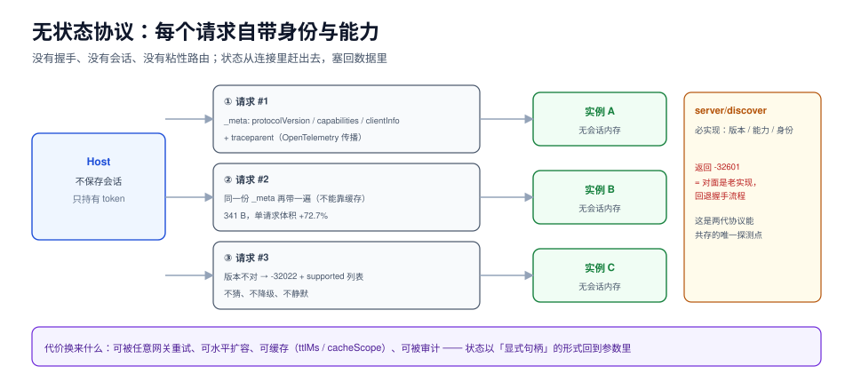

# 无状态协议（2026-07-28 起，当前）

`2026-07-28` 这一版做了一件很硬的事：**把「会话」从协议里删掉**。没有 `initialize`，没有 `Mcp-Session-Id`，没有 `ping`，没有断线续传。每个请求都自带「我说哪个版本、我支持什么能力、我是谁」，服务端不记得你，也不需要记得你。

这不是简化，是**把状态从连接里赶出去，塞回数据里**。代价是每个请求多背几百字节，收益是这个协议终于能被放进普通 HTTP 基础设施：无粘性会话、无共享会话存储、可被任意网关重试。



本页判据族 `AT6-A` ~ `AT6-H`，共 8 条。定义表见文末「本页判据」一节。

## 一、`_meta` 成了协议的主干

会话式协议把「版本 + 能力 + 身份」放在握手时协商一次；无状态协议把同样的信息放进**每个请求的 `params._meta`**：

```json [tools/call 请求]
{
  "jsonrpc": "2.0",
  "id": 42,
  "method": "tools/call",
  "params": {
    "name": "files.read_file",
    "arguments": { "path": "/etc/hosts" },
    "_meta": {
      "io.modelcontextprotocol/protocolVersion": "2026-07-28",
      "io.modelcontextprotocol/clientCapabilities": {
        "elicitation": {},
        "extensions": { "io.modelcontextprotocol/tasks": {} }
      },
      "io.modelcontextprotocol/clientInfo": { "name": "my-host", "version": "1.4.0" },
      "traceparent": "00-4bf92f3577b34da6a3ce929d0e0e4736-00f067aa0ba902b7-01"
    }
  }
}
```

体积实测：这段 `_meta`（含 `traceparent`）**341 B**，让一个 128 B 的 `tools/call` 请求涨到 **469 B（+72.7%）**。三项纪律：

1. **每个请求都要带，不能靠缓存**。网关可能把请求转给任意实例，实例不记得上一次。
2. **键名是全限定名**（`io.modelcontextprotocol/...`），不是 `protocolVersion`。别按直觉简写，否则服务端拿不到、又不会报错——它只是「没看见」。
3. **`traceparent` 也在这里传**。这是 `2026-07-28` 明确写进规范的 OpenTelemetry 传播方式：`traceparent`、`tracestate`、`baggage` 三个键。跨进程追踪就此不再靠自定义头，见[调用生命周期](../Invocation/index.md)。

## 二、`server/discover` 取代握手

服务端**必须**实现 `server/discover`，它回答三件事：支持哪些协议版本、有哪些能力、我是谁。

```json [server/discover 响应]
{
  "jsonrpc": "2.0",
  "id": 1,
  "resultType": "complete",
  "result": {
    "supportedProtocolVersions": ["2026-07-28", "2025-11-25"],
    "capabilities": {
      "tools": { "listChanged": true },
      "resources": { "subscribe": true }
    },
    "serverInfo": { "name": "files-server", "version": "1.0.0" },
    "_meta": { "io.modelcontextprotocol/serverInfo": { "name": "files-server", "version": "1.0.0" } }
  }
}
```

它有两个用途，第二个才是关键：

- **前置选版**：客户端在发第一个业务请求前调一次，从 `supportedProtocolVersions` 里挑一个自己也会的。
- **向后兼容探测**（stdio 场景）：如果 `server/discover` 返回 `-32601 Method not found`，说明对面是会话式老实现，客户端应回退到 `initialize` 流程，见[会话式协议](../MCP2025/index.md)。**这条探测让两代协议能在同一个客户端里共存**。

版本对不上时不要猜，`2026-07-28` 定义了专用错误码：

```json [版本不匹配]
{"jsonrpc":"2.0","id":42,"error":{"code":-32022,"message":"UnsupportedProtocolVersion",
 "data":{"supported":["2026-07-28","2025-11-25"]}}}
```

## 三、`resultType`：结果也有形状了

无状态之后，「这个响应是最终结果，还是中途要你再给点东西」必须写在结果里，不能靠连接状态推断。于是**所有结果都带 `resultType`**：

| `resultType` | 含义 | 客户端动作 |
| --- | --- | --- |
| `"complete"` | 普通结果 | 直接用 |
| `"input_required"` | 中途结果：还差输入（多轮往返 MRTR） | 读 `inputRequests`，补齐后**重发原请求**并带 `inputResponses` |

老服务端可能不带这个字段——规范要求客户端**把缺失当作 `"complete"`**。这条看似琐碎，实际是唯一的平滑升级路径：新客户端能读老服务端，老客户端遇到 `input_required` 会当作空结果（这就是为什么新服务端要谨慎使用它）。

## 四、错误码的分区

`2026-07-28` 给 JSON-RPC 的服务器错误区间做了**权限划分**，把「实现自定义」和「规范保留」分开：

| 区间 | 归属 | 举例 |
| --- | --- | --- |
| `-32700` ~ `-32600` | JSON-RPC 规范固定 | `-32700` 解析错误、`-32600` 非法请求、`-32601` 方法不存在、`-32602` 参数非法、`-32603` 内部错误 |
| `-32000` ~ `-32019` | 实现自定义 | 已有 SDK 的私有码被「祖父条款」保留 |
| `-32020` ~ `-32099` | **MCP 规范保留** | `-32020` `HeaderMismatch`、`-32021` `MissingRequiredClientCapability`、`-32022` `UnsupportedProtocolVersion` |

两条直接影响排错的改动：

1. **资源不存在从 `-32002` 改成 `-32602`**（对齐 JSON-RPC「参数非法」语义）。老客户端里写死 `-32002` 的分支会静默失效——它不再命中任何错误。
2. **头不一致有了正式错误码 `-32020`**：当 `Mcp-Name`（HTTP 头）与 body 里的 `params.name` 不一致时返回。这个码的存在本身就说明：**网关按头路由、服务端按 body 执行，两者必须一致，否则就是两套真相**。

## 五、服务器发起的交互，改成了「重发」

会话式里的 `roots/list`、`sampling/createMessage`、`elicitation/create` 都是「服务端反向发请求」。无状态之后这条路走不通了（服务端没有一条常驻通道能敲客户端），于是改成**多轮往返（MRTR）**：

```json [第一轮：服务端说「我还差一个参数」]
{"jsonrpc":"2.0","id":42,"resultType":"input_required",
 "result":{"inputRequests":[{"type":"elicitation","message":"确认要覆盖已存在的文件吗？",
                            "requestedSchema":{"type":"object","properties":{"confirm":{"type":"boolean"}}}}],
           "requestState":"eyJ2IjoxfQ=="}}
```

```json [第二轮：客户端带答案重发同一个请求]
{"jsonrpc":"2.0","id":42,"method":"tools/call",
 "params":{"name":"files.write_file","arguments":{"path":"/etc/hosts"},
           "inputResponses":[{"confirm":true}],
           "requestState":"eyJ2IjoxfQ=="}}
```

`requestState` 是服务端自己签发的**不透明字符串**，用来在多轮之间保持上下文——因为服务端不再有会话可存。它必须被签名或加密：客户端能改它，就等于能改「服务端以为自己在处理哪个请求」。

::: danger MRTR 的三个工程陷阱
1. **重发必须用同一个 `id`**，否则服务端视为新请求，`requestState` 对不上。这一点与「断线重发用新 id」的规则正好相反，别混。
2. **`inputResponses` 必须能对上 `inputRequests` 的顺序或标识**。多轮嵌套（第二轮又要求输入）时，凭数组下标匹配会错位，要用 `type` + 业务标识。
3. **每一轮都要重新校验权限**。第二轮请求是一次全新的 HTTP 请求，会经过网关、会被鉴权；如果沿用第一轮缓存的授权结论，就会出现「第一轮有权限、第二轮权限已被回收但仍在执行」。
:::

## 六、可缓存性与确定性

无状态带来的直接红利是**列表可以缓存**。`2026-07-28` 给列表类结果加了两个必填字段：

| 字段 | 取值 | 作用 |
| --- | --- | --- |
| `ttlMs` | 毫秒 | 这份列表多久内算新鲜，客户端可以据此跳过轮询 |
| `cacheScope` | `"public"` / `"private"` | 共享缓存（CDN、网关）能不能存；含用户私有工具时必须 `"private"` |

配套的还有一条**排序要求**：服务端**应当**按确定顺序返回 `tools/list`。原因很实际——工具清单会进模型的 prompt，顺序不稳定会让 prompt 前缀缓存命中率下降，而 prompt 缓存是按**前缀**命中的。同一个工具集，排序抖动一次，缓存全废。

## 七、迁移检查表

从会话式迁到无状态，按这个顺序做，每步都能独立验证：

| 步骤 | 做什么 | 怎么验证 |
| --- | --- | --- |
| 1 | 服务端实现 `server/discover`，返回支持版本列表 | `printf '{"jsonrpc":"2.0","id":1,"method":"server/discover"}\n' \| ./server` 有版本与能力 |
| 2 | 服务端每个请求校验 `_meta` 里的 `protocolVersion` | 故意发 `2024-11-05`，应得 `-32022` |
| 3 | 所有结果补 `resultType` | `grep -c '"resultType"' ` 与结果构造点数一致 |
| 4 | 删掉 `initialize`/`initialized`/`ping`/`logging/setLevel` 的 handler | 调这些方法应得 `-32601` |
| 5 | 客户端改成每请求带 `_meta` | 抓包看每个请求都有三个 `io.modelcontextprotocol/*` 键 |
| 6 | 客户端保留「`server/discover` 返回 `-32601` 就回退握手」的探测 | 拿一个老 server 跑通，说明两代共存 |
| 7 | 跨调用状态改成显式句柄参数 | 句柄有签名、有 TTL、可被审计 |
| 8 | 列表结果补 `ttlMs` 与 `cacheScope`，并固定排序 | 连续两次 `tools/list` 字节级相同 |

## 本页判据

| 编号 | 判据 | 看什么现象 | 不满足时改哪里 |
| --- | --- | --- | --- |
| `AT6-A` | 每个请求都带版本 | 抓包里每个请求的 `_meta` 都有 `protocolVersion` | 在客户端传输层统一注入，禁止业务代码手写 |
| `AT6-B` | 版本不匹配回 `-32022` | 发旧版本号得到专用错误码，且带 `supported` 列表 | 在请求入口做版本闸，早于业务逻辑 |
| `AT6-C` | `server/discover` 可用 | 一条命令拿到支持版本与能力 | 实现该方法；它是两代共存的唯一探测点 |
| `AT6-D` | 结果都带 `resultType` | 所有结果对象都有该字段 | 统一结果构造函数；客户端把缺失当 `complete` |
| `AT6-E` | 删除会话残留 | 调 `initialize`/`ping`/`logging/setLevel` 得 `-32601` | 删 handler；同时删掉依赖它们的客户端状态位 |
| `AT6-F` | 跨调用状态是显式句柄 | 状态以参数传递、可签名、有 TTL | 把会话里的隐式状态改为返回值中的句柄 |
| `AT6-G` | 列表可缓存且确定 | 有 `ttlMs`/`cacheScope`；两次列表字节相同 | 补字段并固定排序；含私有工具时用 `private` |
| `AT6-H` | 头与体一致 | `Mcp-Name` 与 `params.name` 相同，不一致得 `-32020` | 服务端加入口校验；网关与业务共用同一份路由表 |

## 参考资料

- MCP `2026-07-28` 规范：<https://modelcontextprotocol.io/specification/2026-07-28>
- 变更日志（无状态、`server/discover`、`resultType`、错误码分区）：<https://modelcontextprotocol.io/specification/2026-07-28/changelog>
- 多轮往返（MRTR）模式：<https://modelcontextprotocol.io/specification/2026-07-28/basic/patterns/mrtr>
- JSON-RPC 2.0 错误码：<https://www.jsonrpc.org/specification#error_object>
- RFC 9110（HTTP 语义，缓存与头字段）：<https://www.rfc-editor.org/rfc/rfc9110.html>
