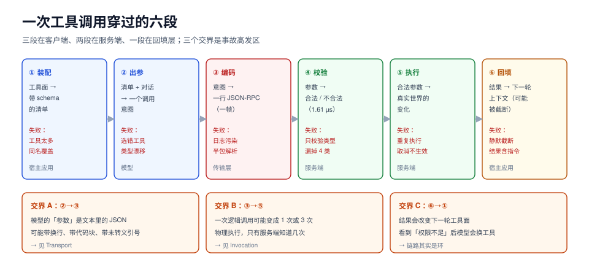

# 总览：一次工具调用穿过的六段

「工具调用」在教程里是三次消息传递，在线上是一条带边界的流水线。这条流水线有六段，每段都有自己的失败方式，而且**大多数段的失败看起来都像模型的问题**。

这一页把六段拆开，给出每段的输入、输出、必失点和一条可测的读数，后面八页按这个骨架展开。



本页判据族 `ATO-A` ~ `ATO-H`，共 8 条。定义表见文末「本页判据」一节。

## 一、六段链路

| 段 | 输入 → 输出 | 谁负责 | 典型失败 | 下一页 |
| --- | --- | --- | --- | --- |
| ① 工具面装配 | 可用工具集 → 一份带名字与 schema 的清单 | 宿主应用 | 工具太多挤占上下文；同名工具互相覆盖 | [工具面](../Surface/index.md) |
| ② 模型出参 | 清单 + 对话 → 一个 `tools/call` 意图 | 模型 | 选错工具；参数类型漂移（`100` 写成 `"100"`） | [工具面](../Surface/index.md) |
| ③ 帧编码 | 意图 → 一行 JSON-RPC | 传输层 | 日志污染流；半包解析；多字节字符被切在中间 | [帧与传输](../Transport/index.md) |
| ④ 契约校验 | 参数 → 合法 / 不合法 | 服务端 | 缺必填、多字段、枚举越界全靠下游兜 | [工具面](../Surface/index.md) |
| ⑤ 副作用执行 | 合法参数 → 真实世界的变化 | 服务端 | 超时重试导致重复执行；取消不生效 | [调用生命周期](../Invocation/index.md) |
| ⑥ 回填与再决策 | 结果 → 下一轮上下文 | 宿主应用 | 结果太大被截断；把结果里的指令当命令 | [结果回填](../Result/index.md) |

三段之间有三个**交界**，事故几乎都发生在这里：

1. **②→③**：模型输出的参数是「文本里的 JSON」，不是「JSON 值」。它可能带 `\n`、可能带未转义的引号、可能就是一段 markdown 代码块。
2. **③→⑤**：一次逻辑调用在传输层可能变成 1 次或 3 次物理执行，而**只有服务端知道到底执行了几次**。
3. **⑥→①**：回填的结果会改变下一轮的工具面（模型看到「权限不足」后会换工具），所以第 ⑥ 段的输出是第 ① 段的输入之一——链路其实是环。

::: tip 一句话理解
把这条链路当流水线看，就能回答一个很实际的问题：**这个 bug 该谁修**。选错工具是 ②，参数差一点是 ④，扣了两次款是 ⑤，答非所问是 ⑥。
:::

## 二、每段一条可测读数

下面六个数字来自本专题的同一个本地实测台（Python 3.13 标准库，种子 20261024，脚本不入库），后面各页会分别展开：

| 段 | 读数 | 说明 |
| --- | --- | --- |
| ① 装配 | 60 个工具 = **12.4 KB**（212 B/工具） | 工具定义本身占上下文，且随工具数线性增长 |
| ② 出参 | 6 类缺陷里，只校验类型会漏掉 **4 类** | 缺必填、多字段、枚举越界、范围越界 |
| ③ 编码 | 任意字节切分下，按行解析在 **98.3%** 的切点失败 | 173 个切点里失败 170 个 |
| ④ 校验 | 全量校验 **1.61 µs/次** | 相对一次 800 ms 的模型调用是 0.0002% |
| ⑤ 执行 | 超时 800 ms / 重试 2 次 → 执行放大 **3.00×** | 副作用次数取决于幂等键，不取决于重试 |
| ⑥ 回填 | 193 KB 结果、8 KB 预算、目标在 62.2% 处 | 只留头部与头尾各半**都会丢目标** |

这六个数字合起来说一件事：**协议层的每一个「小决定」都有一个可测量的代价，而且代价通常不在你以为的那一段**。

## 三、为什么不能「先跑通再优化」

因为这条链路的四类缺陷是**静默**的：

1. **静默重复**：超时重试导致的重复执行，在日志里表现为「一次调用成功、一次调用超时」，只有对账能发现。
2. **静默截断**：结果超限被截断，模型看到的是「数据里没有这条」，它会自信地回答「查无此单」。
3. **静默越权**：服务身份调用一切正常，只有安全评审能发现「这个工具拿的是网关的权限」。
4. **静默漂移**：工具描述改了一个词，选择准确率下降 3 个百分点，没有任何报警。

这四条都不会让构建失败、不会让测试变红，只会让线上慢慢变差。所以它们必须写成**判据**，而不是写成「注意事项」。

## 四、一段最小可跑的链路

不接任何模型，先把 ③④⑤⑥ 四段跑起来——这是最省时间的排错方式：**排除模型，剩下的都是工程问题**。

```python [pipeline.py]
"""六段链路里 ③~⑥ 的最小可跑版本（纯标准库）。"""
import json

SCHEMA = {"type": "object", "additionalProperties": False, "required": ["order_no"],
          "properties": {"order_no": {"type": "string", "minLength": 8}}}


def validate(args):
    """④ 契约校验：返回 (ok, reason)。"""
    if not isinstance(args, dict):
        return False, "INVALID_PARAMS"
    props = SCHEMA["properties"]
    if SCHEMA["additionalProperties"] is False and set(args) - set(props):
        return False, "EXTRA_ARG"
    for k in SCHEMA["required"]:
        if k not in args:
            return False, "MISSING_ARG"
    for k, v in args.items():
        if not isinstance(v, props[k]["type"]):
            return False, "ARG_TYPE"
    return True, ""


def handle(request, seen: set):
    """③ 解帧 → ④ 校验 → ⑤ 执行（幂等）→ ⑥ 回填。"""
    call_id = request.get("id")
    args = request.get("params", {}).get("arguments", {})
    ok, reason = validate(args)
    if not ok:
        # 参数错属于 JSON-RPC 的 -32602，不是业务错误
        return {"jsonrpc": "2.0", "id": call_id,
                "error": {"code": -32602, "message": reason, "data": {"schema": SCHEMA}}}
    key = f'{request["params"]["name"]}:{args.get("order_no")}'
    if key in seen:                       # 同一逻辑调用的第二次到达：不重复执行
        return {"jsonrpc": "2.0", "id": call_id,
                "result": {"content": [{"type": "text", "text": "duplicate"}],
                           "structuredContent": {"deduped": True}}}
    seen.add(key)
    return {"jsonrpc": "2.0", "id": call_id,
            "result": {"content": [{"type": "text", "text": "shipped"}],
                       "structuredContent": {"order_no": args["order_no"], "status": "SHIPPED"}}}


seen = set()
req = {"jsonrpc": "2.0", "id": 7, "method": "tools/call",
       "params": {"name": "ship_order", "arguments": {"order_no": "E20261024"}}}
for i in range(2):                        # 同一个逻辑调用到达两次
    print(json.dumps(handle(req, seen), ensure_ascii=False))
print(json.dumps(handle({**req, "id": 8, "params": {"name": "ship_order",
                                                    "arguments": {"order_no": 20261024}}},
                        seen), ensure_ascii=False))
```

预期输出（三行，第二行必须是 `duplicate`，第三行必须是 `-32602`）：

```text
{"jsonrpc": "2.0", "id": 7, "result": {"content": [{"type": "text", "text": "shipped"}], "structuredContent": {"order_no": "E20261024", "status": "SHIPPED"}}}
{"jsonrpc": "2.0", "id": 7, "result": {"content": [{"type": "text", "text": "duplicate"}], "structuredContent": {"deduped": true}}}
{"jsonrpc": "2.0", "id": 8, "error": {"code": -32602, "message": "ARG_TYPE", "data": {"schema": {"type": "object", "additionalProperties": false, "required": ["order_no"], "properties": {"order_no": {"type": "string", "minLength": 8}}}}}}
```

这段代码刻意做了三个「反教程」的选择，每一个都对应一条判据：

1. **参数错走 `-32602`，不走业务错误**。业务错误（余额不足、库存为零）是「工具正常工作了，结果是失败」；参数错是「协议层面的输入非法」。两者混在一起，客户端就没法决定「该修 prompt 还是该重试」。
2. **幂等键用业务键（`order_no`），不用请求 id**。请求 id 每次重试都会变，服务端拿它去重等于没去重。
3. **回填同时给 `content` 与 `structuredContent`**。前者给人/模型看，后者给程序用；只给文本，下游只能再解析一次自然语言。

## 五、四类静默缺陷与它们的观测点

| 缺陷 | 现象 | 能观测到它的位置 | 观测不到的后果 |
| --- | --- | --- | --- |
| 静默重复 | 同一业务键被执行 2 次以上 | 服务端按业务键计数（不是按请求 id） | 重复扣款、重复发货 |
| 静默截断 | 结果被切到 N KB | 回填层的 `original_bytes` 与 `injected_bytes` 两个指标 | 「查无此单」的幻觉 |
| 静默越权 | 工具成功且结果正确 | 授权决策日志里的 `subject` 与 `audience` | 安全评审不通过，或真实数据泄露 |
| 静默漂移 | 选择准确率缓慢下降 | 每次工具面变更后的回归集 | 用户投诉「它越来越笨」 |

四个观测点都不在「模型调用」这一层，这就是为什么只用 LLM 的 trace 不能定位工具调用的故障。

## 本页判据

| 编号 | 判据 | 看什么现象 | 不满足时改哪里 |
| --- | --- | --- | --- |
| `ATO-A` | 六段各有明确归属 | 画得出「哪段代码/哪个服务」负责每一段 | 把没有主人的段补上归属，否则它会落到「模型出问题」这个垃圾桶里 |
| `ATO-B` | 协议错误与业务错误分开表达 | 参数非法走 JSON-RPC `-32602`，业务失败走结果里的 `isError` 或状态字段 | 统一错误出口，见[结果回填](../Result/index.md) |
| `ATO-C` | 一次逻辑调用有稳定业务键 | 重试前后业务键相同、请求 id 不同 | 引入业务幂等键，见[调用生命周期](../Invocation/index.md) |
| `ATO-D` | 回填同时有机器可读与人类可读两份 | 响应里既有 `content` 又有 `structuredContent` | 补结构化字段，避免下游二次解析自然语言 |
| `ATO-E` | 四类静默缺陷都有指标 | 重复数、截断字节、授权主体、选择准确率各有读数 | 每类至少一个计数器，dashboard 上能看见 |
| `ATO-F` | 链路可脱离模型单独验证 | 有一条命令能不调用模型就跑通 ③~⑥ | 补一个 `--dry-run` 的假模型，把工程问题与语义问题隔离 |
| `ATO-G` | 工具面变更走回归 | 加/改工具后有固定的回归集与读数 | 把工具清单纳入版本控制，变更即触发回归 |
| `ATO-H` | 链路有明确的「不可回退点」 | 说得出「从哪一步之后就不能当没发生过」 | 把不可回退点后的操作设计成幂等或可补偿，见[Invocation](../Invocation/index.md) |

## 参考资料

- MCP 规范概览（Hosts / Clients / Servers 三个角色）：<https://modelcontextprotocol.io/specification/2026-07-28>
- OpenAI 结构化输出与工具调用：<https://developers.openai.com/api/docs/guides/function-calling>
- Anthropic 工具使用（`tool_use` / `tool_result` 块）：<https://docs.anthropic.com/en/docs/build-with-claude/tool-use/overview>
- JSON-RPC 2.0 错误对象与错误码：<https://www.jsonrpc.org/specification#error_object>
