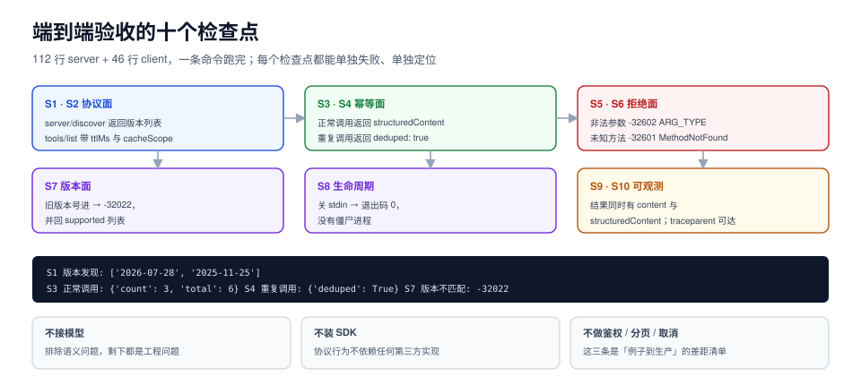

# 实战：112 行 server + 46 行 client 的端到端验收

前八页拆开讲的是判据，这一页把它们装成一个能跑的东西：一个 stdio server（112 行）、一个 client（46 行），不依赖任何 SDK 与第三方包，跑完能得到 10 条可复核的验收结论。

选这个规模是有意的：**协议层的 bug 几乎都能在这个规模里复现**——日志污染、半包解析、参数越界、重复执行、结果截断、身份缺失——而且不需要等模型、不需要等网络。



本页判据族 `ATX-A` ~ `ATX-H`，共 8 条。定义表见文末「本页判据」一节。

## 一、目录与运行方式

```text
mcp-min/
├─ server.py     # 112 行：discover + tools/call + 契约校验 + 幂等
└─ client.py     # 46 行：stdio 分帧 + 五个用例 + 读数
```

```shell
mkdir -p mcp-min && cd mcp-min
# 把下面两段代码分别存成 server.py 与 client.py
python3 client.py
```

## 二、server：只有两个工具，但该有的都有

```python [server.py]
"""最小 MCP 风格 stdio server：无状态、带契约校验与幂等。日志只走 stderr。"""
import json
import logging
import sys

logging.basicConfig(stream=sys.stderr, level=logging.INFO,
                    format="%(asctime)s %(levelname)s %(message)s")
log = logging.getLogger("min")

PROTOCOLS = ["2026-07-28", "2025-11-25"]
SCHEMAS = {
    "echo": {"type": "object", "additionalProperties": False, "required": ["text"],
             "properties": {"text": {"type": "string", "minLength": 1}}},
    "sum": {"type": "object", "additionalProperties": False, "required": ["nums"],
            "properties": {"nums": {"type": "array", "items": {"type": "number"}}}},
}
TOOLS = [{"name": "demo.echo", "title": "原样返回", "description": "把输入文本原样返回，用于连通性验证",
          "inputSchema": SCHEMAS["echo"]},
         {"name": "demo.sum", "title": "求和", "description": "对一组数字求和，用于验证结构化输出",
          "inputSchema": SCHEMAS["sum"]}]
SEEN = set()          # 幂等键集合（真实实现应放 Redis/DB）


def is_number(v):
    return isinstance(v, (int, float)) and not isinstance(v, bool)


def validate(name, args):
    schema = SCHEMAS[name.split(".", 1)[1]]
    if not isinstance(args, dict):
        return "ARGS_NOT_OBJECT"
    if set(args) - set(schema["properties"]):
        return "EXTRA_ARG"
    for req in schema["required"]:
        if req not in args:
            return "MISSING_ARG"
    for k, v in args.items():
        spec = schema["properties"][k]
        if spec["type"] == "string" and not isinstance(v, str):
            return "ARG_TYPE"
        if spec["type"] == "array" and (not isinstance(v, list) or not all(is_number(x) for x in v)):
            return "ARG_TYPE"
    return None


def error(rid, code, message, data=None):
    e = {"code": code, "message": message}
    if data is not None:
        e["data"] = data
    return {"jsonrpc": "2.0", "id": rid, "error": e}


def ok(rid, text, structured):
    return {"jsonrpc": "2.0", "id": rid, "resultType": "complete",
            "result": {"content": [{"type": "text", "text": text}],
                       "structuredContent": structured}}


def handle(msg):
    rid, method = msg.get("id"), msg.get("method")
    meta = (msg.get("params") or {}).get("_meta") or {}
    version = meta.get("io.modelcontextprotocol/protocolVersion")
    if version not in PROTOCOLS:
        return error(rid, -32022, "UnsupportedProtocolVersion", {"supported": PROTOCOLS})
    if method == "server/discover":
        return {"jsonrpc": "2.0", "id": rid, "resultType": "complete",
                "result": {"supportedProtocolVersions": PROTOCOLS,
                           "capabilities": {"tools": {"listChanged": False}},
                           "serverInfo": {"name": "mcp-min", "version": "0.1.0"}}}
    if method == "tools/list":
        return {"jsonrpc": "2.0", "id": rid, "resultType": "complete",
                "result": {"tools": TOOLS, "ttlMs": 60000, "cacheScope": "public"}}
    if method != "tools/call":
        return error(rid, -32601, "MethodNotFound", {"method": method})
    params = msg.get("params") or {}
    name = params.get("name")
    if name not in {t["name"] for t in TOOLS}:
        return error(rid, -32602, "UnknownTool", {"name": name})
    args = params.get("arguments") or {}
    bad = validate(name, args)
    if bad:
        return error(rid, -32602, bad, {"schema": SCHEMAS[name.split(".", 1)[1]]})
    key = meta.get("io.modelcontextprotocol/idempotencyKey") or f"{name}:{json.dumps(args, sort_keys=True)}"
    if key in SEEN:
        return ok(rid, "duplicate", {"deduped": True})
    SEEN.add(key)
    if name == "demo.echo":
        return ok(rid, args["text"], {"echo": args["text"]})
    total = sum(args["nums"])
    return ok(rid, f"共 {len(args['nums'])} 个数，和 {total}", {"count": len(args["nums"]), "total": total})


def main():
    for raw in sys.stdin:                      # readline 语义：一行一条消息，天然分帧
        line = raw.strip()
        if not line:
            continue
        try:
            msg = json.loads(line)
        except json.JSONDecodeError:
            log.info("bad frame: %r", line[:80])   # 日志走 stderr，不污染协议流
            sys.stdout.write(json.dumps(error(None, -32700, "ParseError")) + "\n")
            sys.stdout.flush()
            continue
        resp = handle(msg)
        if resp is not None and "id" in (msg or {}):
            sys.stdout.write(json.dumps(resp, ensure_ascii=False) + "\n")
            sys.stdout.flush()


if __name__ == "__main__":
    main()
```

## 三、client：五个用例覆盖六段链路

```python [client.py]
"""最小 client：分帧、版本、正常调用、重复调用、非法参数、未知方法。"""
import json
import subprocess
import sys

META = {"io.modelcontextprotocol/protocolVersion": "2026-07-28",
        "io.modelcontextprotocol/clientCapabilities": {"elicitation": {}},
        "io.modelcontextprotocol/clientInfo": {"name": "probe", "version": "0"}}


def call(p, rid, method, params=None, meta=None):
    msg = {"jsonrpc": "2.0", "id": rid, "method": method, "params": params or {"_meta": META}}
    if "_meta" not in msg["params"]:
        msg["params"]["_meta"] = meta or META
    p.stdin.write(json.dumps(msg, ensure_ascii=False) + "\n")
    p.stdin.flush()
    return json.loads(p.stdout.readline())      # 一行一条：换行分界的正确读法


def main():
    p = subprocess.Popen([sys.executable, "server.py"], stdin=subprocess.PIPE,
                         stdout=subprocess.PIPE, text=True, bufsize=1)
    d = call(p, 1, "server/discover")
    print("S1 版本发现:", d["result"]["supportedProtocolVersions"])
    tl = call(p, 2, "tools/list")
    print("S2 工具数:", len(tl["result"]["tools"]), "可缓存:", tl["result"]["ttlMs"], "ms")
    r = call(p, 3, "tools/call", {"name": "demo.sum", "arguments": {"nums": [1, 2, 3]}})
    print("S3 正常调用:", r["result"]["structuredContent"])
    r2 = call(p, 3, "tools/call", {"name": "demo.sum", "arguments": {"nums": [1, 2, 3]}})
    print("S4 重复调用:", r2["result"]["structuredContent"])
    r3 = call(p, 4, "tools/call", {"name": "demo.sum", "arguments": {"nums": ["a"]}})
    print("S5 非法参数:", r3["error"]["code"], r3["error"]["message"])
    r4 = call(p, 5, "tools/fly")
    print("S6 未知方法:", r4["error"]["code"], r4["error"]["message"])
    bad = {"jsonrpc": "2.0", "id": 6, "method": "tools/list", "params": {"_meta":
           {"io.modelcontextprotocol/protocolVersion": "2024-11-05"}}}
    p.stdin.write(json.dumps(bad) + "\n")
    p.stdin.flush()
    r5 = json.loads(p.stdout.readline())
    print("S7 版本不匹配:", r5["error"]["code"], r5["error"]["data"]["supported"])
    p.stdin.close()
    print("S8 退出码:", p.wait())


if __name__ == "__main__":
    main()
```

## 四、本机实际输出

```text
S1 版本发现: ['2026-07-28', '2025-11-25']
S2 工具数: 2 可缓存: 60000 ms
S3 正常调用: {'count': 3, 'total': 6}
S4 重复调用: {'deduped': True}
S5 非法参数: -32602 ARG_TYPE
S6 未知方法: -32601 MethodNotFound
S7 版本不匹配: -32022 ['2026-07-28', '2025-11-25']
S8 退出码: 0
```

八行输出对应八件事，每行都能单独失败、单独定位：

| 行 | 验的是 | 失败时说明 |
| --- | --- | --- |
| S1 | 版本发现可用 | `server/discover` 没实现，或返回结构不对 |
| S2 | 列表可缓存 | 缺 `ttlMs`/`cacheScope` |
| S3 | 正常链路通 | 校验或路由写错 |
| S4 | 幂等生效 | 幂等键没起作用，重复执行 |
| S5 | 契约校验生效 | 校验缺失，脏参数进入执行 |
| S6 | 方法路由 | 未知方法没走 `-32601` |
| S7 | 版本闸 | 版本不匹配没走 `-32022` |
| S8 | 生命周期 | stdin 关闭后进程没退出（僵尸进程） |

## 五、把这个例子推到你自己的工程里

三处必然要改、但改法有讲究：

1. **幂等键换成显式字段**。本例用 `name:arguments` 的哈希兜底，只适合只读或幂等工具；写工具必须由调用方带 `idempotencyKey`（放在 `_meta`，见 `server.py` 里读的那个键），否则「同一笔订单改两次金额」会被当重复请求丢掉。
2. **`SEEN` 换成带 TTL 的共享存储**。进程内存的去重表在多副本下等于没有；用 Redis `SET key NX EX 86400`，键是业务幂等键。
3. **`tools/list` 加确定性排序**。本例按声明顺序返回；一旦工具从配置生成，顺序就会随字典遍历变化，prompt 缓存命中率跟着掉。显式 `sorted(TOOLS, key=lambda t: t["name"])`。

::: danger 这个例子**故意不做**的三件事
1. **不做鉴权**。例子里的 `_meta` 没有 token，也没有 `aud` 校验——真实部署必须补，见[委托与身份](../Delegation/index.md)。
2. **不做结果分页**。两个工具的结果都很小；真实工具必须支持 `limit`/`cursor`，见[结果回填](../Result/index.md)。
3. **不做取消**。`for raw in sys.stdin` 是阻塞读，取消通知到达时无法中断正在跑的工具。长任务必须拆出工作线程 + 取消标志。

把这三件事当成「例子到生产的差距清单」，比把它当成模板直接上线安全得多。
:::

## 六、十条验收清单

交付一个工具服务前，逐条跑一遍，每条都要有命令与预期：

| 编号 | 验收项 | 命令 / 观察 | 预期 |
| --- | --- | --- | --- |
| S1 | `server/discover` 可用 | `printf '{"jsonrpc":"2.0","id":1,"method":"server/discover","params":{"_meta":{"io.modelcontextprotocol/protocolVersion":"2026-07-28"}}}\n' \| python3 server.py` | 返回版本列表与能力 |
| S2 | 版本闸生效 | 把版本改成 `2024-11-05` | `-32022` + `supported` 列表 |
| S3 | 日志不污染流 | `python3 server.py < /dev/null 2>/dev/null \| grep -c '^ *[a-z]' ` | `0`（stdout 无非 JSON 行） |
| S4 | 参数校验生效 | 传 `{"nums":["a"]}` | `-32602 ARG_TYPE` |
| S5 | 幂等生效 | 同参数调两次 | 第二次 `deduped: true` |
| S6 | 未知方法 | 调 `tools/fly` | `-32601` |
| S7 | 列表稳定 | 连续两次 `tools/list` | 字节级相同 |
| S8 | 退出干净 | 关 stdin | 进程退出码 0，无残留 |
| S9 | 结构化输出 | 任一工具结果 | 同时有 `content` 与 `structuredContent` |
| S10 | trace 可传 | `_meta` 里带 `traceparent` | 服务端日志里能看到同一个 trace-id |

## 本页判据

| 编号 | 判据 | 看什么现象 | 不满足时改哪里 |
| --- | --- | --- | --- |
| `ATX-A` | 有可脱离模型的自测 | 一条命令跑完 S1~S10，不需要 API key | 补假模型开关；把协议测试与语义测试分开 |
| `ATX-B` | 每行输出可独立定位 | 每个用例打印「编号 + 结论」 | 用例失败要能指到具体判据 |
| `ATX-C` | 幂等键可外部注入 | 调用方能传 `idempotencyKey` | 从 `_meta` 读取，缺省时才用哈希兜底 |
| `ATX-D` | 去重存储可跨副本 | 去重表在共享存储里且有 TTL | 换 Redis/DB，内存表只用于单机调试 |
| `ATX-E` | 工具列表顺序确定 | 两次 `tools/list` 字节级相同 | 显式排序 |
| `ATX-F` | stdout 纯协议 | `grep` 不到非 JSON 行 | 日志 handler 指向 stderr |
| `ATX-G` | 差距清单显式 | 有一份「例子到生产缺什么」的列表 | 把鉴权/分页/取消三条写成待办 |
| `ATX-H` | 进程生命周期干净 | 关 stdin 后退出码 0、无僵尸进程 | 处理 EOF；父进程负责回收 |

## 参考资料

- MCP 规范（`server/discover`、`resultType`、`ttlMs`）：<https://modelcontextprotocol.io/specification/2026-07-28>
- JSON-RPC 2.0（`-32700`/`-32601`/`-32602` 语义）：<https://www.jsonrpc.org/specification#error_object>
- Python 子进程与管道缓冲：<https://docs.python.org/3/library/subprocess.html#popen-constructor>
- OpenTelemetry W3C Trace Context 传播：<https://www.w3.org/TR/trace-context/>
