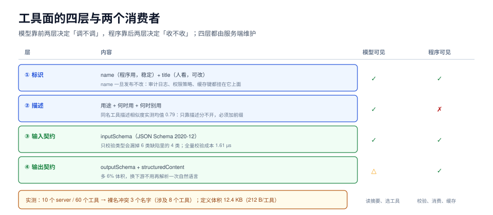

# 工具面：命名、契约与装配

「工具面」（tool surface）是一次调用里唯一同时给**模型**和**程序**看的东西：模型看名字和描述决定调不调，程序看 schema 决定收不收。它写得好不好，直接决定两件事——模型选得对不对、脏参数进不进得来。

这一页讲四件事：名字怎么起（含命名空间与冲突）、schema 该多严（含一个必踩的类型坑）、工具多了怎么办（体积与按需加载）、以及为什么排序也算契约。



本页判据族 `ATS-A` ~ `ATS-H`，共 8 条。定义表见文末「本页判据」一节。

## 一、工具面有四层，只有两层给模型看

| 层 | 内容 | 模型可见 | 程序可见 | 谁维护 |
| --- | --- | --- | --- | --- |
| 标识 | `name`（程序用）、`title`（人看） | `name` + `title` | 只用 `name` | 服务端 |
| 描述 | 一句话用途 + 何时用 + 何时别用 | 是 | 否 | 服务端 |
| 输入契约 | `inputSchema`（JSON Schema 2020-12） | 是 | 是 | 服务端 |
| 输出契约 | `outputSchema` + `structuredContent` | 部分 | 是 | 服务端 |

`title` 是 `2025-06-18` 才加的字段，目的很明确：让 `name` 可以纯粹当**程序标识**（稳定、可被引用、可被审计），人看的名字另放。把中文标题塞进 `name` 会让名字随文案变化而变，审计日志和历史数据就对不上了。

## 二、命名：先解决冲突，再谈可读性

工具名在客户端往往被摊平成一张**全局表**，而每个 server 只看得见自己的命名空间。于是冲突不是理论问题：

本机实测（10 个 server、共 60 个工具，按真实业务命名）：

| 现象 | 读数 |
| --- | --- |
| 裸名冲突 | **3 个名字 / 涉及 8 个工具**：`search`×4、`send`×2、`status`×2 |
| 加 `<server>.<tool>` 前缀后 | 唯一名 **60/60**，冲突 **0** |
| 同名工具的描述相似度（字符二元组 Jaccard） | 8 对，均值 **0.79**，全部 **≥0.6** |

第三行是关键：`crm.search` 与 `kb.search` 的描述有 79% 的重合度——因为它们的描述本来就该一样（都是「按关键词检索」）。**模型没有任何依据区分它们，除了前缀**。

::: danger 命名冲突的三种「解决方案」，只有一种对
1. **后加载覆盖先加载**。表现是「明明装了文件工具，调用的却是数据库工具」。这类 bug 在工具数少时完全不出现，装到第十个 server 时爆炸。
2. **加序号 `search_2`**。序号会随加载顺序变化，等于名字不稳定；prompt 缓存与审计日志都跟着抖。
3. **加命名空间 `files.search` / `db.search`**（推荐）。稳定、可读、可路由，还能让网关按前缀做策略。
:::

命名还有三条硬约束，写的时候顺手检查：

1. **字符集与长度**：主流实现要求 `[A-Za-z0-9_-]`、长度 ≤64。带空格、中文、点的名字在部分客户端直接被拒。
2. **动词 + 对象**：`read_file` 好过 `file`，`ship_order` 好过 `shipping`。模型对动词的敏感度高于名词。
3. **`name` 一旦发布就不要改**。它是审计日志、权限策略、缓存键的公共键；改名的代价是重写这三处。

## 三、schema 该多严：三个档位的实测差别

同一个工具，三种校验强度，六类输入缺陷的拦截情况（本机实测，`validate()` 见第六节）：

| 缺陷类 | 不校验 | 只校验类型 | 全量校验 |
| --- | --- | --- | --- |
| 类型漂移 `limit="100"` | 放行 | 拦截 | 拦截 |
| 缺失必填 `path` | 放行 | **放行** | 拦截 |
| 多余字段 `extra` | 放行 | **放行** | 拦截 |
| 枚举越界 `mode="all"` | 放行 | **放行** | 拦截 |
| 范围越界 `limit=0` | 放行 | **放行** | 拦截 |
| 边界表达 `limit=100.0`（朴素判据 `type(v) is int`） | 放行 | **误拒** | **误拒** |

两个读数值得盯：

1. **只校验类型会漏掉 6 类里的 4 类**（缺必填、多字段、枚举、范围）。而「只校验类型」恰恰是最常见的实现——因为大多数 Web 框架的「参数绑定」只做类型转换。
2. **`limit=100.0` 被误拒**：JSON 里 `100.0` 是**数字**，语义上完全满足 `integer`（JSON Schema 明确允许整数值的浮点表示）。判据写成 `type(v) is int` 就会把它判成非法。正确判据是「值等于自身取整」：

```python
def is_integer(v):
    # JSON Schema 的 integer 语义：整数值的 number，不要求 Python 类型是 int
    return isinstance(v, int) and not isinstance(v, bool) or (isinstance(v, float) and v.is_integer())
```

第三个数是成本：全量校验 **1.61 µs/次**，只校验类型 **0.71 µs/次**。相对一次 800 ms 的模型调用，全量校验占 **0.0002%**——**没有任何理由为了性能省掉它**。

## 四、输出契约：`structuredContent` 值那 6%

`2025-06-18` 新增结构化工具输出：工具可以声明 `outputSchema`，并在结果里同时返回给人/模型看的 `content` 和给程序用的 `structuredContent`。

单条记录的两种回填形状实测：

| 形状 | 体积 | 谁受益 |
| --- | --- | --- |
| 只有 `content: [{type:"text", text:"<json 字符串>"}]` | 276 B | 只有模型；程序要二次解析 |
| `content` + `structuredContent` | 293 B（**+6%**） | 模型与程序各取所需 |

6% 换的是「下游不用再解析一次自然语言」。这笔交易在**有下游**时永远值得做；只有当结果是纯给人看的文本（比如一段总结）时，只给 `content` 才是对的。

::: warning `structuredContent` 不是万能的
规范允许服务端在 `structuredContent` 里放任意 JSON，客户端**不应**假设它与 `content` 里的文本一致。两者不一致时以哪个为准是**你的契约问题**，不是规范问题。实践做法：`structuredContent` 是权威数据，`content` 是它的自然语言投影，且由同一份数据生成（不要手写两遍）。
:::

## 五、工具多了怎么办

工具定义本身占上下文，且近似线性增长：

| 装载工具数 | 定义体积 | 平均 |
| --- | --- | --- |
| 10 | 2.1 KB | 218 B/工具 |
| 30 | 6.3 KB | 214 B/工具 |
| 60 | 12.4 KB | 212 B/工具 |

60 个工具 12.4 KB 看着不多，但它是**每一轮**都要重发的固定成本，还要与对话历史、检索结果争预算；更麻烦的是**选择准确率随候选数下降**——候选越多，描述之间的差异越重要。

三档策略，按工具数选：

| 工具数 | 策略 | 做法 | 代价 |
| --- | --- | --- | --- |
| ≤ 20 | 全量装载 | 一次全给，最省事 | 无 |
| 20~100 | **分组装载** | 按场景分 3~6 组，先让模型「选组」再给该组工具 | 多一轮决策 |
| > 100 | **检索式装载** | 用工具描述做向量检索，每次只给 top-k（k≈8~15） | 需要索引与召回质量，且要处理「没检索到」的兜底 |

检索式装载有一个容易忽略的失效：**模型不知道自己不知道**。它只看到 8 个工具，就会在这 8 个里挑一个最像的，而不是说「没有合适的工具」。所以必须配一个 `no_tool_matches` 的显式出口，并在系统提示里写清「当前只装载了部分工具，若都不匹配请说明」。

## 六、可运行验证

把「六类缺陷 × 三档校验」跑成一张表，顺便验证 `integer` 的边界语义：

```python [schema_probe.py]
"""六类输入缺陷在三档校验下的拦截情况（纯标准库）。"""
SCHEMA = {"type": "object", "additionalProperties": False, "required": ["path"],
          "properties": {"path": {"type": "string", "minLength": 1},
                         "limit": {"type": "integer", "minimum": 1, "maximum": 1000},
                         "mode": {"type": "string", "enum": ["head", "tail"]}}}


def is_int(v):
    if isinstance(v, bool):
        return False
    return isinstance(v, int) or (isinstance(v, float) and v.is_integer())


def check(obj, mode):
    props = SCHEMA["properties"]
    if mode == "none":
        return True
    if not isinstance(obj, dict):
        return False
    if mode == "full" and set(obj) - set(props):
        return False
    for k, v in obj.items():
        sp = props.get(k)
        if sp is None:
            continue
        if sp["type"] == "string" and not isinstance(v, str):
            return False
        if sp["type"] == "integer" and not is_int(v):
            return False
        if mode == "full":
            if "enum" in sp and v not in sp["enum"]:
                return False
            if sp["type"] == "integer" and not (sp["minimum"] <= v <= sp["maximum"]):
                return False
    return all(r in obj for r in SCHEMA["required"]) if mode == "full" else True


CASES = {
    "type": {"path": "/a.csv", "limit": "100"},
    "missing": {"limit": 100},
    "extra": {"path": "/a.csv", "extra": 1},
    "enum": {"path": "/a.csv", "mode": "all"},
    "range": {"path": "/a.csv", "limit": 0},
    "float_int": {"path": "/a.csv", "limit": 100.0},
}
for name, obj in CASES.items():
    row = [name] + ["放行" if check(obj, m) else "拦截" for m in ("none", "type", "full")]
    print(" | ".join(row))
```

本机实际输出（前五行与第三节表格一致；**最后一行是差异**：这里换成了修正后的 `is_int`，所以 `100.0` 被正确放行）：

```text
type | 放行 | 拦截 | 拦截
missing | 放行 | 放行 | 拦截
extra | 放行 | 放行 | 拦截
enum | 放行 | 放行 | 拦截
range | 放行 | 放行 | 拦截
float_int | 放行 | 放行 | 放行
```

最后一行是本页最值钱的一格：**把 `integer` 判成 `type(v) is int`，会让 `100.0` 这类合法输入被误拒，而误拒在线上表现为「模型偶尔发疯，同样的参数重试一次就好了」**。

## 本页判据

| 编号 | 判据 | 看什么现象 | 不满足时改哪里 |
| --- | --- | --- | --- |
| `ATS-A` | 工具名全局唯一且稳定 | 装载后名字无重复；名字不含中文/空格/点 | 加 `<server>.` 前缀；`title` 放人读文案 |
| `ATS-B` | 名字与描述可由回归集区分 | 同名工具的描述两两相似度 < 0.6，或有前缀 | 描述里写清「读什么、不读什么」，别只写「检索」 |
| `ATS-C` | schema 全量校验 | `additionalProperties: false`、必填、枚举、范围都生效 | 补校验层；不要依赖框架的参数绑定 |
| `ATS-D` | `integer` 按数值判而非按类型判 | `100.0` 被判为合法整数 | 用「值等于自身取整」的判据 |
| `ATS-E` | 输出契约完整 | 有 `outputSchema` 时结果必带 `structuredContent`，且由同一份数据生成 | 统一结果构造函数，禁止手写两份 |
| `ATS-F` | 工具面体积有预算 | 有「本次装载 N 个工具 / X KB」的读数与上限 | 超限即分组或改检索式装载 |
| `ATS-G` | 装载策略有兜底出口 | 检索式装载时有 `no_tool_matches` 与提示语 | 补出口，并写清「只装载了部分工具」 |
| `ATS-H` | 列表顺序确定 | 连续两次 `tools/list` 字节级相同 | 按名字排序；不要在遍历字典时输出 |

## 参考资料

- MCP 工具定义（`name` / `title` / `inputSchema` / `outputSchema`）：<https://modelcontextprotocol.io/specification/2026-07-28/server/tools>
- 结构化工具输出（`2025-06-18` 引入）：<https://modelcontextprotocol.io/specification/2025-06-18/server/tools#structured-content>
- JSON Schema 2020-12 `integer` 语义：<https://json-schema.org/draft/2020-12/json-schema-validation#rfc.section.6.1.1>
- OpenAI 工具定义与 `strict` 模式：<https://developers.openai.com/api/docs/guides/function-calling>
- Anthropic 工具定义最佳实践：<https://docs.anthropic.com/en/docs/build-with-claude/tool-use/implement-tool-use>
