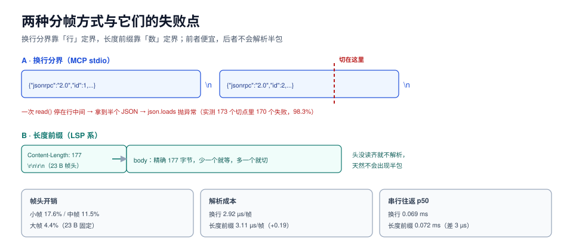

# 帧与传输：JSON-RPC 在线上到底是什么形状

协议文档写的是「消息」，线上跑的是**字节流**。中间那一层叫帧（framing）：怎么知道一条消息在哪结束、下一条从哪开始。这一层没有抽象，只有两种做法——**换行分界**和**长度前缀**——以及它们各自的失败方式。

这一页讲四件事：JSON-RPC 的四种消息形状、stdio 上的换行分界、LSP 系长度前缀的取舍、以及把这两条流搞脏的三种常见写法。



本页判据族 `ATF-A` ~ `ATF-H`，共 8 条。定义表见文末「本页判据」一节。

## 一、四种消息形状

JSON-RPC 2.0 只有四种消息，认错形状的后果比认错内容严重得多：

| 消息 | 有 `id` | 有 `method` | 有 `result`/`error` | 对方该怎么处理 |
| --- | --- | --- | --- | --- |
| 请求 Request | 是 | 是 | 否 | 执行并回一条响应 |
| 响应 Response | 是（与请求同一个） | 否 | 是（二选一） | 按 `id` 找到等待者并唤醒 |
| 通知 Notification | **否** | 是 | 否 | 执行，**不回任何东西** |
| 错误响应 | 是 | 否 | `error` | 把 `code` 映射成本地异常 |

三条容易踩的规则：

1. `id` 只能是字符串、数字或 `null`。**`null` 是合法 id**，不能拿它当「没有 id」的判据——判断通知要看**字段是否存在**，不是看值。
2. 通知**不能有响应**。给通知回一条 `{"id": null, "result": {}}`，严格客户端会把它当成「一个不认识的响应的响应」而报错。
3. `result` 与 `error` **互斥且必居其一**。两个都给，客户端行为未定义；两个都不给，客户端会等到超时。

## 二、stdio 上的换行分界

MCP 的 stdio 传输用的是**换行分界**：一行一条 JSON，行内不允许出现裸换行符。规范里那句「消息不得包含内嵌换行」不是风格建议，是**分帧的正确性前提**——因为解析器的切分依据就是换行。

本机实测（同一个请求体，两种分帧的实际开销）：

| 帧类型 | body | 帧头开销 | 帧头占比 |
| --- | --- | --- | --- |
| 小帧（单参数） | 108 B | NDJSON +1 B / 长度前缀 +23 B | 17.6%（长度前缀） |
| 中帧（三维参数） | 177 B | 同上 | 11.5% |
| 大帧（批量 100 个 id） | 497 B | 同上 | 4.4% |

结论很直接：**帧头开销只在极小帧上才值得关心**（17.6% 看着吓人，实际是 23 字节）。真正的成本在别处——解析与健壮性：

| 指标 | NDJSON（换行分界） | Content-Length（长度前缀） |
| --- | --- | --- |
| 解析成本 | 2.92 µs/帧 | 3.11 µs/帧（+0.19 µs） |
| stdio 串行往返 p50 | 0.069 ms | 0.072 ms |
| stdio 串行往返 p99 | 0.151 ms | 0.150 ms |
| 半包鲁棒性 | **见下** | 头部未收齐时等待，不会解析半个 JSON |

::: danger 换行分界的真实代价：98.3% 的切点会炸
把一个两帧拼接的缓冲区在**每一个字节位置**切开（173 个切点），然后喂给「见到换行就 `json.loads`」的增量解析器：**170 个切点（98.3%）抛异常**。

这不是解析器写得差，而是换行分界的固有性质：只要一次 `read()` 恰好停在行中间，你就拿到了半个 JSON。三种正确写法：

1. **缓冲到换行为止**（推荐）：维护一个 `bytearray`，每次 `read` 后 `find(b"\n")`，只对完整行解析。
2. **用带缓冲的 `readline()`**：`sys.stdin.buffer.readline()` 本身就保证「一行或 EOF」，这是 Python 实现 stdio server 最省事的写法。
3. **给消息加长度前缀**：LSP 的做法（`Content-Length: N\r\n\r\n`），代价是每条消息多 23 字节和 0.19 µs 解析。
:::

## 三、stdio 的生命周期

| 阶段 | 谁做 | 关键点 |
| --- | --- | --- |
| 启动 | 客户端 `spawn` 子进程 | 参数、环境变量、工作目录都算「契约」的一部分，必须显式传 |
| 通信 | 双向：请求走 stdin、响应走 stdout | **stdout 只允许协议字节**，日志一律走 stderr |
| 结束 | 客户端关 stdin | 服务端读到 EOF 后应主动退出；不退出会留僵尸进程 |
| 异常 | 进程崩溃 | 客户端拿到的是 `BrokenPipe`，不是「工具执行失败」——两者要分开报 |

最后一行是实践里最常混淆的：**工具返回错误**与**工具进程死了**是两类故障。前者可以重试一次换策略，后者重试只会再崩一次，应该先重启进程并清空在途请求。

## 四、HTTP 上的传输形状

| 形态 | 版本 | 怎么收、怎么发 | 现在的状态 |
| --- | --- | --- | --- |
| HTTP+SSE 双端点 | `2024-11-05` | 一个 GET 建 SSE 长连接收消息，另一个 POST 发消息 | `2025-03-26` 起弃用，`2026-07-28` 正式列为 Deprecated |
| Streamable HTTP | `2025-03-26` 起 | 单个端点：POST 发请求，响应可以是 `application/json` 或 `text/event-stream` | 当前唯一推荐的 HTTP 传输 |
| 会话与续传 | `2025-11-25` 及以前 | `Mcp-Session-Id` 头维持会话；`Last-Event-ID` 断线续传 | `2026-07-28` **两者都移除**：流断了就当这次请求丢了，客户端用**新 id** 重发 |

`2026-07-28` 还要求 POST 带上这两个头，服务端据此在不解包 body 的前提下路由与鉴权：

```http [POST /mcp]
POST /mcp HTTP/1.1
Content-Type: application/json
Accept: application/json, text/event-stream
Mcp-Method: tools/call
Mcp-Name: files.read_file
Authorization: Bearer <scoped-token>

{"jsonrpc":"2.0","id":42,"method":"tools/call","params":{"name":"files.read_file","arguments":{"path":"/etc/hosts"}}}
```

`Mcp-Method` / `Mcp-Name` 的价值在网关：**不需要解析 JSON 就能做按方法的限流、按工具的审计**。反过来说，如果你的网关是靠正则去 body 里抠 `method`，那它就是这套协议里最脆的一环。

## 五、把流搞脏的三种写法

::: danger 三种「看起来没问题」的写法，会把协议流变成垃圾
1. **`print()` 调试日志**。stdio 传输下 stdout 是协议通道，一行 `print("tool called")` 会让客户端在下一个分帧点读到非 JSON 内容，报出「服务器返回非法响应」。正确做法：日志写 `sys.stderr`，且服务端启动时把 `logging` 的 handler 显式指到 stderr。
2. **在 JSON 字符串里塞裸 `\n`**。`{"text": "第一行\n第二行"}` 序列化时如果没转义（手拼字符串的常见后果），物理上就变成了两行，分帧直接错位。正确做法：永远用序列化器生成，不手拼 JSON。
3. **按字符切片而不是按字节切片**。UTF-8 的一个汉字占 3 字节，`read(1024)` 可能切在汉字中间，解码就抛 `UnicodeDecodeError`。正确做法：按字节缓冲、只在完整帧边界上解码；或用 `io.TextIOWrapper` 并保证换行边界。
:::

## 六、可运行验证

不依赖任何 SDK，用两个 20 行的进程验证分帧行为：

```python [framing_probe.py]
"""验证：换行分界下，任意切分点会破坏多少比例。"""
import json

body = json.dumps({"jsonrpc": "2.0", "id": 1, "method": "tools/call",
                   "params": {"name": "read_csv", "arguments": {"path": "/data/a.csv"}}},
                  ensure_ascii=False).encode()
two = body + b"\n" + json.dumps({"jsonrpc": "2.0", "id": 2, "result": {"ok": True}}).encode() + b"\n"

bad = 0
for cut in range(1, len(two)):
    left = two[:cut]
    try:
        for line in left.split(b"\n"):          # 「见到换行就解析」
            if line.strip():
                json.loads(line)
    except Exception:
        bad += 1
print(f"切点 {len(two)-1} 个，解析失败 {bad} 个（{bad/(len(two)-1)*100:.1f}%）")

# 正确写法：缓冲到换行为止
buf, frames = bytearray(), 0
for start in range(0, len(two), 7):              # 故意用 7 字节这种不对齐的块
    buf += two[start:start + 7]
    while (i := buf.find(b"\n")) >= 0:
        if buf[:i].strip():
            json.loads(buf[:i])
            frames += 1
        del buf[:i + 1]
print(f"缓冲写法解析出 {frames} 帧，无异常")
```

本机实际输出：

```text
切点 173 个，解析失败 170 个（98.3%）
缓冲写法解析出 2 帧，无异常
```

判读：**分帧写错不会「偶尔出错」，而是「按切分位置确定地出错」**——这正好解释了为什么这类 bug 在本地（一次写完整帧）不复现，一上高延迟网络就必现。

## 本页判据

| 编号 | 判据 | 看什么现象 | 不满足时改哪里 |
| --- | --- | --- | --- |
| `ATF-A` | stdout 只有协议字节 | 服务端 stdout 里搜不到日志行 | 把日志 handler 显式指向 stderr，或在启动时重定向 `sys.stdout` |
| `ATF-B` | 分帧按缓冲边界解析 | 解析器维护缓冲区，只在完整帧上 `json.loads` | 改用 `readline()` 或自建缓冲，禁止逐 chunk 直接解析 |
| `ATF-C` | 消息里没有内嵌裸换行 | 序列化结果中 `\n` 全部转义 | 用序列化器生成，禁止手拼 JSON 字符串 |
| `ATF-D` | `id` 三态区分正确 | 通知靠「字段不存在」判断，不靠 `null` | 改成 `"id" not in msg` 判据 |
| `ATF-E` | `result` 与 `error` 互斥 | 响应里两者恰有一个 | 统一响应构造函数，杜绝两条出口 |
| `ATF-F` | 多字节字符不跨帧切分 | 随机块长下的解码零异常 | 按字节缓冲、按帧边界解码 |
| `ATF-G` | 进程死亡与工具失败分开报 | 客户端能区分 `BrokenPipe` 与 `isError` | 在客户端加一层「传输异常」类型 |
| `ATF-H` | HTTP 端点带方法头 | POST 上有 `Mcp-Method`，能按方法做网关策略 | 补头；`2026-07-28` 起为规范要求 |

## 参考资料

- JSON-RPC 2.0 消息类型与 `id` 规则：<https://www.jsonrpc.org/specification#request_object>
- MCP 传输层（stdio 的换行分界、Streamable HTTP）：<https://modelcontextprotocol.io/specification/2026-07-28/basic/transports>
- MCP `2026-07-28` 变更：移除 `Last-Event-ID` 续传与会话头：<https://modelcontextprotocol.io/specification/2026-07-28/changelog>
- LSP 基础协议（`Content-Length` 帧）：<https://microsoft.github.io/language-server-protocol/specifications/lsp/3.17/specification/#baseProtocol>
- Python `io` 缓冲语义：<https://docs.python.org/3/library/io.html#binary-i-o>
