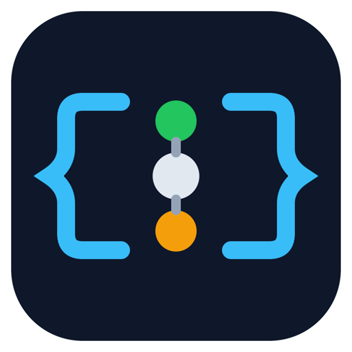
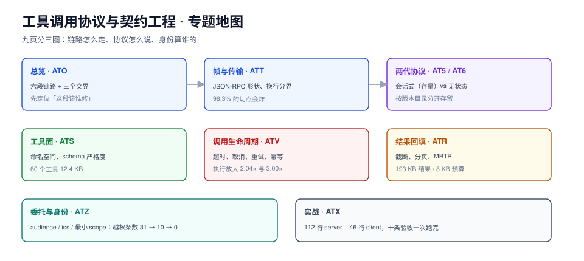

# 智能体工具调用协议与契约工程

工具调用有两层：**语义层**管「模型选不选得对」，**协议层**管「选对之后，那一帧怎么走、身份算谁的、错了怎么表达」。绝大多数线上事故出在第二层——模型选对了工具，参数也对，然后调用因为一条写进 stdout 的日志、一个没有 audience 的 token、一次超时重试而变成两次扣款。

本专题只做协议层与契约层：JSON-RPC 帧怎么切、`_meta` 里该带什么、工具描述膨胀到什么程度会反噬、超时和重试的乘积效应怎么算、24 KB 的结果该怎么回填。语义层（提示词、few-shot、选工具的准确率）留给[工具调用](../Agent/ToolCalling/index.md)与[工具与函数调用](../LLMApp/FunctionCalling/index.md)。

::: tip 一句话理解
工具调用不是「模型 + 函数」两次跳转，而是一条**六段链路**：装配 → 出参 → 编码 → 校验 → 执行 → 回填。这条链路上任何一段没有主人，失败就会以「模型胡说」的形式表现出来。
:::

::: info 本专题与相邻专题的分工
- **工具是什么、schema 怎么写、五步循环的完整代码** → [工具调用](../Agent/ToolCalling/index.md)、[工具与函数调用](../LLMApp/FunctionCalling/index.md)：那里回答「第一次怎么跑通」，本专题从「跑通之后要上生产」接手。
- **权限分级、审批、预算、拒绝码** → [运行时护栏](../AISecurityCompliance/Guardrails/index.md)：那里是**应用层策略**（这个工具准不准用），本专题是**协议层身份**（这一帧以谁的名义发出、token 的 audience 对不对），见[委托与身份](Delegation/index.md)。
- **提示注入、沙箱、危险工具确认** → [安全边界](../Agent/Safety/index.md)：那里防「模型被说服」，本专题防「协议被滥用」。
- **span 树、GenAI 语义约定、采样** → [Trace 模型与会话](../LLMObservability/Tracing/index.md)：那里定 span 的形状，本专题只补**跨进程**那一段——`traceparent` 怎么塞进 `_meta` 跟着工具调用走过去。
- **Agent 的循环、记忆、多智能体** → [Agent 原理](../Agent/AgentPrinciples/index.md)、[多智能体](../Agent/MultiAgent/index.md)：本专题把「一次调用」放大到字节级，不讨论循环怎么设计。
- **框架怎么选（LangChain / LangGraph / CrewAI）** → [Agent 框架](../AgentFramework/index.md)：框架把协议藏在 SDK 里，本专题讲 SDK 下面那一层，读懂之后换框架不掉坑。
- **模型服务的过载与排队** → [推理请求调度与批处理](../InferenceScheduling/index.md)：那边管「请求排第几」，这边管「请求发出去之后能不能取消」。
- **项目侧的订单状态机与事件** → [EventOrderHub 架构](../../../project/Complete/EventOrderHub/Architecture/index.md)：那边的 outbox 与本专题的「调用幂等」是同一个问题的两种形态。
:::

## 目录

- [总览：一次工具调用穿过的六段](Overview/index.md)
- [帧与传输：JSON-RPC 在线上到底是什么形状](Transport/index.md)
- [会话式协议（2025-11-25 及以前，存量）](MCP2025/index.md)
- [无状态协议（2026-07-28 起，当前）](MCP2026/index.md)
- [工具面：命名、契约与装配](Surface/index.md)
- [调用生命周期：超时、取消、重试与幂等](Invocation/index.md)
- [结果回填：截断、分页与「还差一个输入」](Result/index.md)
- [委托与身份：token 该以谁的名义发](Delegation/index.md)
- [实战：90 行 server + 60 行 client 的端到端验收](Practice/index.md)

## 专题地图

## 判据纪律

沿用全库写法：**每页 8 条，编号形如 `ATO-A`**，逐页前缀唯一，可被 `utils/audit` 下的判据类巡检机械核对。每条判据回答三件事：**看什么现象、判成什么、不满足时改哪里**。

| 页 | 判据族 | 这一族管什么 | 条数 |
| --- | --- | --- | --- |
| 总览 | `ATO-A` ~ `ATO-H` | 六段链路、三个交界、必失点 | 8 |
| 帧与传输 | `ATF-A` ~ `ATF-H` | 消息形状、流边界、编码、日志污染 | 8 |
| 会话式协议 | `AT5-A` ~ `AT5-H` | initialize、会话 ID、续传、能力声明 | 8 |
| 无状态协议 | `AT6-A` ~ `AT6-H` | 每请求 `_meta`、`server/discover`、`resultType`、错误码 | 8 |
| 工具面 | `ATS-A` ~ `ATS-H` | 命名空间、schema 严格度、体积、按需加载 | 8 |
| 调用生命周期 | `ATV-A` ~ `ATV-H` | 请求 ID、超时、取消、重试、幂等、追踪 | 8 |
| 结果回填 | `ATB-A` ~ `ATB-H` | content 形状、isError、截断、分页、MRTR | 8 |
| 委托与身份 | `ATZ-A` ~ `ATZ-H` | audience、透传、issuer、最小 scope | 8 |
| 实战 | `ATX-A` ~ `ATX-H` | 端到端验收、可观测、交付物 | 8 |

合计 **9 族 72 条**。

## 版本速览（核对时间 2026-10-24，以官方 changelog 为准）

| 修订版 | 状态 | 对本专题影响最大的三件事 |
| --- | --- | --- |
| `2024-11-05` | 历史 | 初版；HTTP+SSE 双端点（一个收、一个发），会话靠连接本身维持 |
| `2025-03-26` | 存量 | Streamable HTTP 取代 HTTP+SSE；OAuth 2.1 授权框架进入正文 |
| `2025-06-18` | 存量 | **移除 JSON-RPC 批处理**；新增结构化工具输出（`outputSchema` / `structuredContent`）；HTTP 下要求带 `MCP-Protocol-Version` 头；新增 elicitation 与 resource link |
| `2025-11-25` | 存量，仍在大量 SDK 里跑 | 会话式协议的最后一版：`initialize` 握手 + `Mcp-Session-Id`；tasks 还在核心协议里 |
| `2026-07-28` | **当前** | 改为**无状态**：删掉 `initialize` 与会话，改由每个请求的 `_meta` 自带版本与能力；新增 `server/discover`；`resultType` 必填；服务器发起的请求被 [MRTR](Result/index.md) 取代 |

::: warning 读老资料的正确姿势
网上 2025 年写的 MCP 文章几乎全部基于 `initialize` 握手 + `Mcp-Session-Id`。它们在**存量实现**上仍然对，但照着写新 server 会直接跑不通当前版本。本专题把两代分开写成[会话式（存量）](MCP2025/index.md)与[无状态（当前）](MCP2026/index.md)两页，**旧页保留、标注状态、不覆盖**。
:::

## 三条底线

::: danger 三条不可让步的底线
1. **协议流里不能有非协议字节**。stdio 传输上，`print()` 一行调试信息就等于往 JSON-RPC 流里插了一段无法解析的垃圾：客户端读到的是「服务器返回了非法响应」，而不是「你多打了一行日志」。实测把一个两帧缓冲区在 173 个字节位置切开，**按行切分的解析器在 170 个位置（98.3%）解析失败**——这不是容错问题，是设计上不允许出现半行。
2. **重试次数不产生重复副作用，幂等键才产生**。超时 1500 ms、执行 1200~1800 ms、重试 2 次：实际执行 **814 次**（放大 2.04×），无幂等键时副作用也是 **814 次**；有幂等键时回到 **400 次**。把超时收到 800 ms，执行放大到 **3.00×**——**收紧超时等于给自己加负载**。
3. **工具的身份必须是有 audience 的**。5 个角色 × 12 个工具 = 60 条用例里，本应拒绝 31 条：用「网关的服务身份」调用，越权放行 **31 条**；用「透传用户身份但不校验 audience」，跨资源服务器的 **10 条**照放；只有「受限期票 + audience 校验 + scope 交集」把越权压到 **0 条**。
:::

## 阅读顺序

先读[总览](Overview/index.md)拿到六段链路的全局图，然后按你手上的问题选主线：

- **接一个新 server，握手过不去** → [帧与传输](Transport/index.md) → [无状态协议](MCP2026/index.md)；老 SDK 报 `initialize` 相关错，先看[会话式协议](MCP2025/index.md)
- **模型选错工具、参数总是差一点** → [工具面](Surface/index.md)
- **偶发重复下单、调用卡死、trace 断链** → [调用生命周期](Invocation/index.md)
- **上下文被工具结果撑爆、模型答非所问** → [结果回填](Result/index.md)
- **要给安全评审交材料** → [委托与身份](Delegation/index.md)
- **要一个能跑起来的参照实现** → [实战](Practice/index.md)，按 S1~S10 走

## 参考资料

- MCP 规范（当前修订版 `2026-07-28`）：<https://modelcontextprotocol.io/specification/2026-07-28>
- MCP 变更日志 `2026-07-28`：<https://modelcontextprotocol.io/specification/2026-07-28/changelog>
- MCP 变更日志 `2025-06-18`（批处理移除、结构化输出）：<https://modelcontextprotocol.io/specification/2025-06-18/changelog>
- JSON-RPC 2.0 规范：<https://www.jsonrpc.org/specification>
- JSON Schema 2020-12：<https://json-schema.org/draft/2020-12/json-schema-core>
- RFC 8707（Resource Indicators）：<https://www.rfc-editor.org/rfc/rfc8707.html>
- RFC 9207（`iss` 参数）：<https://www.rfc-editor.org/rfc/rfc9207.html>
- Language Server Protocol 传输层（Content-Length 帧的来源）：<https://microsoft.github.io/language-server-protocol/specifications/lsp/3.17/specification/#baseProtocol>
- OpenTelemetry 语义约定（`gen_ai` 与 trace context 传播）：<https://opentelemetry.io/docs/specs/semconv/gen-ai/>
