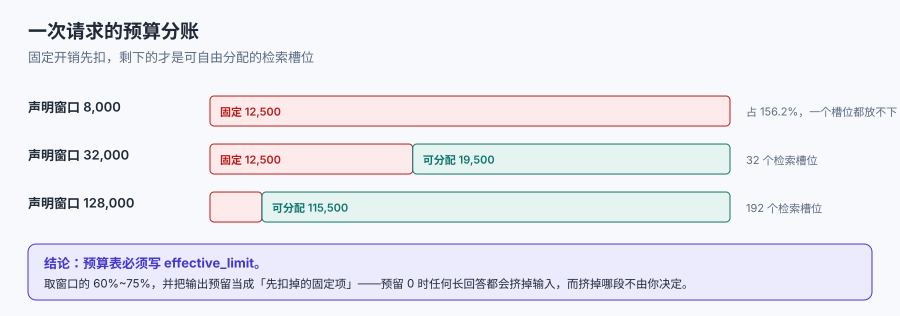

# 预算与配额

上下文工程的第一件事不是「写提示词」，是**算账**：这次请求有多少 token 可用、必须花掉的有多少、能自由分配的有多少、超了砍谁。没有这张账，后面所有的选材、压缩、排布都是在一个看不见上限的池子里瞎装。



## 1. 一次请求的六笔固定开销

窗口不是全给你的。下面六笔在任何真实系统里都存在，且**大部分是常量**——它们不会因为你的问题变短而变小：

| 开销项 | 典型量级（token） | 谁在花 | 能不能省 |
| --- | --- | --- | --- |
| 系统指令 | 300 ~ 3,000 | 角色、规范、输出格式、安全条款 | 能，但每减一句都要重跑评测 |
| 工具定义 | 200 ~ 8,000 | function calling 的 JSON Schema | 能：按需装载、拆分工具组 |
| 输出预留 | 500 ~ 16,000 | 模型要写的那部分 | 不能省，只能设上限 |
| 单轮用户输入 | 20 ~ 2,000 | 用户问题 | 不能省 |
| 历史对话 | 0 ~ 50,000+ | 多轮累积 | 能：摘要、滑窗、按需回捞 |
| 框架胶水 | 50 ~ 500 | 分段标记、编号、`<doc>` 标签 | 能，但别省到失去边界 |

本库的实测账：把上表取一组**中等偏保守**的值——系统 800、工具 1,500、输出预留 4,000、用户 200、历史 6,000，合计 **12,500 token**——在不同窗口下的占比是这样：

| 声明窗口 | 固定开销占比 | 可自由分配 | 检索槽位（600/段） |
| --- | --- | --- | --- |
| 8,000 | **156.2%** | 0 | **0** |
| 32,000 | 39.1% | 19,500 | 32 |
| 128,000 | 9.8% | 115,500 | **192** |
| 200,000 | 6.2% | 187,500 | 312 |
| 1,000,000 | 1.2% | 987,500 | 1,645 |

第一行是这张表存在的理由：**在 8k 窗口上，你把固定开销配齐就已经超了 56%**，一个检索片段都放不进去。这不是模型的问题，是预算表从来没被算过——很多人是在「换了小模型」或者「工具从 3 个加到 12 个」的那天才发现的。

::: warning 关于「输出预留」
输出预留经常被写成 0，理由是「我只要它答一句话」。这是最贵的一种省法：**预留 0 意味着任何长回答都会把输入挤掉**，而挤掉的是哪一段由框架决定，不由你决定。正确写法是给 `max_output_tokens` 一个明确值，并把它从可用预算里先扣掉。
:::

## 2. 预算表的四行结构

一张能用的预算表只需要四行：**总量、固定、可变、保留**。

```yaml
context_budget:
  window: 128000            # 声明窗口，只作上限参考
  effective_limit: 96000    # 自己设的硬上限，通常取窗口的 60%~75%
  fixed:
    system: 800
    tools: 1500
    output_reserve: 4000
  variable:
    history: 6000           # 上限，不是配额
    retrieved: 40000        # 检索片段总配额
    tool_results: 20000     # 本轮工具返回
  reserve:
    safety: 5000            # 给「算漏了的胶水与分词误差」
```

四行里最容易被忽略的是 **`effective_limit` 与 `safety`**：

- `effective_limit` 之所以不取满窗口，是因为**分词误差 + 框架注入 + 供应商侧的隐藏开销**三者叠加。本册 token 口径是估算（字符/1.5），中文场景实际比值可能在 1.2~1.8 之间浮动，同一段 10 万字符的文本，两种比值下相差 **2.5 万 token**。取 60%~75% 是在给这个误差留位置。
- `safety` 是**最后一道**：当所有配额都按上限花完时，它保证你不会正好撞线。撞线的表现不是报错，而是请求被拒或者被静默截断——后者更糟，因为你拿到的答案看起来是正常的。

## 3. 超限的四种策略，各自的代价

预算不够时怎么砍，是一个**必须提前写死**的决定。四种常见策略的代价完全不同：

| 策略 | 做法 | 省下的量 | 代价 | 适用 |
| --- | --- | --- | --- | --- |
| 尾部截断 | 砍最早的历史 | 可控 | 丢的往往是最初的需求约束 | 长会话闲聊 |
| 头部保留 + 中段压缩 | 首尾留，中间摘要 | 大 | 中段的事实被摘要「概括」掉 | 长文档问答 |
| 按分数丢弃 | 检索片段按相关度从低到高丢 | 大 | 分数不可比时会丢掉唯一答案 | 多路召回 |
| 拒绝并降级 | 直接走小上下文路径（如只给摘要） | 全部 | 用户感知到「这次答得浅」 | 有 SLA 的线上服务 |

::: danger 四种「看起来在省、其实在坏」的写法
1. **按字数截断**。`text[:4000]` 在中文里是 4,000 个字符，约 2,667 token，与你的配额毫无关系。
   - 正确做法：按 token 估算截断，并把截断点对齐到**段落或标题边界**。
2. **先拼后量**。拼完再数 token 超了就报错。
   - 正确做法：装配前先按配额收缩，装配后再断言一次总量（见[实战](../Practice/index.md)的 `CXP-C`）。
3. **把 `max_tokens` 当成输出预留**。很多 SDK 里它同时影响可用输入空间，改了它输入预算会跟着变。
   - 正确做法：把「请求侧上限」与「预算表里的预留」分开写，并在装配日志里记录实际生效值。
4. **历史只增不减**。20 轮之后历史成了最大的一块。
   - 正确做法：给历史设**上限**而不是**策略**（见第 4 节）。
:::

## 4. 历史增长的账：什么时候会溢出

多轮会话里，历史是唯一一个**每轮都在涨**的块。按一个真实但克制的量级算：每轮用户输入 300 token、助手回复 900 token、工具结果 336 token，合计 **1,536 token/轮**。

| 轮次 | 历史累计 | 在 32k 窗口（固定 12,500）下的占用 | 状态 |
| --- | --- | --- | --- |
| 5 | 7,680 | 63% | 正常 |
| 10 | 15,360 | 87% | 检索空间被压到 4 段 |
| 20 | 30,720 | **135%** | 必须先摘要 |
| 40 | 61,440 | 231% | 只能滑窗 + 摘要 |

也就是说，**32k 窗口在第 12 轮左右就装不下完整历史了**，而这通常是用户刚开始觉得「它挺懂我」的时候。三种处置的取舍：

- **滑窗**（保留最近 N 轮）：便宜、可预测，代价是「第一轮说过的约束」会消失。
- **摘要**（把旧历史压成一段）：保留语义，代价是数字与专有条件被概括掉（见[压缩](../Compression/index.md)的实测）。
- **结构化记忆**（把关键事实抽成键值，历史只留指针）：最贵，但唯一能同时保住「长」与「准」的做法。

::: tip 一条实用判据
**历史长度超过可变预算的 1/3 时，就必须开始摘要**——不是等到溢出。理由是：摘要本身要花一次模型调用，而这次调用的输入就是那段历史；等溢出再摘，你已经在用超限的上下文做摘要了。
:::

## 5. 成本：填充率每涨 10 个点

输入 token 是**按量计费**的，而上下文工程最容易的失控方式就是「多塞一点应该更准吧」。本机按两个常见的输入量级算账：

| 单次输入 | ×1.0 | ×1.3 | ×2.0 |
| --- | --- | --- | --- |
| 2,000 token → 1,000 次请求 | 2.0M | 2.6M | 4.0M |
| 8,000 token → 1,000 次请求 | 8.0M | 10.4M | 16.0M |

倍数不大，但它是**线性叠加**的：把检索从 5 段加到 15 段（约 ×1.3），再把历史从 6k 放到 12k，两个「一点点」乘起来就是 ×2。所以预算表里每一块的上限都必须有**依据**，而不是「先给大点」。

::: info 缓存会改变这张账
如果前缀稳定（见[前缀与缓存复用](../PrefixCache/index.md)），被缓存的那部分输入通常按远低于原价计费。本机在 20 轮、每轮新增 1,536 token 的模型下，稳定前缀的复用率是 **65.7%**，按 0.1× 的缓存读取口径折算，成本降到 **40.9%**。**先做前缀稳定，再谈省 token**——顺序反了会把省下来的钱又花回去。
:::

## 6. 子代理与工具结果的预算隔离

多代理（multi-agent）与工具调用会把预算问题放大一个量级，因为**每个子代理都有自己的窗口**：

- **子代理只回摘要**：子代理读 5 万 token、只回 800 token，主上下文只承担 800。这是最有效的隔离方式，代价是信息在子代理那一侧就被压缩了。
- **工具结果先落地再引用**：大结果（如整张表、整个文件）不要直接进上下文，先存成可寻址对象，上下文里只放**指针 + 前 N 行 + 统计摘要**。
- **并行子任务要合并口径**：三个子代理各回一段摘要，拼起来可能互相矛盾，必须在主上下文里做一次冲突消解（见[排布与注意力](../Ordering/index.md)第 5 节）。

## 本页判据

本页判据族 `CXB-A` ~ `CXB-H`，共 8 条。

| 判据 | 约定 | 定错了会怎样 | 怎么验证 |
| --- | --- | --- | --- |
| `CXB-A` | 存在一张写明 `window / effective_limit / fixed / variable / reserve` 的预算表 | 超限只能靠报错发现 | 配置文件里有五个键 |
| `CXB-B` | 输出预留是一个明确的正数，且已从可用预算中扣除 | 长回答挤掉输入，且挤掉哪段不可控 | 配置里 `output_reserve > 0` |
| `CXB-C` | `effective_limit` ≤ 声明窗口的 75% | 分词误差把请求顶到上限 | 配置对比脚本 |
| `CXB-D` | 历史有上限（不是策略），超过上限触发摘要 | 第 12 轮后检索空间归零 | 装配日志里 history 有上限 |
| `CXB-E` | 超限策略四选一写死，且降级路径可执行 | 超限时抛错或静默截断 | 有一次人为超限的演练记录 |
| `CXB-F` | 每一块配额都写了依据（为什么是这个数） | 配额随时间通胀，成本悄悄翻倍 | 预算表每行有备注 |
| `CXB-G` | 工具结果超过阈值时改为「落地 + 引用」 | 一次大结果吃掉整轮预算 | 代码里有阈值判断 |
| `CXB-H` | 每次装配记录实际 token 用量与截断点 | 无法复算、无法归因 | 日志字段齐全 |

## 验证方式

```shell
# 1. 复算固定开销占比（口径：字符/1.5）
python3 - <<'PY'
fixed = 800 + 1500 + 4000 + 200 + 6000
for w in (8000, 32000, 128000, 200000, 1000000):
    print(w, f"{fixed/w*100:.1f}%", max(0, w - fixed)//600)
PY
# 期望：8000 行输出 156.2% 与 0

# 2. 检查预算表五个键是否齐全（把路径换成你的配置）
grep -nE 'window|effective_limit|output_reserve|history|safety' config/context.yaml
# 期望：五个键各至少一次

# 3. 历史溢出点复算
python3 -c "print([n for n in range(1,41) if 12500+1536*n>32000][:1])"
# 期望：[13]  → 第 13 轮起超出 32k 窗口
```

## 参考资料

- [OpenAI — Prompt caching（前缀复用与计费口径）](https://platform.openai.com/docs/guides/prompt-caching)
- [Anthropic — Context windows 与 token 计数口径](https://docs.anthropic.com/en/docs/build-with-claude/context-windows)
- [本库：推理请求调度 · KV Cache](../../InferenceScheduling/KVCache/index.md)
- [本库：RAG · 切分策略](../../RAG/Chunking/index.md)
- [本册目录页](../index.md)
