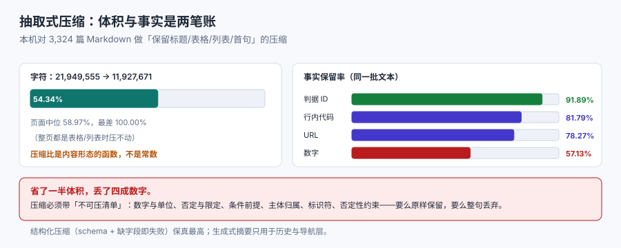

# 压缩与摘要

上下文不够用时，第一反应是「压缩一下」。压缩确实是最有效的手段——本机实测能把一份 Markdown 压到原文的 **54.34%**——但同一批实验也说明：**省下的体积主要来自被丢掉的数字、条件与限定语**，而它们往往是答案本身。

这一页讲三件事：怎么压、什么不能压、压完怎么证明没压坏。



## 1. 三种压缩，代价完全不同

| 方法 | 做法 | 压缩比（本机实测） | 信息损失 | 可复算性 |
| --- | --- | --- | --- | --- |
| 抽取式 | 按规则保留标题、表格、列表、每段首句 | **到 54.34%** | 论证链、限定语、例子 | **完全可复算**（同一输入同一输出） |
| 生成式摘要 | 让模型写一段概括 | 到 10%~25% | 数字、否定、主体归属都可能变 | 不可复算，需另行核对 |
| 结构化压缩 | 抽成键值/表格（字段、约束、结论） | 到 15%~35% | 只保留被 schema 覆盖的部分 | 可复算（schema 与抽取规则确定） |

三者的分界是**「谁来承担保真的责任」**：抽取式由规则承担（规则写错就错得一致），生成式由模型承担（每次可能不一样），结构化由 schema 承担（schema 没覆盖的字段会被静默丢弃）。

::: tip 选择顺序
**先结构化，再抽取，最后才生成式。** 结构化压缩的产物还能被程序校验（字段缺失就报错）；抽取式的产物能被 diff（两次跑不同就说明规则不稳）；生成式的产物只能靠人看或另一次模型调用核对，成本最高。
:::

## 2. 本机的压缩账：省了一半，丢了四成数字

实验口径：对 3,324 篇 Markdown 做「抽取式压缩」——保留标题行、表格行、列表项、围栏首行，普通段落只留首句（按句号/问号/叹号切）。

| 指标 | 原始 | 压缩后 | 保留率 |
| --- | --- | --- | --- |
| 字符 | 21,949,555 | 11,927,671 | **54.34%** |
| 数字（连续 2 位以上） | 313,332 | 178,994 | **57.13%** |
| 判据 ID（如 `CXO-A`） | 17,604 | 16,177 | 91.89% |
| URL | 11,610 | 9,087 | 78.27% |
| 行内代码 | 130,059 | 106,373 | 81.79% |

页面级分布更能说明问题：**中位页面压到 58.97%，最差的页面压到 100.00%**（一行都没压掉——整页都是表格或列表）。所以「压缩比」不是一个可以写进 SLA 的常数，它是**内容形态的函数**。

::: danger 三个关于压缩的错判
1. **「压到一半就安全了」**。字符压到 54.34%，但数字只剩 57.13%——如果答案是「延迟从 1,240 ms 降到 780 ms」，被丢掉的概率接近一半。
   - 正确做法：把「数字、单位、否定词、条件从句、主体归属」列为**不可压**，压缩后用正则核对这几类的保留率。
2. **「摘要比截断好」**。摘要会**改写**，改写就可能把「不支持」写成「支持」，把「A 导致 B」写成「B 导致 A」。
   - 正确做法：摘要只用于**叙事性历史**；事实性材料（配置、DDL、接口契约、判据表）一律抽取式或结构化，不改写。
3. **「压缩一次就好」**。多轮里每轮都压一遍，误差会累积（第 3 次摘要已经在概括第 2 次摘要）。
   - 正确做法：**压缩必须基于原文，不能基于上一次的摘要**；原文留在可寻址存储里。
:::

## 3. 不可压清单

按「丢了会导致答案错」排序，六类内容必须原样保留：

| 类别 | 例子 | 丢了会怎样 | 保留方式 |
| --- | --- | --- | --- |
| 数字与单位 | `1,240 ms`、`2.5%`、`¥ 38,954.72` | 答案直接错，且错得看不出来 | 正则白名单，压缩后核对 |
| 否定与限定 | 「**不**支持」「仅在 X 时」「除…以外」 | 语义反转 | 句子级不可压 |
| 条件与前提 | 「若 QPS > 5,000」「在事务内」 | 结论被套用到错误前提 | 条件从句整句保留 |
| 主体归属 | 「A 导致 B」而不是「B 导致 A」 | 归因反转 | 保留主谓宾，不改写 |
| 标识符 | 判据 ID、字段名、错误码、路径 | 无法回查、门禁失效 | 原样保留 |
| 否定性约束 | 「禁止 / 不得 / 不要」 | 变成建议或遗漏 | 整句保留 |

::: warning 一条容易忽略的：数值的「口径」
`54.34%` 与 `54%` 是两个事实。压缩时四舍五入会**改变结论**（「保留 57.13%」与「保留 57%」误差不大，但「1,471 条样本」压成「1,500 条」就可能让门禁算错）。规则：**压缩不改数字精度，只决定留不留**——要么原样，要么整句丢。
:::

## 4. 结构化压缩：schema 决定保真

结构化压缩是最可控的一种：先定义 schema，再按 schema 抽取，**缺字段就报错**。

```yaml
# 一份「接口契约」的结构化压缩 schema
contract:
  endpoint: str        # 必填，缺失即失败
  method: enum[GET, POST, PUT, DELETE]
  auth: str            # 认证方式，必填
  rate_limit: str      # 限流口径（含单位），必填
  errors:              # 错误码表，至少 1 条
    - code: int
      meaning: str
      retryable: bool
```

三条纪律：

1. **必填字段缺失时失败，不填默认值**。默认值会把「未知」变成「零」，这是最贵的一种静默错误。
2. **schema 里放不下的事实单独成段**，不要硬塞进 `notes` 字符串——否则它等于没被结构化。
3. **schema 版本化**。改了字段就要能识别「这批压缩产物是旧 schema 的」。

## 5. 压缩后的核对：三条可复算的断言

压缩最容易的失败是「看起来还行」。三条断言能把「还行」变成可判定的：

| 断言 | 做法 | 本机口径下的期望 |
| --- | --- | --- |
| 实体保留率 | 压缩前后各抽一次数字/ID/URL，比保留率 | 数字 ≥ 95%、ID ≥ 99% |
| 语义极性 | 压缩前后各数一次否定词数量，差值应为 0 | 差 0；不为 0 就是改写了语义 |
| 可回查 | 压缩后的每个 ID 能在原文里找到 | 100% 命中 |

本机默认抽取式压缩在这三条上的读数是：数字 57.13%、否定词（未单独处理时）会随段落丢弃、ID 91.89%。**三个数都不达标**——这不是说抽取式不能用，而是说**裸用不行**：必须加白名单（数字与否定词整句保留）再压，之后的保留率才可能上到 95%。

## 6. 生成式摘要的两种安全用法

生成式摘要不是不能用，而是只能在两个位置上用：

- **历史对话**：叙事性内容，允许概括。要求是「保留所有数字与承诺」，并在摘要里显式标出「以下为摘要，可能不含全部细节」。
- **长文档的导航层**：摘要只用来**决定去哪一段**，不作为答案来源。真正的答案仍从原文片段取。

反例（真实高频）：把接口文档摘要一遍，然后拿摘要回答「这个字段能不能为空」。摘要不会写「NOT NULL」，它只会写「必填」——而「必填」在业务上可能指「界面必填、库可为空」。

## 本页判据

本页判据族 `CXC-A` ~ `CXC-H`，共 8 条。

| 判据 | 约定 | 定错了会怎样 | 怎么验证 |
| --- | --- | --- | --- |
| `CXC-A` | 压缩方法按内容类型选择：事实性材料不用生成式 | 语义反转、字段丢失 | 代码里按 `content_type` 分支 |
| `CXC-B` | 有「不可压清单」，六类内容整句保留 | 答案里的数字被压掉 | 清单存在且有对应实现 |
| `CXC-C` | 压缩后核对实体保留率（数字/ID/URL 三条） | 省了体积丢了事实 | 门禁脚本输出三个百分比 |
| `CXC-D` | 压缩不改数字精度（只决定留不留） | 四舍五入让结论偏移 | 对比压缩前后的数字串集合 |
| `CXC-E` | 摘要基于原文，不基于上一次的摘要 | 误差累积、越压越偏 | 摘要是从原文生成的 |
| `CXC-F` | 结构化压缩的必填字段缺失即失败，不填默认 | 「未知」变「零」 | 有失败用例 |
| `CXC-G` | 压缩产物带 schema 版本与来源指纹 | 无法判断这批产物可不可信 | 产物头部有版本与哈希 |
| `CXC-H` | 压缩比不作为 SLA 承诺（它是内容形态的函数） | 换一批内容就违约 | 文档里写明口径 |

## 验证方式

```shell
# 1. 复算本页压缩账（脚本 cx_e3.py，仓库外执行）
python3 cx_e3.py
# 期望：字符 54.34%、数字 57.13%、判据 ID 91.89%

# 2. 抽查一页：压缩前后的数字个数
python3 - <<'PY'
import re
src = open('docs/AI/ContextEngineering/Compression/index.md', encoding='utf-8').read()
print('numbers:', len(re.findall(r'\d+(?:\.\d+)?', src)))
PY
# 期望：> 60（本页数字密度高，压缩时会大量落入「整句保留」）

# 3. 检查本页判据族完整
grep -c 'CXC-[A-H]' docs/AI/ContextEngineering/Compression/index.md
# 期望：≥ 8
```

## 参考资料

- [Anthropic — Effective context engineering（压缩与摘要的取舍）](https://www.anthropic.com/engineering/effective-context-engineering-for-ai-agents)
- [LangChain — Context compression 与 summarization 的边界](https://python.langchain.com/docs/how_to/#document-compressors)
- [本库：RAG · 切分策略（分块与压缩的关系）](../../RAG/Chunking/index.md)
- [本册：预算与配额](../Budget/index.md)
- [本册目录页](../index.md)
