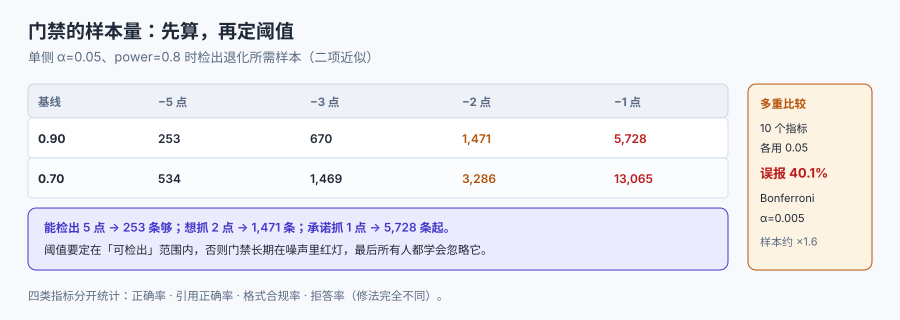

# 评测与退化门禁

上下文工程最危险的地方是**改动看起来都无害**：把系统提示精简两句、把检索从 5 段加到 8 段、把历史摘要换成滑窗。每一项都能在手工抽查里通过，合起来却让效果掉了几个百分点——而这几百分点通常要等到用户投诉才会被发现。

这一页解决一件事：**怎么用可复算的样本量，证明「这次改动没有让效果变差」**。



## 1. 评测集要覆盖四个维度

一个只按「难易」分层的评测集是没用的，因为上下文工程关心的是**分布**。四个维度各切一刀：

| 维度 | 分层 | 为什么必须分 | 最小样本/层 |
| --- | --- | --- | --- |
| 答案位置 | 首 1/3、中 1/3、尾 1/3 | 中段退化会被平均值抹平 | 30 |
| 材料规模 | 小（<4k）、中（4k~32k）、大（>32k） | 长输入退化与位置效应叠加 | 30 |
| 任务类型 | 抽取、多跳、聚合、改写 | 四类的有效长度差数倍 | 30 |
| 干扰密度 | 0 干扰、k 个无关段 | 噪声敏感度不同 | 30 |

四刀切完是 3×3×4×2 = 72 格。**不必每格 30 条**——按风险分配：已知高风险格（中段 × 大输入 × 聚合）多放，低风险格（首段 × 小输入 × 抽取）少放。总量控制在 300~600 条，够跑一次门禁又不至于没人维护。

::: warning 「评测集 20 条」是这类系统最常见的自欺
20 条样本，一条的变化就是 5 个百分点。用它判「有没有退化」，等于抛硬币。**样本量必须先算，再定门禁阈值**（见第 3 节）。
:::

## 2. 分桶报告：平均值会藏住最贵的失败

同一批 300 条样本，两种报告方式给出完全不同的结论：

| 报告方式 | 结论 | 风险 |
| --- | --- | --- |
| 总体准确率 82.3% → 81.0%（−1.3 点） | 「在噪声范围内，可以上线」 | 中段可能掉了 8 点，被首段涨的 3 点抵消 |
| 分位置桶：首 88.0→89.1、中 79.2→71.4、尾 84.0→84.6 | 「中段崩了」 | 立即定位到排布/截断 |

上面这组数字是**示意**（不是本机测量，本机没有跑模型）。它要说明的是：**平均值的稳定性不能证明分桶的稳定性**；而位置效应恰恰是分桶才能看见的。

所以报告至少要有三张表：按位置、按长度、按任务类型。三张表里任何一张出现「某桶掉超过阈值而总体没掉」，就说明这次改动**有针对性地伤到了某一类**。

## 3. 样本量：先算，再定阈值

### 3.1 二项检验的样本量

要检出「准确率从 `p0` 掉到 `p1`」，单侧 α=0.05、power=0.8 时需要的样本量（标准二项近似）：

| 基线 p0 | 检出 −5 点 | −3 点 | −2 点 | −1 点 |
| --- | --- | --- | --- | --- |
| 0.90 | **253** | 670 | 1,471 | 5,728 |
| 0.70 | **534** | 1,469 | 3,286 | 13,065 |

读法：

- 想检出 **5 个点**的退化，基线 90% 时 253 条够用；**想检出 2 个点，要 1,471 条**。
- 基线越低，样本量越大（方差更大）：同样 −2 点，0.90 要 1,471，0.70 要 3,286。
- **1 个点**的退化在多数团队的成本下不可检出（5,728 条起）——所以别承诺「我们的门禁能抓 1% 的退化」。

::: tip 一条务实的取舍
**阈值定在「可检出」的范围内，而不是「你想抓」的范围内。** 300 条样本能可靠检出约 5 点（p0=0.90）的退化；把阈值定成 1 点，门禁会长期在噪声里红灯，最后所有人都学会忽略它。
:::

### 3.2 多重比较：10 个指标一起看，误报率 40%

如果门禁同时看 10 个指标，每个用 α=0.05，那么**至少一个误报的概率是 1 − 0.95¹⁰ = 40.1%**。这就是「门禁总是红、但每次都不是真问题」的来源。

三种处置：

| 做法 | 效果 | 代价 |
| --- | --- | --- |
| Bonferroni：α 除以指标数（0.05/10 = 0.005） | 误报率回到 5% | 样本量需求上升约 1.6 倍 |
| 只对**主指标**做门禁，其余做监控 | 简单、误报低 | 可能漏掉次要指标的退化 |
| 分层门禁：先看总体，红了再看分桶 | 两次检验，需分层阈值 | 需要更多样本 |

## 4. 门禁的四类指标

上下文改动最常伤到的不是「答对率」，而是下面四类。它们必须分开统计，因为**修法完全不同**：

| 指标 | 定义 | 掉了说明什么 | 修哪里 |
| --- | --- | --- | --- |
| 正确率 | 答案与标注一致 | 材料缺失/位置错误 | 检索、排布 |
| 引用正确率 | 给出的 `doc id` 真的支持结论 | 材料被摘要改写、段落错配 | 压缩、切片 |
| 格式合规率 | 输出符合 schema（可解析） | 输出契约在长上下文里失效 | 收束区、约束复述 |
| 拒答率 | 回答「信息不足」的比例 | 材料不足或过度保守 | 检索召回、提示措辞 |

四类里**引用正确率**最容易被漏掉，而它恰恰是上下文工程的核心证据：答案对但引用错，说明模型在「用自己的知识答」，上下文其实没起作用。

## 5. 污染与漂移

两个让评测数字失真的系统性因素：

- **训练数据污染**：评测题可能出现在模型的训练语料里，分数虚高。处置：① 用**改写版**（换表述、换数字）；② 用**时间切分**（只评测模型训练截止之后产生的内容）；③ 记录每个题目的产生日期。
- **分布漂移**：线上问题分布与评测集不同（用户会问那些「评测集里没有」的问题）。处置：每月从线上抽样 50 条真实请求，人工标注后并入评测集，同时淘汰过期条目。

::: danger 三个让门禁形同虚设的写法
1. **用同一批样本调参又验收**。调完必然「变好」，因为你在拟合这批样本。
   - 正确做法：调参集与验收集分开，且验收集**不参与任何决策**。
2. **只跑一次就下结论**。温度大于 0 时，同一样本两次结果可能不同，单次差异可能全是噪声。
   - 正确做法：固定种子跑 1 次 + 随机种子跑 2 次，看分布而不是单点。
3. **门禁阈值写成绝对值**（如「准确率 ≥ 85%」）。基线涨了它永远绿，基线跌了它永远红。
   - 正确做法：用**相对基线**（相对上一版不低于 −2 点），并同时保留绝对下限。
:::

## 6. 一次门禁的完整流程

1. **固定评测集版本**：`eval_set@2026-11-11`，480 条，四维分层。
2. **跑基线**：记录总体 + 3 张分桶表（每桶 n、准确率、95% 区间）。
3. **跑候选**：同样记录。
4. **判定**（四条，按顺序）：
   - 主指标（正确率）相对基线下降 > 2 点且样本量够（n ≥ 1,471）→ FAIL；
   - 任一分桶下降 > 5 点（该桶 n ≥ 253）→ FAIL；
   - 引用正确率下降 > 1 点 → WARN，人工看 20 条；
   - 格式合规率下降 > 0.5 点 → FAIL（这是硬伤，用户会看到）。
5. **输出**：结论 + 每条的置信区间 + 差异最大的 10 条样本。

第 5 步的「差异最大的 10 条」比总体数字有用得多：它能告诉你**这次改动伤到的是哪一类问题**。

## 7. 线上监控：三个必须有的比率

离线门禁防「变差」，线上监控防「环境变了」：

| 指标 | 口径 | 告警阈值（示例） |
| --- | --- | --- |
| 上下文 token 的 P95 | 每次装配的总 token | 超过预算的 90% |
| 截断率 | 触发截断的请求占比 | 超过 1% |
| 引用缺失率 | 回答里没有 `doc id` 的占比 | 超过 2% |

三个指标都便宜（不需要人工标注），且都能在**用户投诉之前**暴露问题。

## 本页判据

本页判据族 `CXE-A` ~ `CXE-H`，共 8 条。

| 判据 | 约定 | 定错了会怎样 | 怎么验证 |
| --- | --- | --- | --- |
| `CXE-A` | 评测集按位置/规模/任务/密度四维分层 | 中段退化被平均值掩盖 | 评测集元数据有四列 |
| `CXE-B` | 报告含分桶表，不只报总体 | 定位不到退化来源 | 报告模板有三张表 |
| `CXE-C` | 门禁阈值与样本量一起论证（可检出范围内） | 阈值不可检出，门禁被忽略 | 文档里有样本量算式 |
| `CXE-D` | 主指标与分桶分别设阈值 | 总体绿、局部崩 | 判定规则有两条 |
| `CXE-E` | 引用正确率单独统计 | 模型用自己的知识答，上下文失效 | 报告有该指标 |
| `CXE-F` | 调参集与验收集分离 | 数字虚高 | 两个集合路径不同 |
| `CXE-G` | 评测题标注产生日期，防训练污染 | 分数不可比 | 元数据有日期列 |
| `CXE-H` | 线上有截断率与引用缺失率监控 | 用户投诉才发现 | 监控面板可查 |

## 验证方式

```shell
# 1. 复算样本量（脚本 cx_e7.py，仓库外执行）
python3 cx_e7.py
# 期望：p0=0.90 / −2 点 → 1,471；p0=0.70 / −2 点 → 3,286

# 2. 复算多重比较误报率
python3 -c "print(round((1-0.95**10)*100,1))"
# 期望：40.1

# 3. 检查本页判据族完整
grep -c 'CXE-[A-H]' docs/AI/ContextEngineering/Evaluation/index.md
# 期望：≥ 8
```

## 参考资料

- [Anthropic — Evaluating context engineering changes](https://www.anthropic.com/engineering/effective-context-engineering-for-ai-agents)
- [Chroma — Context Rot（长度对性能的影响与评测方法）](https://research.trychroma.com/context-rot)
- [NIST/SEMATECH — 样本量与功效计算（二项近似）](https://www.itl.nist.gov/div898/handbook/prc/section2/prc242.htm)
- [本库：模型评测工程与判据校准](../../EvalEngineering/index.md)
- [本册：长窗口的边界](../WindowLimit/index.md)
- [本册目录页](../index.md)
