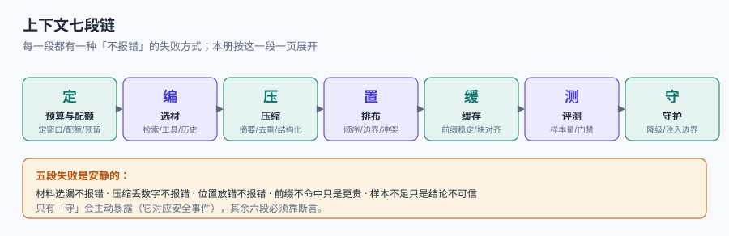

# 上下文工程总览

大模型每次推理只看得见**你这一次塞给它的那一段文本**。它不知道上一次会话说过什么、不知道你库里另外三千页写了什么、也不知道你的工期还剩几天。所以「模型答得不对」这件事，绝大多数时候不是权重的问题，而是**那一段文本里缺了什么、多了什么、或者把重要的东西放在了它读不到的地方**。

上下文工程（Context Engineering）就是把「这一次推理到底该看见什么」当成一个**有预算、有排版、有生命周期**的工程问题来处理，而不是在对话框里反复追加「请仔细阅读」。

::: tip 一句话理解
提示词工程管**怎么说**，上下文工程管**给它看什么、看多少、按什么顺序看**。前者是一句话的措辞，后者是一份要在有限窗口里塞进事实、指令、历史与工具结果的**排版与配额问题**。
:::

## 一、为什么单开一册

本库已经有四册写到了「上下文」的边上，但都停在别的层面：

| 已有专题 | 它回答的问题 | 与本册的边界 |
| --- | --- | --- |
| [提示词工程](../../PromptEngineering/index.md) | 一句话怎么写才稳：角色、少样本、思维链、结构化输出 | 它假设**材料已经就位**；本册负责把材料凑齐并塞进窗口 |
| [RAG 检索增强](../../RAG/index.md) | 怎么从库里**找出**相关片段：切分、向量、召回、重排 | 它交出来的是候选片段；本册决定**拿几段、怎么排、放哪** |
| [AI 编程助手的上下文](../../AICodingAssistant/Context/index.md) | 工具侧怎么装载 `AGENTS.md`、规则文件怎么收口 | 那是**工程约定文件**的装载；本册是**窗口内的配额与保真** |
| [推理请求调度](../../InferenceScheduling/KVCache/index.md) | 引擎侧 KV Cache 怎么复用、怎么调度 | 那是**引擎内部**的缓存块；本册是**应用侧**怎么排前缀让缓存命中 |
| [Agent 记忆](../../Agent/MemoryContext/index.md) | 跨会话记什么、怎么召回 | 那是**长期存储**；本册是**单次装配** |

五处都不回答同一个问题：**这一次请求，窗口里到底放什么、放多少、按什么顺序放，以及凭什么说这样放是对的。** 这就是本册的位置。

::: info 本册定位与读数口径
适用对象：要把 LLM 接进真实产品的应用工程师、平台工程师与评测工程师；读者已经会调 API，但需要回答「为什么同样的模型，别人的效果好」这类问题。

本册全部读数来自本机 **Python 3.13.14 标准库**在本仓库语料（`docs/` 与 `project/`，**3,324 篇 Markdown / 2,194.96 万字符**）上跑出的实验，固定种子 `20261111`，脚本不入库、读者可按各页命令复现扫描与统计部分。

**token 口径全册统一**：按「字符数 ÷ 1.5」估算（中文为主、夹杂英文与代码）。这是**估算**，不同分词器在中文上的实际比值在 1.2~1.8 之间浮动，因此全册只把 token 数用于**比例与量级**，不用于「精确到个位」的断言。凡涉及模型能力（位置效应、注意力稀释）的结论，一律标为**公开口径**并给出来源，本机没有跑模型，不编造读数。
:::

## 二、七段链：定 → 编 → 压 → 置 → 缓 → 测 → 守



| 段 | 做什么 | 安静的失败 | 本册读数 |
| --- | --- | --- | --- |
| 定 | 定窗口、定预算、定每一块的配额 | 预算表没有，靠「先塞进去试试」 | 固定开销 12,500 token 在 8k 窗口下占 **156.2%**，根本装不下 |
| 编 | 选材：检索、工具结果、历史、结构化字段 | 选了一堆「相关」但不含答案的片段 | top-5 命中率 **64.2%**，三成半问题从第一步就没有材料 |
| 压 | 压缩、摘要、去重 | 压掉了否定词、数字、单位、条件 | 抽取式压缩到 **54.34%**，但**数字只留下 57.13%** |
| 置 | 排布顺序与结构标记 | 关键信息落在中段，被稀释掉 | 预算 25% 时中段保留率 **0.0%**（头尾各留一半的写法） |
| 缓 | 前缀稳定化与缓存复用 | 每轮把检索结果插在 system 后面 | 前缀命中 **0.0%** vs 稳定排布的 **65.7%** |
| 测 | 离线评测与线上退化门禁 | 只看几个手工样例，样本量不够 | 要检出 2 个百分点的退化，p0=0.90 时需要 **1,471** 条样本 |
| 守 | 注入防护、边界标记、超限降级 | 把用户数据当指令执行 | 见[排布与注意力](../Ordering/index.md)第 6 节 |

七段里**五段的失败是安静的**：材料选漏不报错、压缩丢数字不报错、位置放错不报错、前缀不命中只是账单变贵、评测样本不足只是结论不可信。只有「守」这一段会主动暴露（因为它对应安全事件），其余六段要靠断言。

## 三、三个「这一份上下文」

同一个请求，会同时存在三份「上下文」，它们**长度不同、内容不同、可信度也不同**：

| 名字 | 定义 | 谁决定 | 典型偏差 |
| --- | --- | --- | --- |
| 声明窗口 | 模型文档写的最大 token 数（如 128k） | 模型/供应商 | 与实际可用的**有效上下文**相差数倍 |
| 装配预算 | 你在代码里分配的额度：固定开销 + 检索 + 历史 + 输出预留 | 你的装配器 | 少了任何一块都会在长输入上溢出 |
| 实际生效 | 模型真正利用到的那部分 | 位置、密度、干扰项与任务难度共同决定 | 中段的关键事实可能等于没给 |

三者混用是这类系统最常见的口径错误：拿「128k」当「能放 128k 的有效信息」，于是把二十页文档整篇塞进去，然后在评测里发现「塞得越多越差」，却以为是模型退化。

::: danger 三句最容易说错的话
1. **「窗口够大，就不用做检索了」**——窗口大只说明装得下，不说明用得上。本机语料 1,463 万 token，128k 窗口也只装得下 **0.87%**；把整个库塞进去需要 **114.3 倍**窗口。真实系统里「全塞」几乎永远不成立。
2. **「上下文越长，信息越充分」**——长度是成本，不是收益。同一份语料，检索路径的中位上下文是 **13,497 token**（整页 5 篇口径），全塞是 **14,633,028**；前者是后者的 **1/1,084**，而 top-5 的答案覆盖并不低。
3. **「压缩就是摘要一下」**——本机实测抽取式压缩把 2,194.96 万字符压到 **54.34%**，同时把**数字**从 313,332 个压到 178,994 个（保留 **57.13%**）。省了一半体积、丢了四成数字，而数字往往正是答案本身。
- **正确做法**：先写预算表（每块多少 token、超了砍谁），再写压缩的「不可压清单」，最后用固定样本量跑退化门禁。
:::

## 四、五个必失点

这五处不是「可能出错」，而是**在默认写法下几乎必然出错**，本册每一章对应一处：

1. **预算无账**：没有预算表，超限时才临时截断，截断位置随机 → [预算与配额](../Budget/index.md)。
2. **窗口当容量**：把声明窗口当可用容量，忽略位置效应与干扰密度 → [长窗口的边界](../WindowLimit/index.md)。
3. **压缩不设禁区**：摘要器自由发挥，数字、否定、单位、条件先丢 → [压缩与摘要](../Compression/index.md)。
4. **排布靠感觉**：重要内容随手放，指令与数据混在一起 → [排布与注意力](../Ordering/index.md)。
5. **缓存不友好**：每次请求都重排前缀，缓存永远不命中，账单翻数倍 → [前缀与缓存复用](../PrefixCache/index.md)。

另有两条横切要求：材料从哪来（[检索与长上下文的分工](../RetrievalSplit/index.md)）与怎么证明没变差（[评测与退化门禁](../Evaluation/index.md)）。

## 五、成熟度五档

| 档位 | 特征 | 典型症状 | 升级动作 |
| --- | --- | --- | --- |
| L0 手拼 | 字符串拼一拼，没有预算概念 | 长输入偶发失败、失败无法复现 | 写一张预算表 |
| L1 有预算 | 有固定/可变配额与截断策略 | 截断丢关键段、成本随输入线性涨 | 截断按结构而不是按字数 |
| L2 有结构 | 分段标记、指令与数据分离、关键内容定位 | 排布变了效果就变，说不清为什么 | 固定排布模板并做 A/B |
| L3 有度量 | 有评测集、有退化门禁、有样本量论证 | 门禁误报/漏报，评测集与线上分布不一致 | 分层抽样 + 置信区间 |
| L4 有账本 | 每次装配留下「放了什么、为什么、花了多少」 | 出了事能定位、能复算、能回滚 | 装配日志 + 版本化模板 |

多数团队停在 L2：模板看起来很像样，但**没有一条断言能在改动后变红**。L3 与 L4 的分界是——L3 能证明「这次没变差」，L4 能回答「上周三那次为什么差」。

## 六、判据族与阅读路径

| 页 | 判据族 | 条数 | 这一族管什么 |
| --- | --- | --- | --- |
| 总览（本页） | `CXO-A` ~ `CXO-H` | 8 | 口径统一、三份上下文的区分、必失点登记 |
| 预算与配额 | `CXB-A` ~ `CXB-H` | 8 | 预算表、输出预留、超限策略、成本账 |
| 长窗口的边界 | `CXW-A` ~ `CXW-H` | 8 | 有效上下文、位置效应、干扰密度、任务难度 |
| 压缩与摘要 | `CXC-A` ~ `CXC-H` | 8 | 压缩比、不可压清单、失真可核 |
| 排布与注意力 | `CXR-A` ~ `CXR-H` | 8 | 结构标记、首尾定位、指令数据分离、冲突消解 |
| 前缀与缓存复用 | `CXK-A` ~ `CXK-H` | 8 | 前缀稳定、块对齐、指纹、增长账 |
| 检索与长上下文的分工 | `CXS-A` ~ `CXS-H` | 8 | 决策树、混合策略、召回-预算联合调参 |
| 评测与退化门禁 | `CXE-A` ~ `CXE-H` | 8 | 评测集、样本量、门禁阈值、分层报告 |
| 实战：装配器 | `CXP-A` ~ `CXP-H` | 8 | 装配契约、预算断言、降级路径 |

合计 **9 族 72 条**。

推荐顺序：本页 → 预算 → 长窗口边界 → 压缩 → 排布 → 前缀缓存 → 检索分工 → 评测 → 实战。前五页是「一次装配」的内部顺序，后三页是「怎么选材」与「怎么证明」。

## 本页判据

本页判据族 `CXO-A` ~ `CXO-H`，共 8 条。

| 判据 | 约定 | 定错了会怎样 | 怎么验证 |
| --- | --- | --- | --- |
| `CXO-A` | 全系统统一 token 口径，并在文档里写明估算方式与误差范围 | 预算表与实际用量差 20% 以上，门禁失效 | 文档里有口径句 + 抽样比对实测分词 |
| `CXO-B` | 区分「声明窗口 / 装配预算 / 实际生效」，三者分别记录 | 用声明窗口做容量规划，长输入必溢出 | 配置与日志里三个字段各自存在 |
| `CXO-C` | 每次装配输出可复算的账：每块 token、总量、截断点 | 出了事只能靠猜 | 装配日志含分块计数 |
| `CXO-D` | 五个必失点在设计与代码里各有一条对应断言 | 缺陷只在线上暴露 | 逐条列出断言位置 |
| `CXO-E` | 明确标注本系统当前成熟度档位与升级条件 | 「我们做得挺好」无法证伪 | 文档里有档位与下一档的判据 |
| `CXO-F` | 涉及模型能力的结论标注来源（公开口径 or 自测） | 把别人的论文结论当自己的测量 | 逐句可查来源标注 |
| `CXO-G` | 单次装配的输入上限与降级路径成对存在 | 超限时抛错或静默截断 | 配置里上限与降级策略同文件 |
| `CXO-H` | 本册与相邻五册的分工写进代码注释或设计文档 | 同一件事两处实现、口径漂移 | 分工表可被引用 |

## 验证方式

```shell
# 1. 语料体量与窗口倍数（口径：字符/1.5）
find docs project -name '*.md' -not -path '*/assets/*' | wc -l
# 期望：3324

# 2. 复跑本页读数（脚本存成仓库外 cx_e0.py，全文同口径）
python3 cx_e0.py
# 期望：tokens_est≈14,633,028；128k 窗口需 114.3 倍

# 3. 检查本页判据族完整
grep -c 'CXO-[A-H]' docs/AI/ContextEngineering/Overview/index.md
# 期望：≥ 8
```

## 参考资料

- [Anthropic — Effective context engineering for AI agents](https://www.anthropic.com/engineering/effective-context-engineering-for-ai-agents)
- [Lost in the Middle: How Language Models Use Long Contexts（Liu et al., TACL 2024）](https://arxiv.org/abs/2307.03172)
- [Chroma — Context Rot: How Increasing Input Tokens Impacts LLM Performance](https://research.trychroma.com/context-rot)
- [本库：提示词工程](../../PromptEngineering/index.md)
- [本库：RAG 检索增强](../../RAG/index.md)
- [本册目录页](../index.md)
