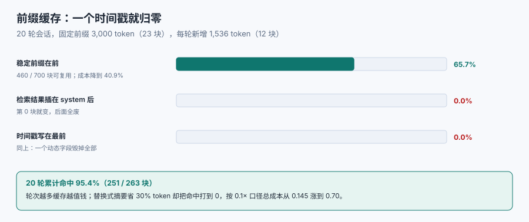

# 前缀与缓存复用

同一段系统提示，一天发十万次。如果每次都要从头算一遍，你付的是十万次的钱；如果供应商能把「已经算过的前缀」缓存下来，你付的只是**没变的那部分的一小部分**。这就是前缀缓存（prompt caching）——它不改变答案质量，只改变账单和首字延迟，而它的开关**只有一个**：前缀是否逐字节相同。

::: tip 一句话理解
前缀缓存要求「从第 0 个 token 开始、连续 N 个 token 完全一致」。这意味着**任何在开头发生变化的东西，都会让后面全部失效**——包括一个时间戳、一个随机 ID、一次「检索结果插到系统提示后面」。
:::



## 1. 命中条件：从第 0 个 token 起，按块对齐

主流实现的机制可以压成三条：

| 条件 | 含义 | 常见破坏方式 |
| --- | --- | --- |
| 从第 0 token 起连续一致 | 不是「这段出现过」而是「前缀完全相同」 | 在 system 开头拼当前时间、会话 ID |
| 按块对齐 | 命中粒度通常是 128 token 之类的块，末尾不足一块不算 | 前缀长度抖动，每次少几十 token |
| 有存活时间 | 缓存通常只保留几分钟到一小时 | 低频调用、长间隔请求 |

三条里最容易忽略的是**块对齐**：你的固定前缀如果是 3,050 token，按 128 对齐后只有 **23 块（2,944 token）**能命中，剩下 106 token 每轮重算。这不算大问题，但如果前缀本身只有 300 token，对齐后会掉到 2 块（256 token），命中率立刻难看。

## 2. 本机的账：稳定排布 65.7%，易变排布 0%

实验口径：20 轮会话，系统+工具固定前缀 **3,000 token**（23 块），每轮新增 1,536 token（12 块），块大小 128。三种排布各算一次**按 token 加权的命中率**：

| 排布 | 命中率 | 说明 |
| --- | --- | --- |
| 稳定前缀在前，检索结果在后 | **65.7%** | 460 / 700 块可复用 |
| 检索结果插在 system 之后 | **0.0%** | 第 0 块就变了，后面全废 |
| 稳定前缀在前，但每轮重排（时间戳在最前） | **0.0%** | 同上，一个时间戳毁掉全部 |

按常见的「缓存读取按原价 0.1 倍计费」口径折算，第一种排布的成本是原价的 **40.9%**——也就是**打了六折还多**。这个 0.1 是**计费口径假设**（各家不同，也会调整），但结论不依赖这个系数：**命中率从 65.7% 掉到 0%，任何折扣系数下都是纯亏。**

::: danger 五种「一改就归零」的写法
1. **系统提示开头写当前时间**。`当前时间：2026-11-11 14:09:33` —— 每秒都不同，永远 0%。
   - 正确做法：时间单独成段放在**材料之后**，或作为用户消息的一部分。
2. **把检索结果插在 system 与工具定义之间**。「先给参考资料再给工具」看起来自然，实际把动态内容放进了前缀。
   - 正确做法：常量（角色、工具）在前，变量（材料）在后。
3. **工具定义按字典序/哈希序序列化**。同一批工具两次序列化顺序不同，前缀就不同。
   - 正确做法：按固定顺序（如工具名升序）序列化，且 JSON 键序固定。
4. **每轮重排 few-shot 示例**。随机抽 3 个示例放在前面，每次都不一样。
   - 正确做法：示例固定，或把示例放在材料区。
5. **每轮把摘要插到最前面**。「历史摘要」放在 system 后面，摘要一更新，前缀全变。
   - 正确做法：摘要放在常量之后、材料之前，且**只在必要时更新**（例如每 10 轮一次，或超限时）。
:::

## 3. 多轮会话的账：历史是天然的追加

多轮对话其实非常适合前缀缓存，因为历史是**追加**的：第 N 轮的前缀 = 第 N-1 轮的全部内容。前提是你不去动它。

| 轮次 | 上下文块数 | 其中可复用 | 本轮新增计算 | 累计命中率 |
| --- | --- | --- | --- | --- |
| 5 | 83 | 71 | 12 | 85.5% |
| 10 | 143 | 131 | 12 | 91.6% |
| 20 | 263 | 251 | 12 | 95.4% |

（算法：23 块固定 + 12 块/轮；命中率 = 可复用块 / 总块。这张表说明**轮次越多，缓存越值钱**——这也是为什么「长会话」与「无状态单次调用」的成本结构完全不同。）

破坏这张表的方式也很简单：**每轮重写历史**（例如把历史重新摘要后替换）。所以摘要策略要和缓存策略一起设计：

- **滑窗**（丢掉最早的几轮）：前缀从某个点开始变化，命中率掉到「窗口起点之前的部分」。
- **追加式摘要**（保留原文，另加一段摘要）：命中率保持，成本只增加摘要那段。
- **替换式摘要**（用摘要替代旧轮次）：命中率归零，每轮全量重算。

::: warning 「省 token」与「保缓存」经常互相打架
替换式摘要省掉 30% 的 token，看起来是 0.70×；但它把命中率打到 0，按 0.1 倍缓存读取口径算，成本就是 **0.70**。追加式保留原文（1.00×），靠 95% 的命中率，成本约 **0.95×0.1 + 0.05×1.00 ≈ 0.145**。两者相差约 **4.8 倍**——**省下的 token 被丢掉缓存吃回去了**。要做这个决定，必须同时算两个数，不能只算 token 数。
:::

## 4. 前缀的稳定化清单

把「常量区」做成真正常量，需要五件事：

| 动作 | 具体做法 | 检查方式 |
| --- | --- | --- |
| 序列化稳定 | JSON 用固定键序、数组按固定键排序 | 同一输入两次序列化哈希相等 |
| 无时间无随机 | 常量区不含时间、UUID、请求 ID | 正则扫描模板 |
| 长度稳定 | 不因开关不同而插入/删除段落 | 前缀 token 数在版本内恒定 |
| 版本显式 | 改了常量就升 `template_version` | 日志里有版本号 |
| 块对齐 | 前缀长度尽量是块大小的整数倍 | 记录前缀 token 数与对齐余数 |

五件事里「序列化稳定」最容易被忽略，因为它**只在跨进程、跨语言、跨版本时才现形**：Python 的 `dict` 保序，Go 的 `map` 不保序，同一个模板在两种语言里序列化出的 JSON 键序不同，缓存不命中，而两边日志都显示「前缀没变」。

## 5. 与引擎侧 KV Cache 的分工

库内另有一册讲引擎侧的 KV Cache（[推理请求调度 · KV Cache](../../InferenceScheduling/KVCache/index.md)），两者不是同一件事：

| 维度 | 引擎侧 KV Cache | 应用侧前缀缓存 |
| --- | --- | --- |
| 谁管理 | 推理引擎（PagedAttention 等） | 供应商 API / 你的网关 |
| 复用单位 | KV 块（通常 16 token 一级） | 前缀块（通常 128 token） |
| 生命周期 | 请求间、显存内，秒级到分钟级 | 会话间，分钟级到小时级 |
| 你能控制什么 | 请求的到达顺序、批处理、共享前缀 | **前缀内容与顺序** |
| 失效原因 | 显存不足被换出、批次调度 | 前缀变化、TTL 到期、跨区域路由 |

应用侧能做的只有一件事：**保证前缀稳定**。引擎侧怎么复用，不归你管；但如果你把前缀写花了，引擎再强也救不回来。

## 6. 命中率掉了怎么查

四步，按成本从低到高：

1. **看前缀指纹**：装配日志里记录「常量区哈希」，两次不同就查模板改动。
2. **看长度余数**：前缀 token 数 mod 块大小，余数变化说明长度在抖。
3. **看路由**：多区域/多实例部署时，同一会话是否打到同一后端（缓存不跨节点）。
4. **看 TTL**：调用间隔是否超过缓存存活时间（低频任务天然不命中，别为此改架构）。

## 本页判据

本页判据族 `CXK-A` ~ `CXK-H`，共 8 条。

| 判据 | 约定 | 定错了会怎样 | 怎么验证 |
| --- | --- | --- | --- |
| `CXK-A` | 常量区（角色、工具、示例）在前，变量区在后 | 命中率归零 | 模板顺序可读 |
| `CXK-B` | 常量区不含时间、UUID、请求 ID | 每轮 0% 命中 | 正则扫描模板 |
| `CXK-C` | 序列化键序固定、数组按固定键排序 | 跨进程/跨语言时不命中 | 两次序列化哈希一致 |
| `CXK-D` | 记录前缀指纹与 token 数（含块对齐余数） | 命中率下降无法归因 | 装配日志字段齐全 |
| `CXK-E` | 摘要策略与缓存策略一起评估（替换式摘要要算总账） | 省了 token、贵了三倍 | 有对比测算 |
| `CXK-F` | `template_version` 随常量变更递增 | 无法判断是哪次改动导致失效 | 日志里有版本 |
| `CXK-G` | 多实例部署时确认缓存是否跨节点共享 | 命中率只有 1/N | 部署文档有说明 |
| `CXK-H` | 缓存折扣系数标注为「计费口径假设」而非实测 | 结论被误当测量值 | 文档里有假设标注 |

## 验证方式

```shell
# 1. 复算本页命中率（脚本 cx_e5.py，仓库外执行）
python3 cx_e5.py
# 期望：稳定前缀 65.7%；易变前缀 0.0%；20 轮累计 95.4%

# 2. 块对齐余数
python3 -c "p=3000;b=128;print(p//b, p%b, '可命中 token =', (p//b)*b)"
# 期望：23 56 可命中 token = 2944

# 3. 扫描模板里是否含时间/随机（示例路径）
grep -nE 'datetime|now\(\)|uuid|random' prompts/system.txt
# 期望：无输出（有输出则说明常量区在变）

# 4. 检查本页判据族完整
grep -c 'CXK-[A-H]' docs/AI/ContextEngineering/PrefixCache/index.md
# 期望：≥ 8
```

## 参考资料

- [OpenAI — Prompt caching（前缀命中与计费）](https://platform.openai.com/docs/guides/prompt-caching)
- [Anthropic — Prompt caching（块对齐与 TTL）](https://docs.anthropic.com/en/docs/build-with-claude/prompt-caching)
- [vLLM — Automatic Prefix Caching（引擎侧机制）](https://docs.vllm.ai/en/latest/features/prefix_caching.html)
- [本库：推理请求调度 · KV Cache](../../InferenceScheduling/KVCache/index.md)
- [本册：排布与注意力](../Ordering/index.md)
- [本册目录页](../index.md)
