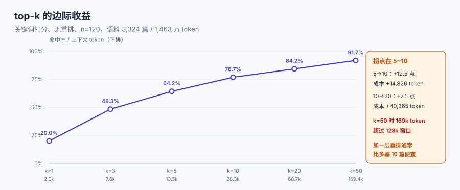

# 检索与长上下文的分工

「窗口够大了，还要不要检索」是这两年被问得最多的问题。答案是：**要，但理由变了**——以前检索是为了「装得下」，现在检索是为了「不装无关的东西」。这一页把四种手段（检索、长上下文、微调、工具）的分工写清，并给出预算约束下「取几段」的算法。



## 1. 四种手段各解决什么

| 手段 | 解决什么 | 不解决什么 | 成本结构 |
| --- | --- | --- | --- |
| 检索（RAG） | 从海量材料里**定位**相关片段 | 需要全局一致的任务 | 每次查询一次检索开销 + 片段 token |
| 长上下文 | 需要**通篇**材料的任务（改写、校对、跨段推理） | 海量材料的定位 | 输入 token 随长度线性涨 |
| 微调 | 稳定的**风格、格式、领域语感** | 事实类知识（易幻觉、易过期） | 一次性训练 + 每次推理 |
| 工具调用 | 精确计算、查询、写入 | 需要语言理解的部分 | 每次调用往返 + 结果 token |

四者的关系不是替代，是**分层**：微调改「怎么说」，检索决定「看到什么」，长上下文处理「必须整体看」，工具负责「算得准」。真实的系统通常是「微调过的模型 + 检索 + 工具 + 少量长上下文」。

::: tip 一句话判据
**答案在材料的「某几句」里 → 检索；答案依赖材料的「整体」→ 长上下文；答案需要精确计算或最新事实 → 工具；答案取决于「说话的腔调」→ 微调。**
:::

## 2. 取几段：一条实测的边际收益曲线

本机在 3,324 篇 / 1,463 万 token 的语料上，用 120 个「以标题为查询」的样本跑了一遍 top-k 曲线（关键词打分，无重排）：

| k | 答案页命中率 | 上下文 token（中位） | 相对 top-1 | 每多 1 个百分点的代价 |
| --- | --- | --- | --- | --- |
| 1 | 20.0% | 1,969 | 1× | — |
| 3 | 48.3% | 7,629 | 3.9× | 200 token/点 |
| 5 | **64.2%** | 13,497 | 6.9× | 369 token/点 |
| 10 | 76.7% | 28,323 | 14.4× | 1,186 token/点 |
| 20 | 84.2% | 68,688 | 34.9× | 5,382 token/点 |
| 50 | 91.7% | 169,440 | 86.1× | 13,434 token/点 |

三条读法：

1. **1 → 3 单位成本最低**（200 token/点），但绝对值只到 48.3%；**3 → 5 是召回主力段**（+15.9 点，只多 5,868 token）；**5 → 10 开始变贵**（1,186 token/点，多 14,826 token）；**20 之后基本是买保险**。
2. **k=50 时上下文 169,440 token，已经超过 128k 窗口**——「多取一点总没坏处」在 20 以后连装都装不下。
3. 这条曲线**没有重排**。加一层重排通常能把 k=10 的命中率提到接近 k=20 的水平，代价是一次模型调用——**重排通常比「多塞 10 篇」便宜**。

::: warning 这条曲线的适用边界
它是**关键词打分**的结果，不是向量检索、更不是生产系统。绝对值会随切片质量、语料分布、查询构造方式大幅变化。**可迁移的是形状**：边际收益前高后低、成本近似线性、拐点通常在 5~10 之间。要用自己语料重跑，别把 64.2% 当自己的基线。
:::

## 3. 预算约束下的 k 选择

给定检索预算 `B`（token）与平均片段长度 `s`，可选 `k = B / s`。把它和上面的曲线叠起来，就是一个带约束的优化问题——但实践里不需要解方程，用三档就够：

| 场景 | 建议 k | 依据 | 备注 |
| --- | --- | --- | --- |
| 有重排、答案局部 | 5 ~ 8 | 重排把噪声压下去，k 不必大 | 重排后再截断 |
| 无重排、答案局部 | 10 ~ 15 | 用数量补召回 | 必须去重，否则同页多段挤占 |
| 聚合/统计类 | 不适用 | 应在工具侧聚合 | 检索再全也会漏 |

::: danger 三个与检索分工有关的错误
1. **用长上下文替代检索，成本按 1000 倍算**。全库 1,463 万 token，top-5 是 1.3 万——差 **1,084 倍**。即使窗口装得下，也没有理由每次都全量。
   - 正确做法：默认检索，只有「必须整体看」的任务才整篇塞。
2. **只调 k，不调切片**。切片 2,000 token 时，k=5 就是 1 万 token，且每段都含大量无关正文。
   - 正确做法：切片按语义单元（300~800 token），k 才有意义。
3. **把检索当"事实校验"**。检索到的是文档里的说法，不等于事实正确；文档本身可能过期。
   - 正确做法：材料带 `updated_at`，冲突时按权威/时效规则处理（见[排布与注意力](../Ordering/index.md)第 4 节）。
:::

## 4. 切片大小与预算的联动

切片大小决定了三件事：检索精度、单段信息密度、上下文成本。本库的经验区间与依据：

| 切片 | 优点 | 缺点 | 适用 |
| --- | --- | --- | --- |
| 100~200 token | 定位准、噪声少 | 上下文碎片化，跨段推理难 | 事实抽取、字段查询 |
| 300~800 token | 一段一个完整论点 | 需要较好的切分器 | 通用默认 |
| 1,000~2,000 token | 保留上下文完整性 | 单段噪声大、成本高 | 代码、合同条款、表格 |

联动关系：**切片越小，k 要越大才能覆盖同一片信息**。切片 200 token、k=5 只有 1,000 token 上下文，往往不够；切片 1,500 token、k=5 已经 7,500 token。所以「k 取多少」必须和切片一起定，单独调一个没有意义。

## 5. 混合策略：检索 + 长上下文 + 工具

三种组合在实践中被验证有效：

**组合一：先检索定章节，再整章塞。** 适合「答案在一份长文档的某一节里」。用 200 token 的片段定位到章节，然后把整节（1,000~3,000 token）塞进去——既保住了检索的精度，又保住了章节内的连续性。

**组合二：先工具聚合，再塞结果。** 适合「数一数 / 求和 / 去重计数」。让工具在数据侧完成聚合，上下文里只放「结果 + 口径 + 样本量」三行。这类任务用上下文做聚合是必错的（漏读一段就错）。

**组合三：检索 + 摘要层。** 适合「材料量大但只需要结论」。检索出 20 段，先压成 8 条要点（结构化），再把要点与原段落的 `id` 一起塞进去——模型可以按 `id` 要求展开某一条。

## 6. 失败模式：召回不到、召回错、召回过量

| 失败 | 表现 | 判据 | 处置 |
| --- | --- | --- | --- |
| 召回不到 | 答案不在 top-k 里 | 离线评测的 recall@k | 改切片、加同义词、混合检索、加重排 |
| 召回错 | 答案在，但材料自相矛盾 | 冲突计数 | 权威/时效规则 + 显式冲突 |
| 召回过量 | token 涨、效果降 | 成本曲线与命中率不同向 | 降 k、加重排、去重 |
| 召回到「相似但无关」 | 术语相同、语境不同 | 人工抽检 50 条 | 加元数据过滤（版本、租户、时间） |

四类里最难发现的是**召回过量**：它表现为「效果没变差但账单涨了」，而账单通常不在工程师的视野里。

## 本页判据

本页判据族 `CXS-A` ~ `CXS-H`，共 8 条。

| 判据 | 约定 | 定错了会怎样 | 怎么验证 |
| --- | --- | --- | --- |
| `CXS-A` | 按任务类型选择手段（检索/整篇/工具/微调），并写明理由 | 用检索做聚合、用整篇做定位 | 设计文档有决策记录 |
| `CXS-B` | k 与切片大小一起定，不单独调 | k=5 却塞进 1 万 token | 配置里两者相邻且有注释 |
| `CXS-C` | 有 recall@k 的离线读数 | 不知道召回天花板 | 评测报告有该指标 |
| `CXS-D` | 放宽 k 必须配套重排或去重 | 成本线性涨、效果不涨 | 代码顺序：rerank → 截断 |
| `CXS-E` | 聚合类任务在工具侧完成 | 漏读导致结论错 | 有聚合工具实现 |
| `CXS-F` | 材料带来源与时间，冲突可显式化 | 用过期材料回答 | 装配日志有 `conflicts[]` |
| `CXS-G` | 全量塞入前先算窗口倍数 | 请求超限或成本爆炸 | 有倍数计算 |
| `CXS-H` | 曲线读数标注语料与打分方式，不跨语料套用 | 把别人的 64.2% 当自己的基线 | 文档写明口径 |

## 验证方式

```shell
# 1. 复算窗口倍数
python3 -c "print(round(14633028/13497))"
# 期望：1084  → top-5 与全库相差约 1,084 倍

# 2. 复跑 top-k 曲线（脚本 cx_e6.py，仓库外执行）
python3 cx_e6.py
# 期望：k=5 命中 64.2%、13,497 token；k=50 命中 91.7%、169,440 token

# 3. 检查本页判据族完整
grep -c 'CXS-[A-H]' docs/AI/ContextEngineering/RetrievalSplit/index.md
# 期望：≥ 8
```

## 参考资料

- [Lost in the Middle（长上下文与检索的对比实验）](https://arxiv.org/abs/2307.03172)
- [Anthropic — Contextual retrieval（切片与上下文化）](https://www.anthropic.com/news/contextual-retrieval)
- [本库：RAG · 检索与重排](../../RAG/Retrieval/index.md)
- [本库：RAG · 切分策略](../../RAG/Chunking/index.md)
- [本册：长窗口的边界](../WindowLimit/index.md)
- [本册目录页](../index.md)
