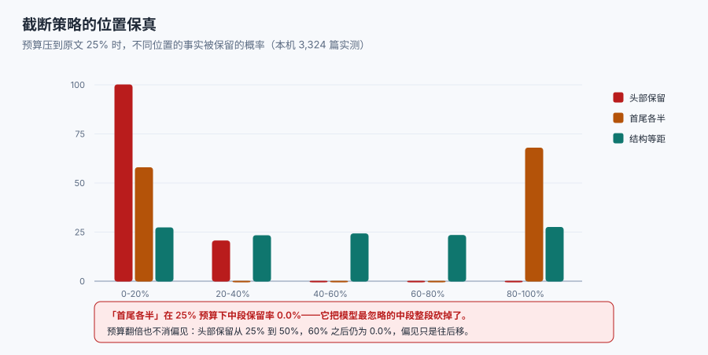

# 长窗口的边界

「128k 窗口」是**装得下**的意思，不是**读得完**的意思。这一页把「窗口」和「有效上下文」分开，并把三件决定实际效果的事说清：位置、密度、任务难度。

::: danger 一句必须纠正的直觉
**「上下文越长，模型掌握的信息越多」是错的。** 公开研究给的结论一致：把更多内容塞进窗口，模型在需要精确定位的任务上表现会**下降**，而且下降与「答案在哪」强相关——首尾好、中段差（Lost in the Middle，TACL 2024）；即使用户任务很简单，输入变长本身也会造成退化（Chroma 的 Context Rot 报告）；多家模型的**有效上下文**显著短于其声明窗口（RULER 基准）。
- **正确做法**：把「窗口」当上限，把「有效上下文」当预算（通常只取声明值的 1/4 ~ 1/2），并用自己任务的评测集标定这个比例。
:::



## 1. 三个长度的区别

| 长度 | 含义 | 谁决定 | 怎么用 |
| --- | --- | --- | --- |
| 声明窗口 | 模型能接受的最大 token 数 | 供应商 | 只作硬上限，不作规划依据 |
| 有效上下文 | 在该任务上仍能稳定利用的长度 | 任务 + 模型 + 排布 | 用评测标定，写进预算表 |
| 实际装配 | 这次真正发出去的 token | 你的装配器 | 每次记录，用于归因 |

三者混用会直接导致两个典型误判：把「装得下 20 页」当成「能答对 20 页里的细节」；以及把「答错了」归因为模型能力，而实际是**答案落在中段**。

## 2. 位置效应：为什么中段最危险

公开口径的结论可以压成一句：**同一份事实，放在开头或结尾比放在中间更容易被用上**，且这个差距在需要「多跳定位」时最大。本机不能跑模型，但可以量化一个**和它同构的结构问题**：如果你的截断或选取策略有位置偏好，那么它保留「不同位置事实」的概率是可以算的。

本机在 3,324 篇 Markdown 上按段落切分，把预算压到原文的 25% 与 50%，用四种策略各跑一遍，统计**位置落在各区间的事实被保留的概率**：

| 策略 | 0-20% | 20-40% | 40-60% | 60-80% | 80-100% |
| --- | --- | --- | --- | --- | --- |
| 头部保留（预算 25%） | **100.0%** | 20.5% | **0.0%** | 0.0% | 0.0% |
| 尾部保留（预算 25%） | 0.0% | 0.0% | 0.0% | 29.6% | **100.0%** |
| 首尾各半（预算 25%） | 57.8% | 0.0% | **0.0%** | 0.0% | 67.8% |
| 结构等距（预算 25%） | 27.2% | 23.2% | 24.1% | 23.3% | 27.4% |
| 头部保留（预算 50%） | 100.0% | 100.0% | 45.3% | 0.0% | 0.0% |
| 首尾各半（预算 50%） | 100.0% | 19.0% | **0.0%** | 30.9% | 100.0% |

读法有三层：

1. **「首尾各半」在 25% 预算下中段保留率是 0.0%**。这类写法看起来很公平（头尾都照顾），但它恰好把**最容易被模型忽略的中段**整段砍掉，等于把「位置劣势」放大成「位置灭绝」。
2. **结构等距是唯一位置无关的策略**（各区间 23%~27%），代价是它会把每一段都切碎——如果答案需要连续上下文（如一段代码、一张表），等距抽样反而更难用。
3. **预算翻倍不等于风险减半**：头部保留从 25% 提到 50%，60% 之后的位置依旧 **0.0%**。**位置偏见不会因为预算变大而消失，它只会往后移。**

::: tip 一条能落地的排布规则
**关键事实不要只出现一次，且至少在头尾各出现一次。** 具体做法：检索到的片段按相关度排序后，把**最高分的那段**放在最前（紧跟指令）或最后（紧邻问题），把低分的堆中段；如果只有一个答案，宁可在中段再重复一遍它的关键字段（成本是一段 200 token，收益是命中率）。
:::

## 3. 密度：干扰项的账

「多给几段参考」直觉上是提高召回，实际是**降低信噪比**。本机按语料实测了两种取法的量级差：

| 取法 | 上下文 token（中位） | 相对全库 | 答案页覆盖（top-5，n=120） |
| --- | --- | --- | --- |
| 按段落取 5 段（600/段） | 3,000 | 1/4,878 | 与整页取法同源，取决于切片质量 |
| 按整页取 5 篇 | **13,497** | 1/1,084 | **64.2%** |
| 全库（3,324 篇） | **14,633,028** | 1× | 100%（但装不下） |

三行说明两件事：**「全塞」在这个量级根本不可行**（128k 窗口只能装 0.87%）；而「取 5 篇整页」比「取 5 段」贵 5 倍以上，多出来的部分是**与问题无关的正文**——它们既是成本，也是干扰项。

::: warning 长窗口最容易掉进去的坑：用「少检索」换「大窗口」
既然窗口有 128k，就把召回从 top-5 放宽到 top-30，「反正装得下」。代价体现在两处：① 输入 token 从 3,000 涨到 18,000，成本 ×6；② 25 个与问题无关的片段会把答案的概率质量摊薄，位置越靠中间越明显。**放宽召回必须配套重排（rerank）与去重**，否则是拿成本换噪声。
:::

## 4. 任务难度：同一条上下文，不同任务的有效长度差数倍

有效上下文不是一个固定数字，它随任务类型变化。可以按「定位难度」粗分四档：

| 任务类型 | 定位难度 | 典型有效长度（相对声明窗口） | 判断依据 |
| --- | --- | --- | --- |
| 单点事实抽取（答案是原文一句） | 低 | 1/2 ~ 1/4 | 只需命中一处 |
| 多跳推理（A 在片段 3，B 在片段 17，需合成） | 中 | 1/4 ~ 1/8 | 需要同时保有两条事实 |
| 聚合统计（数一数、求和、去重计数） | 高 | 1/8 ~ 1/20 | 需要覆盖全部片段，漏一段就错 |
| 长文改写（保持结构、风格、术语一致） | 中高 | 1/4 ~ 1/10 | 需要通篇一致而非精确检索 |

这张表的用法不是背数字，而是**按任务选预算**：聚合统计类任务再大的窗口也不该「整篇塞」，而应该**先算后塞**（在检索侧或工具侧完成聚合，把结果塞进去）。

## 5. 五种「以为窗口大就没问题」的写法

1. **整篇文档直塞**。超过有效长度后，答案段落的命中率下降而成本线性上涨。
   - 正确做法：先按章节切，按问题定位到章节，再整章塞。
2. **长历史全保留**。历史里的旧约束会与新指令冲突，模型往往选「更近的那条」。
   - 正确做法：历史设上限，冲突时显式声明「以本条为准」。
3. **用窗口长度做分片大小**。把 128k 当切分单位，切出来的块既超有效长度又难检索。
   - 正确做法：切分按语义单元（300~800 token），与窗口无关。
4. **把「模型说它读了」当成读了**。很多模型会复述你给的开头，但不代表它用了中段。
   - 正确做法：评测里把答案位置作为变量（分位置桶报告，见[评测](../Evaluation/index.md)）。
5. **一次塞满、多次追问**。第一轮塞 100k，后面每轮都带着这 100k 重算。
   - 正确做法：把长材料压成结构化摘要，原文留在可寻址存储里按需回捞。

## 6. 什么时候「整篇塞」是对的

反过来也要说清：有三种场景，整篇塞确实优于检索。

| 场景 | 为什么 | 注意 |
| --- | --- | --- |
| 需要**通篇一致**的改写（合同、法律条款、风格统一） | 检索会破坏上下文连续性 | 先确认在有效长度内，超了就分段改写再合并 |
| 材料**短且必须全对**（一页配置、一份 schema） | 漏一行就出错，检索没有意义 | 控制在有效长度内，别塞第二份无关材料 |
| 一次性任务（离线批处理，成本不敏感） | 没有交互延迟压力 | 仍要防「聚合类任务」的漏读 |

判据是：**这份材料的价值在于「整体」，而不在于「某几句」时，整篇塞；价值在于「某几句」时，检索。**

## 本页判据

本页判据族 `CXW-A` ~ `CXW-H`，共 8 条。

| 判据 | 约定 | 定错了会怎样 | 怎么验证 |
| --- | --- | --- | --- |
| `CXW-A` | 文档区分「声明窗口」与「有效上下文」，后者有实测值 | 用声明值做规划，长输入必退化 | 预算表里有 `effective_limit` 与其来源 |
| `CXW-B` | 有效上下文按任务类型分别标定（至少区分抽取与聚合） | 聚合任务用抽取任务的预算，漏读 | 评测报告按任务分档 |
| `CXW-C` | 评测结果按「答案位置」分桶报告 | 中段失效被平均值掩盖 | 报告里有位置分桶 |
| `CXW-D` | 关键事实在头尾各出现至少一次 | 中段答案等于没给 | 装配模板可检出 |
| `CXW-E` | 放宽召回必须配套重排与去重 | 成本 ×6、噪声 ×5 | 代码里 rerank 在截断之前 |
| `CXW-F` | 聚合类任务不在上下文里做聚合 | 漏读一段全错 | 有工具侧聚合实现 |
| `CXW-G` | 长材料采用「摘要 + 可寻址原文」而非整篇常驻 | 每轮重复计费 | 存储里有原文，上下文里只有指针 |
| `CXW-H` | 涉及模型能力的结论标注来源（论文/报告/自测） | 把别人的结论当自己的测量 | 逐条可查 |

## 验证方式

```shell
# 1. 复算「全塞不可行」
python3 -c "print(round(128000/14633028*100, 2))"
# 期望：0.87  → 128k 窗口只装得下全库的 0.87%

# 2. 复跑位置保真表（脚本见目录页 assets 说明，仓库外执行）
python3 cx_e2.py
# 期望：预算 25% 时「首尾各半」中段 0.0%，「结构等距」各桶 23%~27%

# 3. 检查本页判据族完整
grep -c 'CXW-[A-H]' docs/AI/ContextEngineering/WindowLimit/index.md
# 期望：≥ 8
```

## 参考资料

- [Lost in the Middle: How Language Models Use Long Contexts（Liu et al., TACL 2024）](https://arxiv.org/abs/2307.03172)
- [Chroma Research — Context Rot](https://research.trychroma.com/context-rot)
- [RULER: What's the Real Context Size of Your Long-Context Language Models?](https://arxiv.org/abs/2404.06654)
- [本库：RAG · 检索与重排](../../RAG/Retrieval/index.md)
- [本册：压缩与摘要](../Compression/index.md)
- [本册目录页](../index.md)
