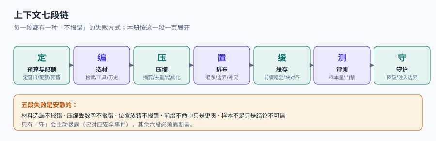
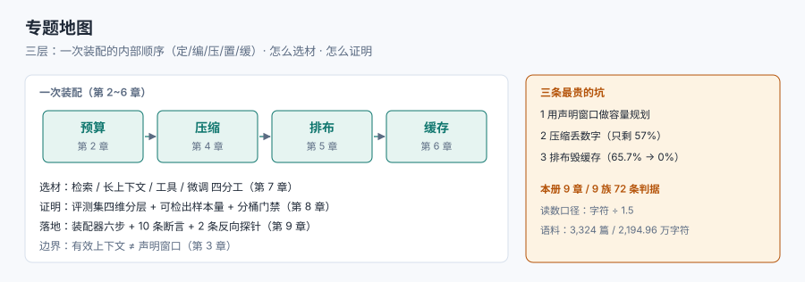

# 上下文工程与长上下文治理

一个模型每次推理只看得见**这一次塞进去的那段文本**。它不知道你的库里有三千多页文档，不记得上一轮说过什么，也不会主动去查——它只能在给定的窗口里，把注意力分给已经在那儿的东西。所谓「模型不行」，很多时候是**该在的东西不在，在的东西太多，或者重要的东西被放在了它读不到的位置**。

本册讲的是**这次推理的输入该怎么组织**：预算怎么算、材料怎么选、压缩到什么程度、按什么顺序排、怎么让缓存命中、以及怎么证明改完之后没变差。

::: info 本册定位与读数口径
适用对象：把 LLM 接进真实产品的应用工程师、平台工程师与评测工程师。读者已经会调 API、会写提示词，但需要回答「为什么同样的模型，别人的效果好」。

全部读数来自本机 **Python 3.13.14 标准库**在本仓库语料上的实验：取 HEAD 已跟踪的 **3,324 篇 Markdown / 2,194.96 万字符**（`git ls-files docs project` 可复现同一批页面），固定种子 `20261111`，脚本不入库、明标「非生产」。

**token 口径全册统一**：按「字符数 ÷ 1.5」估算。这是估算而非实测分词，中文场景实际比值在 1.2~1.8 之间浮动，同 10 万字符在两种比值下可差 **2.5 万 token**；因此全册 token 数只用于**比例与量级**。凡涉及模型能力（位置效应、注意力稀释）的结论一律标「公开口径」并给来源——本机没有跑模型，不编造模型读数。
:::

## 一、一句话定位

**上下文工程不是「写一句更好的提示词」，而是把一个有限的窗口当成预算来分配：谁能进、进来多少、按什么顺序、花多少钱、错了怎么知道。**

同一份材料，换一种装法，效果与成本都能差几倍；而绝大多数差异**不会报错**——页面能开、接口返回 200、日志一片绿，只有评测集和账单能看出来。

## 二、七段链与专题地图

| 段 | 一句话 | 在哪一页 |
| --- | --- | --- |
| 定 | 窗口、预算、配额表 | [预算与配额](Budget/index.md) |
| 编 | 选材：检索、工具、历史 | [检索与长上下文的分工](RetrievalSplit/index.md) |
| 压 | 压缩、摘要、去重 | [压缩与摘要](Compression/index.md) |
| 置 | 顺序、边界、冲突消解 | [排布与注意力](Ordering/index.md) |
| 缓 | 前缀稳定与缓存命中 | [前缀与缓存复用](PrefixCache/index.md) |
| 测 | 评测集、样本量、门禁 | [评测与退化门禁](Evaluation/index.md) |
| 守 | 注入边界、降级、可复算 | [实战：装配器](Practice/index.md) |

## 三、十行分工表

库内已有五册写到「上下文」的边上，边界必须写死，否则同一件事会有两套口径：

| 相邻专题 | 它回答什么 | 本册回答什么 |
| --- | --- | --- |
| [提示词工程](../PromptEngineering/index.md) | 一句话怎么写得稳：角色、少样本、思维链、结构化输出 | 这一次该给它看什么、看多少、按什么顺序 |
| [RAG 检索增强](../RAG/index.md) | 怎么从库里**找出**候选片段（切分、向量、召回、重排） | 拿几段、怎么截断、放在窗口的哪个位置 |
| [AI 编程助手的上下文](../AICodingAssistant/Context/index.md) | 工具侧怎么装载规则文件（`AGENTS.md` 收口） | 窗口内的配额与保真，与文件装载无关 |
| [推理请求调度 · KV Cache](../InferenceScheduling/KVCache/index.md) | 引擎侧 KV 块怎么复用、怎么调度 | 应用侧怎么排前缀让引擎有东西可复用 |
| [Agent 记忆](../Agent/MemoryContext/index.md) | 跨会话记什么、怎么召回（长期存储） | 单次装配：把召回结果编进窗口 |
| [模型评测工程](../EvalEngineering/index.md) | 评测集怎么建、判据怎么校准（通用方法） | 上下文改动的四类指标与样本量算式 |
| [多模态检索与重排](../MultimodalRetrieval/index.md) | 图文混合的召回与重排 | 多模态结果进窗口时的 token 与位置账 |
| [提示词安全与评估](../PromptSecurity/index.md) | 注入与越狱的攻击面与检测 | 材料/指令分离这一处结构性防护 |
| [大模型应用开发](../LLMApp/index.md) | 应用骨架、编排、部署 | 装配层：预算、压缩、排布、缓存 |
| [数据库 · 连接池与代理](../../DB/ConnectionPool/index.md) | 连接复用与代理形态 | 类比来源：都是「有限资源的配额与复用」，但对象不同 |

## 四、判据族

沿用全库写法：**每页 8 条，编号形如 `CXO-A`**，逐页前缀唯一，可被 `utils/audit` 下的判据巡检机械核对。每条判据回答三件事：**看什么现象、判成什么、不满足时改哪里**。

| 页 | 判据族 | 这一族管什么 | 条数 |
| --- | --- | --- | --- |
| [总览](Overview/index.md) | `CXO-A` ~ `CXO-H` | 口径统一、三份上下文、必失点登记 | 8 |
| [预算与配额](Budget/index.md) | `CXB-A` ~ `CXB-H` | 预算表、输出预留、超限策略、成本账 | 8 |
| [长窗口的边界](WindowLimit/index.md) | `CXW-A` ~ `CXW-H` | 有效上下文、位置效应、干扰密度 | 8 |
| [压缩与摘要](Compression/index.md) | `CXC-A` ~ `CXC-H` | 压缩比、不可压清单、失真可核 | 8 |
| [排布与注意力](Ordering/index.md) | `CXR-A` ~ `CXR-H` | 结构标记、首尾定位、指令数据分离 | 8 |
| [前缀与缓存复用](PrefixCache/index.md) | `CXK-A` ~ `CXK-H` | 前缀稳定、块对齐、指纹、增长账 | 8 |
| [检索与长上下文的分工](RetrievalSplit/index.md) | `CXS-A` ~ `CXS-H` | 决策树、k 与切片、混合策略 | 8 |
| [评测与退化门禁](Evaluation/index.md) | `CXE-A` ~ `CXE-H` | 评测集、样本量、门禁阈值 | 8 |
| [实战：装配器](Practice/index.md) | `CXP-A` ~ `CXP-H` | 装配契约、预算断言、降级路径 | 8 |

全册共 **9 族 / 72 条判据**。判据表列序固定为「页 | 判据族 | 这一族管什么 | 条数」，它是巡检契约的一部分，不是排版自由。

## 五、事实速览（2026-11 核对）

前缀缓存的**机制参数各家不同且会变**，本册只依赖其中稳定的三条：

| 事实 | 口径 | 对本册的影响 |
| --- | --- | --- |
| 有「最低可缓存长度」 | 各家不同（常见 1,024 / 2,048 / 4,096 三档），低于阈值**不报错、静默不缓存** | 系统提示太短时做了缓存也白做，必须看返回的缓存计数字段 |
| 默认 TTL 通常 5 分钟，命中即刷新 | 可付费延长到 1 小时，写入加价（约 1.25×），读取约 0.1× | 「低频调用天然不命中」不是配置错，是流量形态 |
| 命中要求前缀逐字节一致、按块对齐 | 具体块大小与最多断点数随供应商不同 | 排布纪律（常量在前、变量在后）跨供应商通用 |

::: warning 关于价格与块大小的具体数字
本页**不写**具体美元价格与块大小，因为它们是会按月变的商务参数，写进文档很快就过期。判断方法写在[前缀与缓存复用](PrefixCache/index.md)：看 `cache_read_input_tokens` 是否非零、看块对齐余数、看两次装配的前缀指纹是否一致。以各家官方文档为准。
:::

## 六、为什么这一册不建版本目录

AGENTS.md 第 3 节要求「出现大版本差异时按版本目录组织」，本库已有 `Java/Frame/Spring/Spring5` 与 `Spring6`、`Frontend/Frame/Vue/Vue2` 与 `Vue3` 两个范式。本册**不建**版本目录，三条理由：

1. **换代的是模型与计费口径，判据没变**。七段链（定/编/压/置/缓/测/守）在 4k 窗口时代就成立，在 1M 窗口时代仍然成立；变的是每一段的数字，不是结构。
2. **并存差异是「同一套判据的不同取值」，不是代际**。同一家公司同时跑 8k 与 200k 两条链路，差别在预算表，不在「两份写法」。
3. **真正需要版本目录的是「同一份代码两套写法」**——例如 Spring 5 的 `WebSecurityConfigurerAdapter` 与 Spring 6 的 `SecurityFilterChain`、Vue 2 的 Options API 与 Vue 3 的 Composition API。本册没有这种分叉：没有任何一段代码在新旧模型上必须换写法才能跑。

旧版本内容一律保留、不覆盖；本册为新建，无旧内容可动。

## 七、三条最贵的坑

1. **用声明窗口做容量规划**。128k 窗口在固定开销 12,500 token 时，可用配额是 115,500；但**有效上下文**通常只有声明值的 1/4~1/2，按 128k 规划就是按 2~4 倍乐观估计。
2. **压缩丢数字**。本机抽取式压缩到 54.34%，数字只剩 **57.13%**——省的是体积，丢的是答案。压缩必须带**不可压清单**。
3. **排布毁缓存**。稳定前缀命中 65.7%，把检索结果插到 system 后面就变 **0.0%**；账单翻数倍，而所有日志都「正常」。

## 八、阅读顺序

- **第一次接**：本页 → [预算与配额](Budget/index.md) → [排布与注意力](Ordering/index.md) → [实战](Practice/index.md)。
- **效果不稳**： [长窗口的边界](WindowLimit/index.md) → [压缩与摘要](Compression/index.md) → [评测与退化门禁](Evaluation/index.md)。
- **账单太贵**：[前缀与缓存复用](PrefixCache/index.md) → [检索与长上下文的分工](RetrievalSplit/index.md) → [预算与配额](Budget/index.md)。

## 参考资料

- [Anthropic — Effective context engineering for AI agents](https://www.anthropic.com/engineering/effective-context-engineering-for-ai-agents)
- [Anthropic — Prompt caching（最低长度、TTL、断点）](https://docs.anthropic.com/en/docs/build-with-claude/prompt-caching)
- [Lost in the Middle: How Language Models Use Long Contexts（TACL 2024）](https://arxiv.org/abs/2307.03172)
- [Chroma — Context Rot](https://research.trychroma.com/context-rot)
- [RULER: What's the Real Context Size of Your Long-Context LMs?](https://arxiv.org/abs/2404.06654)
- [本库：RAG 检索增强](../RAG/index.md)
- [本库：提示词工程](../PromptEngineering/index.md)
