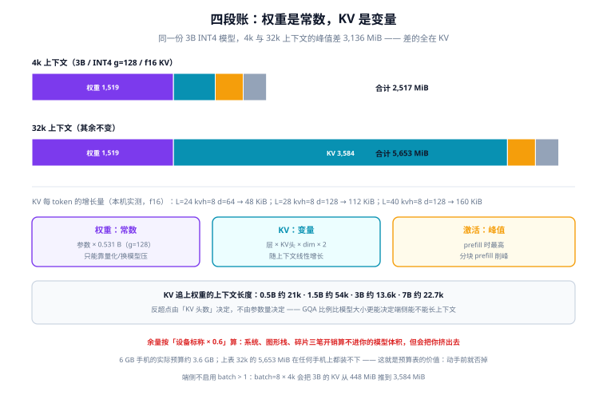

# 内存与延迟预算

端侧方案的生死在写代码之前就定了：**预算表算错，后面所有优化都是在给一个不可能的方案续命**。这一页把预算拆成四段可算的账（权重、KV、激活、运行时），给出解码速度的上界公式，并说明为什么余量要从服务端的 20% 提到 40%。

::: tip 一句话理解
权重是**常数**，KV 是**变量**，激活是**峰值**，运行时是**税**。四段里只有权重能靠量化直接压，其余三段要靠「限制上下文、限制并发、换更轻的运行时」压。
:::

## 判据族声明

本页判据族 `EIB-A` ~ `EIB-H`，共 8 条。定义表在第八节。

## 本页不讲什么

- 不讲量化粒度怎么选、误差怎么测，归 [量化方案与端侧可行性](../Quantization/index.md)。
- 不讲运行时怎么委派算子，归 [运行时与算子委派](../Runtime/index.md)。
- 不讲服务端的显存规划（多卡、并发、continuous batching），归 [GPU 与显存规划](/docs/AI/LocalModel/Hardware/index.md)。

## 一、四段账：先分类，再算数



| 段 | 性质 | 主要影响因子 | 能不能压 |
| --- | --- | --- | --- |
| **权重（weights）** | 常数 | 参数量 × bit 数 + scale 开销 | 量化、剪枝、换小模型 |
| **KV cache** | 随上下文线性增长 | 层数 × KV 头数 × head_dim × 2（K+V）× 精度 × token 数 | 减上下文、GQA / MQA、KV 量化 |
| **激活与中间张量** | 峰值，随 batch 与序列长度增长 | prefill 长度、attention 矩阵、FFN 中间层 | 分块 prefill、限制单次输入长度 |
| **运行时开销** | 常数（但会被低估） | 运行时本体、图优化后的副本、GPU 缓冲、着色器缓存 | 换轻量运行时、复用会话 |

四段里最容易被漏掉的是**运行时开销**：浏览器里一份 WebGPU 上下文 + 模型缓冲 + 着色器编译缓存，200~400 MB 是常态；Android 上一个带 NNAPI delegate 的进程，光 delegate 与驱动就占几十到上百 MB。这些不进你的模型体积统计，但进系统的 OOM 判定。

## 二、权重：`bytes/param` 不是整数

量化后的权重体积不是「参数量 × bit / 8」，因为每组还要存一个 scale（有时还有 zero point）：

| 精度 | bytes/param | 相对 FP16 | 说明 |
| --- | --- | --- | --- |
| FP16 | 2.000 | 100% | 端侧基线，很多 NPU 只吃 FP16 |
| INT8 | 1.000 | 50% | scale 通常按通道，开销可忽略 |
| INT4 `group=128` | **0.531** | **26.6%** | 0.5 + 4/128（scale 用 FP16 时是 4/128） |
| INT4 `group=64` | 0.563 | 28.1% | scale 密度翻倍 |
| INT4 `group=32` | 0.625 | 31.3% | scale 开始显著吃体积 |

本机实测（4096×4096 共 16.7M 参数，脚本不入库）：

```text
FP16          32.00 MiB
INT4 g=128     8.50 MiB   → 26.6%（不是 25%，多出来的 3.1% 是 scale）
INT4 g=64      9.00 MiB   → 28.1%
```

这 3.1% 看着小，但在「刚好装不下」的场景里就是最后一根稻草。按这个系数换算：

| 参数量 | FP16 | INT8 | INT4 `g=128` |
| --- | --- | --- | --- |
| 0.5B | 954 MiB | 477 MiB | **253 MiB** |
| 1.5B | 2,861 MiB | 1,431 MiB | **760 MiB** |
| 3B | 5,722 MiB | 2,861 MiB | **1,519 MiB** |
| 7B | 13,351 MiB | 6,676 MiB | **3,544 MiB** |

## 三、KV cache：唯一会「反超」的一段

公式很短：

```text
KV_bytes_per_token = layers × kv_heads × head_dim × 2 × bytes_per_elem
                     └ 层数 ┘  └ KV 头数 ┘  └ 每头维度 ┘  └K+V┘
```

注意是 `kv_heads`，不是 `heads`——GQA / MQA 降低的正是这一项，**它是端侧最有效的一根杠杆**，比量化 KV 更安全（量化 KV 会引入误差，减头数只是模型设计选择）。

本机实测四组配置（f16 KV，每 token）：

| 配置 | 每 token | 4k 上下文 | batch=8 × 4k | 对应典型规模 |
| --- | --- | --- | --- | --- |
| L=12, kvh=4, d=64 | 12.000 KiB | 48.00 MiB | 384.00 MiB | 小模型 / 嵌入级 |
| L=24, kvh=8, d=64 | 48.000 KiB | 192.00 MiB | 1,536.00 MiB | 1B 级（8 KV 头） |
| L=28, kvh=8, d=128 | 112.000 KiB | 448.00 MiB | 3,584.00 MiB | 3B 级 |
| L=40, kvh=8, d=128 | 160.000 KiB | 640.00 MiB | 5,120.00 MiB | 7B 级 |

把权重表叠上来，就能算出**KV 追上权重**的上下文长度：

| 规模 | INT4 权重 | 每 token KV | KV = 权重时的上下文 | 4k 时 KV/权重 | 32k 时 KV/权重 |
| --- | --- | --- | --- | --- | --- |
| 0.5B（L=24, kvh=2, d=64） | 253 MiB | 12 KiB | 约 **21k** | 19% | 152% |
| 1.5B（L=28, kvh=2, d=64） | 760 MiB | 14 KiB | 约 **54k** | 7% | 59% |
| 3B（L=28, kvh=8, d=128） | 1,519 MiB | 112 KiB | 约 **13.6k** | 30% | 236% |
| 7B（L=40, kvh=8, d=128） | 3,544 MiB | 160 KiB | 约 **22.7k** | 18% | 141% |

三条可复用的结论：

1. **反超点由「KV 头数」而不是「参数量」决定**。1.5B 用 2 个 KV 头，反超点在 54k；3B 用 8 个 KV 头，反超点只有 13.6k。**同一代模型里，GQA 比例比模型大小更能决定端侧能不能长上下文。**
2. **4k 上下文下 KV 还不是主角**，20%~30% 而已；但**它每多一轮对话就多一份**，而权重不会。用户第 5 轮贴第二份合同的时候，超的是 KV。
3. **batch 是端侧的奢侈品**。batch=8 × 4k 直接把 3B 的 KV 从 448 MiB 推到 3.5 GiB——端侧通常只有 1 路用户，**不要照搬服务端的 batching 参数**。

## 四、激活与 prefill：峰值出现在「输入最长的那一刻」

prefill 阶段要一次性处理整段输入，attention 的中间张量规模约与「序列长度的平方」相关（有 flash-attention 类实现时按块摊平，但仍有峰值）。两个实操结论：

- **限制单次输入长度**是端侧最便宜的保护：把「一次最多 2,000 token」写进产品约束，比事后加内存监控有效。
- **分块 prefill**（chunked prefill）能把峰值削平，代价是首 token 慢一点。端侧通常愿意换——**首 token 慢 200 ms 用户感觉不到，OOM 闪退用户会卸载**。

## 五、速度上界：`tok/s ≈ 有效带宽 ÷ 权重字节`

```text
tok/s_max = 有效带宽(GB/s) × 1000 / 权重字节(MB)
有效带宽 ≈ 标称带宽 × 0.6~0.75      # 其他进程、缓存未命中、控制器开销
```

两个算例（3B INT4，权重 1,519 MiB ≈ 1,593 MB）：

| 设备档位 | 标称带宽 | 有效带宽（×0.7） | 理论上界 | 现实预期（×0.5~0.7） |
| --- | --- | --- | --- | --- |
| 三年前中端机 | LPDDR4X ~25 GB/s | 17.5 GB/s | **11 tok/s** | 5~8 tok/s |
| 当代旗舰 | LPDDR5X ~68 GB/s | 47.6 GB/s | **30 tok/s** | 15~21 tok/s |

「现实预期」再打一次折，是因为 decode 里除了 GEMV 还有 attention、LayerNorm、采样，以及**降频**。这张表最实用的地方是**反向使用**：给定「至少 15 tok/s」的产品要求与目标设备档位，可以直接反推「权重不能超过多少 MB」，从而定死参数量与 bit 数——**这是预算表唯一应该被用来做决策的地方**。

::: info 为什么不是「算力 ÷ FLOPs」
batch=1 的 decode 是 GEMV，算术强度极低（每个权重只参与一次乘加），**算力单元大部分时间在等数据**。所以端侧的 decode 速度由内存带宽决定，prefill 速度才由算力决定。把两者混在一起谈「这颗芯片多少 TOPS」，是端侧性能评估最常见的错位。
:::

## 六、余量为什么是 40%，而不是服务端的 20%

服务端的 20% 余量是为了「峰值波动 + 碎片」；端侧要多留三笔：

| 额外开销 | 量级 | 为什么算不进去 |
| --- | --- | --- |
| 系统与其他 App | 不可控 | 用户后台开着相机、地图，随时把你的页换出 |
| 图形栈 / delegate | 100~400 MB | 浏览器 GPU 缓冲、驱动、着色器缓存不在你的统计里 |
| 内存碎片与峰值抖动 | 10%~20% | 反复加载/卸载模型会产生碎片，长会话里 KV 逐轮增长 |

所以端侧的可用上限要按「设备标称内存 × 0.6」估，而不是「标称内存 − 模型体积」。6 GB 手机的实际可用预算大约 **3.6 GB**，其中还要给系统与页面留位置。

## 七、预算表模板与三个取舍

一张能直接填的表：

| 项 | 数值 | 来源 |
| --- | --- | --- |
| 最低支持设备内存 | 6 GB（可用 3.6 GB） | 需求文档 |
| 模型参数量 / 精度 | 3B / INT4 `g=128` | 选型 |
| 权重 | 1,519 MiB | 参数量 × 0.531 |
| 上下文上限 | 8k | 产品约束 |
| KV（8k, f16） | 896 MiB | 112 KiB × 8192 |
| 激活峰值 | 300 MiB | 实测或按 prefill 长度估 |
| 运行时 + 图形栈 | 250 MiB | 实测 |
| **峰值合计** | **2,965 MiB** | 82% of 3.6 GB → **超预算** |

上表故意算成超预算：这就是预算表的用法——**在你写第一行代码之前就发现「3B + 8k + 手机」装不下**，于是回到三个取舍：

| 取舍 | 动作 | 代价 |
| --- | --- | --- |
| 减上下文 | 8k → 4k | KV 减半（896 → 448 MiB），长文档场景要改交互（分段摘要） |
| 减精度 | f16 KV → INT8 KV | KV 减半，但需要运行时有对应 kernel，且精度要复测 |
| 减模型 | 3B → 1.5B | 权重降 50%，质量下降，需要重跑评测集 |

三条都能把上表拉回预算内，**要选哪条取决于产品**：长文档产品选「减精度 + 分段」，对话产品选「减模型」，而「减上下文」通常是最不痛的。

## 八、判据表

| 编号 | 规则 | 违反时的样子 | 怎么验证 |
| --- | --- | --- | --- |
| `EIB-A` | 预算表必须四段齐全（权重/KV/激活/运行时），每段有数字与来源 | 只写「模型 1.5 GB」 | 方案文档里有这张表，四段无空缺 |
| `EIB-B` | 权重体积按 `bytes/param` 实算，包含 scale 开销 | 按 0.5 B/param 估，实际多 6% | 计算式里出现 `0.531`（或对应 group 值） |
| `EIB-C` | KV 必须按 `layers × kv_heads × head_dim × 2` 算，且标注 KV 头数 | 用 `heads` 算，KV 高估 4~8 倍 | 算式里是 `kv_heads`；表格里有该模型的 KV 头数 |
| `EIB-D` | 上下文上限必须与 KV 预算一起给，不能只给「支持 32k」 | 宣传支持 32k，实际 8k 就崩 | 产品文档里「上下文」与「峰值内存」同页出现 |
| `EIB-E` | 端侧不启用 batch > 1，除非有实测依据 | 照搬服务端 `batch=8`，内存爆 | 配置里 `batch`（或并发）为 1，或附实测报告 |
| `EIB-F` | 速度目标必须写成「上界公式 + 目标设备带宽」的推导 | 「应该能跑到 20 tok/s」 | 文档里有 `tok/s = 带宽 / 权重字节` 的算式 |
| `EIB-G` | 余量按可用上限 0.6 计，不是按「标称 − 模型」 | 按 8 GB 算，低端机 OOM | 预算表里出现「可用 = 标称 × 0.6」这一行 |
| `EIB-H` | 超预算时必须记录选了哪个取舍、代价是什么 | 悄悄降精度，没人知道为什么 | 决策记录里有一条「取舍：f16 KV → INT8 KV，代价：xxx」 |

## 验证方式

四段账都能用一段算术复核，下面这段脚本只依赖标准库：

```python
# 预算复核：把方案里的四个数字代进去，看是否超预算
PARAMS, BITS, GROUP = 3.0e9, 4, 128
LAYERS, KVH, D, CTX = 28, 8, 128, 8192
DEVICE_GB, AVAIL_RATIO = 6, 0.6

w_mib = PARAMS * (BITS / 8 + 4 / GROUP) / 1024 / 1024
kv_mib = LAYERS * KVH * D * 2 * 2 * CTX / 1024 / 1024
peak = w_mib + kv_mib + 300 + 250
print(f"weights={w_mib:.0f} MiB kv={kv_mib:.0f} MiB peak={peak:.0f} MiB "
      f"budget={DEVICE_GB*1024*AVAIL_RATIO:.0f} MiB -> {'OK' if peak < DEVICE_GB*1024*AVAIL_RATIO else 'OVER'}")
# 实跑读数：weights=1520 MiB kv=896 MiB peak=2966 MiB budget=3686 MiB -> OVER（正是正文那张超预算表）
```

```shell
# EIB-C：确认代码里用的是 kv_heads 而不是 heads
grep -rn "num_key_value_heads\|kv_heads\|n_kv_head" config.json src/ 2>/dev/null | head
# 期望：能读到 KV 头数，且预算表里的数字与它一致

# EIB-E：确认端侧没有开多路并发
grep -rn "batch_size\|num_beams\|max_concurrent" src/ 2>/dev/null
# 期望：batch_size=1，num_beams=1（beam search 会让 KV 翻倍）
```

需要运行时读数的两条：

```text
EIB-A：在最低支持设备上跑 4k/8k/16k 三段上下文，记录 peak_rss 曲线
       期望：16k 时的 peak 与预算表的「4k 值 + 12k × 每 token KV」相差 <10%
EIB-F：同一设备记录 tok_s，与「有效带宽 ÷ 权重字节」对比
       期望：实测在理论上界的 45%~75% 之间；>90% 说明权重没进主存（或测错了）
```

## 参考资料

- [ONNX Runtime · 内存与 KV cache 优化](https://onnxruntime.ai/docs/genai/)——分页 KV、KV 量化
- [Google AI Edge · LiteRT](https://developers.google.com/edge/litert)——delegate 与内存行为
- [llama.cpp · KV cache 与 GQA](https://github.com/ggml-org/llama.cpp)——`-ctk/-ctv` 与 `n_gqa` 的实践对照
- 本站 [GPU 与显存规划](/docs/AI/LocalModel/Hardware/index.md)——服务端的同类公式
- 相邻：[总览](../Overview/index.md) · [量化](../Quantization/index.md) · [端侧评测](../Evaluation/index.md)
