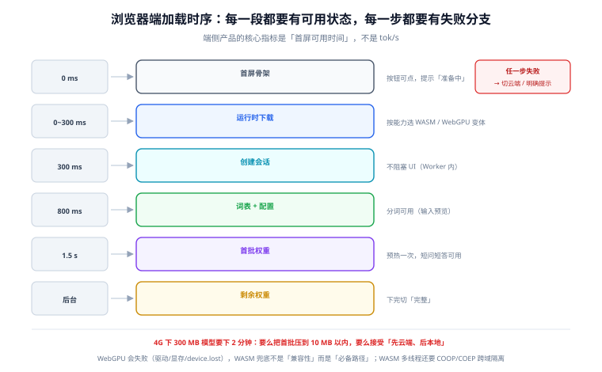

# 浏览器与移动端落地

端侧推理真正落到用户手里只有两种形态：**网页**与**App**。两者的约束完全不同——浏览器要跟标签页、缓存策略、跨域隔离策略打交道；App 要跟系统内存回收、后台限制、平台 delegate 打交道。相同的是：**首次体验决定用户是否再打开第二次**。

这一页讲首包、缓存、双后端、线程、内存上限与热节流，并给出一份可以直接照着做的加载时序。

::: tip 一句话理解
浏览器端的第一难题不是「能不能跑」，而是「**下载完之前用户还在不在**」。一个 300 MB 的模型在 4G 上要下 2 分钟——所以端侧产品的核心指标是**首屏可用时间**，不是 tok/s。
:::

## 判据族声明

本页判据族 `EIW-A` ~ `EIW-H`，共 8 条。定义表在第八节。

## 本页不讲什么

- 不讲后端怎么选、EP 怎么配，归 [运行时与算子委派](../Runtime/index.md)。
- 不讲算子在哪个后端跑、怎么自证，归 [算子覆盖与回退](../OperatorSupport/index.md)。
- 不讲 H5 页面的视口与触摸，归 [移动 H5](/docs/Frontend/MobileH5/Overview/index.md)。

## 一、首包：三个东西要下载，只有一个是「模型」



| 组成 | 体积量级 | 能不能避免 |
| --- | --- | --- |
| 运行时（WASM / JS） | 2~15 MB（含 SIMD / 多线程变体） | 只能选轻量版；不同变体按能力加载 |
| 模型权重 | 100 MB ~ 2 GB | 量化、分片、按需加载 |
| 词表与配置 | 1~10 MB | 通常可忽略，但分词器实现会拖慢启动 |

三个实操结论：

1. **按能力加载运行时变体**：支持 WebGPU 的浏览器加载 WebGPU 变体，不支持的加载 WASM SIMD 变体。一份「全都带」的包会让所有人多下几 MB。
2. **模型分片 + 渐进可用**：先下「首层 + 词表 + 配置」让 UI 变成可用状态，其余权重后台继续下。用户感知的是「能输入了」，不是「下完了」。
3. **压缩要端到端算**：服务端 gzip/brotli 对已量化的二进制权重收益有限（4 bit 权重近似随机），**别指望 CDN 压缩能把 300 MB 变成 30 MB**。

```text
首屏可用的三段预算（4G，约 8 Mbps ≈ 1 MB/s）：
  运行时 6 MB      → 6 s
  词表+配置 3 MB   → 3 s
  首批权重 40 MB   → 40 s   ← 这一段决定「用户等不等」
结论：要么把首批权重压到 10 MB 以内，要么接受「先云端、后本地」的渐进策略
```

## 二、缓存：三种存法，各自的失效条件

| 存法 | 容量 | 失效条件 | 适用 |
| --- | --- | --- | --- |
| **HTTP 缓存**（`Cache-Control: immutable`） | 受浏览器配额 | 用户清缓存、隐私模式 | 运行时与不常变的资源 |
| **Cache Storage**（Service Worker） | 较大（配额按站点） | 配额清理、SW 更新 | 模型权重分片 |
| **IndexedDB / OPFS** | 较大 | 配额清理、Safari 的 7 天策略 | 需要随机读的大文件（OPFS 更快） |

三条纪律：

1. **文件名带内容哈希**，并用 `immutable` 长缓存。这样「换模型」= 换文件名，不需要处理缓存失效。
2. **必须处理「缓存被清」**：隐私模式、系统清理、Safari 的存储策略都会让缓存消失。**每次启动都要能走完整的下载路径**，不能假设「上次下过」。
3. **下载要可续**：用 `Range` 请求或分片，断网重连后不从头开始。移动网络下这不是优化，是必需。

## 三、双后端：WebGPU 与 WASM 的分工

| 维度 | WebGPU | WASM（SIMD + 多线程） |
| --- | --- | --- |
| 速度 | 快（矩阵乘、attention 有感） | 中等；单核受限，多线程需跨域隔离 |
| 兼容性 | Chromium 系稳定；其他浏览器按版本推进 | 几乎所有现代浏览器 |
| 内存 | 显存/统一内存，配额受限 | 线性内存，受 4 GB 上限与配额限制 |
| 失败模式 | 着色器编译失败、设备丢失（`device.lost`） | 慢，但不容易崩 |
| 适用 | 大模型、长上下文 | 小模型、兼容兜底 |

**必须两条都实现**，理由不是「兼容性」，而是**WebGPU 会失败**：驱动问题、显存不足、标签页切后台导致设备丢失。`device.lost` 是异步事件，**它会在你没准备的时候发生**。

```javascript
// 设备丢失的兜底：切到 WASM，并重建会话
device.lost.then(async (info) => {
  console.warn("[gpu] device lost:", info.reason, info.message);
  await rebuildSession("wasm");     // 不要试图「重试 WebGPU」，会连环失败
});
```

::: danger WASM 多线程需要跨域隔离，不是加个参数就行
`SharedArrayBuffer` 要求页面处于**跨域隔离**状态：响应头必须有 `Cross-Origin-Opener-Policy: same-origin` 与 `Cross-Origin-Embedder-Policy: require-corp`。少一个，`SharedArrayBuffer` 就是 `undefined`，多线程变体直接不可用。

更麻烦的是 `COEP: require-corp` 会**让所有跨域资源（图片、CDN 脚本、iframe）都要求 CORP 头**，经常把整个页面搞挂。上线前必须整体验一遍，而不是只在推理模块里加头。
:::

## 四、线程模型：推理必须在 Worker 里

主线程跑推理的后果不是「卡」，而是**页面完全无响应**：流式输出、取消按钮、滚动全部停止。端侧推理一律放 Worker：

| 方案 | 适用 | 注意 |
| --- | --- | --- |
| 专用 Worker | 单模型、单会话 | 最简单；消息传递用 `Transferable` 避免拷贝 |
| `SharedArrayBuffer` + 多 Worker | 需要多线程矩阵运算 | 依赖跨域隔离 |
| 主线程 + 时间切片 | 极小模型（< 20 MB） | 切片粒度难调，容易抖动 |

消息传递有一条容易踩的坑：**token 流式输出不要「一个 token 一条消息」**。高频 `postMessage`（每秒几十次）本身就有开销，应该**按时间窗批量发送**（如每 30~50 ms 一批）。

## 五、移动 App：内存上限与后台限制

| 平台 | 关键限制 | 应对 |
| --- | --- | --- |
| **Android** | 每进程内存上限（`largeHeap` 之外还有系统限制）；后台进程会被杀 | 前台服务保活推理；峰值内存按 `ActivityManager.getMemoryClass()` 的 0.6 算 |
| **Android NPU** | NNAPI 已进入弃用轨道，厂商 delegate 各自为政 | 优先用运行时提供的 vendor delegate；按机型灰度 |
| **iOS** | jetsam 机制会直接杀进程，无回调；后台超过时限被挂起 | 峰值内存按设备档位分档；后台任务用 `beginBackgroundTask` 争取时间 |
| **iOS Core ML** | 首次加载有编译开销；模型需要按版本转换 | 预热 + 缓存编译产物（见 [运行时](../Runtime/index.md)） |

::: warning 「内存够用」在 iOS 上不是看物理内存
iOS 的 jetsam 按设备档位给每个 App 一个上限，**8 GB 的机器上你的 App 可能只有 1.5 GB**。判断标准是「同档位设备上，峰值内存不超过该档位历史上被杀的阈值」，这个数只能靠真机实测与崩溃日志反推。
:::

## 六、热节流：持续生成必须按降频后算

移动设备被动散热，持续满负载 10~30 秒后开始降频。三个可观测信号：

| 信号 | 观测方式 | 判据 |
| --- | --- | --- |
| tok/s 下滑 | 分时间段统计（前 10 s / 30~40 s / 110~120 s） | 120 s 时 ≥ 10 s 时的 50% |
| 机身温升 | 系统热状态 API（iOS `ProcessInfo.thermalState`、Android `PowerManager`） | 进入 `serious` 后必须降级 |
| 电量下降 | 一次 5 分钟会话的电池百分比 | 有产品级上限（如 < 3%） |

**降级策略要预先设计**：进入热限制时，主动把「每轮最多生成 token 数」调小、把上下文缩短、或切到云端。用户能接受「慢一点」，不能接受「手机烫得拿不住」。

## 七、一份可直接照做的加载时序

```text
[0 ms]    首屏渲染（骨架屏，按钮可点但提示「准备中」）
[0 ms]    并行：检查缓存 → 有则跳到 [800 ms]；无则开始下载运行时
[300 ms]  运行时就绪 → 创建会话（不阻塞 UI）
[800 ms]  词表 + 配置就绪 → 分词可用（可以本地做「输入预览」）
[1.5 s]   首批权重就绪 → 会话可跑短输入（预热一次）
[1.5 s]   状态切「可用（简版）」：短问短答走本地
[后台]    继续下剩余权重 → 完成后切「可用（完整）」
[异常]    任一步失败 → 切云端；无网则明确提示「离线模式不可用」
```

这个时序有两个设计要点：**每一段都有可用状态**（不是「全有或全无」），以及**每一步都有失败分支**（不是「出问题就转圈」）。

## 八、判据表

| 编号 | 规则 | 违反时的样子 | 怎么验证 |
| --- | --- | --- | --- |
| `EIW-A` | 首屏可用时间必须给数，并拆成「运行时 / 词表 / 首批权重」三段 | 用户等到 2 分钟 | 有预算表；实测首屏可用 < 3 s |
| `EIW-B` | 模型文件名带内容哈希 + `immutable` 长缓存 | 换模型后用户还在用旧模型 | 响应头与文件名都符合 |
| `EIW-C` | 必须能处理「缓存被清空」，冷启动路径每次都可用 | 隐私模式下白屏 | 清缓存后走一遍完整下载 |
| `EIW-D` | WebGPU 与 WASM 双后端都要实现，且处理 `device.lost` | 部分用户白屏或卡死 | 代码里有 `lost` 处理，并演练过切后端 |
| `EIW-E` | 推理必须在 Worker 中执行 | 流式输出时页面卡死 | 主线程无推理调用 |
| `EIW-F` | 跨域隔离（COOP/COEP）只在需要多线程时启用，且全站资源验证过 | 加了头之后图片全裂 | 有「开启 COOP/COEP 后的全站回归」记录 |
| `EIW-G` | 峰值内存按平台档位上限的 0.6 算，并记录实测峰值 | iOS 上偶发闪退 | 有真机 `peak_rss` 记录 |
| `EIW-H` | 热节流必须有降级策略与触发阈值 | 长会话时设备发烫、速度断崖 | 有 `thermalState` 监听与降级分支 |

## 验证方式

```shell
# EIW-B：确认静态资源带长缓存（以 nginx 为例）
grep -rn "immutable" nginx.conf deploy/ 2>/dev/null
# 期望：模型与 wasm 路径命中 immutable；HTML 命中 no-cache

# EIW-F：确认跨域隔离头只在需要的路径上
curl -sI https://your.site/ | grep -i "cross-origin"
# 期望：需要多线程的页面有 COOP+COEP；首页可以没有

# EIW-E：确认主线程没有推理调用（以打包产物为例）
grep -rn "InferenceSession\|session.run" dist/assets/*.js | head
# 期望：只出现在 worker 产物中（文件名常含 worker）
```

```text
EIW-A：用 Chrome DevTools 的 Performance 面板 + Network throttling（Fast 4G）
  记录：first_interactive_ms（首屏可点）、model_ready_ms（可本地推理）
  期望：first_interactive < 1000 ms，model_ready < 3000 ms（简版）

EIW-G：真机峰值内存
  Android: adb shell dumpsys meminfo <pkg> | grep -E "TOTAL|Native"
  iOS: Xcode Instruments → Allocations → Peak
  期望：< 设备档位上限 × 0.6，且连续 5 轮会话后不单调上涨（上涨 = KV 未释放）
```

## 参考资料

- [WebGPU 规范](https://www.w3.org/TR/webgpu/)——设备、队列、缓冲区与 `device.lost`
- [MDN · SharedArrayBuffer](https://developer.mozilla.org/docs/Web/JavaScript/Reference/Global_Objects/SharedArrayBuffer)——跨域隔离要求
- [MDN · COOP / COEP](https://developer.mozilla.org/docs/Web/HTTP/Headers/Cross-Origin-Opener-Policy)——跨域隔离头的完整语义
- [web.dev · 存储配额](https://web.dev/storage-for-the-web/)——Cache Storage / IndexedDB 的配额与清理
- [Google AI Edge · LiteRT delegates](https://developers.google.com/edge/litert/android/delegates)——Android 侧的 delegate 选择
- [Apple · 降低内存占用](https://developer.apple.com/documentation/xcode/reducing-your-app-s-memory-use)——jetsam 与内存警告
- 本站 [移动 H5](/docs/Frontend/MobileH5/Overview/index.md) · [WebAssembly · 性能](/docs/Frontend/WebAssembly/Performance/index.md)
- 相邻：[运行时与算子委派](../Runtime/index.md) · [端云协同与降级](../HybridRouting/index.md) · [端侧评测](../Evaluation/index.md)
