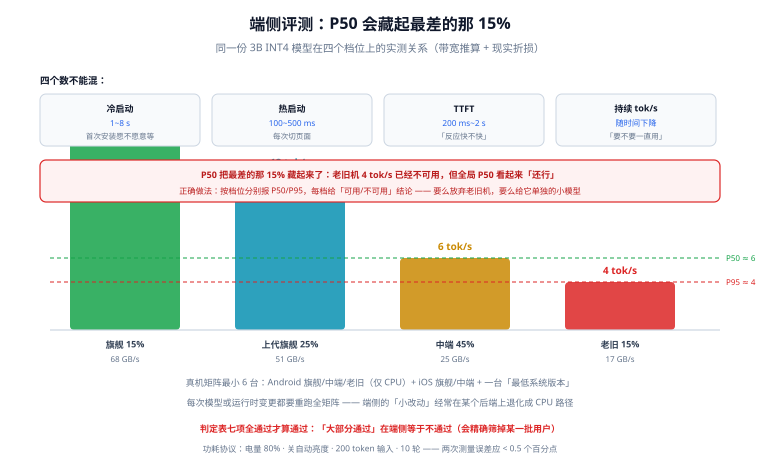

# 端侧评测

端侧评测最容易做成「我在自己手机上试了一下，挺快的」。这句话在服务端是合格的自测，在端侧是**不合格的验收**——因为端侧的用户不是一台设备，而是一条从旗舰到五年前旧机的长尾。

这一页给出一套可以直接照做的评测框架：三维指标、真机矩阵、冷热分离、功耗与温升的测法，以及一张判定表。

::: tip 一句话理解
端侧评测的核心不是「测得准」，而是**「测在最差的设备上」**。P50 只能证明你的开发机不错，P95（按设备档位分）才能回答「有多少用户不可用」。
:::

## 判据族声明

本页判据族 `EIE-A` ~ `EIE-H`，共 8 条。定义表在第八节。

## 本页不讲什么

- 不讲服务端的压测与 SLO，归 [性能工程 · 容量](/docs/Ops/PerformanceEngineering/Capacity/index.md)。
- 不讲通用评测集构建与判官校准，归 [模型评测工程](/docs/AI/EvalEngineering/Overview/index.md)。
- 不讲怎么优化到目标性能，归 [运行时](../Runtime/index.md) 与 [算子覆盖](../OperatorSupport/index.md)。

## 一、三维指标：质量、时延、内存（+ 功耗）

| 维度 | 指标 | 采集方式 | 为什么要单独看 |
| --- | --- | --- | --- |
| **质量** | 关键字段命中率、与云端结果一致率 | 冻结回归集，离线跑 | 端侧模型比云端弱，差距必须量化 |
| **时延** | 冷启动 init、首 token（TTFT）、持续 tok/s | 设备内打点 | 三个数回答三个不同问题（见第三节） |
| **内存** | 峰值 RSS、会话结束后是否回落 | 系统工具 / `performance.memory` | 峰值决定会不会被杀，回落决定会不会累积 |
| **功耗** | 单次任务电量百分比、平均功率 | 系统电池统计 / 外接功率计 | 用户在意的不是「快」，是「别掉电」 |
| **温升** | 机身温度、热状态等级、降频后的 tok/s | 系统热 API + 分段计时 | 决定长会话能不能用 |

五维里只有「质量」能离线批量跑，其余四项**必须在真机上、在目标场景下跑**。

## 二、P50 为什么没用：设备是长尾分布



同一份 3B INT4 模型在不同档位上的实测关系（按 [预算](../Budget/index.md) 的带宽公式推算 + 公开机型带宽参数）：

| 档位 | 代表年限 | 标称带宽 | 理论上界 tok/s | 现实 tok/s | 相对旗舰 |
| --- | --- | --- | --- | --- | --- |
| 当代旗舰 | 2025-2026 | 68 GB/s | 30 | 15~21 | 100% |
| 上一代旗舰 | 2023-2024 | 51 GB/s | 23 | 11~16 | 75% |
| 中端主力 | 2022-2023 | 25 GB/s | 11 | 5~8 | 35% |
| 老旧机型 | 2020 及以前 | 17 GB/s | 8 | 3~5 | 20% |

如果用户分布是「旗舰 15%、上代 25%、中端 45%、老旧 15%」，那么：

```text
P50 ≈ 中端机 ≈ 6 tok/s      ← 看着「还行」
P95 ≈ 老旧机 ≈ 4 tok/s      ← 15% 的用户在这一档，体验已经不可用
```

**P50 把最差的那 15% 藏起来了**。正确的做法是**按档位分别报 P50/P95**，并给每个档位一个「可用/不可用」的结论。这比一个全局 P50 有用得多，因为它直接告诉你「要么放弃老旧机型，要么给它单独一个小模型」。

## 三、冷启动、热启动、首 token、持续速度：四个数不能混

| 指标 | 定义 | 用户感知 | 典型值 |
| --- | --- | --- | --- |
| **冷启动** | 首次安装后到「可推理」 | 第一次打开愿不愿意等 | 1~8 s |
| **热启动** | 进程内二次进入 | 每次切换页面 | 100~500 ms |
| **TTFT** | 发送到第一个 token 出现 | 「反应快不快」 | 200 ms~2 s |
| **持续 tok/s** | 第 N 秒的生成速度 | 「要不要一直用」 | 见上表，且随时间下降 |

最常见的报告错误是把「冷启动」算进「平均响应时间」，得到「平均 3 秒」这种既不能优化也不能验收的数字。**四个数必须分列**，而且冷启动要单独看「首次安装」与「更新后首次」（后者可能因为缓存失效而重新付一次）。

## 四、真机矩阵：最小可行 6 台，标准 9 台

| 维度 | 档位 | 台数 | 说明 |
| --- | --- | --- | --- |
| 设备档位 | 旗舰 / 中端 / 老旧 | 3 | **老旧机必须在列**，否则等于没测 |
| 平台 | Android / iOS | 2 | iOS 的 jetsam 与 Android 的 LMK 行为不同 |
| 后端 | GPU / NPU / 仅 CPU | 按平台 | 至少覆盖「只有 CPU」这一档 |
| 系统版本 | 最低支持版本 / 最新 | 2 | 最低版本常有 kernel 缺失 |

**6 台最小集**：Android 旗舰（NPU）+ Android 中端（GPU）+ Android 老旧（仅 CPU）+ iOS 旗舰 + iOS 中端（两台老系统）+ 一台「最低系统版本」设备。

矩阵的三条纪律：

1. **每台设备跑同一份输入集**，否则结果不可比。
2. **记录设备标识、系统版本、后端**，与结果一起入库。
3. **每次模型或运行时变更都要重跑全矩阵**。端侧的「小改动」经常在某个后端上退化成 CPU 路径。

## 五、功耗与温升怎么测（不用专业设备也能做）

| 方法 | 精度 | 操作 | 适用 |
| --- | --- | --- | --- |
| 电池百分比 | 粗（1%） | 满电或固定电量，跑 5 分钟固定任务，记录前后差值 | 快速比较两个方案 |
| 系统电池统计 | 中 | Android `dumpsys batterystats`、iOS 设置里的「按 App」 | 单 App 对比 |
| 外接功率计 | 高 | USB 功率计串在充电线上 | 需要绝对值时 |
| 热状态 API | 定性 | iOS `ProcessInfo.thermalState`、Android `PowerManager.getCurrentThermalStatus` | 判断降频时机 |

一个可复现的最小协议：

```text
1. 电量固定 80%，关自动亮度，飞行模式 + Wi-Fi 单开
2. 同一段 200 token 的输入，连续跑 10 轮，记录：
   - 每轮 tok/s（看降频曲线）
   - 起始与结束电量（看功耗）
   - 结束时 thermalState / thermal status
3. 换方案（如 INT8 KV / 更小模型）重复，比较
判据：方案 B 的 10 轮平均 tok/s 不低于 A 的 90%，且电量下降不超过 A 的 90%
```

## 六、质量：端侧只要「够用」，但要能证明「够用在哪」

端侧评测不需要追平云端，需要回答**「差距在哪类任务上」**：

| 任务类型 | 与云端一致率目标 | 说明 |
| --- | --- | --- |
| 抽取（槽位、实体） | ≥ 95% | 小模型在这类任务上接近大模型 |
| 结构化输出（JSON） | ≥ 98%（可解析率 100%） | 端侧模型容易漏字段 |
| 短问答（< 50 字） | ≥ 85% | 事实性问题容易错 |
| 长文总结 | ≥ 70% | 端侧上下文与能力都受限 |
| 开放式创作 | 不设目标 | **不该由端侧承担** |

「不设目标」也是一种结论：把开放式创作路由到云端（见 [端云协同](../HybridRouting/index.md)），比让端侧硬扛更诚实。

## 七、判定表：什么算通过

| 项 | 通过条件 | 不通过怎么办 |
| --- | --- | --- |
| 老旧机 tok/s | ≥ 3 tok/s（低于此用户会放弃） | 给老旧机换更小模型，或直接路由云端 |
| 冷启动 | < 5 s 且有未就绪态 | 做 EPContext 缓存 / 分片下载 |
| 峰值内存 | < 档位上限 × 0.6 | 减上下文、KV 量化、换小模型 |
| 10 轮后内存 | 不单调上涨（涨幅 < 5%） | 检查 KV 释放与取消路径 |
| 120 s 时 tok/s | ≥ 10 s 时的 50% | 加降级策略（减 token、短上下文） |
| 质量（抽取类） | ≥ 95% 一致率 | 升 bit 数或换模型 |
| 崩溃率（内测） | 0 次 OOM | 回归内存预算 |

七项里任何一项不通过，都不能上线。**「大部分通过」在端侧等于不通过**——因为不通过的那一项会精确地筛掉某一批用户。

## 八、判据表

| 编号 | 规则 | 违反时的样子 | 怎么验证 |
| --- | --- | --- | --- |
| `EIE-A` | 必须按设备档位分别报 P50/P95，不给全局 P50 | 上线后 15% 用户不可用 | 报告里有三档 × 两分位的表 |
| `EIE-B` | 冷启动、热启动、TTFT、持续 tok/s 四个数分列 | 「平均响应 3 秒」无法优化 | 报告里四个字段独立出现 |
| `EIE-C` | 真机矩阵至少含一台「最低支持设备」与一台「仅 CPU 后端」 | 低端机闪退 | 矩阵表里有这两行 |
| `EIE-D` | 每次模型 / 运行时变更重跑全矩阵 | 某后端退化成 CPU 无人知 | 版本记录与评测记录一一对应 |
| `EIE-E` | 峰值内存与「10 轮后是否回落」都要测 | 长会话越用越卡 | 有 `peak` 与 `after_10_rounds` 两个数 |
| `EIE-F` | 功耗与温升要有可复现协议（电量、亮度、轮次） | 无法比较两个方案 | 协议写在评测文档里 |
| `EIE-G` | 质量按任务类型分档给目标，开放创作不设端侧目标 | 用端侧硬扛创作，口碑崩 | 质量表里五类任务各有目标 |
| `EIE-H` | 判定表七项全通过才算通过 | 「大部分通过」就上线 | 上线清单里七项逐条打勾 |

## 验证方式

`EIE-A` 到 `EIE-C` 是文档与矩阵的结构检查：

```shell
# EIE-C：矩阵里必须有「最低支持设备」与「仅 CPU」
grep -nE "最低支持|min.*device|CPU" eval/device-matrix.md
# 期望：两行都存在，且填写了具体机型与系统版本

# EIE-D：每个模型版本都有对应评测记录
for v in $(grep -oE "model-[0-9a-f]{8}" versions.txt | sort -u); do
  test -f "eval/report-$v.md" || echo "MISSING eval for $v"
done
# 期望：无 MISSING 输出
```

```text
EIE-B：四个数分开采（设备内打点）
  cold_start_ms = 首次创建会话到 run 成功
  warm_start_ms = 第二次创建（或复用）
  ttft_ms       = 发送到首个 token 回调
  tok_s_10s / tok_s_120s = 分段统计

EIE-F：功耗协议跑一遍
  固定 80% 电量、200 token 输入、10 轮，记录前后电量与热状态
  期望：电量下降可复现（两次误差 < 0.5 个百分点）
```

## 参考资料

- [Android · 内存管理](https://developer.android.com/topic/performance/memory)——`getMemoryClass` 与低内存回收
- [Apple · 降低内存占用](https://developer.apple.com/documentation/xcode/reducing-your-app-s-memory-use)——jetsam 与内存警告
- [Android · 热状态](https://developer.android.com/reference/android/os/PowerManager#getCurrentThermalStatus())——降频信号
- [web.dev · 性能指标](https://web.dev/metrics/)——TTFT 一类指标的通用定义
- 本站 [模型评测工程](/docs/AI/EvalEngineering/Overview/index.md) · [性能工程 · 容量](/docs/Ops/PerformanceEngineering/Capacity/index.md)
- 相邻：[内存与延迟预算](../Budget/index.md) · [浏览器与移动端](../DeviceWeb/index.md) · [实战](../Practice/index.md)
