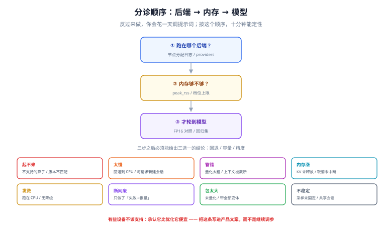

# 常见问题与分诊

端侧的问题有一套固定的形状：**它不在你的机器上出现**。同一个包在开发机流畅，在用户的中端机上闪退；同一个模型在昨天正常，今天升级运行时后开始胡说。这一页按「症状」组织，目标是**让你在十分钟内定位到该看哪一页**，而不是从头读一遍架构。

::: tip 一句话理解
端侧排障的顺序永远是：**先确认跑在哪个后端 → 再确认内存够不够 → 最后才怀疑模型**。反过来做，你会花一天调提示词。
:::

## 判据族声明

本页判据族 `EIF-A` ~ `EIF-H`，共 8 条。定义表在第八节。

## 本页不讲什么

- 不讲某一类问题的完整解法，只给分诊与指路；细节归各专题页。
- 不讲服务端的推理故障（OOM、并发、队列堆积），归 [本地模型部署 · 常见问题](/docs/AI/LocalModel/FAQ/index.md)。

## 一、八类症状分诊表



| 症状 | 最可能的原因（按概率） | 第一个检查动作 | 归属页 |
| --- | --- | --- | --- |
| **起不来**（白屏 / 立即报错） | ① 图里有不支持的算子 ② 模型格式与运行时版本不匹配 ③ WASM 多线程但没跨域隔离 | 看控制台第一条错误；跑 `risky ops` 检查 | [算子覆盖](../OperatorSupport/index.md) |
| **太慢**（比预期慢 2 倍以上） | ① 大量算子回退到 CPU ② 每次请求新建会话 ③ 主线程跑推理 ④ 降频 | 打节点分配日志，统计 CPU 分区占比 | [运行时](../Runtime/index.md) |
| **答错 / 胡说** | ① 量化粒度太粗（`per-tensor INT4`）② 上下文被截断 ③ 分词器与模型不匹配 | 用同一输入跑 FP16 版本对照 | [量化](../Quantization/index.md) |
| **内存一直涨** | ① KV 未释放 ② 取消未中断 ③ 会话被反复创建 | 连续 10 轮看峰值曲线 | [浏览器与移动端](../DeviceWeb/index.md) |
| **发热 / 掉电快** | ① 跑在 CPU 而非 NPU/GPU ② 长上下文反复 prefill ③ 无降级策略 | 看后端自证 + 热状态 | [端侧评测](../Evaluation/index.md) |
| **断网就废** | ① 只做了「云端失败 → 报错」 ② 模型没缓存到本地 ③ 队列未实现 | 飞行模式走一遍核心任务 | [端云协同](../HybridRouting/index.md) |
| **包太大 / 首屏太慢** | ① 模型未量化 ② 运行时带了全部变体 ③ 没有分片下载 | 看 Network 面板的首屏瀑布 | [浏览器与移动端](../DeviceWeb/index.md) |
| **结果不稳定**（同一输入两次不同） | ① 采样参数未固定 ② 浮点累加顺序随后端变化 ③ 并发共享了会话 | 固定 `temperature=0` 重跑 | [端侧评测](../Evaluation/index.md) |

## 二、十二问

**Q1：端侧一定要用 INT4 吗？**
不一定。先算预算：装得下就用 INT8（误差小一个量级）。INT4 是「装不下」时的必要手段，不是默认选项。

**Q2：为什么 `per-tensor INT4` 会差这么多？**
因为一个离群值就能把整个张量的 scale 拉大，剩下的权重全被压进很窄的量化区间。实测：0.1% 的 ×20 离群值让输出余弦从 0.976 掉到 **0.524**（见 [量化](../Quantization/index.md)）。

**Q3：`group=32` 一定比 `group=128` 好吗？**
精度上更好（有离群值时误差低 41%），体积上更差（+17.7%），**而且很多 NPU 只支持 per-channel**。选它之前先查算子表。

**Q4：浏览器里能跑多大的模型？**
按 4 bit 算，0.5B 约 253 MiB、3B 约 1.5 GiB。浏览器单标签页可用 1.5~2 GB，所以**0.5B 宽裕、3B 勉强、7B 不要想**（还要给 KV 与运行时留位置）。

**Q5：WebGPU 一定比 WASM 快吗？**
在矩阵运算上通常快 2~3 倍，但**它可能失败**：驱动、显存、`device.lost`。所以两条都要实现，且都要验收。

**Q6：为什么第一次推理特别慢？**
kernel / 着色器编译发生在首次执行。解决办法是**预热一次**，并把 `warmMs` 单独记录，不要混进 TTFT。

**Q7：iOS 上内存明明够，为什么还被杀？**
jetsam 按设备档位给每个 App 一个上限，不是看物理内存。8 GB 的机器上你可能只有 1.5 GB。按「档位上限 × 0.6」规划。

**Q8：端侧模型能更新吗？**
能，但必须带哈希与签名校验，并且**能回滚到包内版本**。远端下发的模型属于不可信输入。

**Q9：离线时用户的操作怎么办？**
排队，但队列必须带 `client_request_id`（幂等）与 TTL（过期），并且**对用户可见**。

**Q10：怎么证明「真的跑在 NPU 上」？**
三条：节点分配日志、耗时与功耗同时下降、CPU 与目标后端的输出比对。三条都做，别只做第一条。

**Q11：量化后怎么验收？**
冻结 200 条回归集，按数字/日期/否定/长输入/JSON 五类各 40 条，判「关键字段命中率」而不是「像不像」。

**Q12：端侧和云端怎么选？**
先过合规（能不能出端），再看能力（装不装得下），再看网络，再看置信度，最后看预算。**顺序不能换**。

## 三、十二项上线自查

| # | 自查项 | 通过标准 |
| --- | --- | --- |
| 1 | 预算表四段齐全 | 权重/KV/激活/运行时都有数字 |
| 2 | 峰值内存 | < 最低档设备可用上限 × 0.6 |
| 3 | 最低支持设备明确 | 有机型 + 系统版本清单 |
| 4 | 冷启动有未就绪态 | 不是白屏，是可操作的等待态 |
| 5 | 四个时延指标分列 | 冷启动/热启动/TTFT/持续 tok/s |
| 6 | 后端自证 | 有节点分配日志 + 输出比对 |
| 7 | WASM / CPU 兜底路径 | 独立验收过（强制切后端仍可用） |
| 8 | 断网可用 | 飞行模式走通核心任务 |
| 9 | 量化回归集 | 200 条，命中率 ≥ 98% |
| 10 | 内存回落 | 10 轮后涨幅 < 5% |
| 11 | 热节流降级 | 有 `thermalState` 监听与降级分支 |
| 12 | 远程开关 | 能一键关闭端侧并回退云端 |

十二项里第 7 与第 12 项最常被跳过，也最容易在事故时救命。

## 四、术语表

| 术语 | 含义 | 容易混淆的点 |
| --- | --- | --- |
| **EP**（Execution Provider） | ONNX Runtime 的后端抽象，按节点认领 | 与「delegate」不是一回事（后者按子图） |
| **Delegate** | LiteRT / TFLite 的硬件委派单位 | delegate 不支持一个算子可能导致整块回退 |
| **TTFT** | Time To First Token | 不等于「响应时间」，也不含冷启动 |
| **GQA** | Grouped-Query Attention，多个 Q 头共享一组 KV 头 | 它降的是 KV 头数，**不是层数** |
| **KV cache** | 每 token 存一份 K/V，随上下文线性增长 | 量化 KV 有误差，减 KV 头数没有 |
| **group-wise 量化** | 每 N 个权重共享一个 scale | N 越小越准、体积越大 |
| **super-block** | 量化格式里的块内分层结构（如 `Q4_K`） | 需要专用 kernel，通用实现跑不了 |
| **jetsam** | iOS 的内存回收机制 | 被杀时通常**没有回调**，只有崩溃日志 |
| **EPContext** | ORT 的后端上下文序列化机制 | 它缓存的是**编译产物**，不是权重 |
| **COOP / COEP** | 跨域隔离响应头 | 少一个，`SharedArrayBuffer` 就是 `undefined` |

## 五、一个真实的分诊过程（把方法走一遍）

```text
现象：iOS 上 3B 模型 12 tok/s，Android 旗舰 18 tok/s，但 Android 中端只有 4 tok/s。

第 1 步：确认后端
  → Android 中端打节点分配日志：CPU 分区占 47%（因为该机型 GPU delegate 不支持某算子）
  → 结论：不是模型慢，是回退了。

第 2 步：确认内存
  → 该机型峰值 2.1 GB，档位上限约 2.5 GB → 逼近 jetsam 线
  → 结论：即使修好后端，也随时可能被杀。

第 3 步：结论与处置
  → 对「中端及以下」直接路由云端（见端云协同）；
  → 端侧只承诺「旗舰 + 上代旗舰」；
  → 把这条写进产品文案，而不是继续优化。

第 4 步：留证
  → 保存分配日志、峰值曲线、机型清单，供下次升级对比。
```

这个例子里最关键的是第 3 步：**有些设备不该支持，承认它比优化它便宜**。

## 六、判据表

| 编号 | 规则 | 违反时的样子 | 怎么验证 |
| --- | --- | --- | --- |
| `EIF-A` | 排障必须按「后端 → 内存 → 模型」顺序 | 花一天调提示词 | 缺陷单里有这三项的检查结论 |
| `EIF-B` | 每类症状必须有可执行的第一个检查动作 | 「再看看」 | 分诊表里每行都有命令或操作 |
| `EIF-C` | 必须能一键关闭端侧回退云端 | 出问题只能发版 | 配置里有开关，且演练过 |
| `EIF-D` | 兜底后端（WASM/CPU）必须独立验收 | 只测了主路径 | 有「强制切后端」的验收记录 |
| `EIF-E` | 「不支持某些设备」必须写进产品文案 | 用户以为支持，实际闪退 | 文案里有设备/系统要求 |
| `EIF-F` | 每个缺陷单必须记录设备型号 + 系统版本 + 后端 | 无法复现 | 缺陷模板里有这三个字段 |
| `EIF-G` | 采样参数必须固定（可复现） | 同一输入结果不同 | 配置里 `temperature` / `top_p` 固定 |
| `EIF-H` | 升级运行时后必须重跑「分配日志 + 输出比对」 | 静默退化 | 升级清单里有这两项 |

## 验证方式

```shell
# EIF-C：确认远程开关存在（前端配置项 / 服务端开关）
grep -rn "edgeEnabled\|edge_enabled\|forceCloud" src/ 2>/dev/null
# 期望：有该开关，且默认值明确

# EIF-F：缺陷模板里有设备三要素
grep -nE "device|机型|系统版本|backend" .github/ISSUE_TEMPLATE/*.md 2>/dev/null
# 期望：三个字段都出现

# EIF-G：确认采样参数被固定
grep -rn "temperature\|top_p\|top_k" src/ | grep -v test
# 期望：temperature=0（或固定小数），没有 Math.random() 参与采样
```

```text
EIF-A：一次标准分诊（十分钟内完成）
  1. 后端：打印 providers 与节点分配（2 min）
  2. 内存：读 peak_rss 与档位上限（3 min）
  3. 模型：同一输入跑 FP16 对照（5 min）
  期望：三步之后能给出「回退 / 容量 / 精度」三者之一的结论
```

## 参考资料

- [ONNX Runtime · 性能调优](https://onnxruntime.ai/docs/performance/)——日志、profile 与算子分配
- [ONNX Runtime · 常见问题](https://onnxruntime.ai/docs/reference/faq.html)——版本与 EP 的兼容性
- [Google AI Edge · LiteRT 故障排查](https://developers.google.com/edge/litert)——delegate 与模型兼容
- [Apple · 内存与 jetsam](https://developer.apple.com/documentation/xcode/reducing-your-app-s-memory-use)
- 本站 [本地模型部署 · 常见问题](/docs/AI/LocalModel/FAQ/index.md) · [模型评测工程 · 常见问题](/docs/AI/EvalEngineering/FAQ/index.md)
- 相邻：[总览](../Overview/index.md) · [端侧评测](../Evaluation/index.md) · [实战](../Practice/index.md)
