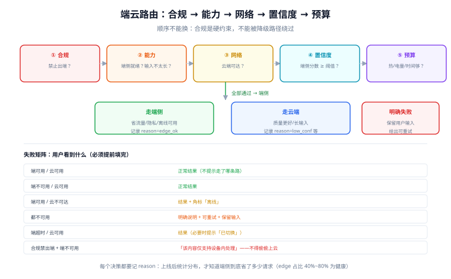

# 端云协同与降级

端侧推理很少是「全量替换云端」，绝大多数产品最终落在**端云混合**：简单的、私密的、高频的走端侧，复杂的、需要最新知识的走云端；断网时降级到端侧，端侧算不动时升级到云端。

这一页讲五件事：四种分工形态、双阈值路由、离线队列、模型版本灰度、以及**失败时用户到底看到什么**。

::: tip 一句话理解
端云协同的本质是**两条路径都要能独立完成一次任务**，而不是「主路径 + 报错」。做不到这一点，所谓的「离线可用」只是在断网时换了一种报错方式。
:::

## 判据族声明

本页判据族 `EIC-A` ~ `EIC-H`，共 8 条。定义表在第八节。

## 本页不讲什么

- 不讲服务端多模型之间的路由策略与成本模型，归 [模型路由与降级](/docs/AI/ModelRouting/Overview/index.md)。
- 不讲端侧模型怎么量化与导出，归 [量化](../Quantization/index.md) 与 [实战](../Practice/index.md)。
- 不讲幂等键与状态机建模，归 [幂等与状态机工程](/docs/Backend/IdempotencyStateMachine/Overview/index.md)。

## 一、四种分工形态：选一种，别混着做

| 形态 | 端侧负责 | 云端负责 | 适合 | 代价 |
| --- | --- | --- | --- | --- |
| **分层（推荐）** | 意图识别、槽位抽取、敏感信息脱敏 | 生成、知识问答、长文总结 | 绝大多数产品 | 两次调用，要设计衔接 |
| **端侧优先** | 全部推理 | 兜底与质量校验 | 高频、短、私密 | 端侧质量决定口碑 |
| **云端优先** | 缓存、预热、离线兜底 | 全部推理 | 质量敏感、低频 | 「离线可用」名不副实 |
| **端侧草稿 + 云端校验** | 生成草稿（快） | 校验/改写（准） | 时延极敏感 | 成本翻倍，链路复杂 |

**分层形态**值得单独展开，因为它是性价比最高的一条：端侧跑一个 100M 级的小模型做「意图 + 槽位」，云端只处理「需要生成」的部分。它的好处是**敏感信息（身份证、地址）在端侧就被抽出来并脱敏**，云端拿到的只是结构化槽位。

```text
用户输入："帮我把上周三那份合同的付款条款改成本月 30 号前"
端侧（100M 级）：intent=edit_contract, slot.date=上周三, slot.field=付款条款, slot.value=本月30号前
                 → 命中的合同标题不含敏感信息，直接上行
云端（大模型）：只收到结构化槽位 + 合同 ID，生成改写结果
```

## 二、双阈值：置信度管「准不准」，预算管「值不值」



只用一个阈值会出两种错：阈值高 → 大量请求上云，端侧白做；阈值低 → 端侧质量差，用户骂。

| 阈值 | 度量 | 典型取值 | 越线动作 |
| --- | --- | --- | --- |
| **置信度** | 端侧模型给出的 score / 与云端小样本的一致性 / 规则命中 | 0.75~0.9（按任务标定） | 上云 |
| **预算** | 预估剩余时间、剩余流量、电量、热状态 | 见下表 | 上云或直接失败 |

预算阈值的具体形态：

| 预算维度 | 判定 | 动作 |
| --- | --- | --- |
| 时间 | 端侧预估耗时 > 用户可等上限（如 1.5 s） | 上云（云端更快时）或先返回「简版」 |
| 流量 | 当前非 Wi-Fi 且剩余流量 < 阈值 | **不上云**，用端侧简版 |
| 电量 | 电量 < 20% 且未充电 | 优先端侧（省射频），但缩短生成 |
| 热状态 | `serious` / `critical` | 降级：减 token、短上下文、或上云 |

注意「流量」这一行是**反向**的：多数人以为「端侧省流量所以优先端侧」，但**云端请求只传文本（几 KB），端侧模型要下载几百 MB**。所以「省流量」在首次使用时支持云端，在长期使用中支持端侧——**这两个结论的适用时间窗不同**，不能笼统写「端侧省流量」。

## 三、路由决策的输入：一张表定清

| 输入 | 来源 | 用途 |
| --- | --- | --- |
| 能力探测结果 | 启动时一次性探测（内存/后端/模型是否就绪） | 决定「端侧是否可用」 |
| 端侧置信度 | 端侧模型输出 | 决定「端侧是否可信」 |
| 输入长度 | 分词后 token 数 | 长输入直接上云（端侧 prefill 太慢） |
| 网络状态 | `navigator.onLine` + 一次探活 | 决定「云端是否可达」 |
| 合规标记 | 租户/字段级标记 | 标记为「禁止出端」的必须端侧 |
| 预算状态 | 电量/热/流量/时间 | 决定「值不值得上云」 |

决策顺序建议写死为：**合规 → 能力 → 网络 → 置信度 → 预算**。合规必须在第一位：一个「禁止出端」的请求，哪怕端侧算不动也不能上云，只能明确失败。

## 四、离线队列：不只是「存起来等联网」

离线时用户的操作要能排队，但队列带来三个新问题：

| 问题 | 后果 | 处理 |
| --- | --- | --- |
| **重复提交** | 联网后重放两次，数据翻倍 | 客户端生成 `client_request_id`，服务端按它幂等 |
| **顺序错乱** | 「先删后建」变成「先建后删」 | 队列按 FIFO + 依赖标记；冲突时以服务端版本为准 |
| **过期失效** | 三小时前的请求联网后执行，业务已变 | 队列项带 TTL；过期项标记为 `expired` 并提示用户 |

还有一条容易忽略的：**离线队列必须可见**。用户要知道「有 3 条待同步」，否则会重复操作。这与 [幂等与状态机工程](/docs/Backend/IdempotencyStateMachine/Overview/index.md) 里的「客户端可重放」是同一套设计。

## 五、模型版本与灰度：包内模型 vs 下发模型

| 方式 | 更新速度 | 包体积 | 风险 |
| --- | --- | --- | --- |
| 包内（随 App 发版） | 慢（等审核/发版） | 大 | 低（版本可控） |
| 下载（首次启动拉取） | 快 | 小 | 中（分发与校验） |
| 混合（包内小模型 + 下载大模型） | 快 | 中 | 中 |

三条纪律：

1. **模型必须有内容哈希与签名**。端侧加载的是「用户设备上的文件」，它属于**不可信输入**——被篡改的模型不只是效果问题，可能触发解析器漏洞。
2. **灰度按「设备档位 × 地区 × 用户比例」三维**，而不是只按用户比例。低端机上新模型的风险远高于旗舰机。
3. **必须能回滚到包内版本**。远端下发的模型出问题时，「删掉下载的、用回包内的」要是**一次配置变更**，而不是发版。

## 六、失败时用户看到什么：一张必须提前填的表

| 场景 | 端侧 | 云端 | 用户应该看到 | 绝不能出现 |
| --- | --- | --- | --- | --- |
| 都可用 | 可用 | 可用 | 正常结果（不提示走了哪条路） | 「已使用本地模型」这类技术提示 |
| 端侧不可用（内存不足） | 否 | 可用 | 正常结果 | 报错或降级提示 |
| 云端不可达、端侧可用 | 可用 | 否 | 结果 + 角标「离线」 | 转圈或「网络异常」 |
| 都不可用 | 否 | 否 | 明确说明 + 可重试 + 保留输入 | 白屏、丢输入 |
| 端侧超时 | 超时 | 可用 | 结果（必要时提示「已切换」） | 卡住 |
| 合规禁止出端且端侧不可用 | 否 | **禁止** | 「该内容仅支持在设备内处理，当前设备暂不支持」 | 偷偷上云 |

最后一行是合规底线：**降级路径不能成为绕过合规的通道**。路由表里「合规禁止出端」必须是硬约束，而不是一个权重。

## 七、一次请求的完整决策伪代码

```typescript
type Decision = { route: "edge" | "cloud" | "fail"; reason: string };

async function route(req: Request, env: Env): Promise<Decision> {
  // 1. 合规硬约束
  if (req.mustStayOnDevice) {
    return env.edgeReady ? { route: "edge", reason: "compliance" }
                         : { route: "fail", reason: "compliance_no_edge" };
  }
  // 2. 能力
  if (!env.edgeReady || req.tokens > env.edgeMaxTokens) {
    return env.online ? { route: "cloud", reason: "no_edge_or_too_long" }
                      : { route: "fail", reason: "offline_no_edge" };
  }
  // 3. 网络
  if (!env.online) return { route: "edge", reason: "offline" };
  // 4. 置信度（端侧先算一次轻量打分，不生成）
  const score = await env.edgeConfidence(req);
  if (score < env.threshold) return { route: "cloud", reason: "low_confidence" };
  // 5. 预算
  if (env.thermal === "serious" || req.estEdgeMs > env.timeBudgetMs) {
    return { route: "cloud", reason: "budget" };
  }
  return { route: "edge", reason: "ok" };
}
```

这段伪代码里最值得抄的不是结构，而是**每个分支都带 `reason`**。上线后统计 `reason` 分布，就能回答「端侧到底省了多少请求」——没有这个字段，端云协同的收益永远说不清。

## 八、判据表

| 编号 | 规则 | 违反时的样子 | 怎么验证 |
| --- | --- | --- | --- |
| `EIC-A` | 端与云都必须能独立完成一次任务 | 断网即不可用 | 飞行模式下走一遍核心任务 |
| `EIC-B` | 路由必须同时有置信度阈值与预算阈值 | 端侧质量差或白跑 | 配置里有两类阈值及标定依据 |
| `EIC-C` | 合规「禁止出端」必须是硬约束，优先于所有其他判断 | 降级路径偷偷上云 | 决策函数里合规是第一分支 |
| `EIC-D` | 每个路由决策必须记录 `reason`，并可按分布统计 | 说不清端侧省了多少 | 埋点里有 `route_reason` 维度 |
| `EIC-E` | 离线队列必须带 `client_request_id` 与 TTL | 重放导致重复数据 | 服务端有幂等表；队列项有过期字段 |
| `EIC-F` | 离线队列对用户可见 | 用户重复操作 | UI 有「待同步 N 条」 |
| `EIC-G` | 下发模型必须有哈希与签名校验，且能回滚到包内版本 | 模型被篡改或无法回滚 | 加载前校验；配置可切回 `bundled` |
| `EIC-H` | 失败矩阵必须提前填完，且「都不可用」时不丢用户输入 | 白屏、输入丢失 | 有矩阵文档；断网+低内存组合演练过 |

## 验证方式

`EIC-A` 到 `EIC-C` 靠场景演练，可以脚本化为一组开关：

```shell
# 用本地 mock 服务模拟六种场景（在线/离线 × 端侧可用/不可用 × 合规标记）
for net in online offline; do
  for edge in on off; do
    for must in 0 1; do
      echo "case net=$net edge=$edge mustStayOnDevice=$must"
      # 调用决策函数并打印 route + reason，人工核对是否与失败矩阵一致
    done
  done
done
# 期望：mustStayOnDevice=1 且 edge=off 时，route 必须是 fail（不是 cloud）
```

```text
EIC-D：上线后看 reason 分布
  期望：edge 占比在 40%~80%（太低说明端侧白做；太高要复核质量与合规）
  异常：fail 占比 > 2% → 说明能力探测或网络判定有问题

EIC-E：幂等验证
  同一 client_request_id 提交两次，服务端应返回同一结果，且业务数据只写一次
  期望：第二次返回 200 且结果一致（不是 409，也不是新增一条）
```

## 参考资料

- [ONNX Runtime · GenAI](https://onnxruntime.ai/docs/genai/)——端侧生成式推理的会话与 KV 管理
- [Google AI Edge · LiteRT-LM](https://developers.google.com/edge/litert-lm)——端侧 LLM 的运行与模型分发
- [MDN · navigator.onLine](https://developer.mozilla.org/docs/Web/API/Navigator/onLine)——网络状态判定的局限（只代表「有没有网络接口」）
- 本站 [模型路由与降级](/docs/AI/ModelRouting/Overview/index.md) · [幂等与状态机工程](/docs/Backend/IdempotencyStateMachine/Overview/index.md)
- 相邻：[浏览器与移动端落地](../DeviceWeb/index.md) · [端侧评测](../Evaluation/index.md) · [常见问题](../FAQ/index.md)
