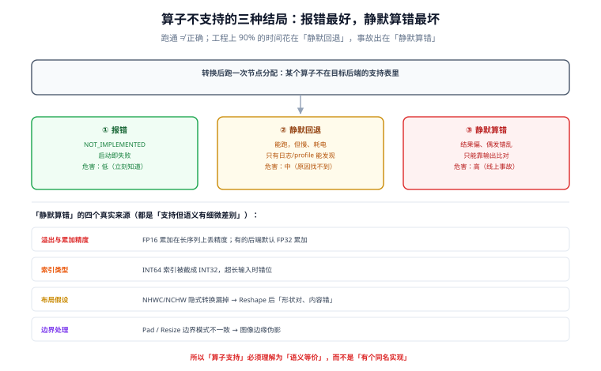

# 算子覆盖与回退

「我们用了 NPU」这句话在端侧项目里几乎等于没说。真实的运行时行为是：**一部分算子跑在 NPU，一部分回退到 GPU，剩下一点由 CPU 兜底**，中间夹着若干次数据搬运。跑通了、结果也对，但速度是预期的一半，耗电是预期的三倍。

这一页讲三件事：怎么读算子矩阵、不支持时会发生什么、以及**怎么自证「真的跑在你想的那个后端上」**。

::: tip 一句话理解
算子不支持有三种结局：**报错**（最好，你立刻知道）、**静默回退**（最常见，慢但能跑）、**静默算错**（最坏，数字不对但不报错）。工程上 90% 的时间花在第二种，事故出在第三种。
:::

## 判据族声明

本页判据族 `EIS-A` ~ `EIS-H`，共 8 条。定义表在第八节。

## 本页不讲什么

- 不讲 EP / delegate 的注册与初始化，归 [运行时与算子委派](../Runtime/index.md)。
- 不讲量化粒度怎么选，归 [量化方案与端侧可行性](../Quantization/index.md)。
- 不讲服务端的算子融合与图优化，归 [GPU 与显存规划](/docs/AI/LocalModel/Hardware/index.md)。

## 一、算子矩阵怎么读：四列就够

官方文档里的算子表信息量很大，但工程上只需要四列：

| 列 | 为什么关键 | 常见坑 |
| --- | --- | --- |
| **算子名 + 版本约束** | 同一个名字在不同 opset 语义不同 | `Resize` 在 opset 11 与 13 的参数顺序变了 |
| **支持的后端** | 决定跑在哪 | 文档写「支持」，但只在特定数据类型下支持 |
| **数据类型** | INT8 / FP16 / FP32 各有支持面 | 声明支持 FP16，实际只在 FP32 累加，精度对但速度不对 |
| **动态 shape 支持** | 端侧几乎必须固定 shape | 声明支持，但动态维度会触发重新编译（每次换 shape 编译一次） |

四列里最容易被忽略的是**「动态 shape 支持」**：很多后端对静态 shape 有专用 kernel，对动态 shape 直接回退。端侧固定 `max_length` 不只是省内存，更是**让 kernel 能被选中**。

## 二、不支持的三种结局



| 结局 | 表现 | 危害 | 怎么发现 |
| --- | --- | --- | --- |
| **报错** | `NOT_IMPLEMENTED` / `Unsupported operator` | 低（立刻知道） | 启动即失败 |
| **静默回退** | 能跑，但慢、耗电 | 中（性能不达标，找不到原因） | 只有看日志或逐节点 profile |
| **静默算错** | 结果偏差、偶发错乱 | **高**（线上事故） | 只能靠输出比对 |

第三种结局的真实来源通常不是「算子完全不支持」，而是**「支持但语义有细微差别」**：

- **溢出与累加精度**：FP16 累加在长序列上会丢精度；某些后端默认 FP16 累加，某些用 FP32。
- **索引类型**：INT64 索引在部分移动后端会被截成 INT32，超长输入时索引错位。
- **布局假设**：NHWC 与 NCHW 的隐式转换如果被漏掉，`Reshape` 之后的张量会「形状对、内容错」。
- **边界处理**：`Pad` / `Resize` 的边界模式不一致，图像类模型会出现边缘伪影。

所以「算子支持」必须理解为**「语义等价」**，而不是「有个同名实现」。

## 三、图切分的代价：一次性算清

假设一张图有 `N` 个节点，被切成 `k` 个分区，分区之间需要 `k−1` 次数据搬运。搬运成本约等于：

```text
copy_cost ≈ Σ (分区边界张量字节数) / 有效带宽
```

端侧一个中间张量可能是几 MB（如 batch×seq×hidden 的 FP16 激活），而带宽只有几十 GB/s。**一次 4 MB 的边界拷贝约 0.1 ms**，看着不多，但 decode 阶段每生成一个 token 都要付一次——**20 层模型若每层都有一个边界，就是 2 ms/token 的纯开销**，相当于把 22 tok/s 拉到 15 tok/s。

三条减少切分的实操：

1. **改写不支持的算子**：把 `TopK(k=动态)` 改成固定的 `k`，或用 `Sort + Slice` 组合（如果这两个支持）。
2. **把连续的小算子合并成一个自定义算子**（如果运行时支持），或用融合后的等价图。
3. **调整精度让后端认领**：某个算子只支持 FP32 时，把它周围的子图整体保 FP32，避免「一个 FP32 节点把整段拖回 CPU」。

::: danger 「先跑通再优化」在端侧会反噬
服务端「先跑通再优化」成本很低；端侧跑通往往意味着**你已经有了一条带 N 个回退分区的路径**，后面所有优化都要在这条路径上做。正确顺序是：**先定后端与算子子集，再选模型结构**——模型结构（GQA、激活函数、归一化位置）会直接决定算子覆盖。
:::

## 四、自证「真的跑在后端上」的三条路

厂商工具不一定有，但下面三条基本都能用：

### 路线一：逐节点分配日志

```python
# ONNX Runtime：开 verbose，检索节点分配
import onnxruntime as ort
so = ort.SessionOptions()
so.log_severity_level = 0                 # verbose
so.optimized_model_filepath = "opt.onnx"  # 顺手导出优化后的图
sess = ort.InferenceSession("model.onnx", so, providers=["QNNExecutionProvider", "CPUExecutionProvider"])
# 日志里检索 "Node placements" / "assigned to" / "fallback"
```

```text
看点：整图是否被切成多段；哪些节点落在 CPUExecutionProvider
判据：CPU 分区占比（按节点数）< 15%，且不含主循环内的节点
```

### 路线二：端到端耗时与功耗反证

如果开启了后端，**耗时和功耗应该同时下降**。只降时间不降功耗，通常意味着「跑在更快的 CPU 核上」而不是 NPU。

```text
对照组：providers = [CPU]
实验组：providers = [NPU, CPU]
期望：时间 -40% 以上，且同任务功耗 -30% 以上
若时间 -5%、功耗 +10% → 大概率回退了，且多了搬运
```

### 路线三：输出比对（唯一能抓「静默算错」的）

同一份输入，分别跑「纯 CPU」与「目标后端」，逐层或端到端比对：

```python
import numpy as np
a = run(providers=["CPUExecutionProvider"])     # 基准
b = run(providers=["CoreMLExecutionProvider", "CPUExecutionProvider"])
print("max_abs_diff", np.abs(a - b).max(), "cos", (a @ b) / (np.linalg.norm(a) * np.linalg.norm(b)))
# 期望：cos > 0.999，max_abs_diff < 1e-2（FP16 后端）
# cos < 0.99 → 不是精度问题，是语义问题，必须定位到层
```

## 五、端侧最常见的六类「不支持」

| 类别 | 例子 | 处理 |
| --- | --- | --- |
| 动态 shape | `Reshape` 带动态维度、`TopK` 动态 `k` | 固定 shape；把动态值改成常量 |
| 控制流 | `If` / `Loop` / 自回归循环写在图里 | 把循环提到宿主代码（端侧本来就要流式输出） |
| 自定义算子 | 业务自定义的 `postprocess` | 移到宿主侧用原生代码实现 |
| 低精度不支持 | INT4 的某个粒度、FP8 | 换粒度或换 bit 数 |
| 索引类型 | INT64 索引的 `Gather` | 转 INT32（注意上限） |
| 复杂后处理 | `NonMaxSuppression`、`BeamSearch` | 移到宿主侧，或用后端提供的融合版本 |

注意最后一行：**把后处理移到宿主侧，常常是端侧最快的优化**。一个 `NMS` 在 CPU 上跑 0.3 ms，在某个不支持它的后端上可能触发整段回退。

## 六、算子子集要写进模型设计约束

端侧项目应该在需求阶段就产出一份**算子白名单**，并把它作为模型结构的约束：

| 约束项 | 具体写法 | 影响 |
| --- | --- | --- |
| 归一化 | 只用 RMSNorm 或 LayerNorm，不用两者混用 | 后端通常只优化了其中一种 |
| 激活 | 只用 GELU / SiLU / ReLU 的固定变体 | `GELUApproximate` 等变体常缺失 |
| 注意力 | 固定 KV 头数与 head_dim | 便于后端选中专用 attention kernel |
| 位置编码 | RoPE 用后端提供的融合实现 | 手写 `sin/cos` 组合会切成多段 |
| 输出 | 不在图内做采样（`TopK/TopP`） | 采样放宿主侧，避免动态 shape |

这份白名单的价值在于**它是可验收的**：转换后跑一次节点分配日志，就能判定「模型是否落在白名单内」。

## 七、一次完整的定位流程

```text
1. 现象：tok/s 只有预期的 1/3
2. 查节点分配：CPU 分区占 42% 的节点，且集中在每层的 FFN 之后
3. 定位算子：该段含 ReduceMean + Mul + Add（自定义 LayerNorm 写法）
4. 结论：后端有融合的 LayerNorm，但不认这个手写组合
5. 修法：换成标准 LayerNorm 算子（或在转换时启用融合 pass）
6. 复测：CPU 分区降到 6%，tok/s 从 7 → 19
7. 留证：把节点分配日志与前后耗时写进验收报告
```

第七步最容易被省掉，但它决定了下次升级运行时能不能快速判断「有没有退化」。

## 八、判据表

| 编号 | 规则 | 违反时的样子 | 怎么验证 |
| --- | --- | --- | --- |
| `EIS-A` | 必须有算子白名单，且作为模型结构约束 | 转换完才发现一堆不支持 | 文档里有白名单表，且与模型结构一致 |
| `EIS-B` | 必须留一份节点分配日志（升级前后各一份） | 升级后变慢，无法判断是否退化 | 仓库里有 `ep_assignment_*.log` |
| `EIS-C` | CPU 分区占比（按节点数）< 15%，且不含主循环节点 | 慢 3 倍，找不到原因 | 日志统计；主循环节点必须落在目标后端 |
| `EIS-D` | 「用了 NPU/GPU」必须有输出比对记录 | 静默算错，线上才炸 | 有 CPU vs 目标后端的 `cos` / `max_abs_diff` |
| `EIS-E` | 动态 shape 必须消除，或明确接受重编译 | 每次换长度卡一下 | 图里 `Reshape`/`TopK` 无动态维度 |
| `EIS-F` | 后处理（NMS / 采样 / 解码）应在宿主侧 | 整段回退，性能断崖 | 图里没有后处理子图 |
| `EIS-G` | 精度相关约定（累加精度、索引类型）必须写明 | 长序列精度漂移 | 文档里有「FP32 累加」「INT32 索引上限」两条 |
| `EIS-H` | 每次运行时升级都要重跑「分配日志 + 输出比对」 | 结果漂移无感知 | CI 或发布清单里有这两项 |

## 验证方式

```shell
# EIS-E：静态扫图，找动态维度（ORT 优化后的模型也会保留动态标记）
python3 - <<'PY'
import onnx
m = onnx.load("opt.onnx")
dyn = []
for i in m.graph.input:
    for d in i.type.tensor_type.shape.dim:
        if d.dim_param:                     # 有符号维度 = 动态
            dyn.append(f"{i.name}:{d.dim_param}")
print("dynamic dims:", dyn or "none")
PY

# EIS-F：确认图里没有采样/后处理算子
python3 - <<'PY'
import onnx
m = onnx.load("opt.onnx")
bad = {"TopK", "NonMaxSuppression", "Multinomial", "Loop", "If"}
hit = sorted({n.op_type for n in m.graph.node} & bad)
print("postprocess ops in graph:", hit or "none")   # 期望 none（采样应在宿主侧）
PY
```

```text
EIS-C：统计 CPU 分区占比
  从 verbose 日志中提取 "assigned to CPUExecutionProvider" 的节点数 / 总节点数
  期望 < 15%；若 > 30%，先修算子再谈性能

EIS-D：输出比对阈值
  FP16 后端：cos > 0.999，max_abs_diff < 1e-2
  INT8 后端：cos > 0.995，max_abs_diff < 5e-2
  cos < 0.99：判为语义问题，禁止上线
```

## 参考资料

- [ONNX Runtime · Execution Providers](https://onnxruntime.ai/docs/execution-providers/)——各 EP 的算子覆盖表
- [ONNX Runtime · 算子文档](https://onnxruntime.ai/docs/reference/operators/)——算子版本与类型约束
- [Google AI Edge · LiteRT delegates](https://developers.google.com/edge/litert/android/delegates)——delegate 的子图委派行为
- [ONNX 算子规范](https://onnx.ai/onnx/operators/)——`Resize` / `Reshape` 等算子的 opset 差异
- 本站 [运行时与算子委派](../Runtime/index.md) · [量化方案与端侧可行性](../Quantization/index.md)
- 相邻：[浏览器与移动端](../DeviceWeb/index.md) · [端侧评测](../Evaluation/index.md) · [常见问题](../FAQ/index.md)
