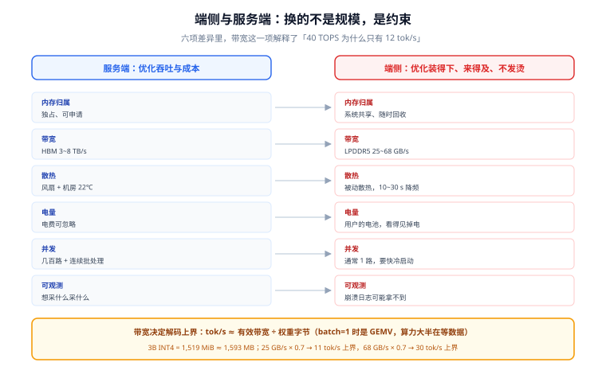
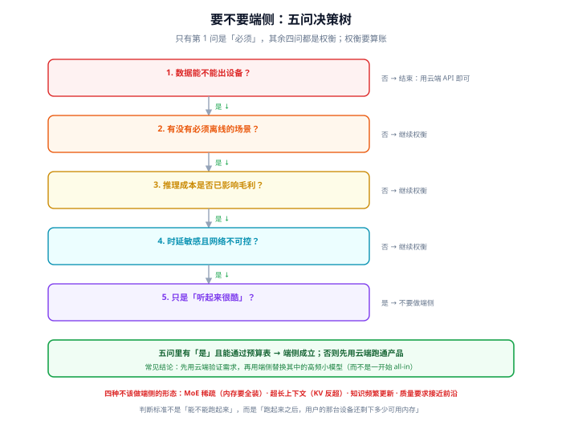

# 总览：三个硬约束与五个必失点

「端侧推理」这四个字在方案会上经常只值一句「我们也可以本地跑，保护隐私」。真要落地时会发现，端侧不是把服务端那套缩小一号，而是**换了一个约束系统**：内存是被别人管的、带宽是共享的、散热是被动的、电量是用户的钱、设备是你没见过的。

这一页要把这个约束系统讲清，并给出一个判断标准：**什么情况下该上端侧，什么情况下上了就是自找麻烦**。

::: tip 一句话理解
服务端优化的是**吞吐与成本**，端侧优化的是**能不能装下、来不来得及、会不会发烫**。前者是「同样的钱服务更多人」，后者是「同一个人只有这台设备」。
:::

## 判据族声明

本页判据族 `EIO-A` ~ `EIO-H`，共 8 条。定义表在第八节。

## 本页不讲什么

- 不讲权重、KV cache、激活的具体算式，归 [内存与延迟预算](../Budget/index.md)。
- 不讲量化粒度与误差，归 [量化方案与端侧可行性](../Quantization/index.md)。
- 不讲 ONNX Runtime / LiteRT 的 API，归 [运行时与算子委派](../Runtime/index.md)。
- 不讲端云路由的阈值设计，归 [端云协同与降级](../HybridRouting/index.md)。

## 一、端侧与服务端的六项差异（换的不是规模，是约束）

| 维度 | 服务端 | 端侧 | 直接后果 |
| --- | --- | --- | --- |
| **内存归属** | 你申请、你独占、你说了算 | 系统共享，随时可回收；浏览器还有每标签页上限 | 峰值内存比「平均占用」重要，必须留 40% 余量 |
| **带宽** | HBM 3~8 TB/s（单卡） | LPDDR5 约 50~70 GB/s，浏览器还要与页面共享 | 解码速度上限由带宽决定，不是由 TOPS 决定 |
| **散热** | 风扇 + 机房 22℃ | 被动散热，10 秒满负载就降频 | 「峰值性能」只能维持十几秒，长会话必须按降频后算 |
| **电量** | 电费可忽略 | 用户的电池，一次推理能看见掉电百分比 | 功耗是产品指标，不是运维指标 |
| **并发** | 几百路同时 | 通常 1 路，浏览器里可能和别人抢 GPU | 不需要 continuous batching，需要**快速冷启动** |
| **可观测** | 你想采什么就采什么 | 崩溃日志可能拿不到，真机数据靠用户上报 | 验收必须前置到真机矩阵，不能靠线上发现 |

这张表最重要的一行是**带宽**。它解释了一个常见的困惑：「我的手机 40 TOPS，为什么跑 3B 模型只有 12 tok/s？」因为自回归解码每一步只做一次矩阵向量乘（batch=1 时是 GEMV），算力几乎闲着一半，时间全花在**把 1.5 GiB 权重从内存搬到计算单元**上：`1.5 GiB × 1024 ÷ 50 GB/s ≈ 30 ms/token ≈ 33 tok/s` 的理论上界，实测能到 12 已经不错。



## 二、三个硬约束：容量、带宽、热

### 约束一：容量 —— 算的是峰值，不是模型大小

端侧的「能不能跑」不是「模型 1.5 GB、手机 8 GB」这个除法。真实峰值由五段构成：

| 段 | 典型占比 | 说明 |
| --- | --- | --- |
| 权重 | 40%~70% | 量化后的常驻部分，最稳定 |
| KV cache | 10%~40% | 随上下文**线性**增长，长上下文时反超权重 |
| 激活与中间张量 | 5%~15% | 与 batch、序列长度相关，prefill 阶段峰值最高 |
| 运行时与图形栈 | 100~400 MB | 浏览器里 WebGPU 的缓冲区、上下文、着色器编译缓存 |
| 系统与页面 | —— | **不属于你**，但会把你挤出去 |

`EIO-A` 要求把这五段写成一张表，并且**用「最低支持设备」的可用上限去比**，而不是用自己手机的物理内存。

### 约束二：带宽 —— 决定 tok/s 的天花板

解码阶段的时间近似等于「权重字节 ÷ 有效带宽」。有效带宽通常只有标称的 60%~75%（受其他进程、内存控制器、缓存命中影响）。所以：

```text
tok/s_max ≈ 有效带宽 / 权重字节
1.5 GiB 权重 + 50 GB/s × 0.7 有效 = 35 GB/s → 1.5×1024/35 ≈ 44 ms/token ≈ 22 tok/s
```

这条公式的价值不是预测准，而是**排除不可能的方案**：如果你的目标是 30 tok/s，而权重是 3 GiB，那么在任何 LPDDR5 手机上都不可能，只能减参数或减 bit 数。

### 约束三：热 —— 峰值只维持十几秒

被动散热的设备在持续负载下 10~30 秒就会触发降频，实际持续性能常跌到峰值的 50%~70%。所以端侧的性能指标必须写成两个数：**首 token 时延（冷启动、峰值性能）**与**持续生成速度（降频后）**。只报前者的方案，用户会在第二分钟开始骂。

## 三、五个必失点：全部是「本地跑通了，但产品不能上」

| 必失点 | 现象 | 根因 | 归属页 |
| --- | --- | --- | --- |
| **只在自己机器上验收** | 开发机流畅，低端机闪退 | 设备长尾，内存与带宽差 4~10 倍 | [端侧评测](../Evaluation/index.md) |
| **量化后只做「看起来对不对」** | 数字、日期、否定句突然错 | INT4 的失效是**局部崩塌**，不是整体变差 | [量化](../Quantization/index.md) |
| **初始化放在首屏路径上** | 白屏 3~8 秒 | 模型加载 + 图优化 + kernel 编译都在主线程 | [运行时](../Runtime/index.md) |
| **以为「用了 NPU」** | 耗电高、速度不如 CPU | 算子不支持，图被切分后大半回退到 CPU | [算子覆盖](../OperatorSupport/index.md) |
| **没有离线路径** | 断网即不可用，或一直转圈 | 端云协同只做了「云端失败 → 报错」 | [端云协同](../HybridRouting/index.md) |

这五条的共同点是：**它们都不会在开发机上暴露**。所以「端侧验收」的核心不是测得多细，而是**在哪台设备上测**。

## 四、要不要端侧：五问决策树



| 问题 | 若答「是」 | 若答「否」 |
| --- | --- | --- |
| 1. 数据能不能出设备？ | 端侧是**唯一**选项，继续 | 进第 2 问 |
| 2. 有没有必须离线可用的场景？ | 端侧是**必要**能力，继续 | 进第 3 问 |
| 3. 单位推理成本是否已显著影响毛利？ | 端侧是**成本手段**，继续 | 进第 4 问 |
| 4. 时延敏感（<200 ms 首响应）且网络不可控？ | 端侧是**体验手段**，继续 | 进第 5 问 |
| 5. 只是「听起来很酷」？ | **不要做端侧**，用云端 API | —— |

五问里只有第 1 问是「必须」，其余四问都是「权衡」。权衡就要算账：端侧省下的是**边际推理成本**，付出的是**包体积、适配成本、效果下降、崩溃率**。一个常见结论是：**先用云端跑通产品，再用端侧替换其中的高频小模型**——这比一开始就 all-in 端侧便宜得多。

## 五、四种不该做端侧的形态

1. **模型大到只能靠 MoE 稀疏激活才跑得动**：端侧内存要装**全部**专家，稀疏只省算力不省容量，等于把最贵的资源花在最没收益的地方。
2. **效果依赖超大上下文**：4k 以上上下文时 KV cache 会反超权重（实测见 [预算](../Budget/index.md)），端侧会先撞容量墙。
3. **需要频繁更新的知识型问答**：端侧模型的知识是冻结的，更新一次要发版；这类需求应该用「端侧检索 + 云端生成」而不是「端侧生成」。
4. **质量要求接近前沿模型**：0.5B~3B 的模型在开放生成上与前沿模型差一个档，硬上端侧只会得到「免费但没用」。

## 六、一次端侧推理的完整路径（把三个约束串起来）

```text
应用启动
  ├─ 1. 检查能力：内存水位 / 是否 WebGPU / 是否有 NPU delegate
  ├─ 2. 加载运行时（WASM 或原生库）：实例化 + kernel 编译（1~8 s）
  ├─ 3. 加载权重：从包内 / 缓存 / IndexedDB 读入，反量化到工作精度
  ├─ 4. 预热一次短输入：触发 JIT / 着色器编译，避免首 token 抖动
  └─ 5. 进入可服务状态
用户输入
  ├─ 6. tokenize → prefill（算力受限，长输入时最慢）
  ├─ 7. decode 循环（带宽受限，每 token 搬一遍权重）
  └─ 8. 流式输出 + 每 N 个 token 检查内存水位与取消信号
```

三个约束落在不同阶段：**容量**卡在第 3 步与第 7 步（KV 增长），**带宽**卡在第 7 步，**热**卡在第 7 步的持续阶段。把它们标在同一张流程图上，比背三条口号有用。

::: info 冷启动与热启动是两个指标
模型加载 + kernel 编译属于**冷启动**，用户第一次打开时付一次；之后进程/上下文复用就是**热启动**。产品验收要分别给数：冷启动决定「愿不愿意等」，热启动决定「愿不愿意一直用」。多数端侧方案的差评来自冷启动，而不是推理速度。
:::

## 七、最小可行方案：三个决定先定下来

| 决定 | 选项 | 什么时候选它 |
| --- | --- | --- |
| **跑在哪** | 浏览器 / App 内嵌 / 系统级（如 Android AICore） | 浏览器覆盖面最大、成本最低；App 内嵌能拿到 NPU 与更多内存；系统级最省包体但要等平台支持 |
| **跑什么模型** | 0.5B~1B 生成 / 3B~4B 生成 / 专用小模型（分类、抽取、嵌入） | 先问「这个任务真的需要生成吗」——抽取类任务用 100M 级编码器往往更好 |
| **精度怎么定** | FP16 / INT8 / INT4（group-wise） | 内存不足才降 bit；降 bit 必须配一次 200 条回归比对 |

三个决定定完，才轮到选运行时。反过来（先选框架再想模型）是端侧项目最常见的返工原因。

## 八、判据表

| 编号 | 规则 | 违反时的样子 | 怎么验证 |
| --- | --- | --- | --- |
| `EIO-A` | 峰值内存必须写成五段账（权重/KV/激活/运行时/系统余量），并与**最低支持设备**的可用上限对比 | 开发机通过、低端机 OOM | 方案文档里有这张表；每段都有数字与来源 |
| `EIO-B` | 性能目标必须给「首 token 时延」与「持续 tok/s」两个数 | 只报峰值速度，第二分钟开始卡 | 验收报告里两个指标分列，且注明测试时长 |
| `EIO-C` | 端侧决策必须回答五问，且写明「不做端侧」的替代方案 | 上线后发现成本比云端更高 | 决策文档里五问逐条有答案与依据 |
| `EIO-D` | 最低支持设备必须显式列出（机型 / 系统版本 / 内存） | 「支持主流机型」这类无法验收的表述 | 需求文档里是一份具体清单，含至少一台低端机 |
| `EIO-E` | 初始化必须在首屏之外完成，且有「未就绪」的降级路径 | 白屏数秒，或按钮点了没反应 | 代码里初始化在异步任务中；有 loading/降级态 |
| `EIO-F` | 任何「用了 NPU / GPU」的说法必须有后端自证 | 实际跑在 CPU 上，耗电高 | 用 [算子覆盖](../OperatorSupport/index.md) 的三条证法之一留证 |
| `EIO-G` | 端侧能力必须有开关，可远程关闭并回退云端 | 出问题只能发版 | 配置中心有该开关，且演练过关闭路径 |
| `EIO-H` | 模型与运行时的版本必须锁死并记录 | 升级运行时后效果漂移，无法回滚 | 依赖清单里有模型哈希与运行时版本号 |

## 验证方式

前四条不需要真机就能判，用命令即可：

```shell
# EIO-D：确认最低支持设备是一份清单，而不是一句「主流机型」
grep -rn "最低支持\|minSdk\|minimum.*device" docs/ 2>/dev/null || echo "MISSING: no device floor"

# EIO-H：确认模型与运行时版本被锁定（以 npm / Gradle / SPM 为例）
grep -rn "onnxruntime\|litert\|coreml" package.json build.gradle* Package.swift 2>/dev/null
# 期望：版本号是精确值（1.31.0），不是 ^1.31 或 latest

# EIO-E：确认初始化不在首屏同步路径上
grep -rn "InferenceSession\|CompiledModel\|loadModel" src/ | grep -v "await\|then\|async" \
  && echo "CHECK: 上面这些调用是否在同步渲染路径里"
```

`EIO-A` 与 `EIO-B` 的验证要读运行数据，给的是判据形态而非一次性命令：

```text
EIO-A：在最低支持设备上，跑 20 轮 4k 上下文会话，记录
       peak_rss（Android: dumpsys meminfo / iOS: Instruments / 浏览器: performance.memory）
       期望 peak_rss ≤ 设备可用上限 × 0.6
EIO-B：同一台设备，记录
       ttft_ms（首 token）、tok_s_10s（前 10 秒）、tok_s_120s（第 2 分钟）
       期望 tok_s_120s ≥ tok_s_10s × 0.5（否则说明降频后不可用）
```

## 参考资料

- [ONNX Runtime · Execution Providers](https://onnxruntime.ai/docs/execution-providers/)——各后端的平台与算子覆盖
- [Google AI Edge · LiteRT](https://developers.google.com/edge/litert)——`Interpreter` / `CompiledModel` 两代 API
- [WebGPU 规范](https://www.w3.org/TR/webgpu/)——浏览器 GPU 的能力边界与限制
- [Apple · Core ML](https://developer.apple.com/documentation/coreml)——计算单元（CPU/GPU/Neural Engine）选择
- [llama.cpp · quantize](https://github.com/ggml-org/llama.cpp/blob/master/tools/quantize/README.md)——GGUF 量化类型的实际构成
- 本站 [本地模型部署](/docs/AI/LocalModel/index.md) · [量化与模型格式](/docs/AI/LocalModel/Quantization/index.md) · [移动 H5](/docs/Frontend/MobileH5/Overview/index.md)
- 相邻：[内存与延迟预算](../Budget/index.md) · [运行时与算子委派](../Runtime/index.md) · [常见问题](../FAQ/index.md)
