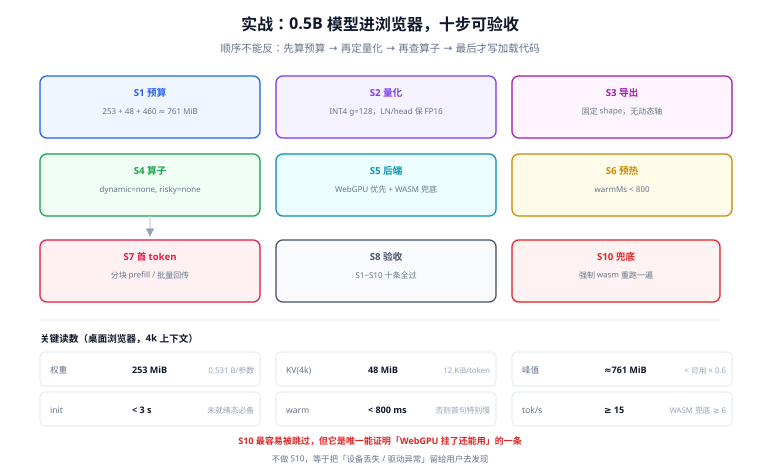

# 实战：把 0.5B 模型装进浏览器

前面九页讲的是约束与机制，这一页把它们串成一条可执行的路径：**一个 0.5B 的对话模型，跑在浏览器里，4k 上下文，断网可用，首屏 3 秒内可输入**。

选 0.5B 不是因为它强，而是因为它**刚好落在浏览器能承受的边界上**：INT4 后权重 253 MiB，4k 上下文 KV 只有 48 MiB，加起来不到 0.3 GB——这个量级才敢在普通笔记本上谈「常驻」。

::: tip 一句话理解
这条路径的成败不在模型，而在**顺序**：先算预算 → 再定量化 → 再查算子 → 最后才写加载代码。顺序反了，你会发现「跑起来了但慢 5 倍」，然后重来一遍。
:::

## 判据族声明

本页判据族 `EIP-A` ~ `EIP-H`，共 8 条。定义表在第八节。

## 本页不讲什么

- 不讲量化误差的理论与实测对比，归 [量化方案与端侧可行性](../Quantization/index.md)。
- 不讲 EP 与算子分配的机制，归 [运行时与算子委派](../Runtime/index.md) 与 [算子覆盖](../OperatorSupport/index.md)。
- 不讲跨端路由与离线队列，归 [端云协同与降级](../HybridRouting/index.md)。

## 一、目标与约束（先写死，后面不再改）

| 项 | 取值 | 依据 |
| --- | --- | --- |
| 模型 | 0.5B 级对话模型，24 层 / 2 KV 头 / head_dim 64 | GQA 比例高，KV 小（12 KiB/token） |
| 精度 | INT4 `group=128`，LayerNorm 与 `lm_head` 保 FP16 | 见 [量化](../Quantization/index.md) 的排除表 |
| 上下文 | 4096 token | 产品约束 |
| 目标设备 | 近三年笔记本 / 桌面浏览器，可用内存 ≥ 2 GB | 低于此不承诺 |
| 后端 | WebGPU 优先，WASM 兜底 | 见 [浏览器与移动端](../DeviceWeb/index.md) |
| 首屏 | 可输入 < 1 s，可推理 < 3 s | 产品指标 |
| 速度 | ≥ 15 tok/s（桌面独显/统一内存） | 低于此用户会放弃 |

## 二、S1：预算表（先算，不写代码）



```text
权重：0.5e9 × 0.531 bytes = 265.6 MB ≈ 253 MiB
KV  ：24 × 2 × 64 × 2 × 2 = 12,288 B/token；4k → 48 MiB
激活：prefill 4k 时约 120~180 MB（含 attention 中间量）
运行时：WASM + WebGPU 缓冲 + 着色器缓存 ≈ 250~350 MB
合计峰值 ≈ 253 + 48 + 160 + 300 ≈ 761 MiB
浏览器单标签页可用 ≈ 1.5~2 GB → 余量 50% 以上，**通过**
```

复核脚本（与 [预算](../Budget/index.md) 同一份逻辑，只改参数）：

```python
PARAMS, BITS, GROUP = 0.5e9, 4, 128
LAYERS, KVH, D, CTX = 24, 2, 64, 4096
w = PARAMS * (BITS / 8 + 4 / GROUP) / 1024 / 1024
kv = LAYERS * KVH * D * 2 * 2 * CTX / 1024 / 1024
print(f"weights={w:.0f} MiB kv={kv:.0f} MiB peak≈{w+kv+460:.0f} MiB")
# 实跑读数：weights=253 MiB kv=48 MiB peak≈761 MiB
```

## 三、S2：量化（按层区别对待，不搞一刀切）

```python
# 量化配置要点（以 ORT 的 quantize 工具为例，伪配置）
{
  "weight_bits": 4,
  "group_size": 128,                       # 有离群值时 g=128 才稳
  "per_channel": True,
  "exclude": [                             # 这些层不量化（保 FP16）
    "model.layers.*.input_layernorm",
    "model.layers.*.post_attention_layernorm",
    "model.norm",
    "lm_head"
  ],
  "activation_bits": 16                    # 端侧不量化激活
}
```

量化后必做两件事：

1. **反算 `bytes/param`**，确认与预算表一致（期望 0.52~0.57）。
2. **跑 200 条回归集**，比对数字、日期、否定、JSON 四类（见 [量化](../Quantization/index.md) 的复测清单）。

## 四、S3：导出固定 shape 的图

端侧不要留动态维度——它会让后端每次换长度都重新编译（见 [算子覆盖](../OperatorSupport/index.md)）。

```python
import torch

MAX_LEN = 4096
dummy = {
    "input_ids": torch.zeros((1, 8), dtype=torch.long),        # 导出用短序列
    "attention_mask": torch.ones((1, 8), dtype=torch.long),
    "position_ids": torch.arange(8).unsqueeze(0),
}
torch.onnx.export(
    model,
    (dummy,),
    "model_fixed.onnx",
    input_names=["input_ids", "attention_mask", "position_ids"],
    output_names=["logits", "present"],
    dynamic_axes=None,                    # 关键：不留动态轴
    opset_version=17,
)
```

```text
导出后自检（三条）：
1. 文件大小 / 参数量 ≈ 0.53 bytes/param（与 S2 一致）
2. 图里无 dim_param（见下方 EIP-C 的脚本）
3. 用纯 CPU 跑一次，输出与 PyTorch 对齐（cos > 0.9999）
```

## 五、S4：算子白名单检查（在跑浏览器之前）

```python
import onnx
m = onnx.load("model_fixed.onnx")

# 1) 动态维度
dyn = [d.dim_param for i in m.graph.input for d in i.type.tensor_type.shape.dim if d.dim_param]
# 2) 端侧不友好的算子
bad = {"Loop", "If", "TopK", "NonMaxSuppression", "Multinomial"}
hit = sorted({n.op_type for n in m.graph.node} & bad)
# 3) 算子种类数（越少越容易被后端整体认领）
ops = sorted({n.op_type for n in m.graph.node})

print("dynamic:", dyn or "none")
print("risky ops:", hit or "none")
print("op kinds:", len(ops), ops[:12])
# 期望：dynamic=none，risky=none，op kinds < 25（0.5B 级模型通常 15~20 种）
```

命中 `Loop` / `If` 通常意味着「自回归循环被写进了图里」。端侧必须把循环提到宿主代码——**流式输出本来就需要宿主逐步驱动**，两件事正好合并。

## 六、S5：运行时与双后端

```javascript
// 选定后端：WebGPU 优先，失败回落 WASM
async function pickProviders() {
  const list = [];
  if ("gpu" in navigator) {
    try {
      const adapter = await navigator.gpu.requestAdapter();
      if (adapter) list.push("webgpu");
    } catch { /* 忽略，走 wasm */ }
  }
  list.push("wasm");
  return list;
}
```

WASM 侧注意两件事（细节见 [浏览器与移动端](../DeviceWeb/index.md)）：

- 多线程变体需要 **COOP/COEP 跨域隔离**，否则 `SharedArrayBuffer` 是 `undefined`。
- 单线程 WASM 的吞吐大约是 WebGPU 的 1/3~1/2，**必须按这个下限做产品承诺**。

## 七、S6：Worker 加载 + 预热

```javascript
// worker.js
let session = null;

self.onmessage = async (e) => {
  if (e.data.type === "init") {
    const t0 = performance.now();
    const providers = e.data.providers;
    session = await ort.InferenceSession.create(e.data.url, {
      executionProviders: providers,
      graphOptimizationLevel: "all",
    });
    const initMs = performance.now() - t0;

    // 预热：短输入，触发 kernel / 着色器编译
    const t1 = performance.now();
    await session.run({
      input_ids: new ort.Tensor("int64", BigInt64Array.from([1n]), [1, 1]),
      attention_mask: new ort.Tensor("int64", BigInt64Array.from([1n]), [1, 1]),
      position_ids: new ort.Tensor("int64", BigInt64Array.from([0n]), [1, 1]),
    });
    self.postMessage({ type: "ready", initMs, warmMs: performance.now() - t1, providers });
  }
};
```

预热必须有，否则**首个真实请求会替你把编译时间付掉**，用户看到的就是「第一句话特别慢」。

## 八、S7：首 token 优化（三处最有效）

| 手段 | 效果 | 代价 |
| --- | --- | --- |
| **分块 prefill**（每块 256~512 token） | 峰值内存下降，长输入不 OOM | 首 token 略慢 |
| **固定 shape + 定长 KV** | 避免重复编译与重分配 | 内存按最大值占用 |
| **批量 postMessage**（每 30~50 ms 一批 token） | UI 不卡，主线程开销降一个量级 | 流式「颗粒度」变粗 |

一个 4k 输入的 prefill 在 WebGPU 上大约 300~900 ms，**这已经超过「首 token < 500 ms」的产品线**。所以长输入场景的正确做法是**先回一句「正在读文档」，再流式给结论**——用交互设计掩盖物理限制，比硬优化便宜。

## 九、S8：验收序列（十条，全部可执行）

| 编号 | 命令 / 操作 | 期望读数 |
| --- | --- | --- |
| S1 | `python3 -c "import os;print(os.path.getsize('model_int4.onnx')/0.5e9)"` | 0.52~0.57 bytes/param |
| S2 | 跑 S4 的算子检查脚本 | `dynamic: none`、`risky ops: none` |
| S3 | 纯 CPU 跑一次，与 PyTorch 比对 | cos > 0.9999 |
| S4 | 浏览器「清空缓存 + 硬刷新」后进入页面 | 首屏可输入 < 1 s |
| S5 | 控制台读 `initMs` / `warmMs` | init < 3000 ms，warm < 800 ms |
| S6 | DevTools 性能面板看主线程 | 推理期间无长任务（> 50 ms） |
| S7 | 断网（DevTools Offline）后发一句短问 | 正常返回，标「离线」 |
| S8 | 连续 10 轮对话，每轮记录峰值内存 | 不单调上涨，10 轮后涨幅 < 5% |
| S9 | 贴 3,000 字文本让它总结 | 不 OOM，首 token < 2 s（可接受「正在读」） |
| S10 | 强制 `providers=["wasm"]` 重跑 S5~S7 | 全部通过（证明兜底路径可用） |

S10 最容易被跳过，但它是**唯一能证明「WebGPU 挂了还能用」的一条**。不做 S10，等于把「设备丢失 / 驱动异常」留给用户去发现。

## 十、判据表

| 编号 | 规则 | 违反时的样子 | 怎么验证 |
| --- | --- | --- | --- |
| `EIP-A` | 预算表必须在写代码前完成，且峰值 < 可用上限 × 0.6 | 做到一半发现装不下 | S1 的复核脚本能跑出通过/不通过 |
| `EIP-B` | 量化必须按层排除（LayerNorm / `lm_head` / 首尾层） | 输出整体偏移 | 量化配置里有 `exclude` 列表 |
| `EIP-C` | 导出的图必须无动态维度 | 换长度就卡一下 | S4 脚本输出 `dynamic: none` |
| `EIP-D` | 图里不得含 `Loop` / `If` / 采样算子 | 速度断崖或整段回退 | S4 脚本输出 `risky ops: none` |
| `EIP-E` | 必须有预热步骤，且记录 `warmMs` | 第一句话特别慢 | 日志里有 `warmMs`，且 < 800 ms |
| `EIP-F` | 推理必须在 Worker，且 token 批量回传 | 页面卡死 | 主线程无推理；消息频率 < 30 次/秒 |
| `EIP-G` | 断网必须可用，且 UI 明确标注离线 | 断网转圈 | S7 通过 |
| `EIP-H` | WASM 兜底路径必须独立验收（S10） | WebGPU 异常时白屏 | S10 通过，且结果一致 |

## 验证方式

```shell
# EIP-A：预算复核（与正文同一份逻辑）
python3 - <<'PY'
PARAMS, BITS, GROUP = 0.5e9, 4, 128
LAYERS, KVH, D, CTX = 24, 2, 64, 4096
w = PARAMS * (BITS/8 + 4/GROUP) / 1024 / 1024
kv = LAYERS * KVH * D * 2 * 2 * CTX / 1024 / 1024
peak = w + kv + 460
print(f"weights={w:.0f} MiB kv={kv:.0f} MiB peak≈{peak:.0f} MiB -> {'OK' if peak < 2048*0.6 else 'OVER'}")
PY

# EIP-C / EIP-D：一次跑完动态维度与风险算子检查
python3 - <<'PY'
import onnx
m = onnx.load("model_fixed.onnx")
dyn = [d.dim_param for i in m.graph.input for d in i.type.tensor_type.shape.dim if d.dim_param]
bad = {"Loop","If","TopK","NonMaxSuppression","Multinomial"}
hit = sorted({n.op_type for n in m.graph.node} & bad)
print("dynamic:", dyn or "none", "| risky:", hit or "none")
PY
```

```text
EIP-E ~ EIP-H：浏览器侧读数（控制台）
  initMs / warmMs        init < 3000 / warm < 800
  ttft_ms                < 2000（4k 输入可放宽到 2500）
  tok_s                  桌面 >= 15；WASM 兜底 >= 6
  peak_heap_mb           10 轮后涨幅 < 5%
  offline_test           断网返回正常，且 UI 有「离线」标识
```

## 参考资料

- [ONNX Runtime · Web](https://onnxruntime.ai/docs/tutorials/web/)——`onnxruntime-web` 的后端与打包变体
- [ONNX Runtime · GenAI](https://onnxruntime.ai/docs/genai/)——生成式模型的 KV 管理与采样
- [WebGPU 规范](https://www.w3.org/TR/webgpu/)——适配器、设备与 `device.lost`
- [Google AI Edge · LiteRT.js](https://developers.google.com/edge/litert)——浏览器侧的另一种选择
- [llama.cpp · GGUF 量化](https://github.com/ggml-org/llama.cpp/blob/master/tools/quantize/README.md)——量化类型的参考实现
- 本站 [WebAssembly · 性能](/docs/Frontend/WebAssembly/Performance/index.md) · [移动 H5 · 页面性能](/docs/Frontend/MobileH5/PagePerformance/index.md)
- 相邻：[量化](../Quantization/index.md) · [算子覆盖](../OperatorSupport/index.md) · [端侧评测](../Evaluation/index.md)
