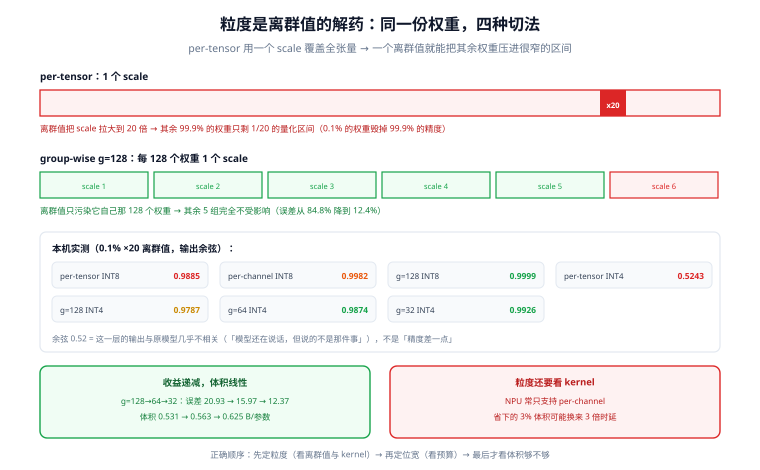

# 量化方案与端侧可行性

量化在服务端是「省钱手段」，在端侧是**准入条件**——装不下就是装不下，没有第二条路。但端侧量化最容易犯的错是**只盯体积不看误差分布**：体积达标了，模型在数字、日期、否定句上开始胡说，而这种失效是局部的、不连续的，靠「随便聊两句」根本发现不了。

这一页把量化拆成三个可独立决策的维度（bit 数、粒度、对称性），用本机实测说明**粒度是离群值的解药**，并给出端侧的复测清单。

::: tip 一句话理解
量化的收益是**线性**的（4 bit 省 4 倍），代价是**非线性**的（误差取决于离群值与粒度）。所以端侧的正确顺序是：**先定粒度，再定 bit 数，最后才看体积够不够**。
:::

## 判据族声明

本页判据族 `EIQ-A` ~ `EIQ-H`，共 8 条。定义表在第八节。

## 本页不讲什么

- 不讲 GGUF / AWQ / GPTQ 的格式差异与转换命令，归 [量化与模型格式](/docs/AI/LocalModel/Quantization/index.md)。
- 不讲量化感知训练（QAT）的训练流程，归 [微调](/docs/AI/FineTuning/Overview/index.md)。
- 不讲量化后怎么测端到端质量，归 [端侧评测](../Evaluation/index.md)。

## 一、三个维度，可以独立决策

| 维度 | 选项 | 端侧默认 | 什么时候要改 |
| --- | --- | --- | --- |
| **bit 数** | FP16 / INT8 / INT4 / 混合 | INT4（体积）或 INT8（质量） | 内存不够降 bit；质量不够升 bit |
| **粒度** | per-tensor / per-channel / group-wise（32/64/128） | **group-wise 64 或 128** | NPU 只支持 per-channel 时必须降级并复测 |
| **对称性** | 对称（只有 scale）/ 非对称（scale + zero point） | 权重对称、激活非对称 | 激活分布明显偏斜（ReLU 后全正）时用非对称 |

三个维度里**粒度最关键**，因为它同时决定误差与 kernel 兼容性：很多 NPU 只支持 per-channel，`group=128` 会被拆成一段段回退到 CPU——**你省下的 3% 体积，换来的是 3 倍时延**（见 [算子覆盖](../OperatorSupport/index.md)）。

## 二、误差有三层，只有第三层能验收

| 层 | 指标 | 能说明什么 | 不能说明什么 |
| --- | --- | --- | --- |
| 权重层 | 相对 Frobenius 误差 `‖W−Ŵ‖/‖W‖` | 量化器本身好不好 | 模型会不会答错 |
| 输出层 | 单层输出相对误差、余弦相似度 | 这一层被破坏得多厉害 | 端到端任务指标 |
| 任务层 | 回归集上的准确率 / 关键字段命中率 | **能不能上线** | 具体坏在哪（要回到前两层定位） |

工程上的用法是「两层筛、一层判」：先用**输出层余弦**快速筛掉明显不可行的方案（余弦 < 0.99 基本没救），再用**任务层回归集**做最终判定。只做任务层，你不知道为什么坏；只做输出层，你会误杀一些「单层误差大但端到端没事」的配置。

## 三、实测：七种方案的误差（4096×4096 权重，16.7M 参数）



权重服从 `N(0, 0.02)`，输入为随机正态向量，本机 numpy 实跑（脚本不入库）：

**无离群值**

| 方案 | 权重误差 | 输出误差 | 输出余弦 | 体积系数（INT8 = 1.000） |
| --- | --- | --- | --- | --- |
| per-tensor INT8 | 1.229% | 1.237% | 0.999924 | 1.000 |
| per-channel INT8 | 0.865% | 0.856% | 0.999963 | 1.000 |
| group=128 INT8 | **0.646%** | **0.636%** | 0.999980 | 1.000 |
| per-tensor INT4 | 22.287% | 22.300% | 0.976146 | 0.531 |
| group=128 INT4 | 11.718% | 11.743% | 0.993169 | 0.531 |
| group=64 INT4 | 10.754% | 10.768% | 0.994260 | 0.563 |
| group=32 INT4 | **9.698%** | **9.697%** | 0.995338 | 0.625 |

**加入 0.1% 的离群值（幅度 ×20，模拟真实权重里的 outlier 通道）**

| 方案 | 权重误差 | 输出误差 | 输出余弦 | 相对无离群值时 |
| --- | --- | --- | --- | --- |
| per-tensor INT8 | 15.171% | 15.209% | 0.988533 | **恶化 12.3 倍** |
| per-channel INT8 | 5.942% | 5.973% | 0.998222 | 恶化 6.9 倍 |
| group=128 INT8 | **1.451%** | **1.438%** | 0.999897 | 恶化 2.2 倍 |
| per-tensor INT4 | 84.839% | 85.156% | **0.524292** | 恶化 3.8 倍（已崩塌） |
| group=128 INT4 | 20.931% | 20.758% | 0.978651 | 恶化 1.8 倍 |
| group=64 INT4 | 15.965% | 15.915% | 0.987435 | 恶化 1.5 倍 |
| group=32 INT4 | 12.370% | 12.241% | 0.992563 | 恶化 1.3 倍 |

四条可以直接拿走的结论：

1. **`per-tensor INT4` + 离群值 = 崩塌，不是「差一点」**：输出余弦 **0.524**，意味着这一层的输出和原模型几乎不相关。它的表现是「模型还在说话，但说的不是那件事」——这种失效最容易被误判成「提示词写得不好」。
2. **粒度是离群值的解药**：同样的离群值，`per-tensor INT8` 恶化 12.3 倍，`group=128 INT8` 只恶化 2.2 倍。**组越小，离群值影响的范围越小**——它只污染自己那 128 个权重。
3. **离群值越多，粒度收益越大**：无离群值时 `128→64→32` 的误差是 11.72% → 10.75% → 9.70%（每档约 -8%）；有离群值时是 20.93% → 15.97% → 12.37%（**每档约 -23%**）。所以「真实权重该用多小的组」，答案取决于它有多少离群值，而不是直觉。
4. **粒度的收益递减，体积代价线性**：`g=128 → g=32` 误差降约 17%（有离群值时约 41%），体积从 0.531 涨到 0.625（**+17.7%**）。在「刚好装不下」的场景里，这笔交易经常不划算。

::: danger 别用「权重误差小」证明量化成功
`group=32 INT4` 的权重误差 9.7% 看着很糟，但在真实模型里（离群值集中在少数通道、且这些通道的重要性低）端到端几乎没有损失。反过来，`per-tensor INT4` 在**某些层**（如 `down_proj`、`lm_head`）误差不大却会显著影响输出。**权重误差只能用来筛方案，不能用来判交付。**
:::

## 四、反量化吞吐：为什么端侧「省体积也省时间」

本机实测（numpy，INT4 `g=128` → FP32，5 轮，64 MiB 权重）：

```text
152.7 ms / 5 轮 → 2,095.9 MiB/s
```

2 GB/s 的反量化吞吐，相对端侧 25~68 GB/s 的内存带宽是**够用的**——说明 unpack 本身不是瓶颈，**瓶颈仍在把权重从内存搬到计算单元**。这就是端侧 `INT4` 比 `INT8` 更快的原因：字节少了，搬运时间就少了。

::: warning 这条结论在服务端会反过来
服务端 batch 大时，同一份权重被 batch 内多条请求复用，**权重搬运被摊薄**，此时反量化与 dequant-GEMM 的算力开销会变成主要成本，`INT4` 可能比 `INT8` 更慢。**同一个结论，换一个 batch 就失效**——这也是端侧不能照抄服务端量化经验的原因。
:::

## 五、打包格式：为什么 `Q4_K_M` 不是「统一 4 bit」

端侧常见的 4 bit 并不是「每个权重 4 bit」这么简单。以 GGUF 的 `Q4_K` 为例，它按 **super-block** 组织：一个块里包含若干权重，共享一个 6 bit 的 super-scale，块内再分子块各带自己的 scale 与 min。这样做的好处是**用极低的元数据开销换到接近 group-wise 的精度**；代价是 **kernel 必须认识这种布局**，通用反量化实现跑不了。

| 打包形态 | 元数据开销 | kernel 要求 | 典型场景 |
| --- | --- | --- | --- |
| per-tensor | 1 个 scale | 最低 | 教学、快速验证 |
| per-channel | 每通道 1 个 | 低（多数 NPU 支持） | NPU 友好路线 |
| group-wise（32/64/128） | 每组 1 个 | 中（需要分组 kernel） | GPU / CPU 主流 |
| super-block（Q4_K 类） | 块内分层 | 高（专用 kernel） | llama.cpp 生态 |
| 混合精度 | 按层不同 | 高 | 敏感层保 FP16 |

**这条决定了端侧的选型顺序**：先看目标运行时的算子支持表（哪个粒度有 kernel），再选量化方案；反过来选完方案发现没 kernel，就只能回退到 CPU。

## 六、哪些层不能一刀切

| 层 / 部件 | 建议 | 原因 |
| --- | --- | --- |
| `lm_head` / 输出投影 | 保 INT8 或 FP16 | 直接决定 logits，量化误差会放大成「选错 token」 |
| 第一层与最后一层 | 保高精度 | 输入输出的动态范围最大 |
| LayerNorm / RMSNorm | **保持 FP16** | 参数量极小，量化收益接近 0，风险极高 |
| Embedding | 可 INT8，慎 INT4 | 查表不省时间（不参与 GEMV），只省体积 |
| Attention 的 softmax 输入 | 保 FP16 | 极值敏感，量化会产生「注意力塌陷」 |
| KV cache | 可 INT8（需 kernel 支持） | 省一半内存，但长上下文误差累积，必须复测 |
| 专家层（MoE） | 按激活频率分层 | 冷专家可以更狠，但**内存要全装**（见 [总览](../Overview/index.md)） |

## 七、复测清单：量化前后各跑一次

不要用「聊两句」验收。一份 200 条的最小回归集，按下面五类各 40 条构造：

| 类别 | 为什么必须有 | 判定方式 |
| --- | --- | --- |
| 数字与单位 | INT4 最先坏在这里 | 关键数字是否逐字一致 |
| 日期与顺序 | 顺序颠倒不报错 | 时间序列是否正确 |
| 否定与条件 | 「不要 X」容易变成「要 X」 | 是否命中禁用项 |
| 长输入（>1k token） | KV 量化误差在这里累积 | 结论是否与短输入一致 |
| 结构化输出 | JSON 字段缺失/错位 | 能否被 `json.loads` 解析且字段齐全 |

判定用「关键字段命中率」而不是「像不像」：前者可复现，后者每次都不同。

## 八、判据表

| 编号 | 规则 | 违反时的样子 | 怎么验证 |
| --- | --- | --- | --- |
| `EIQ-A` | 量化方案必须写明三个维度（bit / 粒度 / 对称性） | 「用了 INT4」但不知道粒度 | 方案文档里三个词都出现 |
| `EIQ-B` | 禁止对权重使用 `per-tensor INT4` | 输出余弦掉到 0.5 量级，模型胡说 | 量化配置里 `granularity` 不为 `per_tensor` |
| `EIQ-C` | 粒度选择必须与目标运行时的 kernel 支持对齐 | 用了 `g=128`，NPU 不支持，全部回退 CPU | 算子表里该粒度有 kernel；或实测确认后端 |
| `EIQ-D` | LayerNorm / 首尾层 / `lm_head` 不做 INT4 | 输出分布整体偏移 | 量化排除表里列出这些层名 |
| `EIQ-E` | 量化前后必须跑同一份 ≥200 条回归集并留档 | 上线后发现数字类问题 | 仓库里有 `quant_before.json` / `quant_after.json` 对比 |
| `EIQ-F` | 体积必须按 `bytes/param` 实算（含 scale） | 按 0.5 估，实际 0.531，装不下 | 预算表里出现 group 对应的系数 |
| `EIQ-G` | KV 量化必须单独复测长上下文 | 短输入正常，长文档错乱 | 有 2k / 8k 两档的对比结果 |
| `EIQ-H` | 量化产物必须记录来源（基座模型哈希 + 工具版本 + 参数） | 无法复现，也无法回滚 | 产物旁有 `quant_manifest.json`，三项齐全 |

## 验证方式

`EIQ-B` 与 `EIQ-F` 可以直接查配置：

```shell
# EIQ-B：确认没有 per-tensor INT4
grep -rn "per_tensor\|per-channel\|group_size" quant_config.json scripts/*.py 2>/dev/null
# 期望：group_size 为 64 或 128；没有 weight_bits=4 + granularity=per_tensor 的组合

# EIQ-F：用实际文件大小反算 bytes/param，验证与预算表一致
python3 - <<'PY'
import os
size = os.path.getsize("model_int4.bin")     # 换成你的权重文件
params = 3.0e9
print(f"{size/params:.4f} bytes/param")      # 期望 0.52~0.57 之间
PY

# EIQ-H：确认产物有清单
ls -l quant_manifest.json && grep -E "base_sha|tool|group_size|bits" quant_manifest.json
```

`EIQ-E` 的回归对比是判据形态，需要跑模型：

```text
对同一份 200 条输入，分别在量化前后取输出，逐条比对「关键字段」：
  数字类：抽取出所有数字，集合必须相同
  JSON 类：字段名集合必须相同，数值误差 <1%
  否定类：命中禁用词的条数必须为 0
期望：整体命中率 ≥ 98%，任一单项 ≥ 95%；低于阈值就不上线
```

## 参考资料

- [llama.cpp · quantize](https://github.com/ggml-org/llama.cpp/blob/master/tools/quantize/README.md)——`Q4_K_M` 等类型的块结构
- [ONNX Runtime · Quantize ONNX models](https://onnxruntime.ai/docs/performance/model-optimizations/quantization.html)——per-channel / group 的配置项
- [Google AI Edge · ai-edge-quantizer](https://developers.google.com/edge/litert/models/post_training_quantization)——端侧 PTQ 的推荐流程
- [AWQ 论文](https://arxiv.org/abs/2306.00978)——激活感知的权重量化（为什么离群值通道要保护）
- 本站 [量化与模型格式](/docs/AI/LocalModel/Quantization/index.md) · [微调](/docs/AI/FineTuning/Overview/index.md)
- 相邻：[内存与延迟预算](../Budget/index.md) · [算子覆盖与回退](../OperatorSupport/index.md) · [端侧评测](../Evaluation/index.md)
