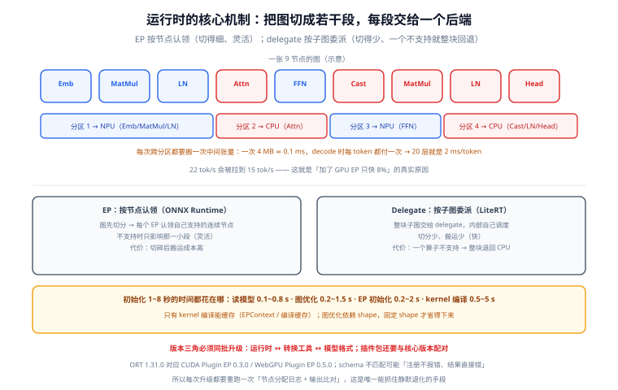

# 运行时与算子委派

选定模型与精度之后，端侧还有一层决定成败的东西：**运行时**。它负责把一张图拆成「谁能跑哪一段」，把权重搬进设备，把 kernel 编译好，并决定你的模型到底跑在 NPU、GPU 还是 CPU 上。

这一页讲四类运行时的委派模型、初始化开销的来源，以及版本三角（运行时 ↔ 转换工具 ↔ 模型格式）为什么必须一起锁。

::: tip 一句话理解
端侧运行时的核心机制只有一句话：**「把图切成若干段，每段交给一个后端」**。切得越碎，跨后端的数据搬运越多——所以「支持 NPU」不等于「跑在 NPU 上」，中间隔着一次图切分。
:::

## 判据族声明

本页判据族 `EIR-A` ~ `EIR-H`，共 8 条。定义表在第八节。

## 本页不讲什么

- 不讲某个算子为什么不被支持、怎么定位回退，归 [算子覆盖与回退](../OperatorSupport/index.md)。
- 不讲浏览器与 App 的加载策略，归 [浏览器与移动端落地](../DeviceWeb/index.md)。
- 不讲服务端的推理服务器（vLLM / Triton），归 [推理服务与 API 接入](/docs/AI/LocalModel/InferenceServer/index.md)。

## 一、四类运行时，两种委派模型



| 运行时 | 委派单位 | 平台 | 典型用途 |
| --- | --- | --- | --- |
| **ONNX Runtime** | Execution Provider（EP），按**节点**认领 | 移动 / 桌面 / 浏览器（Web） | 跨平台、算子覆盖最广、可混合多后端 |
| **LiteRT**（原 TFLite） | Delegate，按**子图**委派 | Android / iOS / 桌面 / 浏览器（LiteRT.js） | Google 生态、NPU 接入（NNAPI / vendor delegate） |
| **Core ML** | 计算单元（CPU / GPU / Neural Engine） | Apple 平台 | Apple 设备上最省事的 NPU 路线 |
| **llama.cpp（GGML）** | 后端（CPU / Metal / CUDA / Vulkan） | 桌面 / 移动（实验性） | LLM 专用，量化格式与 kernel 一体 |

两种委派模型的差别很实质：

- **EP 按节点认领**：运行时先做图切分，把「EP 支持的连续节点」合成一个分区，分区之间用 CPU 或内存拷贝衔接。优点是灵活（一个 EP 不支持某算子，只影响那一小段）；缺点是**切碎后搬运成本高**。
- **Delegate 按子图委派**：把整张（或一整块）子图交给 delegate，delegate 内部自己决定怎么执行。优点是切分少、搬运少；缺点是**只要有一个算子不支持，整块就退回**。

这解释了两种常见的反直觉现象：

```text
现象 A（ORT）：加了 GPU EP，速度只快了 8%
  → 图被切成十几个分区，每个分区前后都有 H2D/D2H 拷贝，收益被搬运吃掉

现象 B（LiteRT）：模型里加了一个小算子，整体慢了 4 倍
  → 该算子不被 delegate 支持，**整个子图**回退到 CPU
```

## 二、初始化开销：1~8 秒都从哪来

| 阶段 | 耗时量级 | 能不能缓存 |
| --- | --- | --- |
| 读模型文件（含解压） | 100~800 ms | 部分（OS 页缓存） |
| 解析图 + 图优化（常量折叠、算子融合） | 200~1,500 ms | 否（每次会话都要做） |
| EP / delegate 初始化（驱动、上下文） | 200~2,000 ms | 部分（进程内复用） |
| kernel 编译 / 着色器编译 | **0.5~5 s** | **能**（EPContext / 编译缓存） |
| 权重搬运到设备内存 | 100~1,000 ms | 否 |

两个关键点：

1. **kernel 编译是最大的一块，而且是可以缓存的**。ONNX Runtime 从 1.31.0 起把 **EPContext 数据 API 提升为稳定接口**，作用就是把「编译好的后端上下文」序列化下来，下次直接加载，跳过编译。移动端首次启动慢、第二次快，多数就是这个机制在起作用。
2. **图优化不能缓存**，因为它依赖输入 shape。所以**固定输入 shape**（尤其是固定最大序列长度）不仅省内存，还能省下每次会话的优化时间。

::: warning 别把初始化放进 `useEffect` 就直接上线
「异步初始化」只解决了「不阻塞渲染」，没解决「用户等 3 秒」。产品上必须有**未就绪态**：要么用规则/小模型先答，要么明确展示「正在准备离线模型（首次约 5 秒）」。前者体验好得多。
:::

## 三、版本三角：运行时 ↔ 转换工具 ↔ 模型格式

端侧最常见的「昨天还好今天崩了」，来源是这三者中有一个被单独升级了：

| 组合 | 典型错误 | 正确做法 |
| --- | --- | --- |
| 运行时升级、模型没重转 | EP 不认识旧格式的某个属性，静默回退 | 升级运行时后**重转一次模型**并比对算子分配 |
| 转换工具升级、运行时没升 | 新算子 / 新量化布局没有对应 kernel | 转换工具与运行时**同批升级**，或锁在兼容矩阵内 |
| 模型格式升级（如 LiteRT v1 → v2 API） | `Interpreter` 能读，`CompiledModel` 报 unsupported | 先确认目标 API 代际，再选转换参数 |

ONNX Runtime 官方对此有一条明确约束：**CUDA Plugin EP 与 WebGPU Plugin EP 是独立包，必须与核心版本配对**（1.31.0 对应 CUDA Plugin EP 0.3.0、WebGPU Plugin EP 0.5.0），且插件与核心必须使用同一份 contrib operator schema，否则「可能在注册阶段检测不出来，直接跑出错误结果」。这条约束值得抄进任何端侧项目的依赖管理规范：**插件与核心同批升级，且升级后必须跑一次输出比对**。

## 四、LiteRT 的两代 API（同格式、不同接入方式）

| 维度 | v1：`Interpreter` API | v2：`CompiledModel` API |
| --- | --- | --- |
| 来源 | TFLite 时代直接换包即可 | 新一代 API |
| 硬件加速 | NNAPI / GPU delegate | ML Drift GPU、NPU、vendor delegate |
| 内存 | 常规分配，拷贝多 | 零拷贝 I/O 缓冲 |
| 执行 | 同步为主 | 支持异步执行 |
| 适用 | 存量项目、简单模型 | 新项目、需要 NPU 与低拷贝 |

两代 API 读的是**同一个 `.tflite` 文件**，所以选 API 不等于选格式。这也正是本专题不建 `LiteRT-v1/`、`LiteRT-v2/` 版本目录的原因——差异是**接入方式**，不是模型资产。

## 五、四条路线的选择表

| 你的情况 | 推荐 | 理由 |
| --- | --- | --- |
| 要覆盖 Android + iOS + Web 三端 | ONNX Runtime | 一套模型、一套 API，EP 按平台替换 |
| 只在 Android，且要接厂商 NPU | LiteRT（v2 API） | vendor delegate 生态更成熟 |
| 只在 Apple 平台 | Core ML | 系统级优化，Neural Engine 接入最直接 |
| 只跑 LLM，且要自己控制量化格式 | llama.cpp | 量化与 kernel 一体，GGUF 生态 |
| 模型里大量自定义算子 | ONNX Runtime（自定义算子） | EP 机制允许局部回退，不至于整块失效 |

一个常被忽略的选项是**混合**：主模型用 ORT，预处理（分词、图像解码）用平台原生代码。端侧的分词器性能经常被低估——**一个 Python 移植的 tokenizer 可能比模型本身还慢**。

## 六、会话复用的三条纪律

1. **一个模型一个会话，进程内复用**。每次请求新建会话 = 每次重付初始化成本。
2. **会话不是线程安全的**（多数运行时如此）。多线程要各持一个会话，或加锁串行——端侧通常只有 1 路，**加锁比多会话更省内存**。
3. **取消要显式**。用户点了「停止」就应中断 decode 循环并释放 KV，而不是等它生成完——端侧不接受「点了没反应 3 秒」。

## 七、一个最小可用的初始化序列

```javascript
// 浏览器端（ORT Web）示意：先探测能力，再决定后端，最后预热
import * as ort from "onnxruntime-web";

async function createSession(modelUrl, preferWebGPU = true) {
  const providers = [];
  if (preferWebGPU && "gpu" in navigator) providers.push("webgpu");
  providers.push("wasm");                       // 永远留一条退路

  const t0 = performance.now();
  const session = await ort.InferenceSession.create(modelUrl, {
    executionProviders: providers,
    graphOptimizationLevel: "all",
  });
  const initMs = performance.now() - t0;

  // 预热：跑一次极短输入，触发 kernel / 着色器编译
  const warm = performance.now();
  await session.run({ input_ids: new ort.Tensor("int64", BigInt64Array.from([1n]), [1, 1]) });
  return { session, initMs, warmMs: performance.now() - warm, providers };
}
```

```text
读数怎么用：
  initMs   < 1500 ms  → 可接受（仍需未就绪态）
  initMs 1.5~5 s      → 必须做「首次提示 + 后台加载」
  warmMs   > 800 ms   → 说明 kernel 编译发生在这里，别把它算进首 token 时延
```

## 八、判据表

| 编号 | 规则 | 违反时的样子 | 怎么验证 |
| --- | --- | --- | --- |
| `EIR-A` | 运行时选型必须写明「委派模型」（EP 按节点 / delegate 按子图） | 以为支持 NPU 就快了，实际大量回退 | 设计文档里有委派模型与切分预期 |
| `EIR-B` | 必须记录初始化耗时（冷/热分列）并设置未就绪态 | 白屏数秒 | 有 `initMs` / `warmMs` 日志与对应的 UI 状态 |
| `EIR-C` | 会话必须进程内复用，禁止每请求新建 | 每次 2 秒延迟 | 代码里会话是单例/缓存，不是请求内创建 |
| `EIR-D` | 运行时、转换工具、模型格式三者版本必须同批锁定 | 升级后静默回退或结果漂移 | 依赖清单里三者版本相邻，且有一次输出比对记录 |
| `EIR-E` | 插件包（如 Plugin EP）必须与核心版本配对 | 结果错误且无报错 | 版本表里成对出现（如 1.31.0 ↔ 0.3.0/0.5.0） |
| `EIR-F` | 必须显式配置回退后端（WASM / CPU），不允许只有一条路 | 某个机型直接白屏 | 初始化代码里有 fallback 分支，且演练过 |
| `EIR-G` | 取消必须可中断 decode，并释放 KV | 点停止后仍输出数秒 | 有取消信号；取消后内存回落 |
| `EIR-H` | 输入 shape 尽量固定，且固定值写进文档 | 每次会话都重新优化，慢且抖动 | 配置里有固定 `max_length`，与预算表一致 |

## 验证方式

`EIR-A` 与 `EIR-E` 可以静态检查，`EIR-B` 需要一次真机运行：

```shell
# EIR-A：确认配置了多个 EP，且有回退
grep -rn "executionProviders\|providers" src/ | grep -v test
# 期望：数组里有 >=2 项，最后一项是 wasm/cpu

# EIR-E：确认插件与核心版本成对（以 package.json 为例）
grep -nE "onnxruntime-(web|node|common)" package.json
# 期望：三者版本一致；若用了 plugin 包，版本与官方配对表一致
```

```python
# EIR-A 的运行时自证：打印每个节点的 EP 分配（ORT Python 侧同款机制）
import onnxruntime as ort
print(ort.get_available_providers())          # 期望包含目标后端，如 CoreMLExecutionProvider
sess = ort.InferenceSession("model.onnx", providers=["CPUExecutionProvider"])
print(sess.get_providers())                   # 实际启用的顺序
# 若要逐节点确认，开 verbose 日志并检索 "Node placements"
```

```text
EIR-B：真机两次启动
  冷启动（清缓存/重装）initMs：期望 < 5000 ms，且 UI 有未就绪态
  热启动（进程内二次进入）initMs：期望 < 300 ms
  若两者接近 → 说明会话没复用，或缓存没生效
```

## 与「推理请求调度与批处理」专题的分工

| 问题 | 本页回答 | 调度专题回答 |
| --- | --- | --- |
| 端侧怎么跑起来 | ✅ 运行时、算子、内存约束 | 不谈端侧（没有多副本概念） |
| 多请求怎么排 | 端侧通常只有单请求 | ✅ 服务端的多副本、批处理、分级 |
| 显存/内存怎么省 | ✅ 量化、算子融合 | 服务端的 KV 分页与抢占 |

**本页特有的一个坑**：端侧「一次只服务一个请求」，所以**排队论在端侧几乎不适用**——没有队列，只有「忙/闲」。把服务端的 `max_queue_depth` 一类参数搬到端侧，会出现「设备明明空闲却拒绝请求」的怪现象（因为参数是按服务端并发模型推出来的）。端侧的过载处置只有一种：**降采样率或降 `max_tokens`**，不要引入队列。服务端那一侧的排队与批处理见[推理请求调度与批处理](../../InferenceScheduling/Overview/index.md)。

## 参考资料

- [ONNX Runtime · Execution Providers](https://onnxruntime.ai/docs/execution-providers/)——每个 EP 的平台与能力
- [ONNX Runtime 1.31.0 release notes](https://github.com/microsoft/onnxruntime/releases)——EPContext 稳定化、CoreML 设备化选择、插件配对
- [ONNX Runtime 1.30.0 release notes](https://github.com/microsoft/onnxruntime/releases)——WebGPU 的 INT8 KV 量化、Arm64 融合算子
- [Google AI Edge · LiteRT](https://developers.google.com/edge/litert)——`Interpreter` 与 `CompiledModel` 两代 API
- [Apple · Core ML](https://developer.apple.com/documentation/coreml)——计算单元与模型格式
- 本站 [推理服务与 API 接入](/docs/AI/LocalModel/InferenceServer/index.md) · [WebAssembly · 性能](/docs/Frontend/WebAssembly/Performance/index.md)
- 相邻：[算子覆盖与回退](../OperatorSupport/index.md) · [浏览器与移动端](../DeviceWeb/index.md) · [常见问题](../FAQ/index.md)
