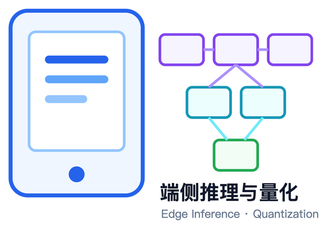
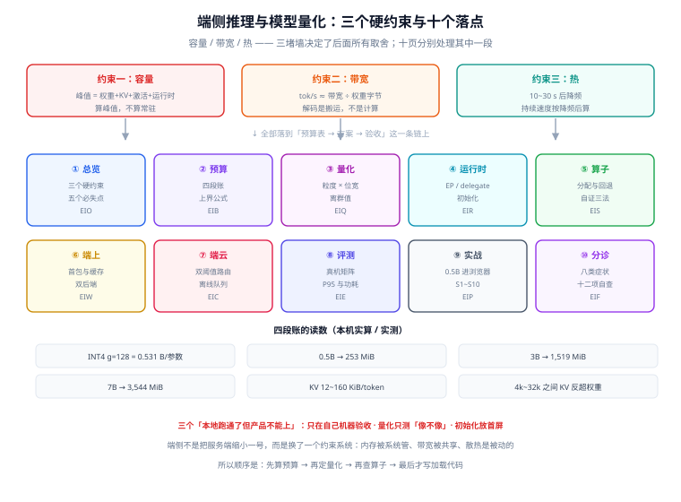

# 端侧推理与模型量化

端侧推理（On-Device Inference）指**把模型跑在用户手里的设备上**——手机、平板、笔记本、浏览器、开发板——而不是跑在你机房的 GPU 上。它被说起时通常只有一句理由「隐私」，但真正把它推上前台的是另外两件事：**离线可用**与**单位成本归零之后的资本化**。

代价也很具体：你的模型要挤进 4~8 GB 的可用内存里，要在一颗 5 W 的芯片上把首 token 压进 1 秒，要在三年前的中端机上不崩，还要在浏览器里跟一个后台标签页抢 GPU。本专题讲的就是这四件事的工程面：**内存预算怎么算、量化怎么选、运行时怎么委派算子、端云怎么分工、怎么评测**。

::: tip 一句话理解
端侧的瓶颈**不是算力，是内存带宽与内存容量**。一个 3B 的 INT4 模型有 1.5 GiB 权重，每生成一个 token 都要把它们从内存里搬一遍——手机 LPDDR5 的有效带宽约 50 GB/s，所以**每秒最多 30 来个 token，跟芯片有多少 TOPS 关系不大**。先算清带宽和容量，再谈优化。
:::

## 与相邻专题的分工

「本地部署」「端侧推理」「模型量化」「模型路由」四个词经常被混着用，边界先写死：

| 专题 | 讲什么 | 与本专题的关系 |
| --- | --- | --- |
| 本专题 | **端侧这个约束环境下的推理工程**：内存/带宽预算、量化方案在端侧的可行性、算子委派与回退、浏览器与移动端落地、端云分工、端侧评测 | —— |
| [本地模型部署](/docs/AI/LocalModel/index.md) | 在**自己的机器或内网**跑开源模型：Ollama、vLLM / llama.cpp server、显存规划、生产运维 | 那边回答「**服务怎么起、并发怎么扛**」，本专题回答「**装进用户口袋之后还剩什么**」。显存规划公式可直接借用，但端侧的「显存」是共享内存且会被系统回收 |
| [量化与模型格式](/docs/AI/LocalModel/Quantization/index.md) | FP16 / INT8 / 4 位量化、GGUF / AWQ / GPTQ 的格式差异 | 那边讲**格式与工具链**，本专题讲**量化误差在端侧怎么被放大**：同一套 INT4，`group=128` 与 `per-tensor` 的输出误差差 1.8 倍，见 [量化方案](./Quantization/index.md) |
| [GPU 与显存规划](/docs/AI/LocalModel/Hardware/index.md) | 权重 + KV Cache + 激活的显存公式、安全余量 | 公式同源；端侧把「显存」换成**统一内存 + 系统可回收**，余量从 20% 提到 40%，见 [内存与延迟预算](./Budget/index.md) |
| [模型路由与降级](/docs/AI/ModelRouting/index.md) | 多模型之间的路由策略、成本与质量权衡、降级链 | 那边的路由发生在**服务端多模型之间**；本专题的 [端云协同](./HybridRouting/index.md) 是**跨设备边界**的路由，多了一个「网络可能没有」的前提 |
| [模型评测工程](/docs/AI/EvalEngineering/index.md) | 评测集、判官校准、指标口径、回归门禁 | 方法论可复用；端侧多两个维度——**时延分布（P50 无意义）与内存峰值**，且必须在真机上测，见 [端侧评测](./Evaluation/index.md) |
| [微调](/docs/AI/FineTuning/Overview/index.md) | SFT / LoRA / 偏好对齐 | 微调改的是**权重内容**，量化改的是**权重表示**；两者叠加时量化误差会被放大，顺序建议「先微调再量化」并复测 |
| [WebAssembly](/docs/Frontend/WebAssembly/Overview/index.md) | 模块体积、线性内存、JS 互操作、启动开销 | 浏览器端推理的**执行层**就是 WASM：模型与运行时都要下载，首包体积与实例化时间是产品问题，见 [浏览器与移动端](./DeviceWeb/index.md) |
| [移动 H5](/docs/Frontend/MobileH5/Overview/index.md) | 视口、触摸、桥接、兼容性 | 移动端**页面**的约束；端侧推理跑在同一个进程里，会与页面抢内存，App 被系统杀掉的概率随峰值内存上升 |
| [WebGL](/docs/Frontend/WebGL/index.md) | 图形管线、着色器、纹理 | WebGPU 的**前一代**；用 WebGL 跑推理是可行但低效的路线，本专题只在对照表里提它 |
| [在线协作任务看板 · 租户数据清单](/project/Complete/TeamBoard/TenantDataInventory/index.md) | 真实项目里的数据清单自动生成与残留检查 | 与本专题无技术重叠，放在这里只为说明「**清单要自动生成**」这条纪律在两处都成立：手写的资产表一定会漏 |

## 专题地图

| 页面 | 内容 | 适合谁读 |
| --- | --- | --- |
| [总览：三个硬约束与五个必失点](./Overview/index.md) | 端侧与服务端的六项差异、三个硬约束（容量/带宽/热）、五个「本地跑通了但产品不能上」的失效、要不要端侧的决策树 | 所有人，先读 |
| [内存与延迟预算](./Budget/index.md) | 权重 + KV + 激活 + 运行时开销的四段账、tok/s 上界公式、上下文与 batch 的取舍、40% 余量的来历 | 定方案的人，**必读** |
| [量化方案与端侧可行性](./Quantization/index.md) | 对称/非对称、per-tensor / per-channel / group-wise、离群值破坏性实测、INT4 的三种打包、什么时候不该量化 | 做模型转换的人，**重点读** |
| [运行时与算子委派](./Runtime/index.md) | ONNX Runtime / LiteRT / Core ML / llama.cpp 四条路线、EP 与 delegate 的委派模型、分区与回退、会话初始化开销 | 做端侧接入的人，**必读** |
| [算子覆盖与回退](./OperatorSupport/index.md) | 算子矩阵怎么读、不支持时会发生什么、`layout` 与精度陷阱、图切分的代价、如何自证「真的跑在 NPU 上」 | 调性能的人，**重点读** |
| [浏览器与移动端落地](./DeviceWeb/index.md) | 首包与缓存、WebGPU 与 WASM 双后端、Worker 与线程、iOS/Android 的内存上限、后台与热节流 | 做端上产品的人，**重点读** |
| [端云协同与降级](./HybridRouting/index.md) | 四种分工形态、置信度与预算双阈值、离线队列、模型版本与灰度、失败时的用户可见行为 | 做架构的人 |
| [端侧评测](./Evaluation/index.md) | 三维指标（质量/时延/内存）、P50 为什么没用、冷热启动、真机矩阵、功耗与温升的测法 | 做验收的人，**必读** |
| [实战：把 0.5B 模型装进浏览器](./Practice/index.md) | 从模型选择到首屏可用：预算表、量化、导出、Worker 加载、首 token 优化、S1~S10 验收序列 | 要照着做的人 |
| [常见问题与分诊](./FAQ/index.md) | 八类症状分诊（起不来/太慢/答错/内存涨/发热/离线崩/包太大/结果不稳定）、十二问、十二项上线自查 | 所有人 |

## 四条底层判断（先记住这四句）

| 判断 | 含义 | 违反它的典型后果 |
| --- | --- | --- |
| **端侧是带宽受限，不是算力受限** | 自回归解码每 token 要读一遍全部权重，`tok/s ≈ 有效带宽 ÷ 权重字节` | 按「芯片有 40 TOPS」估算性能，实测只有标称的 1/8，然后把原因归给「模型没优化好」 |
| **容量算的是峰值，不是常驻** | 峰值 = 权重 + KV + 激活 + 运行时 + 图形栈，且系统随时可能回收 | 按「模型 1.5 GB，手机 8 GB」判断能跑，真实场景里被系统杀掉，日志只有一句 `OOM` |
| **KV 在 8k 上下反超权重** | 权重是常数，KV 每 token 加一份；长上下文方案的容量墙是 KV 而不是模型 | 按「4k 够用」设计，用户一贴长文档就把内存打爆 |
| **量化的收益是线性的，代价不是** | 4 bit 省 4 倍体积；误差随 group size、离群值、层类型**非线性**变化 | 全模型统一 `per-tensor INT4`，体积达标了，准确率掉到不可用（实测输出余弦 0.52） |
| **端侧没有「平均值」** | 设备是长尾分布：同一模型在旗舰与三年前中端机上差 5~10 倍 | 用 P50 或「我这台机器」做验收，上线后 20% 用户不可用 |

## 成熟度五档

端侧这件事最容易「Demo 通过就交付」：在自己手机上跑通一次，就认为成了。按下面五档对照，只补当前档位的下一件事：

| 档位 | 特征 | 只补一件事 |
| --- | --- | --- |
| L0 | 桌面端 Python 跑通了，想「搬到手机上」 | 先读 [总览](./Overview/index.md) 的三个硬约束，把预算表算出来再动手 |
| L1 | 手机上能跑，但只有一台设备、一个模型、一次会话 | 补 [内存与延迟预算](./Budget/index.md)：把峰值内存和 tok/s 上界写成数字 |
| L2 | 预算算清了，但量化后效果明显变差 | 补 [量化方案](./Quantization/index.md)：从 per-tensor 换成 group-wise，并复测输出误差 |
| L3 | 效果可接受，但速度不达标、`session` 初始化要 8 秒 | 补 [算子委派](./Runtime/index.md) 与 [算子覆盖](./OperatorSupport/index.md)：确认到底跑在哪个后端上 |
| L4 | 单机达标，但线上崩溃率与差评集中在低端机 | 补 [端侧评测](./Evaluation/index.md)：真机矩阵 + P95 + 峰值内存 |

## 判据族总览

十个页面各八条，共 **80** 条。写法统一为「规则 + 违反时的样子 + 怎么验证」，每页末尾给出可执行命令与预期读数。

| 页面 | 判据族 | 覆盖的约定 | 条数 |
| --- | --- | --- | --- |
| [总览](./Overview/index.md) | `EIO-A` ~ `EIO-H` | 三个硬约束、五个必失点、端侧决策 | 8 |
| [内存与延迟预算](./Budget/index.md) | `EIB-A` ~ `EIB-H` | 四段账、上界公式、上下文取舍 | 8 |
| [量化](./Quantization/index.md) | `EIQ-A` ~ `EIQ-H` | 量化粒度、离群值、打包、复测 | 8 |
| [运行时与委派](./Runtime/index.md) | `EIR-A` ~ `EIR-H` | 路线选择、EP 分区、初始化、版本锁 | 8 |
| [算子覆盖](./OperatorSupport/index.md) | `EIS-A` ~ `EIS-H` | 算子矩阵、回退、图切分、自证 | 8 |
| [浏览器与移动端](./DeviceWeb/index.md) | `EIW-A` ~ `EIW-H` | 首包、双后端、线程、内存上限 | 8 |
| [端云协同](./HybridRouting/index.md) | `EIC-A` ~ `EIC-H` | 分工形态、双阈值、离线、灰度 | 8 |
| [端侧评测](./Evaluation/index.md) | `EIE-A` ~ `EIE-H` | 三维指标、真机矩阵、冷热、功耗 | 8 |
| [实战](./Practice/index.md) | `EIP-A` ~ `EIP-H` | 从预算到验收的全链路 | 8 |
| [常见问题](./FAQ/index.md) | `EIF-A` ~ `EIF-H` | 分诊、自查、术语 | 8 |

## 事实与版本速览（2026-10 核对）

| 事实 | 口径 | 出处 |
| --- | --- | --- |
| ONNX Runtime **1.31.0** 于 **2026-10-09** 发布 | CoreML EP 开始参与**设备化 EP 选择**（`PREFER_NPU`）；NPU 选择要求 iOS 16 / macOS 13 及以上，GPU 要求 iOS 15 / macOS 12 及以上；ACL EP 标记弃用；CUDA Plugin EP 0.3.0 与 WebGPU Plugin EP 0.5.0 与核心版本配对发布 | ORT release notes |
| ONNX Runtime **1.30.0**（2026-09-10）把生成式推理的几处瓶颈一起补了 | WebGPU EP 支持 GPT-OSS、**INT8 分块 KV cache 量化**、PagedAttention 元数据；CPU 侧加 Arm64 NEON / SVE 的融合 LinearAttention；CUDA 侧支持 **INT4 分页 KV cache** | ORT release notes |
| LiteRT（原 TensorFlow Lite）于 **2024-09-04** 更名 | **`.tflite` 文件格式不变**，改名的是运行时与 API；`litert-torch` 前身是 `ai-edge-torch` | Google AI Edge 文档 |
| LiteRT 分两代 API：**v1 = Interpreter API**（从 TFLite 直接换包）、**v2 = CompiledModel API**（ML Drift GPU、NPU、零拷贝 I/O、异步执行） | 两代 API 在**同一个运行时里并存**，不是两个产品 | Google AI Edge 文档 |
| LiteRT 稳定线为 **2.x**（2.2.0 于 2026-08 发布），配套 `litert-torch` / `litert-lm` / `ai-edge-quantizer` 各自独立版本 | 版本要对齐的是「运行时 ↔ 转换工具 ↔ 模型格式」三角，不是单点 | PyPI / 仓库 tag |
| **LiteRT.js** 于 **2026-07-09** 发布 | 在浏览器里跑 `.tflite`：WASM 为主、WebGPU 加速，目标是把端侧小模型带进网页 | Google Developers Blog |
| Web 端两条执行路线：**WASM**（兼容性好、单核为主）与 **WebGPU**（快，但要看浏览器与驱动） | WebGPU 已在 Chromium 系稳定；Safari / Firefox 的支持随版本推进，**上线前必须按目标浏览器实测** | 各浏览器 release notes |
| 端侧 LLM 的 KV cache 与上下文**线性**相关，权重不随上下文变 | 4k 上下文时 KV 约为 INT4 权重的 **20%~80%**；**8k~16k 之间反超**；32k 时 1.4~6 倍；128k 时 5~24 倍（四组配置实算，见 [预算](./Budget/index.md)） | 本机实算，脚本不入库 |

::: warning 关于「版本目录」
本专题**不建** `LiteRT-v1/`、`LiteRT-v2/`、`ORT-1.30/` 这类版本目录，理由三条：

1. **两代 API 并存，但不是两代技术栈**。LiteRT v1 的 `Interpreter` 与 v2 的 `CompiledModel` 读的是**同一个 `.tflite` 文件**，可以同时存在于一个工程里；拆成两个目录会让「同一个模型」出现两份互相矛盾的接入说明。
2. 差异是**能力矩阵**（NPU 委派、零拷贝、异步）而不是**安装与配置的分叉**，用一张对照表 + 页内 `:::info` 标注适用版本就够，见 [运行时与算子委派](./Runtime/index.md)。
3. 本库的版本目录先例都对应「**同一主题的多代技术栈、且两代要各写一遍安装/配置/API**」：`docs/Backend/Java/Frame/Spring/Spring5` 与 `Spring6`、`Vue2` 与 `Vue3`、`SpringBoot` 下的 `v2`/`v3`/`v4`。端侧运行时**升级是换一个包**，不满足这个标准。

真正存在大版本断层的部分归到各平台专题：Android 的 NNAPI 与 LiteRT 代际差异、Apple 的 Core ML 版本要求，各自由平台文档维护；本专题只标注「最低系统版本」。
:::

## 学习路径

1. **先读总览**，把「三个硬约束」与「五个必失点」记住——后面九页都在补这五处的细节。
2. **动手前算预算**：[内存与延迟预算](./Budget/index.md) 的四段账只用加减乘除，但能提前否掉 80% 不可行的方案。
3. **选量化前先看离群值**：同一份权重，`per-tensor INT4` 与 `group=128 INT4` 的输出误差差 1.8 倍；有离群值时差 4 倍。
4. **接入时先自证后端**：跑通不等于跑在 NPU 上，[算子覆盖](./OperatorSupport/index.md) 给了三条不依赖厂商工具的证法。
5. **验收前建真机矩阵**：一台旗舰机的 P50 不能作为上线依据，[端侧评测](./Evaluation/index.md) 的 P95 + 峰值内存才是。
6. **出问题先分诊**：[常见问题](./FAQ/index.md) 按「起不来 / 太慢 / 答错」三分，比从头读算子矩阵快。

## 三条最容易踩的坑

::: danger 三个「本地跑通了但产品不能上」的写法
1. **只在自己机器上验收**：开发机是 M 系列或旗舰 Android，内存 16 GB、带宽 100 GB/s；目标用户里有三年前的中端机，内存 6 GB、带宽约 25 GB/s。同一份 INT4 模型在两者上的 tok/s 能差 **4 倍**，峰值内存差 2 倍。正确做法是把「最低支持设备」写进需求，并在那台设备上跑 [验收序列](./Practice/index.md)。
2. **把 `session` 初始化放在首屏路径上**：端侧初始化要读模型、做图优化、编译 kernel，1~8 秒都出现过。用户看到的是白屏，然后卸载。正确做法是启动即异步预热，并在模型就绪前用规则/小模型兜底，见 [浏览器与移动端](./DeviceWeb/index.md)。
3. **量化后只测「看起来对不对」**：INT4 的失效不是「答得差一点」，而是**在特定输入上突然胡说**——尤其是数字、日期、否定句。正确做法是冻结一份 200 条回归集，量化前后各跑一次并比对，见 [量化](./Quantization/index.md) 的复测清单。
:::

## 参考资料

- [ONNX Runtime · releases](https://github.com/microsoft/onnxruntime/releases)——EP 能力与版本配对关系
- [ONNX Runtime · Execution Providers](https://onnxruntime.ai/docs/execution-providers/)——每个 EP 的平台与算子覆盖
- [Google AI Edge · LiteRT](https://developers.google.com/edge/litert)——v1 / v2 两代 API 与 delegate
- [LiteRT · GitHub](https://github.com/google-ai-edge/LiteRT)——版本线与发布节奏
- [Apple · Core ML](https://developer.apple.com/documentation/coreml)——模型格式与计算单元选择
- [WebGPU 规范](https://www.w3.org/TR/webgpu/)——浏览器 GPU 能力的边界
- [llama.cpp](https://github.com/ggml-org/llama.cpp)——GGUF 量化类型与端侧实测的常用参照
- 本站 [本地模型部署](/docs/AI/LocalModel/index.md) · [模型路由与降级](/docs/AI/ModelRouting/index.md) · [WebAssembly](/docs/Frontend/WebAssembly/Overview/index.md)
- 相邻：[总览](./Overview/index.md) · [实战](./Practice/index.md) · [常见问题](./FAQ/index.md)
