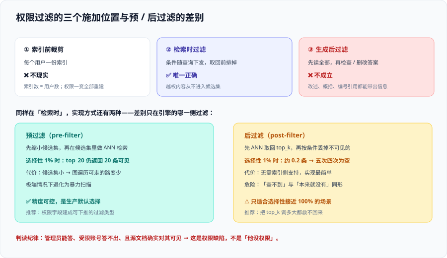
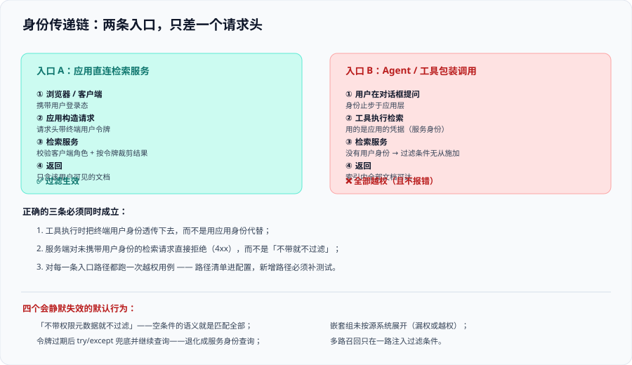

# 权限隔离

这一页是整专题的核心。它回答一个问题：**怎么保证检索出来的每一条内容，提问者都有权阅读**——并且**怎么证明这件事一直成立**。

结论先给：权限隔离的难点**不在算法**，在**三个位置的选择**（过滤施加在哪一段）、**一条身份的传递链**（谁的身份被用来过滤）、以及**四个会静默失效的默认行为**。这三样搞对，剩下的都是配置；搞错任何一样，测试全绿、线上越权。

## 一、四种权限模型与它们的表达能力

先把自己源系统的权限形态归到下面四种之一。**混着用是常态**，但必须知道哪一种是「主模型」，因为它决定了过滤条件怎么写。

| 模型 | 形态 | 例子 | 能不能表达「除某人以外所有人」 | 过滤写法 |
| --- | --- | --- | --- | --- |
| **ACL（访问控制列表）** | 每份文档一个「谁能读」的列表 | 网盘的「共享给这几个人」 | 能（列表里没有他） | 文档的 `readers` 与用户组集合求交集，非空即可读 |
| **RBAC 角色范围** | 读权限挂在一个范围（容器 / 库 / 目录）上，用户通过角色获得 | 云存储的容器级角色 | 不能（范围是「包含」语义，没有排除） | 先把文档映射到范围，再判角色 |
| **标签 / 分类分级** | 文档打标签，用户的标签在策略里被授予可读集合 | 敏感度标签、密级 | 能（策略里不含该标签） | `label in (用户可读标签集合)` |
| **自定义字符串过滤** | 完全由应用决定语义 | 业务自己造的 `acl_group` 字段 | 能（语义自定义） | 由应用构造，**也由应用负责写对** |

::: warning 「范围型角色」是最容易漏权的一类
RBAC 的语义是「**范围包含文档**」，不是「文档授权给某范围」。当你把一个文档从 A 目录移到 B 目录时：

- ACL 型：文档的列表被整体替换，**天然正确**；
- RBAC 型：谁继承了 A、谁继承了 B，是**两次独立的角色判定**，很容易出现「移走之后 A 的组还能看到」。

所以在 RBAC 型源系统上，**目录变更必须进同步范围**，不能只同步内容变更。
:::

## 二、三个施加位置：只有一个是对的



| 位置 | 做法 | 结论 | 理由 |
| --- | --- | --- | --- |
| **① 索引前裁剪** | 每个用户一份索引（或其等价物） | ❌ 不现实 | 索引数量 = 用户数；权限一变全部重建 |
| **② 检索时过滤** | 过滤条件随查询下发，由检索服务在**取回前排掉** | ✅ **唯一正确的位置** | 越权内容从不进入候选集，也就不可能进入上下文 |
| **③ 生成后过滤** | 让模型先读全部内容，再检查/删改答案 | ❌ 不成立 | 信息已经进入上下文；**改述、概括、编号引用**都能把内容带出来 |

::: danger 「生成后过滤」为什么在演示里看起来有效
因为演示时的越权内容是**逐字出现**的，正则或第二道模型很容易拦住。真实场景里：

1. 模型会**概括**：「这份材料里提到，本月奖金池上浮了 15%」——没有一个敏感词命中；
2. 模型会**引用**：「详见文档 [3]」——编号带上去了，用户点开会 403（这是体验问题），但编号本身已经泄露了「存在这样一份文档、它在第 3 位」；
3. 模型会**推理**：即使删掉了原文，也已用「已删除某段内容」暴露了敏感信息的存在性。

**存在性泄露也是泄露。** 所以位置必须选 ②。
:::

## 三、预过滤与后过滤：为什么「取回后自己筛」是错的

即使你选了「检索时过滤」，实现方式还有两种，它们的差别只在**过滤发生在引擎的哪一侧**：

| 方式 | 引擎行为 | 精度 | 代价 |
| --- | --- | --- | --- |
| **预过滤（pre-filter）** | 过滤条件先缩小候选集，再在候选集里做 ANN 检索 | **高**：返回的 `top_k` 全部是可见的 | 过滤后候选集小 → 图索引可走的路变少，极端情况下退化为暴力扫描 |
| **后过滤（post-filter）** | 先做 ANN 取回 `top_k`，再按条件丢掉不可见的 | **不可控**：`top_k` 取 20，若前 20 名恰好都不可见，结果就是空 | 无需索引侧支持，实现最简单 |
| **迭代扫描** | 后过滤的改良版：不断取回更多候选，直到凑够 `top_k` 或触达上限 | 中：有上限，仍有「凑不够」的情况 | 延迟随过滤选择性上升 |

这一节的工程含义可以浓缩成一句话：

> **过滤的选择性越强，后过滤的结果越接近「什么都查不到」——而「查不到」与「本来就没有」在界面上长得一样。**

### 选择性悬崖：一个必须实测的数字

「选择性」= 可见文档数 ÷ 索引总文档数。它越接近 0，后过滤越危险。用一张表把它变成可测的判据：

| 选择性 | 后过滤（`top_k=20`）期望可见条数 | 现象 | 处置 |
| --- | --- | --- | --- |
| 100% | 20 | 正常 | —— |
| 10% | 约 2 | 结果少但还能用 | 观察 |
| 1% | 约 0.2 | **五次里四次返回空** | 必须改预过滤 |
| 0.1% | 约 0.02 | 基本恒定为空 | 必须预过滤；`top_k` 调多大都救不回来 |

::: tip 一个 5 分钟的实测方法
在你的索引里挑一个**只有个位数人可见**的权限组，然后**用该组的账号**问一个答案明确在其中的问题：

```python [selectivity_check.py]
# 用受限账号跑一次「答案一定在库里」的问题，观察能否命中
hits = retrieve(question, user="restricted_user", top_k=20)
print("命中条数:", len(hits))
print("命中文档:", [h["doc_id"] for h in hits])

# 预期：命中 >= 1
# 若恒为 0，而管理员账号跑同一个问题能命中 → 后过滤的选择性问题，不是数据问题
```

判读规则：**管理员能答、受限账号答不出、且源文档确实对其可见 → 这是权限实现的缺陷，不是「他没权限」。** 这两者在界面上都表现为「没有找到相关内容」，把它当成后者放过去，是这类缺陷最典型的漏检方式。
:::

## 四、身份传递链：越权召回的头号来源



前面 [参考架构](.././Architecture/index.md) 已经点出「两条入口」的问题，这里给出**完整的三问检查法**，对每一条调用路径都要走一遍：

| 问题 | 正确的答案 | 错误的答案长什么样 |
| --- | --- | --- |
| **① 这一次检索用的是谁的身份？** | 终端用户 | 「应用的凭据」——**过滤条件无从施加**，等价于不过滤 |
| **② 身份怎么传下去？** | 请求头携带委托令牌，或代表用户换取短期凭据 | 「在应用里查一下用户组，然后拼过滤条件」——条件构造与鉴权同生共死 |
| **③ 传丢了会怎样？** | 服务端**拒绝请求**（4xx） | 「不带就不过滤」——这是默认行为，也是最危险的一个 |

::: danger 四个会静默失效的默认行为
这四条都是「按默认配置跑就是错的」，且**都不报错**。

1. **「不带权限元数据就不过滤」**：多数自建检索服务的默认语义是「条件为空 = 匹配全部」。把中间件写成「有身份就加条件、没有就跳过」，等于给了一条无声的后门。正确写法：**过滤条件是必填项，缺失即拒绝**。
2. **令牌过期后静默退化**：委托令牌有有效期。刷新失败时若代码走了 `try/except` 兜底并继续查询，就会退化成服务身份查询。正确写法：**兜底必须是「失败」，不是「不带令牌重试」**。
3. **嵌套组没展开**：源系统里「B 组属于 A 组」，只同步直接组成员，会导致**该看到的人看不到**（漏权）。反向的错误更隐蔽：把**所有父组**都展开进去，会让不该看到的人看到（越权）。正确写法：**组展开逻辑必须与源系统一致，并有一条对拍用例**。
4. **关键词腿不过滤**：多路召回时只在向量腿带上过滤条件，关键词腿裸查，融合后越权内容又回来了。正确写法：**过滤条件在召回前统一装配，每一路都注入**——把它做成「没有注入就无法发起召回」。
:::

### 组名与标识的三种漂移

同一件事在不同系统里有不同写法，这些漂移**全部表现为漏权或越权**，且都不会报错：

| 漂移 | 例 | 后果 |
| --- | --- | --- |
| 大小写 | 源系统 `Finance`，索引里 `finance` | 精确匹配时匹配不上 → 漏权 |
| 域名前缀 | `CORP\finance` vs `finance@corp.example` | 同上 |
| ID 与名称混用 | 一处用组名、一处用组 UUID | 改名后失效，且**改名当时不报错** |

::: tip 一条纪律
**索引里存组标识，不存组名。** 组名是会变的展示信息，组 ID 才是身份。落地时把「组 ID → 组名」的映射放在查询侧的展示层，索引层只认 ID。这一条能一次性消掉上表中后两行的全部问题。
:::

## 五、四类边界情况（都会真实发生）

| 情况 | 现象 | 处置 |
| --- | --- | --- |
| **权限组人数极少**（1~3 人） | 抽样评估永远抽不到，问题长期不可见 | 评测集**必须**包含一个低人数高敏感组，并按组单独统计 |
| **文档权限比问题更粗** | 一份文档里既有可公开章节也有敏感章节 | 权限必须下探到**分块级**：切分时按权限边界切，不允许一个 chunk 跨两个权限域 |
| **公开文档 + 敏感文档混排** | 公开内容把敏感内容顶出 `top_k` | **按权限域分区**，不要靠降权——详见下方注意块 |
| **用户同时属于互相矛盾的组** | 「可读 A」与「不可读 A」同时成立 | 需要一份明确的**冲突裁决规则**（通常是「显式拒绝优先」），写进设计文档并测试 |

::: danger 「公开文档挤占 `top_k`」这条不要用「降低公开文档权重」解决
很多团队的第一反应是给公开内容降权。这是一个**相关性调优动作**，不是权限动作——它只能缓解、不能保证。

正确处置是**预过滤 + 按权限域分区**：让不同权限域的候选集在引擎里就是分开的（例如同一集合内用可过滤字段分区，或敏感域单独成集合），这样公开内容再多也不会挤掉可见的敏感内容。**「缓解」与「保证」的区别，就是审计时说不说得清的区别。**
:::

## 六、缓存与权限：一个容易被忽略的越权通道

缓存对知识库几乎必需（成本和延迟都在那里）。但缓存**天然是跨用户共享的**，这就引入了两条错误：

| 错误 | 后果 | 正确做法 |
| --- | --- | --- |
| 用「问题文本」当缓存键 | A 问过一次的问题，B 直接命中 A 的答案（含 A 可见的敏感内容） | 缓存键 = 问题 + **权限指纹**（可见组集合的稳定哈希） |
| 缓存**检索结果**而不是缓存**答案** | 结果集是权限裁剪后的，但复用给了别的人 | 要么缓存「已按权限裁剪的结果 + 权限指纹」，要么只缓存问题改写等**无权限语义**的中间产物 |

```python [cache_key.py]
import hashlib

def cache_key(question: str, principals: list[str]) -> str:
    """缓存键必须同时包含问题与权限指纹。

    principals 必须是「已展开的组 ID 集合」，且在比较前排序，
    否则同一组集合的不同顺序会算出不同键（缓存命中率暴跌，但不会报错）。
    """
    scope = ",".join(sorted(principals))            # 排序：保证同一集合同键
    digest = hashlib.sha256(scope.encode()).hexdigest()[:16]
    return f"kb:{hashlib.sha256(question.encode()).hexdigest()[:16]}:{digest}"
```

::: warning 缓存键加权限指纹之后，还有一个隐藏前提
**权限变更必须让旧缓存失效。** 如果用户被移出一个组，他的权限指纹变了，会自然 miss——这一点是自动的。

但反过来不成立：**某个文档被下架时，所有缓存键都不会变**，所以缓存里仍可能返回已下架文档的内容。因此**文档级的删除必须走一次显式的缓存失效**（或给缓存加一个不超过删除 SLO 的 TTL）。这一条几乎总被忘掉。
:::

## 七、权限正确性的判据

权限判据与质量判据的形态不同：**它的期望值是布尔值，不是分数。**

| 判据 | 期望值 | 怎么测 | 频率 |
| --- | --- | --- | --- |
| `ACL-1` 不可见文档**零召回** | 0 条 | 用越权账号跑「不该答」题集，检索结果里不得出现无权文档 ID | 每次发布 |
| `ACL-2` 可见文档**能召回**（防漏权） | ≥ 1 条 | 用受限账号跑「该答」题集，答案在库里却答不出即为漏权 | 每次发布 |
| `ACL-3` 无身份请求被拒绝 | 4xx | 构造不带令牌的检索请求 | 每次发布 |
| `ACL-4` 多路召回一致 | 每一路都通过 `ACL-1` | 在融合前分别断言 | 每次发布 |
| `ACL-5` 权限变更生效时延 | ≤ SLO | 改权限 → 轮询探测 → 记录分钟数 | 每周 |
| `ACL-6` 删除传播 | 0 残留 | 源系统清单 vs 索引清单对账差值 | 每天 |
| `ACL-7` 缓存不跨权限复用 | 0 命中 | 两个不同权限账号交替请求同一问题 | 每次发布 |
| `ACL-8` 嵌套组一致性 | 与源系统一致 | 抽 20 个嵌套组对拍成员 | 每月 |

::: tip 这八条里最该先做的是 `ACL-3`
它只需要一次手工请求，成本最低，却拦住了**最严重的那个默认行为**（不带身份就不过滤）。上线前 24 小时就能做完。
:::

## 验证方式

1. **跑一次越权用例并留下证据**：

   ```shell
   # 用受限账号问一个只有另一个部门文档才答得出的问题（示例为 REST 形态，按你的接口调整）
   curl -s -X POST "$KB_ENDPOINT/search" \
     -H "Authorization: Bearer $RESTRICTED_USER_TOKEN" \
     -H "Content-Type: application/json" \
     -d '{"query": "并购项目 M 的对价结构是什么", "top_k": 20}' \
     | tee /tmp/acl1.json

   # 断言：结果体里不得出现任何越权文档标识
   grep -c "CONFIDENTIAL_DOC_ID" /tmp/acl1.json
   ```

   预期输出：`0`。**出现 `1` 及以上即为越权召回**，且这不是「调参能解决」的问题，必须回到本页第四节改身份传递。
2. **跑一次不带身份的请求**（验证 `ACL-3`）：

   ```shell
   curl -s -o /dev/null -w "%{http_code}\n" -X POST "$KB_ENDPOINT/search" \
     -H "Content-Type: application/json" \
     -d '{"query": "任意问题", "top_k": 5}'
   ```

   预期输出：`4xx`。**输出 `200` 说明存在无声的越权通道。**
3. **跑选择性实测**（验证第三节的预过滤是否生效）：用受限账号跑 20 个「答案确实在其可见范围内」的问题，统计命中数。

   ```shell
   # 期望：20 个问题里命中数 >= 18；若接近 0，则是后过滤的选择性问题
   ```

## 参考资料

- Azure AI Search 官方文档 · Document-level access control（四种做法、令牌头与生效时延）：https://learn.microsoft.com/azure/search/search-document-level-access-overview
- Microsoft Learn · Security filters for trimming results（过滤条件与查询时的裁剪模式）：https://learn.microsoft.com/azure/search/search-security-trimming-designer
- Google Cloud 官方文档 · Vertex AI Search 访问控制（`acl_info` 声明式权限）：https://cloud.google.com/generative-ai-app-builder/docs/access-control
- Amazon Bedrock 官方文档 · Knowledge Bases（托管形态的预检索 ACL 过滤与实时访问检查）：https://docs.aws.amazon.com/bedrock/latest/userguide/knowledge-base.html
- 本站 [向量数据库 · 过滤与元数据检索](../../../DB/VectorDatabase/Filtering/index.md) · 预过滤 / 后过滤 / 迭代扫描的引擎代价：`docs/DB/VectorDatabase/Filtering/index.md`
- 本站 [RAG · 生产工程化](../../RAG/Pipeline/index.md) · 多租户隔离方式的清单式速览：`docs/AI/RAG/Pipeline/index.md`
