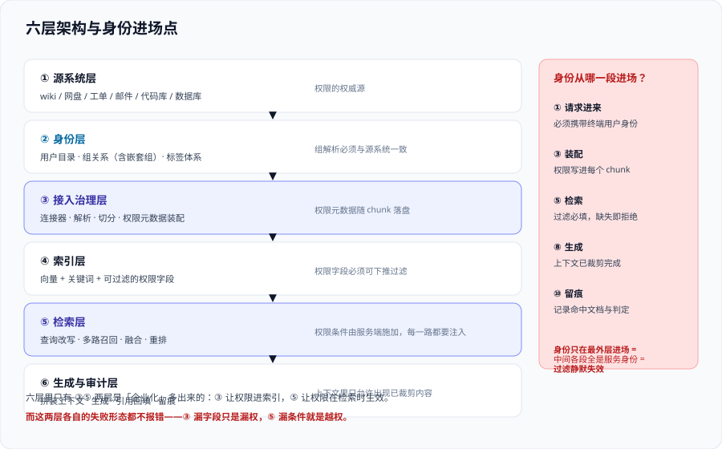

# 参考架构与端到端链路

这一页给出企业知识库的**六层架构**与**一跳的十段链路**，重点标出**身份在哪一段进场**——这一张图决定了后面所有设计：如果身份只在最外层进场（比如只在登录时校验一次），那么中间任何一段拿到的都是「服务身份」，权限过滤会在那一层静默失效。

本页不重复 [RAG 概述](../../RAG/index.md) 的索引链路与在线链路，只补企业化多出来的部分。

## 一、六层架构



| 层 | 职责 | 关键约束 | 常见错误 |
| --- | --- | --- | --- |
| ① 源系统层 | wiki、网盘、工单、邮件、代码库、数据库 | 它是**权限的权威源**，索引层不得自行发明权限 | 把索引里的权限字段当成可编辑的业务字段 |
| ② 身份层 | 用户目录、组关系、标签体系 | 组解析（含嵌套组）必须**与源系统一致** | 只同步「直接组」，漏掉嵌套组导致漏权或越权 |
| ③ 接入治理层 | 连接器、解析、切分、权限元数据装配 | 权限元数据必须**随 chunk 落盘** | 把权限放在文档表里、chunk 上只存 `doc_id`——一旦一对多就查不全 |
| ④ 索引层 | 向量 + 关键词 + 元数据 | 元数据字段要能表达**权限谓词**并支持高效过滤 | 权限字段建成不可过滤的类型，只能取回后自己比 |
| ⑤ 检索层 | 查询改写、多路召回、融合、重排 | **权限条件必须由服务端施加**，且在所有召回腿上一致 | 只在向量腿过滤、关键词腿没过滤——两路融合后越权内容又回来了 |
| ⑥ 生成与审计层 | 拼装上下文、生成、引用、留痕 | 上下文里**只允许出现已裁剪的内容**；每次问答留痕 | 审计只记问题不记「这次检索到哪些文档」 |

## 二、一跳的十段链路

一次提问从进来到返回，实际会穿过十段。**每一段都有各自的失败形态**，其中第 ③、⑤、⑦ 段是越权召回的三个高发位置。

| # | 段 | 输入 → 输出 | 这一段最常见的失败 | 会不会报错 |
| --- | --- | --- | --- | --- |
| ① | 鉴权 | 请求 → 已认证用户标识 | 只有应用级 token，没有终端用户身份 | 不报错 |
| ② | 组解析 | 用户 → 组集合 | 嵌套组未展开；组名大小写漂移 | 不报错 |
| ③ | **权限谓词构造** | 组集合 → 过滤条件 | 谓词构造在**应用代码**里，代码路径没走到就变成空条件 | **不报错**（空条件的语义是「不过滤」） |
| ④ | 查询改写 | 问题 → 检索式 | 改写后的问题**丢失了范围限定词** | 不报错 |
| ⑤ | **多路召回** | 检索式 → 候选集 | 只在其中一路带上过滤条件 | 不报错 |
| ⑥ | 融合与重排 | 候选集 → 排序结果 | 重排模型**跨权限**排序（把无权文档排到前面） | 不报错 |
| ⑦ | **裁剪与拼装** | 排序结果 → 上下文 | 为了「多给点信息」放宽 `top_k` 后再裁，裁剪逻辑有边界 bug | 不报错 |
| ⑧ | 生成 | 上下文 + 问题 → 答案 | 模型复述上下文里的过期口径 | 不报错 |
| ⑨ | 引用回填 | 答案 → 带引用的答案 | 引用只给标题，用户点开发现**自己无权访问** | 会报错（体验问题而非安全问题） |
| ⑩ | 留痕 | 全过程 → 审计记录 | 只记问答文本，不记检索到的文档 ID 与权限判定结果 | 不报错 |

::: danger 这张表最重要的读法
请数一数「会不会报错」这一列有几个「不报错」。**九段不报错、一段报错，而报错的那一段恰恰是无害的引用体验问题。**

这就是权限型系统的核心困难：**该被发现的事情都不会自己发出声音。** 因此本专题反复出现的做法是——把每一段都配一条**静态或离线的判据**，用测试去替代「等它自己报警」。
:::

## 三、身份在哪一段进场（本页最重要的一节）

同一个索引，有两条入口。它们的差别**只有一个请求头**，结果却是「过滤生效」与「全部可达」。

| 入口 | 携带的身份 | 过滤条件 | 结果 |
| --- | --- | --- | --- |
| 应用直连检索服务 | **终端用户令牌** | 服务端按索引里的权限元数据裁剪 | 正确 |
| Agent / 工具包装调用 | **服务身份（应用自己的凭据）** | 没有用户身份，**过滤条件无从施加** | 索引内全部文档可达 |

::: danger 这条路径为什么几乎必然出现
Agent 化的产品形态天然会把检索**包成一个工具**给模型调用。工具执行时用的通常是**应用的凭据**，因为「让模型去传递用户令牌」既别扭又危险。

于是同一套代码里出现两条调用路径：**页面问答走 A 路径（带用户令牌），Agent 问答走 B 路径（带服务身份）**。两条路径都能问答、都能引用，**测试里也都通过**——只有 B 路径把所有权限都绕过了。

**正确写法（三条同时成立才算做完）：**

1. 工具执行时必须把**终端用户身份**透传下去（而不是用应用身份代替）；
2. 服务端对**未携带用户身份**的检索请求（除白名单场景外）**直接拒绝**，而不是「不带就不过滤」；
3. 在测试里对**每一条入口路径**都跑一次越权用例——路径清单本身要进配置，新增路径必须补测试。
:::

### 身份的三种表达方式

不同的入口用不同的方式携带身份，混用是最常见的漏权来源：

| 方式 | 形态 | 用在哪 | 风险 |
| --- | --- | --- | --- |
| 委托令牌 | 请求头里带用户/组令牌，服务端解析声明 | 云托管的文档级访问控制（如 `x-ms-query-source-authorization`） | 令牌过期或未刷新时**静默退化为全量** |
| 显式过滤条件 | 由应用构造 `acl in (...)` / `tenant == 'x'` 之类条件 | 自建栈、或服务端不支持原生权限时 | 条件构造与鉴权**在同一段代码**里，容易一起被跳过 |
| 服务端角色绑定 | 应用以「代表用户」的方式换取短期凭据 | 自建栈里访问受控的检索接口 | 换取的凭据若缓存过久，会**跨用户复用** |

## 四、三种部署形态

| 形态 | 权限层怎么落 | 适用 | 主要代价 |
| --- | --- | --- | --- |
| **纯 SaaS 托管** | 依赖厂商的文档级访问控制能力；自导入的数据要自己声明 ACL | 源系统与厂商生态同源（如文档全在某一套办公套件里） | 连接器覆盖不到的源接不进来；权限映射错**由你负责** |
| **混合（托管检索 + 自建接入）** | 接入侧自己抽权限元数据写进索引；查询时带用户令牌 | 源系统分散在多个厂商 | 要同时维护「权限抽取」与「令牌传递」两条线 |
| **全自建** | ACL 同步、谓词构造、过滤执行全部自己做 | 强合规、数据不出内网 | **所有失败形态都是你的**，包括本页表格里那九个「不报错」 |

::: tip 选型的一个实用判据
不要先问「哪个检索质量高」，先问「**它能不能接受我的源系统的权限模型**」。

把你要接的源系统的权限形态写成一张表（用户级 ACL？组级？角色？标签？继承？嵌套组？），然后逐个查厂商文档里对应哪一种做法。**映射不上的那部分，最后一定会变成「口头约定」**——而口头约定在审计里不成立。
:::

## 五、组件选型速查

| 组件 | 你要确认的三件事 | 为什么是这三件 |
| --- | --- | --- |
| 检索 / 向量库 | ①权限字段**可过滤**（能被下推进索引）②支持**预过滤**（而不是取回后过滤）③过滤条件的**取值域**能表达组集合 | 第 ① 条决定能不能做；第 ② 条决定精度（见 [权限隔离](.././AccessControl/index.md) 的选择性悬崖）；第 ③ 条决定嵌套组怎么展开 |
| 连接器 / 采集 | ①能抽到**文档级**权限（不是目录级）②能收到**删除事件**③能识别**权限变更** | 三条缺一条就得靠全量对账兜底，成本高一个量级 |
| 生成模型 | ①上下文超长的降级行为 ②是否支持结构化引用输出 | 权限裁剪后上下文变短，模型行为要重新评估；引用要能被回填成**有权访问**的链接 |
| 审计存储 | ①留存期 ②能否按用户检索 ③能否按文档反查「谁看过」 | 第二个问题用于安全事件调查的方向一（人 → 文档），第三个用于方向二（文档 → 人） |
| 评测平台 | ①能否跑**权限类**用例（期望值不是分数而是 0）②样本量与置信区间可记录 | 权限类判据的期望值是**布尔**的，与质量分数的框架不同 |

## 六、五类必须写进设计文档的失败形态

把下面五条抄进设计文档的「已知风险」，并逐条给出检测手段。**写不出来检测手段的风险，等于没识别。**

1. **漏传身份** → 检测：对每条入口路径跑越权用例。
2. **只过滤一路召回** → 检测：在融合前分别断言两路召回结果的权限正确性。
3. **权限变更未同步** → 检测：测量「变更 → 索引生效」时延并设 SLO 告警。
4. **删除未传播** → 检测：周期性对账（源系统清单 vs 索引清单）差值必须为 0。
5. **缓存跨用户复用** → 检测：缓存键中必须包含权限指纹（组集合的哈希），并用两个不同权限的账号交替请求同一问题验证。

## 验证方式

本页是架构页，验证方式落在**可执行的自查**上：

1. **数入口**：列出你的系统里所有能触发检索的调用路径（页面问答、Agent 工具、定时任务、管理后台、SDK / OpenAPI）。

   ```shell
   # 在你自己的工程里找出所有发出检索请求的位置（按实际 SDK 名称调整）
   grep -rn "search(\|retrieve(\|query_documents\|similarity_search" \
     --include=*.py --include=*.ts --include=*.java . | grep -v test
   ```

   预期输出：**每一条命中都要能回答「它带的是谁的身份」**。命中的条数就是你要补的越权用例条数。
2. **验证「不带身份必须失败」**：手动构造一个**不带用户令牌**的检索请求，预期是被拒绝（4xx），而不是返回全部文档。若返回 200 且结果非空，本页第三节的条目 2 未落地。
3. **验证过滤取值域**：用一个同时属于多个组的账号提问，确认返回结果的权限字段**落在该账号所有组的并集内**（而不是只有最后一个组）。

## 参考资料

- Azure AI Search 官方文档 · Document-level access control（令牌传递与查询时裁剪）：https://learn.microsoft.com/azure/search/search-document-level-access-overview
- Microsoft Learn · Security filters for trimming results（显式过滤条件的构造模式）：https://learn.microsoft.com/azure/search/search-security-trimming-designer
- Amazon Bedrock 官方文档 · Knowledge Bases（连接器与元数据过滤）：https://docs.aws.amazon.com/bedrock/latest/userguide/knowledge-base.html
- Google Cloud 官方文档 · Vertex AI Search 访问控制：https://cloud.google.com/generative-ai-app-builder/docs/access-control
- 本站 [检索优化](../../RAG/Retrieval/index.md) · 多路召回与融合的基础：`docs/AI/RAG/Retrieval/index.md`
- 本站 [向量数据库 · 过滤与元数据检索](../../../DB/VectorDatabase/Filtering/index.md) · 预过滤与后过滤的引擎侧代价：`docs/DB/VectorDatabase/Filtering/index.md`
