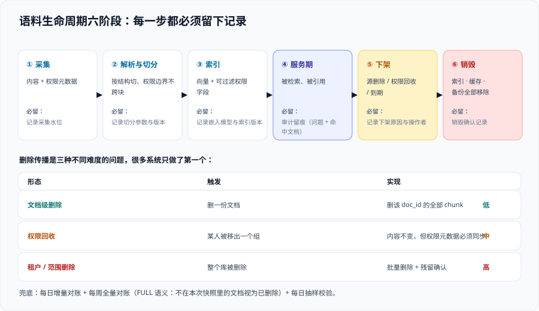

# 数据治理与审计

[权限隔离](.././AccessControl/index.md) 管的是「**此时此刻**谁能看到什么」，这一页管的是「**随时间**这套内容还成不成立、还该不该在库里、出了事能不能复盘」。

四个问题构成了本页的全部内容：

1. **谁的数据**——每一条内容线有没有责任人？
2. **多久重扫**——内容与权限的新鲜度有没有可测量的承诺？
3. **删权即删索引**——源系统的删除与权限回收，怎么传导到索引？
4. **审计留痕**——如果明天有人问「上个月有没有人问过那份并购底稿」，你能不能答出来？

## 一、资产台账：没有责任人的内容线一定会烂

台账不是文档目录，是**责任与期限的登记**。每一行必须能回答五个字段：

| 字段 | 含义 | 缺了会怎样 |
| --- | --- | --- |
| `source_id` | 数据源标识（连接器实例） | 出问题时找不到配置在哪 |
| `owner` | **人名**，不是团队名 | 「找某某团队」在三个月后等于没有责任人 |
| `perm_model` | 权限模型（ACL / RBAC / 标签 / 自定义） | 无法判断过滤条件该怎么写 |
| `refresh_expect` | 期望的内容新鲜度（如「变更后 15 分钟内」） | 新鲜度无从判定「达标没有」 |
| `retention` | 保留期限与销毁方式 | 数据保护审查时无法回答「为什么还留着」 |

::: tip 台账的一个实用检验
把台账里的 `owner` 一列遮住，然后逐个问团队：「这个源如果不更新了，谁会先发现？」——如果答案是「不会有人发现」，那么这一行**要么补一个 owner，要么把它从接入列表里删掉**。接入一个无人负责的源，等于给自己加一条未来的事故线。
:::

## 二、生命周期六阶段



| 阶段 | 关键动作 | 必须产出的记录 | 常见缺口 |
| --- | --- | --- | --- |
| **① 采集** | 从源系统拉取内容与权限元数据 | 采集水位（时间戳 / 游标） | 不记录水位 → 失败后只能全量重跑 |
| **② 解析与切分** | 版式解析、按结构切分、权限边界不跨块 | 切分参数与版本号 | 改了切分参数却不记录 → 无法解释检索质量突变 |
| **③ 索引** | 写入向量与元数据、建立可过滤字段 | `embedding_model` 与索引版本 | 换嵌入模型不重建 → 新旧向量空间混放（见 [RAG · 组件版本](../../RAG/Version/index.md)） |
| **④ 服务期** | 被检索、被引用 | 审计留痕（见第五节） | 只记问题不记命中文档 |
| **⑤ 下架** | 源删除 / 权限回收 / 到期 | 下架原因与操作者 | **只有「删除」没有「原因」**，事后无法区分误删与正常下架 |
| **⑥ 销毁** | 从索引、缓存、备份中彻底移除 | 销毁确认记录 | 只删索引，**缓存与备份里还在** |

## 三、删除传播：三种形态，三种难度

「删除」不是一个动作，是三个不同的问题。**它们的技术难度依次上升，而很多系统只做了第一个。**

| 形态 | 触发 | 实现 | 难度 | 典型缺口 |
| --- | --- | --- | --- | --- |
| **文档级删除** | 源系统里删了一份文档 | 收到事件或在增量同步里发现 → 删该 `doc_id` 的全部 chunk | 低 | 只按 `doc_id` 删除而 chunk 的主键不是 `doc_id` 前缀时**删不干净** |
| **权限回收** | 某人被移出一个组 | 不需要改索引**内容**，只需要索引里的权限元数据与源系统一致 | 中 | 以为「内容没变就不用同步」——**权限变更也是变更** |
| **租户 / 范围级删除** | 整个项目、整个库被删除 | 批量删除 + 确认无残留 | 高 | 按目录判断而不按数据删除，容易漏掉散落文件 |

### 对账：兜住「事件丢了」的最后一道网

任何「监听变更事件」的方案都会丢事件（网络抖动、进程重启、订阅过期）。因此**必须有一个兜底的对账机制**：

| 对账方式 | 做法 | 代价 | 适用 |
| --- | --- | --- | --- |
| **增量对账** | 每日比对源系统清单与索引清单，差集即需处理的项 | 低 | 全量对账之外的日常巡检 |
| **全量对账（FULL）** | 一次导入全量文件，**不在文件里的文档被删除** | 中（要重新导入全部内容） | 定期（如每周）；也是重建前的标准动作 |
| **抽样校验** | 随机抽 30 份索引文档，回源确认仍存在且权限一致 | 极低 | 每天，作为前两者的早期预警 |

Google Cloud 的 Discovery Engine 在批量导入接口里提供了 `reconciliationMode: FULL` 这个开关，语义正是「**本次文件里没有的文档，视为已删除**」——这是治僵尸文档的标准手段。

```json [reconciliation_full.json]
{
  "gcsSource": { "inputUris": ["gs://<bucket>/kb-snapshot.jsonl"] },
  "reconciliationMode": "FULL"
}
```

::: danger 用 FULL 对账前必须想清楚的两件事
1. **它删的是「不在本次文件里的文档」**。所以你必须保证**本次生成的文件是完整快照**——如果采集侧只跑了一半就被中断，FULL 对账会把另一半**全部删掉**。正确做法：快照文件生成成功后再触发对账，且对账前后比较文档总数（差值超过阈值即中止）。
2. **它对权限变更不做保证**。FULL 只保证「文档集合一致」，**权限元数据是否为最新，仍取决于你是否重新抽取了权限**。因此在执行 FULL 的同一轮里，必须强制重新抽取权限元数据，而不是复用旧值。
:::

## 四、新鲜度 SLO：把「应该是实时的」变成分钟数

新鲜度分三条，必须分开承诺——它们的成本差一个数量级：

| SLO | 定义 | 参考目标 | 测量方式 |
| --- | --- | --- | --- |
| **内容新鲜度** | 源内容变更 → 新内容可被检索 | 15 分钟 ~ 24 小时（按源的重要性分级） | 在源系统改一份探针文档，轮询检索其新内容 |
| **权限新鲜度** | 权限变更 → 索引权限元数据一致 | 越短越好；高敏感源 < 15 分钟，普通源 < 24 小时 | 改一个探针用户的组，轮询探测其可见性变化 |
| **删除新鲜度** | 源删除 → 不可被检索 | 高敏感源 < 5 分钟 | 删一份探针文档，轮询探测是否仍能命中 |

::: warning 官方文档里两个必须记住的时延事实
以 Azure AI Search 的文档级访问控制为例，官方明示：

1. **源系统中的权限变更，只有在元数据同步到索引之后才会反映在搜索结果里**——也就是说，**越权窗口是设计的一部分**，不是 bug。
2. **唯一权限（item-level）的 ACL 变更随每次索引器成功运行增量抓取，而从父级（站点 / 库 / 列表 / 文件夹）继承的变更需要显式刷新。**

第 2 条是很多团队踩的坑：**继承型权限的变更没有自动增量，需要显式触发刷新**。如果你的源系统大量使用继承权限（例如整个站点共享同一套权限），那么你必须主动安排刷新，否则「改了一个父级权限」这件事可能**几周都不会生效**。
:::

### 兜底：新鲜度不达标时必须告诉用户

新鲜度是概率性的。当系统已知索引滞后时，**必须把这件事告诉提问者**，而不是假装是最新的：

- 回答里带上「知识库更新至 2026-10-14 08:30」这样的时间戳；
- 若某数据源的滞后超过 SLO，回答页给一条明确提示：「该来源数据可能不是最新，关键决策请以源系统为准」；
- 在高敏感场景下，**滞后超阈值时应拒绝作答**，而不是给一个可能过期的答案。

::: tip 一条反直觉但很有效的设计
**让时间戳可见，比把新鲜度做到实时更能提升信任。** 用户看到「数据更新至 08:30」，会在意的时候自己去源系统核对；看到没有任何时间戳的自信回答，反而会误以为永远最新。
:::

## 五、审计留痕：五类事件

审计问的问题通常只有两个方向：

- **人 → 文档**：这个人上个月看了哪些文档？
- **文档 → 人**：这份并购底稿，谁看过、谁问过相关问题？

要能回答这两问，至少要记录五类事件：

| 事件 | 必记字段 | 用它回答什么 |
| --- | --- | --- |
| 检索请求 | 用户 ID、时间、问题文本（或哈希）、**权限指纹** | 「谁问过什么」 |
| 检索结果 | **命中文档 ID 列表**、每条命中的可见性判定结果 | 「他到底看到了哪些文档」——**最关键、最常被漏记的一条** |
| 生成结果 | 引用的文档 ID、模型与提示词版本 | 「这句答案从哪来」 |
| 权限决策 | 判定结果、依据的组集合、命中的规则 | 「为什么他能看到/看不到」 |
| 管理变更 | 谁改了配置、评测集、权限映射；改前改后的值 | 「什么时候变的、谁变的」 |

::: danger 只记「问题」不记「命中文档」是无效留痕
这是最常见的留痕做法，也是审计时最尴尬的情况：你知道他问过「薪酬带宽怎么定」，但**你不知道系统当时递给他哪些文档**，于是无法回答「有没有越权」。

正确写法：**检索结果列表与每条结果的可见性判定，必须与这次请求在同一个记录里落盘**。这一条同时让安全事件的调查从「猜测」变成「查询」。
:::

## 六、敏感数据与语料分级

知识库容易成为「敏感数据的汇聚点」——本来分散在各个系统、各自有权限的内容，被集中到了一个可被自然语言检索的地方。因此在接入前要做一次分级：

| 级别 | 例 | 处置 |
| --- | --- | --- |
| 公开 | 官网内容、对外文档 | 可入索引，无需额外保护 |
| 内部 | 一般制度、流程 | 入索引，权限跟随源系统 |
| 敏感 | 薪酬、合同、客户数据 | 入索引，**必须**有独立权限域 + 访问审计 + 更短的删除 SLO |
| 极敏感 | 个人信息、法务底稿、并购资料 | **默认不入索引**；确需接入时逐条评估，考虑脱敏或只索引「存在性 + 索引号」而正文留在源系统 |

::: warning 评测集也是数据
评测题里如果出现真实员工姓名、真实客户名、真实项目代号，**评测集本身就变成了需要保护的资产**。三件事要做：评测集纳入资产台账、限定访问范围、定期清理。这一条在多数团队里都是零。
:::

## 验证方式

1. **台账完整性自查**：

   ```shell
   # 统计台账行数与「owner 为空」的行数（按你的台账文件格式调整）
   awk -F'|' 'NF>3 {total++; if ($4 ~ /^ *$/) empty++} END {print "行数:", total, "缺 owner:", empty+0}' kb-assets.md
   ```

   预期输出：`缺 owner: 0`。
2. **删除传播实测**：删一份探针文档，然后轮询。

   ```shell
   # 每 60 秒探测一次，直到检索不到，记录耗时
   start=$(date +%s)
   while curl -s -X POST "$KB_ENDPOINT/search" -H "Authorization: Bearer $TOKEN" \
         -H "Content-Type: application/json" \
         -d '{"query":"PROBE-DOC-KEYWORD","top_k":5}' | grep -q "probe-doc-id"; do
     sleep 60
     [ $(( $(date +%s) - start )) -gt 3600 ] && { echo "超时未消失"; exit 1; }
   done
   echo "删除传播耗时: $(( ($(date +%s) - start) / 60 )) 分钟"
   ```

   预期输出：一个**具体分钟数**。若超过你声明的 SLO，说明删除新鲜度没有落地。
3. **留痕可回溯**：随机取一条历史问答记录，确认它**同时**包含问题、命中文档列表与可见性判定。缺任一项即为留痕不完整。

## 参考资料

- Azure AI Search 官方文档 · Document-level access control（权限变更的同步时延与继承型刷新说明）：https://learn.microsoft.com/azure/search/search-document-level-access-overview
- Google Cloud 官方文档 · Discovery Engine 批量导入 `reconciliationMode`（FULL 对账删除）：https://cloud.google.com/generative-ai-app-builder/docs/reference/rest/v1/projects.locations.dataStores.branches.documents/import
- Microsoft Learn · 审计与合规日志的保留与检索（审计记录字段设计的参考口径）：https://learn.microsoft.com/purview/audit-solutions-overview
- ISO 官方标准页 · ISO/IEC 42001:2023（数据管理与文档化信息要求）：https://www.iso.org/standard/81230.html
- 本站 [数据仓库 · 数据质量与血缘](../../../DB/DataWarehouse/index.md) · 元数据与血缘的体系化做法：`docs/DB/DataWarehouse/`
- 本站 [安全加固 · 审计与检测](../../../Ops/SecurityHardening/AuditDetection/index.md) · 审计日志平台侧的建设：`docs/Ops/SecurityHardening/AuditDetection/index.md`
