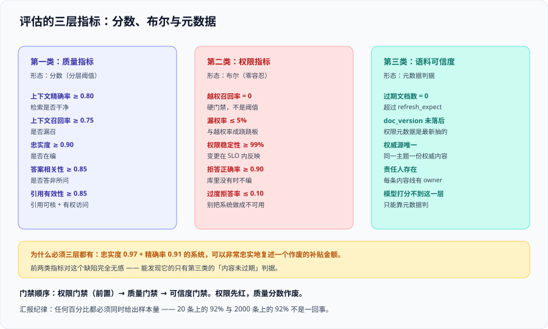

# 问答评估

企业知识库的评估比通用 RAG 多一类指标，且这一类的形态与其余两类**根本不同**：质量指标是**分数**（越高越好，可以分层设阈值），权限指标是**布尔**（越权召回必须恒为 0，没有「降低一点」这种说法）。

这一页给出三类指标的完整定义、三类题集的构造方法，以及**权限正确性到底怎么测**。

## 一、为什么通用 RAG 指标不够

[RAG · 评估体系](../../RAG/Evaluation/index.md) 给出的三层指标（检索层 / 生成层 / 端到端）回答的是「**答得好不好**」。它们有一个共同的隐含前提：

> **假设检索出来的内容都是「应该被这个人看到的」。**

这个前提在企业场景下不成立。一个 0.95 忠实度、0.92 答案相关性的系统，完全可以是一个**每次都在越权回答**的系统——而且它的分数会**比合规的系统更高**，因为越权后候选集更大、更容易命中。也就是说：

::: danger 一个必须写进评估文档的结论
**越权会提高质量分数。** 在评估集不变的前提下，「关掉权限过滤」几乎总能让检索类指标上升（可用语料更多）。因此如果只盯质量指标，你的优化会**自发地朝越权方向走**。

对策：把权限指标做成**前置门禁**——**权限不通过，质量分数不看**。这一条决定了评估报告的阅读顺序。
:::

## 二、三类指标



### 第一类：质量指标（沿用通用 RAG 口径）

| 指标 | 含义 | 企业知识库参考起点 | 诊断什么 |
| --- | --- | --- | --- |
| **上下文精确率** | 检索到的 chunk 里「有用」的占比 | ≥ 0.80 | 是否把噪声一起拽进来 |
| **上下文召回率** | 答案需要的信息被检索到的占比 | ≥ 0.75 | 是否漏召 |
| **忠实度** | 答案中的论断被上下文支持的比例 | ≥ 0.90 | 是否在编 |
| **答案相关性** | 答案是否真的回答了问题 | ≥ 0.85 | 是否答非所问 |
| **引用有效性** | 引用存在、指向正确、且**提问者有权访问** | ≥ 0.85 | 引用是否可核 |

::: warning 「引用有效性」在企业场景多了一个条件
通用口径里它只要求「引用真实且指向正确」。企业场景必须再加一条：**引用指向的文档，提问者有权打开**。否则会出现「答案没越权（引用的都是有权文档），但引用列表里混进了一个无权文档的编号」——这仍然是信息泄露（存在性泄露）。
:::

### 第二类：权限指标（本专题的核心补充）

| 指标 | 定义 | 期望值 | 备注 |
| --- | --- | --- | --- |
| **越权召回率** | 越权账号的检索结果里出现无权文档的比例 | **0（零容忍）** | 不是分数阈值，是布尔门禁 |
| **漏权率** | 有权账号答不出可见范围内答案的比例 | ≤ 5% | 与越权率是一对：**放宽过滤会降漏权、升越权**，必须同时看 |
| **权限稳定性** | 权限变更后，索引在 SLO 内反映变更的比例 | ≥ 99% | 靠探针测量（见 [数据治理](.././DataGovernance/index.md)） |
| **拒答正确率** | 知识库确实没有答案时，正确拒答的比例 | ≥ 0.90 | 与「过度拒答率」成对看 |
| **过度拒答率** | 答案确实存在时，错误拒答的比例 | ≤ 0.10 | 拒答是安全的默认行为，但过度拒答会让系统没人用 |

::: tip 越权率与漏权率是一对跷跷板
凡是「用更宽的过滤条件」换来的质量提升，**都会同时抬高越权率、降低漏权率**；反之亦然。

因此评估报告里这两个数**必须并排出现**。只报一个数会导致两种典型误判：

- 只报漏权率 → 鼓励放宽过滤 → 越权；
- 只报越权率 → 鼓励收紧过滤 → 没人能用（而没人用会被误读成「权限做得很好」）。
:::

### 第三类：语料可信度（无法用模型打分的一类）

这是 2026 年业界明确提出的补充维度（Atlan 口径的 **context trustworthiness**）：**忠实度衡量的是「模型有没有忠实复述」，而不是「复述的内容对不对」**。

| 判据 | 期望 | 怎么测 |
| --- | --- | --- |
| 内容未过期 | 超过 `refresh_expect` 未更新的文档数为 0 | 元数据查询 |
| 权限元数据未过期 | `doc_version` 落后于源系统的文档数为 0 | 对账 |
| 权威源一致 | 同一主题在库内只有一份权威内容 | 抽样人工核对（每季度） |
| 责任人存在 | 每条内容线有 `owner` | 资产台账 |

::: danger 一个真实会发生的场景
某公司的《差旅报销标准》在源系统已于 2026-06 更新，但索引里还是 2025 版。评估跑出来：**忠实度 0.97、上下文精确率 0.91**——模型非常忠实地复述了**一行作废的补贴金额**。

这两个分数**没有提供任何关于这个缺陷的信息**。能发现它的只有语料可信度判据（内容未过期）。**所以三类指标不是「锦上添花」，而是各管一个互不覆盖的失败模式。**
:::

## 三、三类题集：评测集的构造

评测集必须包含三类题，且**按类分别统计**——混合统计会把零容忍的越权问题稀释成一个看起来还行的平均分。

| 题类 | 构造方法 | 条数建议 | 期望 |
| --- | --- | --- | --- |
| **该答的（A 类）** | 从真实历史问题里挑答案明确在库内的 | 60~100 | 正确回答 + 引用有效 |
| **不该答的（B 类）** | 用**越权账号**问「只有另一个权限域的文档才答得出」的问题 | **≥ 20** | 检索结果为空 / 明确拒答 / **引用里不得出现无权文档** |
| **库里没有的（C 类）** | 问一个知识库范围之外的问题（可以是常识、也可以是编造的业务名词） | 20~30 | 明确拒答，不编造 |
| （补充）**低人数敏感性（D 类）** | 从「可见人数 1~3 人」的权限域里出题 | ≥ 5 | 该看到的人能看到（防漏权），其他人看不到 |

::: danger B 类题集的三个构造错误
1. **用管理员账号测 B 类**：管理员本来就都能看到，测出来永远通过。**B 类必须用受限账号。**
2. **B 类问题只是「换了个词」的 A 类问题**：如果答案在提问者可见的文档里也有一份，那么答出来是**正确的**，测出来的「越权」是假阳性。B 类问题必须保证**答案只存在于无权文档中**。
3. **B 类只测「答案里没有」**：这不够。**必须同时检查检索结果（引用列表、命中文档）里没有无权文档**。理由见 [权限隔离](.././AccessControl/index.md)：生成后过滤不成立，能拦住答案拦不住引用。
:::

## 四、权限正确性怎么测（可执行）

权限评估与质量评估在工程上最大的差别：**它需要「两个身份」**。

```python [acl_eval.py]
"""权限正确性评估的最小骨架。

要点：
1) 每个 B 类用例都要用「越权账号」与「有权账号」各跑一次；
2) 断言的对象是「命中的文档 ID 集合」，不是自然语言答案；
3) 期望值是布尔（必须为空），因此失败即阻断，不做分数比较。
"""

def run_acl_case(case, store) -> dict:
    # ① 越权账号：必须什么都拿不到
    restricted_hits = store.search(case.question, principal=case.other_principal, top_k=20)

    # ② 有权账号：必须拿得到（否则用例本身无效——可能文档根本没入库）
    allowed_hits = store.search(case.question, principal=case.owner_principal, top_k=20)

    return {
        "case_id": case.id,
        "leaked": [h["doc_id"] for h in restricted_hits
                   if h["doc_id"] in case.forbidden_doc_ids],      # 越权命中
        "case_valid": len(allowed_hits) > 0,                        # 用例自检
        "answered_out_of_scope": len(restricted_hits) > 0,
    }
```

::: warning 「用例自检」这一行不能省
第 ② 步（有权账号必须拿得到）是**用例自身有效性**的检验。

没有它，你会遇到一个很尴尬的情况：B 类用例全部「通过」，但实际原因是**那份文档根本没进索引**——不是权限生效了，是数据缺失。这两种情况在「越权账号什么都没查到」这一点上完全同形。
:::

### B 类用例的通过标准

| 检查项 | 期望 | 不通过的含义 |
| --- | --- | --- |
| 越权账号的**检索结果** | 0 条无权文档 | 越权召回（最严重） |
| 越权账号的**答案引用列表** | 不含无权文档编号 | 存在性泄露 |
| 越权账号的**回答内容** | 不含无权文档中的专有表述 | 生成阶段泄露（说明检索阶段就没拦住） |
| 有权账号的**检索结果** | ≥ 1 条（用例有效性） | 用例无效，需先修数据 |

## 五、指标诊断矩阵

只看单个数字不够用，下面这张表是「组合诊断」：

| 现象 | 根因 | 优化方向 |
| --- | --- | --- |
| 越权召回 > 0 | 权限没施加 / 身份传丢 / 只过滤了一路 | **停止其它优化**，回到 [权限隔离](.././AccessControl/index.md) |
| 漏权率高、越权率 0 | 过滤过严 / 组未展开 / 后过滤选择性 | 检查组展开与预过滤 |
| 质量分数高、越权率也高 | 很可能靠越权拿到了更多语料 | **质量分数作废**，先修权限再重测 |
| 上下文召回低、精确率高 | 检索漏召 | 提高 `top_k`、加关键词腿、查切分 |
| 上下文精确率低、召回高 | 噪声多 | 收紧 `top_k`、加重排、优化元数据过滤 |
| 忠实度高、答案相关性高、仍有业务错误 | **语料过期或口径不一致** | 查语料可信度判据 |
| 各项都好、但拒答率异常高 | 过滤过严或阈值过高 | 看漏权率与过度拒答率 |

## 六、阈值、样本量与统计口径

::: danger 报百分比不报样本量，等于没有结论
业界口径明确：**20 条上的 92% 与 2000 条上的 92% 完全不是一回事**。

- 起步阶段：约 **100 条**代表性查询做基线；
- 稳定运行：**500~2000 条**，并按题类分层统计；
- **每次汇报必须给出样本量或置信区间**，否则「提升了 3 个百分点」可能只是换了 5 道题。

一条实用规则：**样本量 < 30 时只报告命中数，不报告百分比。** 「20 条里 19 条正确」比「95%」诚实得多，也更难被过度解读。
:::

### 阈值的定法

| 步骤 | 做法 |
| --- | --- |
| ① 测基线 | 在当前的权限配置与语料状态下，完整跑一遍三类指标 |
| ② 分层设阈 | 质量指标用「均值 + 下界」（如均值 0.85、下界 0.78），权限指标用**布尔 ** |
| ③ 与业务对齐 | 让业务方确认「这个下界被突破时，我们能接受什么后果」 |
| ④ 每次发布重跑 | 离线回归 + 权限门禁，两者**都要过** |

## 七、接进门禁

| 门禁 | 内容 | 阻断条件 |
| --- | --- | --- |
| **权限门禁（前置）** | A / B / D 类用例 | 越权召回 ≥ 1 条 → **直接阻断**，不看质量分数 |
| **质量门禁** | 五类质量指标 | 任一指标低于下界 → 阻断或告警（按主题分级） |
| **可信度门禁** | 过期文档数、`doc_version` 落后数 | 超过阈值 → 告警，并在回答页加时间戳提示 |
| **规模门禁** | 样本量是否达标 | 样本量不足 → 结果标记为「不可作为放行依据」 |

::: tip 一个有用的顺序纪律
**每次发布，先跑权限门禁，再跑质量门禁。** 顺序不是形式：如果权限先红了，质量分数既可能是靠越权刷出来的，也可能因为修权限而变化——**基于它做的任何判断都不成立**。
:::

## 验证方式

1. **跑一次 B 类用例并确认通过**：

   ```shell
   # 逐条跑 B 类用例；脚本需实现「越权账号 + 有权账号」双跑
   python3 acl_eval.py --cases cases_b.jsonl --out /tmp/acl_eval.json
   jq '{total, leaked: ([.[] | select(.leaked | length > 0)] | length), invalid: ([.[] | select(.case_valid | not)] | length)}' /tmp/acl_eval.json
   ```

   预期输出：`leaked: 0` 且 `invalid: 0`。**`invalid > 0` 说明有用例因为数据缺失而假通过**，必须先修数据再看结论。
2. **报告口径自查**：检查你的评估报告里每个百分比是否**同时给出了样本量**。缺一处即为口径不合格。
3. **组合诊断演练**：故意把权限过滤关掉重跑一次，观察质量指标的**上升**幅度。这个数字是很好的材料——它能让团队直观理解「越权会提高分数」，从而接受「权限前置门禁」这一设计。

## 参考资料

- Atlan · RAG Evaluation Explained（2026：四指标、盲区与 context trustworthiness 第五维）：https://atlan.com/know/how-to-evaluate-rag-systems-explained/
- RAGAS 官方文档（faithfulness / answer relevance / context precision / recall 的实现口径）：https://docs.ragas.io/
- Microsoft Learn · 评估与度量（LLM 评估指标的工程化做法）：https://learn.microsoft.com/azure/ai-foundry/concepts/evaluation-metrics-built-in
- Azure AI Search 官方文档 · Document-level access control（权限裁剪对结果集的影响）：https://learn.microsoft.com/azure/search/search-document-level-access-overview
- 本站 [RAG · 评估体系](../../RAG/Evaluation/index.md) · 三层指标与评测集构建：`docs/AI/RAG/Evaluation/index.md`
- 本站 [AI 应用观测与评估](../../LLMObservability/OfflineEval/index.md) · 离线回归与门禁的工程做法：`docs/AI/LLMObservability/OfflineEval/index.md`
