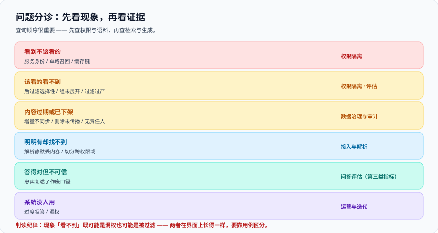

# 常见问题与最佳实践

这一页是收尾页：现象分诊表 → 高频十二问 → 上线自查清单 → 最佳实践 → 术语表。**遇到问题先查第一节的分诊表**，它把现象映射到该看的那一页。

## 一、现象分诊表

| 现象 | 最可能的原因 | 先去哪一页 |
| --- | --- | --- |
| 普通员工能问到其他部门的内容 | 检索用的是服务身份（工具包装路径），过滤条件无从施加 | [权限隔离](.././AccessControl/index.md) 第四节 |
| 大部分人正常，个别问题会带出无权内容 | 只在向量腿注入了过滤条件，关键词腿裸查 | [权限隔离](.././AccessControl/index.md) 第四节 |
| 受限账号经常「找不到」答案，管理员能找到 | 后过滤的选择性悬崖（可见比例太低） | [权限隔离](.././AccessControl/index.md) 第三节 |
| 「我已经把他移出组了，他怎么还能问」 | 权限元数据未同步；继承型权限未显式刷新 | [数据治理与审计](.././DataGovernance/index.md) 第四节 |
| 已下架文档仍被引用 | 增量同步只 upsert 不删除；或删除事件丢失 | [接入与解析](.././Ingestion/index.md) 第四节 |
| 两个不同权限的人拿到同一个答案 | 缓存键只有问题文本，没有权限指纹 | [权限隔离](.././AccessControl/index.md) 第六节 |
| 答案引用的文档，用户点开是 403 | 引用回填没有做权限核对（体验问题，但也是存在性泄露） | [问答评估](.././Evaluation/index.md) 第一节 |
| 文档明明在库里，就是检索不到 | 切分跨了权限域 / 解析静默丢内容 / 过滤过严 | [接入与解析](.././Ingestion/index.md) 第三、六节 |
| 答案非常笃定，但业务说口径早就变了 | 语料过期，模型忠实复述了旧口径 | [问答评估](.././Evaluation/index.md) 第二节 |
| 答案里出现了真实员工姓名 | 敏感数据未分级；评测集或日志里带入个人数据 | [数据治理与审计](.././DataGovernance/index.md) 第六节 |
| 每次发布上线的质量分数忽高忽低 | 评测样本量不足；或权限配置变化导致可用语料变化 | [问答评估](.././Evaluation/index.md) 第六节 |
| 系统没人用，但各项指标都正常 | 过度拒答；或权限过滤把该看到的也过滤掉了（漏权） | [运营与迭代](.././Operations/index.md) 第六节 |



## 二、高频十二问

**Q1：我们已经做了权限过滤，还需要专门测「越权」吗？**
需要，而且这是最该先做的事。原因有两条：① 权限过滤的失败**不报错**（本章分诊表里一半的现象都属于此类）；② 越权测试的成本极低——**一次手工请求就能发现最严重的那类缺陷**（不带身份的请求是否被拒绝）。

**Q2：能不能把全部文档都放进索引，靠提示词约束模型不要说？**
不能。这是把安全问题伪装成体验问题。**理由不是「模型不听话」，而是「内容已经进入上下文」**——上下文里一旦出现那段文字，泄露就已经发生了，模型只是最后一道概率性的闸门。

**Q3：生成之后再检查答案里有没有敏感内容，行不行？**
不行。演示时看起来有效（越权内容是逐字出现的），真实场景里模型会**概括、引用、推理**，而且**「已删除某段内容」本身就是信息**。过滤必须在检索阶段（详见 [权限隔离](.././AccessControl/index.md) 第二节）。

**Q4：我们的组是嵌套的（组属于组），怎么办？**
两件事：① **组展开逻辑必须与源系统一致**，并有一条对拍用例（抽 20 个组比对成员）；② **索引里存组 ID 而不是组名**。反向的坑比正向更常见：把**所有父组**都展开会让不该看到的人看到。

**Q5：一份文档里既有公开章节也有敏感章节，怎么处理？**
**按权限边界切分**——一个 chunk 只能属于一个权限域。这是**唯一一个必须在切分阶段解决、之后无法补救**的问题（详见 [接入与解析](.././Ingestion/index.md) 第三节）。

**Q6：源系统不提供删除事件，怎么办？**
三层兜底：① 增量同步时用「本批清单 vs 索引清单」的差集发现删除；② 每日增量对账；③ 每周全量对账（FULL 语义：不在本次快照里的文档视为已删除）。**前提是全量快照必须完整生成后再触发对账**，否则会把另一半误删。

**Q7：权限变更多久生效才算合格？**
不要给「尽量快」这种答案。写成三个可测量的 SLO：内容新鲜度、权限新鲜度、删除新鲜度，**并且真的去测**（探针法，见 [数据治理与审计](.././DataGovernance/index.md) 第四节）。高敏感源建议 ≤ 15 分钟、删除 ≤ 5 分钟，普通源可以放到 24 小时。

**Q8：评估指标要多少条题才够？**
起步约 100 条代表性查询，稳定后 500~2000 条，**并按题类分层**。一条硬规矩：**样本量 < 30 时只报告命中数，不报告百分比**——「20 条里 19 条正确」比「95%」诚实得多。

**Q9：为什么说「越权会提高质量分数」？**
因为关掉权限过滤后可用语料更多，检索类指标（上下文召回等）几乎必然上升。这意味着**只盯质量指标的优化会自发朝越权方向走**。对策是把权限指标做成**前置门禁**：权限不通过，质量分数不看。

**Q10：忠实度 0.95 是不是就说明答案可信了？**
不是。忠实度衡量的是「模型有没有忠实复述」，不是「复述得对不对」。**索引过期时，模型会非常忠实地复述一个作废口径**，而质量指标对此完全无感。这一条要靠**语料可信度**判据（内容未过期、责任人存在、权威源一致）。

**Q11：缓存能不能直接用问题文本当键？**
不能。缓存天然跨用户共享，**用问题文本当键会让 A 的答案命中给 B**。正确做法是键里包含**权限指纹**（可见组集合的稳定哈希，比较前排序）。另外还有一条易漏的：**文档下架时所有缓存键都不会变**，所以删除必须触发显式缓存失效。

**Q12：用了厂商的托管知识库，合规责任是不是也转移了？**
没有。托管服务提供的是**机制**（例如文档级访问控制 API 与令牌头），**是否用对、权限是否映射正确、数据是否合规**仍然是你自己的责任。一个具体的例子：同一条索引有两条入口，**Agent 工具用服务身份调用时过滤条件无从施加**——这是接入方式的问题，不是服务商的问题。

## 三、上线自查清单（20 项）

上线前逐条打勾，**任何一条打不上勾都不要上线**：

**权限相关（前 8 条是硬门槛）**

- [ ] 1. 索引中每个 chunk 都有权限元数据，且存的是**组 ID** 而非组名
- [ ] 2. 权限字段在索引 schema 里是**可过滤**的类型（能下推给引擎）
- [ ] 3. 过滤采用**预过滤**，或已实测选择性最低的权限域仍能命中
- [ ] 4. 所有检索入口路径（页面 / 工具 / 定时任务 / 管理后台）用的是**终端用户身份**
- [ ] 5. **不带用户身份**的检索请求会被拒绝（4xx），而不是返回全量
- [ ] 6. 多路召回的**每一路**都注入了过滤条件
- [ ] 7. 嵌套组展开逻辑与源系统一致，且有对拍用例
- [ ] 8. 缓存键包含权限指纹；文档下架会触发缓存失效

**治理相关**

- [ ] 9. 每个数据源在资产台账里有**人名 owner**，不是团队名
- [ ] 10. 三条新鲜度 SLO 已定义，且都有一个实测分钟数
- [ ] 11. 删除传播实测通过（含继承型权限的变更）
- [ ] 12. 有每日对账与每周全量对账机制，且快照完整性有校验
- [ ] 13. 敏感与极敏感内容有独立处置（极敏感的默认不入索引）

**评估相关**

- [ ] 14. A / B / C 三类题集齐备，**B 类 ≥ 20 条且用真实受限账号**
- [ ] 15. `EKB-C`（越权召回 = 0）与 `EKB-D`（用例有效性）都在门禁里
- [ ] 16. 所有百分比报告都带样本量
- [ ] 17. 语料可信度判据（过期文档数、`doc_version` 落后数）有例行检查

**运营相关**

- [ ] 18. 审计留痕含**命中文档与可见性判定**，且与请求在同一条记录里
- [ ] 19. bad case 有分诊通道，且采集了权限指纹与命中列表
- [ ] 20. 有一份**AI 影响评估记录**（影响谁、最坏后果、缓解措施、谁批准）

::: danger 清单里最容易被跳过的是第 20 条
它不产生任何技术产出，所以总被排到最后。但在管理体系审核里，**它是被明确要求的交付物**（ISO/IEC 42001 第 6.4 条 AI 影响评估），而且审核时一定会问。

写起来不长——三五百字回答「影响对象、最坏后果、我们做了什么缓解、谁批准的」就够。
:::

## 四、十二条最佳实践

1. **先做越权测试，再做质量调优。** 越权测试一次手工请求即可完成，却拦住了最严重的默认行为。
2. **过滤条件必填，缺失即拒绝。** 「不带就不过滤」是所有默认行为里最危险的一个。
3. **权限元数据随 chunk 落盘。** 索引的最小单元是 chunk，不是文档。
4. **索引里存组 ID，不存组名。** 组名会改，改名当时不会报错。
5. **一个 chunk 只属于一个权限域。** 跨权限域的 chunk 必须在切分阶段消灭。
6. **把三件 SLO 写成分钟数。** 内容、权限、删除，各自可测。
7. **权限指标是布尔，不是分数。** 越权召回没有「降低一点」这种说法。
8. **先跑权限门禁，再看质量分数。** 顺序错了，结论就是错的。
9. **报告百分比必须带样本量。** 否则「提升 3 个百分点」可能只是换了 5 道题。
10. **缓存键必须含权限指纹。** 且删除要触发失效。
11. **留痕要记「命中了哪些文档」。** 只记问题等于没有留痕。
12. **覆盖面最后扩。** 先接三个源把权限与删除跑通，再谈第十三个源。

## 五、术语表

| 术语 | 英文 | 含义 |
| --- | --- | --- |
| 访问控制列表 | ACL（Access Control List） | 挂在文档或目录上的「谁能读」列表，是权限的权威表达 |
| 基于角色的访问控制 | RBAC（Role-Based Access Control） | 读权限挂在**范围**上，用户通过角色获得；语义是「范围包含文档」 |
| 安全裁剪 | Security trimming | 在结果返回前按调用者权限排除不可见项 |
| 预过滤 | Pre-filter | 先缩小候选集再做向量检索，精度可控 |
| 后过滤 | Post-filter | 先取回 `top_k` 再丢弃不可见项，选择性低时结果趋近于空 |
| 选择性 | Selectivity | 可见文档数 ÷ 索引总文档数；越低越危险 |
| 权限指纹 | Permission fingerprint | 用户可见组集合的稳定哈希，用于缓存键分区 |
| 委托令牌 | Delegated token | 代表终端用户身份的凭据，服务端据此做权限判定 |
| 服务身份 | Service identity | 应用自身的凭据；用它检索等于不做权限过滤 |
| 越权召回 | Unauthorized recall | 检索结果中出现提问者无权访问的文档 |
| 漏权 | Over-restriction | 提问者有权访问的文档被错误过滤掉 |
| 越权窗口 | Exposure window | 从权限变更到索引生效之间的时间差 |
| 僵尸文档 | Zombie document | 源系统已删除但索引中仍存在的文档 |
| 对账导入 | Reconciliation import | 以完整快照为准的导入方式，不在快照中的文档会被删除 |
| 语料可信度 | Context trustworthiness | 内容是否最新、有无责任人、是否与权威源一致；模型打分到不了这一层 |
| 忠实度 | Faithfulness | 答案中的论断被检索上下文支持的比例 |
| 存在性泄露 | Existence disclosure | 未泄露内容但暴露了「存在这样一份文档」这一事实 |
| 影响评估 | AI Impact Assessment | 管理体系要求的影响评估记录，回答影响谁、最坏后果、如何缓解 |

## 验证方式

1. **分诊演练**：从第一节分诊表里随机挑 3 行，确认你能在自己的系统里**指出该看哪一页、以及第一个要执行的命令**。
2. **自查清单**：逐条打勾，把打不上勾的项登记进待办。**第 1~8 条任一未勾，不要上线。**
3. **术语一致性**：在团队内确认 `ACL` 与 `RBAC` 的语义区分已被理解（这是最容易在沟通中张冠李戴的一对词）。

```shell
# 自查清单完整度：确认清单文件里 20 项都在
grep -c '^- \[ \]' checklist.md
```

预期输出：`20`（或 `0` —— 如果全部已勾选为 `- [x]`，把命令里的模式改成 `'^- \[[ x]\]'` 后应输出 `20`）。

## 参考资料

- Azure AI Search 官方文档 · Document-level access control（四种做法、令牌传递、生效时延）：https://learn.microsoft.com/azure/search/search-document-level-access-overview
- Microsoft Learn · Security filters for trimming results：https://learn.microsoft.com/azure/search/search-security-trimming-designer
- Amazon Bedrock 官方文档 · Knowledge Bases（连接器、元数据过滤、权限模型）：https://docs.aws.amazon.com/bedrock/latest/userguide/knowledge-base.html
- Google Cloud 官方文档 · Vertex AI Search 访问控制：https://cloud.google.com/generative-ai-app-builder/docs/access-control
- Atlan · RAG Evaluation Explained（2026 年评估指标与盲区）：https://atlan.com/know/how-to-evaluate-rag-systems-explained/
- ISO 官方标准页 · ISO/IEC 42001:2023（AI 管理体系与影响评估要求）：https://www.iso.org/standard/81230.html
- 本站 [RAG 检索增强](../../RAG/index.md) · 检索链路的基础：`docs/AI/RAG/`
- 本站 [向量数据库深入](../../../DB/VectorDatabase/index.md) · 过滤与索引的引擎机制：`docs/DB/VectorDatabase/`
