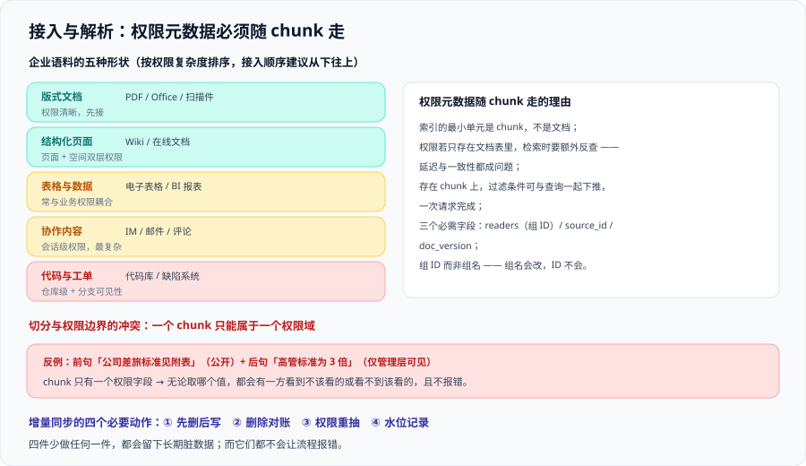

# 接入与解析

这一页讲**语料从源系统走到索引**的那一段。它与 [RAG · 文档解析与切分](../../RAG/Chunking/index.md) 不重复：那边讲**怎么切得合理**，这里讲**切完之后权限元数据有没有跟着走**、以及**企业语料的五种形状各有什么坑**。

顺序上，本页内容的优先级高于切分调优——**权限元数据缺了，切分调得再准也没用**。



## 一、企业语料的五种形状

企业内部文档不是「一堆 PDF」。按解析难度与权限复杂度两个维度，可以归成五类：

| 形状 | 典型来源 | 解析难点 | 权限难点 | 优先级建议 |
| --- | --- | --- | --- | --- |
| **版式文档** | PDF、Office 文档、扫描件 | 版面顺序、表格、图文混排、扫描件需 OCR | 权限在文档级，较清晰 | **先接**（边界最清楚） |
| **结构化页面** | Wiki、知识库、在线文档 | 层级与内部链接；同一页面被多处嵌入 | 页面级 + 空间级双层权限 | **先接** |
| **协作内容** | IM 聊天记录、邮件、评论 | 对话上下文、线程归属、引用关系 | **最复杂**：常在会话/频道级，且存在「外部成员」 | 后接 |
| **表格与数据** | 电子表格、BI 报表、数据库导出 | 单元格公式与格式；多表关联 | 常与业务系统权限耦合 | 后接（或直接走工具调用而非检索） |
| **代码与工单** | 代码库、缺陷系统、变更单 | 代码块切分、diff、注释与代码分离 | 仓库级 + 分支可见性 | 按需 |

::: danger 最常见的接入顺序错误
**先接 IM 聊天记录。** 因为它「信息最多、问答案例最丰富」，演示效果最好。

但它的权限模型是最复杂的（会话成员、外部成员、临时会话），删除语义也最模糊（「撤回一条消息」算不算删除？撤回后的引用要不要清？）。先接它几乎必然导致**权限问题在第一个月就暴露，而团队还没有任何评测手段**。

正确顺序：**版式文档 / Wiki → 表格 → IM → 代码**。每一步都先把权限与删除跑通，再进下一个。
:::

## 二、权限元数据必须随 chunk 走

这是本页最重要的一条。索引的最小单元是 chunk，**不是文档**。因此：

| 做法 | 后果 |
| --- | --- |
| chunk 上只存 `doc_id`，权限存在文档表里 | 检索时要么做一次「按 doc_id 反查权限」的**额外请求**（延迟与一致性都是问题），要么把权限表全量加载到应用内存（规模上限很低） |
| **chunk 上直接存权限谓词所需字段** ✅ | 过滤条件可以与查询一起下推给检索服务，一次请求完成 |

```json [chunk_schema.json]
{
  "chunk_id": "doc-8842#3",
  "doc_id": "doc-8842",
  "text": "（略）",
  "vector": [0.013, -0.271],
  "title_path": "制度 / 财务 / 差旅报销",
  "source_id": "wiki-corp",
  "readers": ["g-finance", "g-hr"],          // 组 ID，不是组名
  "visibility": "internal",                   // 分级标签
  "doc_version": "v7",
  "content_hash": "b1f3...",
  "embedding_model": "text-embedding-3-small",
  "indexed_at": "2026-10-14T02:15:00Z"
}
```

::: warning 三个字段设计上的取舍
1. **`readers` 存组 ID 而非组名**：组名会改，ID 不会（详见 [权限隔离](.././AccessControl/index.md) 的「组名漂移」）。
2. **必须有 `source_id`**：否则你无法回答「这个来源整体要下架时，删哪些 chunk」。
3. **必须有 `doc_version`**：权限变更时你需要知道「这份文档的元数据是第几版抽的」，才能判断要不要重抽。
:::

## 三、切分与权限边界的冲突

一份文档里可能既有「全公司可见的正文」又有「只有管理层可见的附录」。这是**唯一一个必须在切分阶段解决、之后无法补救**的问题。

| 策略 | 做法 | 适用 |
| --- | --- | --- |
| **按权限边界切** ✅ | 解析时先识别权限分区（章节 / 附件 / 批注），同一权限域的内容切成一块，**禁止一个 chunk 跨两个权限域** | 默认策略 |
| 整篇同权限 | 若文档内权限确实统一，按结构正常切 | 绝大多数文档 |
| 拆成多份文档 | 权限差异极大时，视作**不同的源文档**分别入库 | 文中有明确密级标注 |

```python [split_by_permission.py]
def split_document(parsed, acl_of_section) -> list[dict]:
    """按权限边界切分：一个 chunk 只能属于一个权限域。

    acl_of_section: 解析器给出的「章节 → 权限」映射。
                    若某章没有独立权限，继承文档级权限。
    """
    chunks = []
    for section in parsed.sections:
        acl = acl_of_section.get(section.id, parsed.default_acl)
        for piece in structure_split(section):        # 按结构切，不按长度硬切
            chunks.append({
                "text": piece.text,
                "title_path": piece.title_path,
                "readers": acl.readers,              # 权限随块走
                "visibility": acl.visibility,
            })
    return chunks
```

::: danger 一个跨权限域的 chunk 会发生什么
假设一个 chunk 的前半句是「公司差旅标准见附表」（公开），后半句是「高管差旅标准为普通标准的 3 倍」（仅管理层可见）。

- 检索时，这个 chunk 的权限字段只有一个值。无论它是哪个值，都会有一方**看到不该看的**或**看不到该看的**；
- 更糟的是**它不会报错**：对普通员工，它就是「一条本来不太相关的检索结果」；对管理员做测试，一切正常。

**所以「跨权限域的 chunk」是必须在切分阶段消灭的形态**，不能留给检索阶段处理。
:::

## 四、增量同步的四个必要动作

增量同步不是「拉新内容、写进索引」。它至少要同时做四件事，**少做任何一件都会留下长期脏数据**：

| 动作 | 怎么做 | 不做会怎样 |
| --- | --- | --- |
| **① 先删后写** | 按 `doc_id` 删除该文档的全部旧 chunk，再写入新 chunk | 段落被删掉后，旧 chunk 仍可被检索到 |
| **② 删除对账** | 增量同步的同时，检出「源已删、索引还在」的文档并删除 | 僵尸文档长期存在，模型复述已作废内容 |
| **③ 权限重抽** | 内容变更时**同时重抽权限**，不要复用旧值 | 权限已改、索引未改，越权窗口无限延长 |
| **④ 水位记录** | 记录本次同步的游标（时间戳 / 变更序号） | 失败后无法续传，只能全量重跑 |

```python [sync_one_doc.py]
def sync_one_doc(doc, store, source) -> None:
    """单文档增量同步：删旧 → 判删 → 权限重抽 → 写新 → 记水位。"""
    store.delete_by_doc(doc.id)                      # ① 先删后写

    if doc.deleted_at is not None:                   # ② 下架直接结束
        audit.record("doc_removed", doc.id, doc.deleted_at)
        return

    acl = source.fetch_acl(doc.id)                   # ③ 权限必须重抽
    chunks = split_document(source.parse(doc), acl)
    vectors = embed_batch([c["text"] for c in chunks])
    store.upsert([{**c, "vector": v, "doc_id": doc.id,
                   "source_id": source.id, "doc_version": doc.version}
                  for c, v in zip(chunks, vectors)])
```

::: warning 「② 删除对账」为什么不能只在每周全量对账里做
因为**增量同步最容易漏的恰恰是删除**：新增和修改都有内容可拉，删除只有在「源系统给删除事件」时才看得见。若源系统不提供删除事件（很多网盘与知识库都不提供），你就**必须**在增量阶段用「本批清单与索引清单的差集」来发现删除。

替代方案是**每日增量对账 + 每周全量对账**（见 [数据治理与审计](.././DataGovernance/index.md)），代价是全量对账要重新导入全部内容。
:::

## 五、幂等与去重

同一份内容可能被采到两次（重试、多路径发现、内容被复制到两个位置）。不处理会带来两个问题：**同一段文字在检索结果里出现多次**（挤占上下文配额）、**权限不一致的两份副本**（一份可读一份不可读，检索到哪份取决于运气）。

| 维度 | 判据 | 处置 |
| --- | --- | --- |
| **内容去重** | `content_hash` 相同 | 同一 `doc_id` 内去重；跨文档保留（两份文档可能权限不同） |
| **幂等写入** | 相同 `chunk_id` 重复写 | 用 `chunk_id` 做 upsert 主键，**不要** append |
| **副本消解** | 同一内容在两个源 | 保留**权限更严**的那一份，或明确指定「权威源」，其余标记为派生 |

::: tip 跨文档的重复内容要不要合并
一个常见的纠结：同一份《员工手册》既在 HR wiki 又在公司网盘，权限还不同。

**不要合并。** 保留两份、各自带自己的权限，是最安全也最容易解释的做法。合并会逼你回答「合并后权限算谁的」——而这个问题没有显然正确的答案。

代价是检索时可能返回两条相似结果。用**检索侧的近重复合并**（同一 `content_hash` 的候选只保留一条，并标注「另见」）来解决，而不是在索引侧合并。
:::

## 六、解析质量：三种「隐形丢内容」

解析失败最怕的不是报错，是**静默丢内容**——页面上看起来索引成功，实际内容缺了一大块。

| 形态 | 现象 | 检测 |
| --- | --- | --- |
| **扫描件无 OCR** | PDF 解析出 0 字符，但流程显示成功 | 断言：解析结果字符数 / 源文件页数 的比例不低于阈值 |
| **表格被拉平** | 表格内容变成一串无结构的词，行列表头关系丢失 | 断言：表格类文档的解析结果里包含分隔符或结构标记 |
| **附件被忽略** | 正文里的附件链接未被跟进 | 断言：解析结果里的附件引用数 ≥ 源文档的附件数 |

```shell
# 解析质量巡检：列出「字符数异常少」的文档（按实际输出格式调整）
jq -r '.items[] | "\(.doc_id)\t\(.chars)\t\(.pages)"' parse_report.json \
  | awk -F'\t' '$2 < 50 && $3 > 0 {print "疑似解析失败:", $1, "字符", $2, "页数", $3}'
```

预期输出：**空**。有输出说明存在解析失败但被记为成功的文档。

## 验证方式

1. **权限元数据完整性**：确认索引中每个 chunk 都有权限字段。

   ```shell
   # 取一条 chunk 检查必需字段是否齐全（按你的接口调整）
   curl -s "$KB_ENDPOINT/documents/probe-chunk-id" -H "Authorization: Bearer $TOKEN" \
     | jq '{readers, source_id, doc_version, visibility}'
   ```

   预期输出：四个字段都有值，`readers` 为非空数组（公开内容允许为空数组，但要与「字段缺失」区分开）。
2. **增量同步四动作实测**：改一份文档的正文并**同时改它的权限**，触发一次增量同步，然后：
   - 搜新内容 → 应命中（验证「写新」）；
   - 搜旧内容中被删掉的段落 → **不应命中**（验证「先删后写」）；
   - 用被移出的组账号搜 → **不应命中**（验证「权限重抽」）。
3. **删除对账**：在源系统删一份文档，**不做任何手工操作**，等一个同步周期后确认索引里已无该 `doc_id`。

## 参考资料

- Azure AI Search 官方文档 · Indexers 与增量索引（变更检测与删除检测的官方行为）：https://learn.microsoft.com/azure/search/search-howto-indexing-azure-blob-storage
- Azure AI Search 官方文档 · Document-level access control（权限元数据随文档写入索引）：https://learn.microsoft.com/azure/search/search-document-level-access-overview
- Google Cloud 官方文档 · Discovery Engine 批量导入与 `reconciliationMode`：https://cloud.google.com/generative-ai-app-builder/docs/reference/rest/v1/projects.locations.dataStores.branches.documents/import
- Amazon Bedrock 官方文档 · 数据源连接器与同步：https://docs.aws.amazon.com/bedrock/latest/userguide/knowledge-base.html
- 本站 [RAG · 文档解析与切分](../../RAG/Chunking/index.md) · 切分策略与元数据设计：`docs/AI/RAG/Chunking/index.md`
- 本站 [多模态应用](../../Multimodal/index.md) · 版式解析与 OCR 的工具侧：`docs/AI/Multimodal/`
