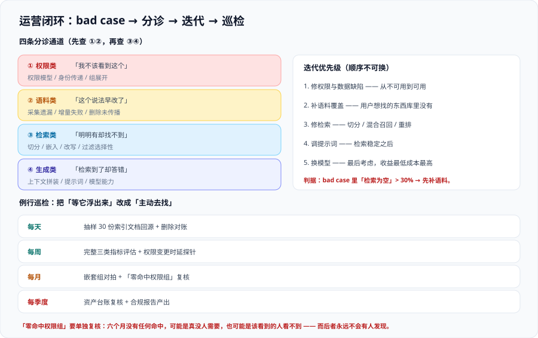

# 运营与迭代

前三页（[权限隔离](.././AccessControl/index.md)、[数据治理](.././DataGovernance/index.md)、[问答评估](.././Evaluation/index.md)）解决的是「**上线时是对的**」。这一页解决「**三个月后还是对的**」——也就是运营。

企业知识库与普通产品的运营有一个关键差别：**它的主要故障不会自己浮出来**。普通产品的运营靠仪表盘，知识库的运营靠「**有人愿意把 bad case 说出来**」和「**定期的主动巡检**」。



## 一、bad case 的四条分诊通道

一条 bad case 从用户嘴到修复，中间必须有一个分诊动作——**分错了，修的地方就错了**。

| 通道 | 现象 | 根因通常在 | 去哪一页 |
| --- | --- | --- | --- |
| **① 权限类** | 「我不该看到这个」/「我该看到却看不到」 | 权限模型、身份传递、组展开、同步时延 | [权限隔离](.././AccessControl/index.md) |
| **② 语料类** | 「这个说法早就改了」/「这份文件已经作废」 | 采集遗漏、增量失败、删除未传播 | [数据治理](.././DataGovernance/index.md) |
| **③ 检索类** | 「明明有这份文档，它就是找不到」 | 切分、嵌入、查询改写、过滤选择性、`top_k` | [接入与解析](.././Ingestion/index.md) + [RAG · 检索优化](../../RAG/Retrieval/index.md) |
| **④ 生成类** | 「检索到了却答错」/「答非所问」 | 上下文拼装、提示词、模型能力 | [RAG · 检索增强](../../RAG/index.md) |

::: warning 分诊最重要的一条规则：先查①②，再查③④
用户报「答错了」时，最常见的真实根因其实在①②：**他看到的是一份过期的文档**，或者**他本该看得到的文档因为权限配置错误没被检索到**。

如果直接跳到④去改提示词，你会把一个数据问题伪装成模型问题——**改完之后问题会以不同形式再次出现，而这次没人知道为什么**。
:::

### 分诊的最小信息集

要让分诊快速完成，反馈入口必须顺带采集四条信息（都可由前端自动附加，不需要用户填写）：

| 信息 | 用途 |
| --- | --- |
| **提问者的权限指纹** | 判断①②通道：他当时能看什么 |
| **本次命中的文档 ID 列表**（含可见性判定） | 判断是「没检索到」还是「被过滤了」 |
| **检索参数快照**（`top_k`、过滤条件、查询改写结果） | 判断③通道 |
| **模型与提示词版本** | 判断④通道 |

::: tip 这一条与 [数据治理](.././DataGovernance/index.md) 的留痕是同一份数据
不要为此单独做一套埋点。审计留痕要求的「检索结果 + 权限判定」正好覆盖了分诊需要的前两项。**一份数据两用**，这也是为什么那五类事件必须完整。
:::

## 二、迭代的优先级顺序

知识库的优化项看起来很多，但**它们的收益差距非常大，且顺序不可换**：

| 顺序 | 优化项 | 典型收益 | 什么时候做 |
| --- | --- | --- | --- |
| 1 | **修权限与数据缺陷** | 从「不可用」到「可用」 | 立即，任何情况下第一优先 |
| 2 | **补语料覆盖**（用户想找的东西库里没有） | 高 | 每周按 bad case 归类补充 |
| 3 | **修检索**（切分、混合召回、重排） | 中高 | 语料覆盖稳定后 |
| 4 | **调提示词** | 中 | 检索已稳定后 |
| 5 | **换模型** | 低（且成本高） | 最后考虑 |

::: danger 一个几乎所有团队都踩过的顺序错误
**先换模型、先调提示词，而不是先补语料。**

这类优化在演示里效果很明显（回答更流畅、格式更漂亮），于是被当作「系统变好了」的证据。但用户真正的问题往往是「**我要的那份文档根本不在库里**」——换任何模型都解决不了。

一个可操作的判据：**统计 bad case 里「检索为空」的比例**。若超过 30%，那么所有④类优化加起来能带来的改善都很有限。
:::

## 三、反馈的采集与使用

| 反馈形式 | 采集方式 | 优点 | 注意 |
| --- | --- | --- | --- |
| 显式评价（赞/踩） | 答案下方按钮 | 意图明确 | 点击率通常 < 2%，且偏向极端体验 |
| 显式纠错 | 「这个答案不对，正确的是……」 | 直接可做评测用例 | 需要有人处理，否则入口形同虚设 |
| 隐式信号 | 追问、复制、跳转到源文档、直接关闭 | 覆盖广 | 语义模糊，需与显式信号交叉验证 |
| 人工抽检 | 每周抽 30 条真实问答人工判 | 质量最高 | 成本高，但**不可省略** |

::: warning 「复制了答案」不等于「答案是对的」
隐式信号最常见的误读是把「复制」当作正反馈。在很多场景里，用户复制是为了**发给别人确认**——那恰恰说明他不确定。

正确的用法是**组合信号**：复制 **且** 没有追问 **且** 没有去点源文档 → 较可能是有用；只有复制 → 语义不明。
:::

## 四、成本模型与降本

知识库的成本分布在四块，它们的可控性完全不同：

| 成本项 | 构成 | 可控性 | 主要降本手段 |
| --- | --- | --- | --- |
| **索引与存储** | 向量存储、元数据、索引副本 | 中 | 量化压缩、下架无用内容、减少副本 |
| **嵌入计算** | 首次全量 + 每次增量 | 低（一次性为主） | 增量只嵌入变更部分；避免无意义的全量重建 |
| **在线检索** | 向量查询 + 重排调用 | 高 | 缓存、减少召回路数、限制 `top_k` |
| **生成** | 上下文 token 数 × 请求数 | 高 | 缩短上下文、按场景分级选择模型、缓存 |

::: danger 三个会「静默算错账」的地方
1. **把权限过滤的成本漏掉**：过滤会让引擎扫描更多候选（尤其后过滤与迭代扫描），这部分成本很容易被算成「检索的固定成本」而看不见。
2. **缓存命中率上升被当成好事**：如果缓存键里没有权限指纹，命中率高说明的是**越权复用的比例高**，不是性能好。
3. **重建索引的账只算了一次**：换嵌入模型要重建全库（见 [RAG · 组件版本](../../RAG/Version/index.md)），但重建往往需要资源翻倍（新旧两套并存期间）。预算里必须包含这次翻倍。
:::

## 五、变更管理：灰度与回滚

知识库有四类变更，**它们的灰度方式互不相同**：

| 变更 | 灰度方式 | 回滚方式 | 回滚代价 |
| --- | --- | --- | --- |
| 提示词 / 生成模型 | 按流量比例灰度 | 切回旧版本 | 低 |
| 检索参数（`top_k`、阈值） | 按用户分组灰度 | 切回旧参数 | 低 |
| **切分 / 嵌入变更** | **必须整库重建**，用别名切换 | 切回旧索引别名 | 中（需保留旧索引） |
| **权限规则变更** | ⚠️ **不允许灰度**——同一时刻只能有一套权限语义 | 切回旧规则 | 高，且**变更期间可能产生越权窗口** |

::: danger 权限规则变更为什么不能灰度
想象两套权限语义同时在跑：一部分用户的请求走了新规则（更松），另一部分走旧规则。

- 对**同一个用户**，他的可见范围在两次请求之间可能不同 → 行为不可解释；
- 更严重的是，如果两套规则对某份文档的判定相反，你**无法事后证明**某个用户当时到底看不看得到它。

因此权限规则的变更必须是**一次原子切换**，并且：

1. 切换前用 B 类用例在预发环境验证；
2. 切换时记录时间点（这是审计需要的）；
3. 切换后立刻跑一遍 `ACL-1 ~ ACL-4`；
4. **不接受「先切一半看看」**这个方案。
:::

## 六、例行巡检：把「等它浮出来」改成「主动去找」

因为故障不会自己报警，运营必须有一份固定动作清单：

| 周期 | 动作 | 判据 |
| --- | --- | --- |
| 每天 | 抽样校验 30 份索引文档回源 | 仍存在、权限一致 |
| 每天 | 删除对账（源清单 vs 索引清单） | 差值为 0 |
| 每周 | 跑一次完整三类指标评估 | 权限门禁通过 |
| 每周 | 权限变更时延探针 | 在 SLO 内 |
| 每月 | 嵌套组对拍（抽 20 组） | 成员一致 |
| 每月 | 「零命中权限组」复核 | 没有长期无任何提问的高敏感组——它可能意味着**该看到的人看不到** |
| 每季度 | 资产台账复核 | `owner` 有效、`retention` 未超期 |

::: tip 「长期零提问的高敏感组」这条最容易被忽略
一个只有 3 个人可见的权限组，如果**六个月来没有任何提问命中过它**，有两种可能：

1. 确实没人需要（正常）；
2. **该看到的人看不到**（漏权，且没有任何人会发现——因为没看到的人不知道自己没看到）。

第二种可能必须排除。低成本做法：请该组的一位成员提一个「答案明确在本组文档里」的问题，人工确认能答出。
:::

## 七、合规报告的例行产出

管理体系的审核通常按周期进行（其中 AI 影响评估是 ISO/IEC 42001 的明确要求）。知识库侧需要能随时拿出：

| 交付物 | 内容 | 频率 |
| --- | --- | --- |
| **资产台账快照** | 源、责任人、权限模型、保留期 | 季度 |
| **影响评估记录** | 影响谁、错了会怎样、拒答对谁不利 | 变更时 + 年度复核 |
| **权限正确性证据** | B 类用例的最近一次结果（含样本量与时间） | 每次发布 |
| **变更记录** | 模型 / 嵌入 / 切分 / 权限规则 / 评测集的每次变更与验证结论 | 变更时 |
| **数据保护记录** | 评测集与日志中的个人数据处理说明 | 年度 |

::: warning 报告里最容易缺的一条
**「影响评估记录」**。多数团队有台账、有测试报告，但没有一份文档回答「**这个系统答错了会影响谁**」。

而这一条恰恰是管理体系标准里被明确要求、且审核时一定会问的。它不需要很长——三五百字回答「影响对象、最坏后果、我们做了什么缓解、谁批准的」就够。
:::

## 验证方式

1. **分诊能力自查**：取最近 10 条 bad case，逐条判定它属于①②③④哪一类。

   ```shell
   # 统计最近 bad case 里「检索为空」的比例（判断是否该先补语料而不是调模型）
   jq -r '.[] | select(.hits | length == 0)' /tmp/badcases.json | wc -l
   ```

   预期输出：一个具体数字。**若占总数的 30% 以上，第 2 节表格里的顺序纪律就适用**——先补语料，别调模型。
2. **缓存不跨权限复用**：用两个不同权限的账号交替请求同一问题，比对返回内容是否不同（应不同，或第二个账号因权限指纹不同而 miss）。
3. **变更记录可查**：随机问一个「上个月检索参数改过吗」，确认能从变更记录里查到时间、改动人、改前改后与验证结论。

## 参考资料

- Atlan · RAG Evaluation Explained（持续评估与用户纠错信号的使用）：https://atlan.com/know/how-to-evaluate-rag-systems-explained/
- Google Cloud 官方文档 · Vertex AI Search 的查询与成本模型（命中成本与检索路数的关系）：https://cloud.google.com/generative-ai-app-builder/pricing
- Microsoft Learn · 生成式 AI 应用的运营与评估（上线后监控与迭代闭环）：https://learn.microsoft.com/azure/ai-foundry/concepts/evaluation-metrics-built-in
- ISO 官方标准页 · ISO/IEC 42001:2023（持续改进与文档化信息的例行要求）：https://www.iso.org/standard/81230.html
- 本站 [AI 应用观测与评估 · 成本与单位经济学](../../LLMObservability/Cost/index.md) · 成本归因方法：`docs/AI/LLMObservability/Cost/index.md`
- 本站 [故障应急体系](../../../Ops/IncidentResponse/index.md) · 越权类事件的定级与响应：`docs/Ops/IncidentResponse/`
