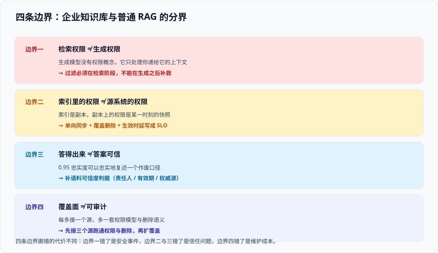

# 总览：企业知识库的四条边界

这一页回答四个「边界问题」：什么该答、什么不该答；权限该在哪一段施加；索引新鲜到什么程度才算「能信」；以及**什么情况下你根本不需要一个企业知识库**。四条边界画错了，后面所有的工程投入都在放大错误。

本页不含代码，是其余八页的**地图**。

## 一、从「能答」到「该答」：多出来的三件事

一个纯 RAG 系统上线后要补的三件事，按**会不会被审计问到**排序：

| 多出来的事 | 一句话定义 | 不做的后果 | 归哪一页 |
| --- | --- | --- | --- |
| **权限判定** | 检索结果必须**先**裁剪到提问者有权阅读的那一部分，再交给模型 | 越权召回。**不报错、不告警、面板全绿**，直到有人在会上引用了一句不该看的话 | [权限隔离](.././AccessControl/index.md) |
| **数据治理** | 文档有责任人、有效期、删除路径，删权即删索引 | 索引里长期躺着已下架、已离职、已作废的内容，模型忠实地复述过期口径 | [数据治理与审计](.././DataGovernance/index.md) |
| **权限正确性评估** | 评估集里必须有「**不该被答出来**」的题，并把它当红线 | 你只能证明「答得准」，不能证明「没越权」——而这恰恰是审计最关心的一条 | [问答评估](.././Evaluation/index.md) |

::: tip 一句话理解
通用 RAG 的验收是「**对不对**」，企业知识库的验收是「**对不对 + 该不该**」。这两句话的差别在于：前者错了用户会投诉，后者错了**没有人会发现**。
:::

## 二、三条「答对了但错了」

这三类是权限型系统里最值得警惕的失败形态。它们的共同点：**从任何一个单点看都正常**。

| 形态 | 现象 | 为什么没人发现 | 正确的判据 |
| --- | --- | --- | --- |
| **越权召回** | A 部门的人问 B 部门的制度，模型引用了 B 部门的原文 | 答案**看起来**很对，引用也真实存在；只有知道「这份文档不该被他看到」的人才能发现 | 用越权账号跑评测集，**期望值是 0 条**，不是「尽量少」 |
| **权限漂移** | 昨天有效今天失效的权限，今天仍然可检索 | 权限变更**在源系统正确，在索引里没同步**；界面上一切正常 | 权限变更的**生效时延**写成 SLO 并测量，见 [数据治理](.././DataGovernance/index.md) |
| **僵尸内容** | 源系统已删除的文档，模型还在引用 | 索引里还有 chunk，检索答案自洽、引用路径也「存在过」 | 定期跑 `reconciliationMode: FULL` 式对账，或自建删除核对，见 [接入与解析](.././Ingestion/index.md) |

::: danger 三个必须写进风险台账的反例
1. **「我们在提示词里写了不要泄露其他部门的内容」**——这不是权限控制。模型的服从性是概率性的，而**上下文里一旦出现那段文字，泄露就已经发生了**。正确做法是在**检索查询里**就把它排除掉。
2. **「我们做了权限过滤，在生成之后检查答案里有没有敏感词」**——太晚了。内容早已进入模型上下文，**改述、概括、引用编号**都能把信息带出来。正确做法是**过滤必须在生成之前**。
3. **「这份文档只有三个人的权限组能看到，量很小不用管」**——量小恰恰是最危险的，因为它**永远不会出现在抽样评估里**。正确做法是让评测集**必须包含**一个高敏感、低人数的权限组。
:::

## 三、四条边界



### 边界一：检索权限 ≠ 生成权限

生成模型没有权限概念，它只处理**你递给它的上下文**。因此「模型会不会泄露」这个问法本身就是错的——正确的问法是「**那段文字有没有机会进入上下文**」。这一条决定了权限必须在[检索阶段](.././AccessControl/index.md)施加，而不是在生成之后补救。

### 边界二：索引里的权限 ≠ 源系统的权限

索引是**副本**。副本上的权限是**某一时刻的快照**，源系统才是权威。因此必须回答：

- 同步方向是单向的吗？（只允许「源系统 → 索引」，不允许索引里改权限）
- 增量同步**能不能覆盖删除**？（只加不减是僵尸内容的直接来源）
- 从权限变更到索引生效，**最长多长时间**？（这就是越权窗口）

### 边界三：答得出来 ≠ 答案可信

模型可以对你索引里**过期的、错的、被撤回的**内容做到 0.95 的忠实度——它非常忠实地复述了一个作废口径。所以评估不能只有质量指标，必须有**语料可信度**这一维：内容归谁负责、什么时候必须复核、和权威源是否一致。这一维**无法用模型打分**，只能用元数据判据。

### 边界四：覆盖面 ≠ 可审计

把所有能接的源都接进来，通常会让系统**更难审计**——每多一个源，就多一套权限模型、多一种删除语义、多一条没人负责的内容线。

::: warning 覆盖面与可审计性的取舍
先接**三个源**、把权限与删除跑通，比接**十三个源**、每一个都只做了「能搜到」，在审计面前强得多。

判断一个源「能不能现在接」的三个问题：

1. 它的权限模型**能不能映射**成你能表达的形式？（嵌套组？继承？标签？）
2. 它的**删除事件你能不能收到**？（收不到就只能定期全量对账）
3. 它的**责任人**是谁？（答不上来，那就是一条无人维护的内容线）
:::

## 四、什么时候不需要企业知识库

这一节和 [RAG 概述](../../RAG/index.md) 的「不该用 RAG」不重复——那里讲的是**技术形态选错**，这里讲的是**治理成本不划算**。

| 场景 | 判断 | 建议 |
| --- | --- | --- |
| 全公司文档同一权限域，人人可读 | 没有权限边界 | 直接按 [RAG 实战](../../RAG/Practice/index.md) 做，**不必引入本专题的机制** |
| 只有一个部门用，且该部门内部无分级 | 边界只在部门外层，不在文档层 | 在**入口处**做一次鉴权（谁能进这个应用）即可，索引层不必带 ACL |
| 知识量小且稳定（几十份制度） | 维护成本 > 收益 | 做成带权限的**文档导航 + 全文检索**，不要上向量检索 |
| 需要严格数值口径（费率、额度） | 模型不可靠 | 走工具调用 / SQL，让知识库只负责「说明书」那部分 |
| **面向公众**提供服务 | 监管口径不同 | 除权限外还要处理**备案、标识、内容安全**，见本页第五节的执法/监管边界；这类场景建议单独评估 |

::: info 一个反直觉的判断
**「我们公司所有人都能看所有文档」这句话，通常不是事实，而是没人盘点过。** 建议在立项第一天就做一次权限盘点：随机抽 30 份文档，问「这份文档在源系统里，谁能打开」。如果抽到的 30 份里有 3 份答案不一致，那么「人人可读」这个前提本身就不成立——而它正是整个方案的地基。
:::

## 五、监管与管理体系的边界（只讲与知识库有关的部分）

这一节刻意写得短。完整合规体系归各企业的法务与安全团队，这里只划出**知识库产品必须自己交付的三样东西**：

| 交付物 | 内容 | 谁会用 |
| --- | --- | --- |
| **资产台账** | 每一个数据源、每一类文档：责任人、权限模型、更新频率、保留期限 | 审计、数据治理 |
| **影响评估记录** | ISO/IEC 42001 第 6.4 条要求的 AI 影响评估，落到知识库上主要回答：会影响谁、错了会怎样、拒绝了会对谁不利 | 管理体系审核 |
| **变更与留痕** | 模型、嵌入、切分、权限规则、评测集的**每一次变更**及其验证结论 | 审计、复盘 |

::: warning 三条只在本专题范围内成立的提醒
1. **评测集本身可能是个人数据**：如果评测题里出现了真实员工姓名、真实客户名，评测集就要按个人数据管理（访问控制、留存、销毁）。
2. **面向公众的服务与内部工具，监管口径不同**：《生成式人工智能服务管理暂行办法》体系下的**备案与内容标识**要求，通常落在「面向境内公众提供」的场景上；内部工具是否触发，请以法务口径为准，不要自行推定。
3. **「用了托管服务所以合规责任也托管了」是错的**：托管服务提供的是**机制**（如文档级访问控制 API），**是否用对、数据是否合规、权限是否映射正确**仍然是你自己的责任。
:::

## 六、最小起步三步

不要一上来就做全量接入。按「先能验证，再扩覆盖」推进：

1. **打通一个源 + 一次越权测试**（1~2 周）
   - 选**权限边界最清楚**的一个源（通常是内部 wiki），把权限元数据随 chunk 落进索引；
   - 准备**一个越权问句**：用 A 部门的账号，问一个只有 B 部门文档才答得出的问题。
   - **通过标准**：检索结果为空，或明确拒答；**引用里不能出现 B 部门的文档标题**。
2. **补删除与权限变更的传播**（1~2 周）
   - 从源系统删一份文档、把一个人的权限组改掉，然后测量**索引多久跟上**；
   - **通过标准**：能报出一个具体分钟数，而不是「应该是实时的」。
3. **建含权限题的评测集并接门禁**（2~3 周）
   - 三类题：**该答的** / **不该答的** / **知识库里没有的**；
   - **通过标准**：`不该答` 一类在门禁里是**零容忍**，红了就阻断发布。

三步做完再谈覆盖面。反过来（先接十个源再补权限）几乎一定会在某一个源上翻车，且翻车时**你没有任何测试能提前告警**。

## 验证方式

本页是纯文档页，验证方式写成「读者可执行的自查」：

1. 用一句话回答：「如果一个普通员工问了一句只有高管能看的文档才答得出的问题，我的系统会发生什么？」——**答不出具体行为（报错 / 空结果 / 拒答 / 真的答出来）就说明边界没定清**。
2. 打开你现有的索引，确认每个 chunk 上**是否带有权限字段**。执行下面的命令自查（把路径换成你自己的配置目录）：

   ```shell
   # 在索引 schema 或 chunk 元数据定义里找权限相关字段
   grep -rn "acl\|permission\|group\|tenant\|visibility" ./index-schema* ./chunk-meta* 2>/dev/null
   ```

   预期输出：能看到至少一个明确用于权限过滤的字段及它的类型。**没有输出 = 权限还没进索引**。
3. 回答「从源系统删一份文档，到它从检索结果里消失，最长多久？」——给不出分钟数，就说明 [数据治理](.././DataGovernance/index.md) 那一页还没有落地。

## 与数据治理专题的分工

企业知识库与数据治理看起来是两件事，实际上**共用同一套方法**：都要求「资产有归属、口径有唯一来源、权限可对账、删除要传播」。

| 问题 | 看哪边 |
| --- | --- |
| 这批文档入库了没有、检索召回了没有、答案忠实不忠实 | 本专题 |
| **这批语料是从哪来的、有没有授权凭证、谁负责它** | [元数据与资产目录](../../../DB/DataGovernance/Metadata/index.md)：「非结构化数据算不算资产」这一问的答案 |
| 某个人不该看到它，却召回了 | 本专题的权限布尔指标 |
| 公司**有哪些**数据资产、它们的责任人是谁、敏感级别怎么定 | [数据治理入门](../../../DB/DataGovernance/index.md)：账本先于一切 |

一句话记法：**知识库专题回答「这套库好不好用」，治理专题回答「公司有哪些数据、谁说了算」**——语料是数据资产的一种，因此「来源与授权登记」这条纪律在两边是**同一条**。

## 参考资料

- Azure AI Search 官方文档 · Document-level access control（四种做法与生效时延）：https://learn.microsoft.com/azure/search/search-document-level-access-overview
- Microsoft Learn · Security trimming（生成前裁剪与生成后过滤的差别）：https://learn.microsoft.com/azure/search/search-security-trimming-designer
- ISO 官方标准页 · ISO/IEC 42001:2023（AI 管理体系现行版）：https://www.iso.org/standard/81230.html
- NIST · AI Risk Management Framework：https://www.nist.gov/itl/ai-risk-management-framework
- 本站 [RAG 检索增强](../../RAG/index.md) · 检索链路基础与「不该用 RAG」的三类反例：`docs/AI/RAG/index.md`
- 本站 [向量数据库深入](../../../DB/VectorDatabase/index.md) · 过滤流派与选择性悬崖的引擎侧解释：`docs/DB/VectorDatabase/Filtering/index.md`
