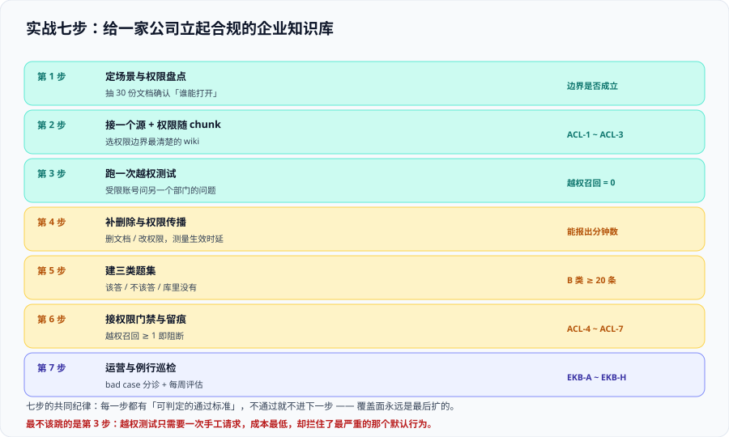

# 实战：给一家公司立起企业知识库

这一页把前七页的机制串成一条可执行的路。设定场景 → 七步落地 → 每步的通过标准 → 八条总判据 → 可执行验证命令。

**本页只讲文档侧的做法**：所有脚本都以「读者在自己的工程里创建后再运行」的形式给出，本仓不提交任何可执行副本（见仓库根目录 `AGENTS.md` 第 9 节）。

## 一、设定场景

| 项 | 取值 |
| --- | --- |
| 公司规模 | 3000 人，12 个部门 |
| 数据源 | ① 内部 wiki（约 1.2 万页）② 公司网盘（约 8 万份文档，含扫描件）③ 工单系统（约 30 万条）④ 代码库 README 与设计文档 |
| 权限形态 | wiki：空间级 + 页面级；网盘：目录继承 + 个别文件独立；工单：项目级 + 参与人；代码库：仓库级 |
| 已具备 | 统一身份（SSO + 组目录）、一台可用的向量库、一个生成模型 API |
| 明确不做 | 不接入 IM 聊天记录（权限与删除语义最复杂，留到第二阶段） |
| 硬约束 | 越权召回必须为 0；删除传播 ≤ 24 小时；高敏感源 ≤ 5 分钟 |
| 人月预算 | 2 人 × 6 周 |

::: warning 场景里最关键的两个数字
1. **8 万份文档里有扫描件**——解析阶段一定要有「解析失败会被发现」的判据，否则会有一批文档静默地什么都没进来（见 [接入与解析](.././Ingestion/index.md) 第六节）。
2. **网盘用目录继承权限**——这正是官方文档里明确「继承型权限变更需要显式刷新」的那一类（见 [数据治理与审计](.././DataGovernance/index.md) 第四节）。**这一条必须在第三天之前解决，不能等到验收前**。
:::

## 二、七步落地



### 第 1 步：定场景与权限盘点

**做什么**：随机抽 30 份文档（覆盖四个源），逐份回答「在源系统里，谁能打开它」。

**为什么先做这一步**：它验证「我们公司的人都能看所有文档」这个假设。**这个假设不成立的话，技术方案完全不同。**

**通过标准**：30 份里答案不一致的不超过 3 份（即边界基本成立）。若超过 3 份，先做一次权限治理，不要开工。

```shell
# 抽样脚本的骨架：从四个源各抽 8 份（读者在自己的工程里实现后运行）
python3 sample_acl_audit.py --sources wiki,drive,ticket,repo --per-source 8 \
  --out /tmp/acl_audit.csv
wc -l /tmp/acl_audit.csv
```

预期输出：约 33 行（含表头）。**每一行的「谁能打开」列必须由人工填写并签字**——这一列是后续所有判据的基准。

### 第 2 步：接一个源，权限随 chunk 落盘

**做什么**：只接 wiki 一个源，把空间级与页面级权限抽成 `readers`（组 ID 数组），随 chunk 写入索引。

**通过标准**（三条同时成立）：

1. 索引里每个 chunk 都有 `readers` / `source_id` / `doc_version`；
2. `readers` 存的是组 ID，不是组名；
3. 抽 20 个嵌套组，成员与源系统一致。

```shell
# 权限元数据完整性：随机取样 100 条 chunk
python3 check_chunk_meta.py --sample 100 --index kb_wiki \
  --require readers,source_id,doc_version
```

预期输出：`missing=0, empty_readers=0`（仅公开内容允许 `empty_readers`，且必须显式标记为公开）。

### 第 3 步：跑一次越权测试（本页最重要的一步）

**做什么**：用 A 部门账号问一个**只有 B 部门 wiki 页面才答得出**的问题。

**通过标准**：

| 检查 | 期望 |
| --- | --- |
| 检索结果里的无权文档数 | **0** |
| 答案引用列表里的无权文档数 | **0** |
| 答案正文里是否出现 B 部门页面中的专有表述 | 否 |
| 用 B 部门账号跑同一问题 | ≥ 1 条命中（**用例有效性**） |

```shell
# 越权用例：双身份各跑一次（脚本需实现「越权账号 + 有权账号」双跑）
python3 acl_probe.py \
  --question "并购项目 M 的对价结构是什么" \
  --restricted-token "$USER_A_TOKEN" \
  --allowed-token "$USER_B_TOKEN" \
  --forbidden-doc-ids forbidden.txt \
  --json /tmp/acl_probe.json
jq '{leaked, forbidden_in_citations, allowed_hits}' /tmp/acl_probe.json
```

预期输出：`leaked: 0`、`forbidden_in_citations: 0`、`allowed_hits >= 1`。

::: danger 这一步的三个常见「假通过」
1. **只跑了一次**：权限过滤是否生效与问题无关，但**缓存**有关。第二次跑同一问题可能命中缓存而绕过检索 → **每次都要用新问题或清缓存**。
2. **用的是管理员账号**：管理员本来什么都看得到。**越权账号必须是真实的受限账号**。
3. **只看了答案、没看引用**：引用列表泄露的是「存在性」，同样是泄露（见 [权限隔离](.././AccessControl/index.md) 第二节）。
:::

### 第 4 步：补删除与权限传播

**做什么**：三件事各自实测一次，并记录耗时。

| 动作 | 测量 | 目标 |
| --- | --- | --- |
| 源系统删一份文档 | 到检索不到为止 | ≤ 24 小时（高敏感源 ≤ 5 分钟） |
| 把一个用户移出一个组 | 到他的可见范围变化为止 | 同上 |
| 改一个**父级**目录的权限 | 到生效为止 | 同上——**这一条最容易做不到**，因为继承型变更通常不自动增量 |

```shell
# 删除传播探针：删完文档后轮询（详见 数据治理与审计 一页的验证节）
python3 probe_delete.py --doc-probe-keyword "PROBE-DOC-KEYWORD" --interval 60 --timeout 3600
```

预期输出：一个具体分钟数。**如果父级权限变更的耗时显著大于另外两项，说明继承型刷新没有配**。

### 第 5 步：建三类题集

**做什么**：按 [问答评估](.././Evaluation/index.md) 第三节构造 A / B / C 三类题，并额外加 D 类（低人数敏感性）。

| 题类 | 条数 | 来源 |
| --- | --- | --- |
| A 该答的 | 80 | 真实历史问题 + 人工确认答案在库内 |
| B 不该答的 | 25 | 跨部门敏感主题，**答案只存在于无权文档中** |
| C 库里没有的 | 25 | 编造的业务名词 + 通用常识 |
| D 低人数敏感 | 6 | 可见人数 1~3 人的权限域 |

**通过标准**：B 类用例的 `invalid`（有权账号也答不出）必须为 0——否则是用例本身无效，不是权限生效。

### 第 6 步：接权限门禁与留痕

**做什么**：

1. 把 B / D 类做成**前置门禁**：越权召回 ≥ 1 条即阻断发布，不看质量分数；
2. 留痕落盘五类事件（见 [数据治理与审计](.././DataGovernance/index.md) 第五节），其中**命中文档列表与可见性判定必须与请求在同一条记录里**；
3. 缓存键加入权限指纹，并让文档下架触发缓存失效。

**通过标准**：`ACL-1 ~ ACL-7` 全部通过（见下文判据表）。

### 第 7 步：运营与例行巡检

**做什么**：按 [运营与迭代](.././Operations/index.md) 第六节的清单把巡检排进日历。

**通过标准**：连续两周的巡检记录齐全，且「零命中权限组」复核已完成。

::: tip 七步的时间分配建议
第 1 步 2 天、第 2 步 5 天、**第 3 步 1 天**、第 4 步 5 天、第 5 步 4 天、第 6 步 5 天、第 7 步 2 天（起步），其余时间用于扩大源覆盖。

注意第 3 步只占 1 天，却是**唯一能在早期拦住最严重缺陷**的一步。把第 1~3 步压在一周内做完，是这套方案里回报最高的安排。
:::

## 三、八条总判据

`EKB-A ~ EKB-H` 是本文档的**验收判据**，每条都要给出可执行命令与期望输出。

| 判据 | 内容 | 可执行性 | 期望 |
| --- | --- | --- | --- |
| **`EKB-A`** | 权限盘点完成，30 份抽样中边界不一致 ≤ 3 份 | 人工 + 抽样脚本 | 成立 |
| **`EKB-B`** | 索引中每个 chunk 都有权限元数据三字段，且存组 ID | 脚本（纯静态） | `missing=0` |
| **`EKB-C`** | 越权召回 = 0（含检索结果与引用列表） | 脚本（需服务在监听） | `leaked=0` |
| **`EKB-D`** | 越权用例有效性 = 100%（有权账号必须能答出） | 脚本 | `invalid=0` |
| **`EKB-E`** | 删除传播与权限变更传播均在 SLO 内，且有分钟数记录 | 探针（需真实环境） | 三个数都达标 |
| **`EKB-F`** | 未携带用户身份的检索请求被拒绝 | 一次手工请求 | `4xx` |
| **`EKB-G`** | 审计留痕含命中文档与可见性判定；缓存键含权限指纹 | 代码审查 + 一次双账号验证 | 成立 |
| **`EKB-H`** | 三类指标可复跑，且每次报告都带样本量 | 评估脚本 | 成立 |

::: warning 其中四条（`C` / `D` / `E` / `F`）需要真实环境
本仓没有工程代码、也没有可用的检索服务，因此这四条在本页**登记为「需读者在自己环境执行」**，不写成「已通过」。

这与 [完整项目交付](../../../Others/ProjectDelivery/index.md) 的口径一致：**验收清单的价值在于它可执行，而不在于它看起来完成了**。
:::

## 四、可执行验证命令（本机可跑的部分）

下面四条不需要任何检索服务，读者可以在自己的工程目录里直接跑：

```shell
# 1) 确认索引侧 schema 里存在可过滤的权限字段
grep -rn "readers\|acl\|permission\|visibility" ./index-schema* ./chunk-meta* 2>/dev/null | head
# 期望：至少一条命中，且字段类型是「可过滤」的（如 collection of string / keyword）

# 2) 统计评测集三类题的数量（enforce 门槛）
for k in A B C D; do printf "%s: %s\n" "$k" "$(grep -c "^${k}" cases.jsonl)"; done
# 期望：A >= 80，B >= 20，C >= 20，D >= 5

# 3) 台账完整性：owner 列不得为空
awk -F'|' 'NF>3 {total++; if ($4 ~ /^ *$/) empty++} END {print "行数:", total, "缺 owner:", empty+0}' kb-assets.md
# 期望：缺 owner: 0

# 4) 确认没有把「服务身份」写进检索调用的默认参数
grep -rn "--token\|api_key\|API_KEY" --include=*.py --include=*.ts . | grep -c "user_token\|USER_TOKEN"
# 期望：每条检索调用都能对上一条「用户令牌」的来源，而不是应用密钥
```

::: tip 第 4 条命令的读法
它不是「数够几个就算通过」。它的用法是：**逐条看命中的位置**，确认每一处检索调用的凭据是**从用户请求里拿到的**，而不是从配置里读的应用密钥。

这正是 [参考架构](.././Architecture/index.md) 第三节「两条入口」要防的那件事——**配置里的应用密钥是最方便、也是最危险的那一种凭据**。
:::

## 五、五类常见失败模式

| 失败 | 现象 | 根因 | 处置 |
| --- | --- | --- | --- |
| **演示通过、上线越权** | 演示时用管理员账号，上线后普通员工能问到敏感内容 | 越权用例用了管理员 | 用例必须固定使用受限账号 |
| **某一路召回裸奔** | 大部分问题正常，个别问题回答里出现无权内容 | 关键词腿未注入过滤条件 | 过滤条件在召回前统一装配 |
| **权限变更长期不生效** | 「我已经把他移出组了，他怎么还能问」 | 继承型权限变更未显式刷新 | 增加父级权限的定时刷新 |
| **删除后仍可检索** | 已下架文档被继续引用 | 只 upsert 不删除；或删除事件丢失 | 增量「先删后写」+ 每日对账 |
| **缓存越权复用** | 两个不同权限的人拿到同一答案 | 缓存键只有问题文本 | 缓存键加入权限指纹 |

## 六、下一步（第二阶段）

七步跑通后，扩大范围时按下面的顺序推进，**每一步都要重跑 `EKB-C` 与 `EKB-D`**：

1. 接入网盘（继承型权限，重点验证第 4 步）；
2. 接入工单系统（项目级权限，注意已关闭项目的可见性口径）；
3. 引入 Agent 形态（**必须先解决身份透传**，见 [参考架构](.././Architecture/index.md) 第三节）；
4. 接入 IM（最后做，先解决「撤回」的删除语义）；
5. 补语料可信度判据，接进周度巡检。

## 验证方式

1. **跑一遍本页第四节四条命令**，逐条对照期望输出。
2. **确认 `EKB-C` / `EKB-D` 的当前状态**：如果你的环境里已经有可用的检索服务，现在就执行第三节的命令；如果没有，在验收文档里如实标注「待环境，未执行」——**不要写成通过**。
3. **做一次「关掉权限过滤」的推演**：临时移除过滤条件重跑 A 类题集，记录质量指标的上升幅度。这个数字应写进验收文档的风险章节，用于说明「为什么权限是前置门禁」。

## 参考资料

- Azure AI Search 官方文档 · Document-level access control（权限元数据、令牌传递与生效时延）：https://learn.microsoft.com/azure/search/search-document-level-access-overview
- Microsoft Learn · Security trimming（过滤式裁剪的完整实现模式）：https://learn.microsoft.com/azure/search/search-security-trimming-designer
- Google Cloud 官方文档 · Vertex AI Search 访问控制（自导入数据的 `acl_info`）：https://cloud.google.com/generative-ai-app-builder/docs/access-control
- Google Cloud 官方文档 · Discovery Engine 批量导入 `reconciliationMode`：https://cloud.google.com/generative-ai-app-builder/docs/reference/rest/v1/projects.locations.dataStores.branches.documents/import
- Atlan · RAG Evaluation Explained（评测集与第五维语料可信度）：https://atlan.com/know/how-to-evaluate-rag-systems-explained/
- 本站 [完整项目交付](../../../Others/ProjectDelivery/index.md) · 上线验收的标准动作清单：`docs/Others/ProjectDelivery/index.md`
