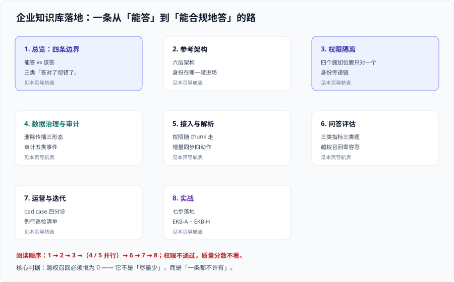

# 企业知识库落地

企业知识库落地回答的是**一个 RAG 回答不了的问题**：系统明明能答，**凭什么允许它答这一句**。

[RAG 检索增强](../RAG/index.md) 解决的是「模型不知道你的业务」——把知识从参数里拿出来、放进可更新的索引，先检索再生成。那一层做完，你会得到一个**能答对的系统**。但只要它面向的是公司内部的文档，第二个问题立刻出现：这些文档**本来是有权限的**。财务的薪酬制度、法务的并购底稿、HR 的绩效记录，它们在源系统里谁都点不开——**却在同一个向量索引里排排坐，谁问都能被检索出来**。

::: tip 一句话理解
企业知识库的成败判据不是「答得准不准」，而是**「它有没有答出过一句它本来不该看到的话」**。前者掉分是体验问题，后者掉分是安全事件——而且**它不会报错、不会告警、不会出现在任何监控面板上**，直到某一天有人问了一句不该问的、拿到了一段不该看的。
:::

因此本专题的主线只有一条：**把 RAG 从「能答」变成「能在企业里合规地答」**。它不讲分块算法怎么选、HNSW 怎么调参、提示词怎么写——那些分别归 [文档解析与切分](../RAG/Chunking/index.md)、[向量库与索引](../RAG/VectorStore/index.md) 与 [向量数据库深入](../../DB/VectorDatabase/index.md)。它讲的是**围在检索链路外面的那一圈东西**：权限从哪来、在链路的哪一段被施加、权限变更多久生效、删掉的文档怎么从索引里消失、谁能证明这一切真的发生过。

## 与相邻专题的分工

「企业知识库」「RAG」「权限过滤」「知识管理」四个词经常混着用，边界必须先写死：

| 专题 | 讲什么 | 与本专题的关系 |
| --- | --- | --- |
| 本专题 | **企业视角的落地与合规**：权限隔离、数据治理、问答评估、运营闭环、审计留痕 | —— |
| [RAG 检索增强](../RAG/index.md) | RAG 的**基本链路**：嵌入、切分、检索、生成、评估、生产工程化的入门版 | 那边回答「**怎么让它答出来**」，本专题回答「**答出来之前，先证明这个人有资格听**」；本专题默认读者已经读完那边的概述页 |
| [RAG · 生产工程化](../RAG/Pipeline/index.md) | 增量索引、多租户过滤、缓存、可观测的**清单式速览** | 那边是**一页清单**（127 行），本专题把其中「权限与多租户」那一节展开到**可实施颗粒度**：四种权限模型、三个施加位置、身份传递链、缓存键污染、删除传播 |
| [RAG · 评估体系](../RAG/Evaluation/index.md) | 三层指标、评测集构建、回归流程 | 那边评的是**答得好不好**；本专题多出**第三类指标——权限正确性**（越权召回率），并把它定成**零容忍硬红线**，与质量指标的「分层阈值」完全不同 |
| [RAG · 实战：企业知识库问答](../RAG/Practice/index.md) | 一条链路跑通的**上手版**（152 行） | 那边的场景边界是「售后政策问答」这类**单一权限域**；一旦文档有权限差异，就该照本专题做 |
| [向量库与索引](../RAG/VectorStore/index.md) / [向量数据库深入](../../DB/VectorDatabase/index.md) | 引擎选型与**引擎内部机制**（HNSW、量化、过滤流派） | 那边讲**过滤怎么被引擎执行**（预过滤 / 后过滤 / 迭代扫描），本专题讲**过滤条件从哪来、由谁保证它一定被带上**——两者是「机制」与「治理」 |
| [AI 应用观测与评估](../LLMObservability/index.md) | Trace、在线 / 离线评估、成本、质量告警 | 那边盯**模型输出语义**；本专题的权限判据要独立成一条告警线——**它的数据源不是模型分数，是检索结果的权限比对** |
| [多模态应用](../Multimodal/index.md) | 文档版面解析、OCR、多模态嵌入 | 那边解决**版式文档读不读得懂**；本专题关心**读完之后，那一页的权限元数据有没有跟着走** |
| [数据仓库建模](../../DB/DataWarehouse/index.md) | 分层建模、缓慢变化维、**数据质量与血缘** | 那边是**企业数据资产的元数据与血缘**，本专题只关心**知识库语料这一小撮文档**的责任人、有效期与销毁 |
| [安全加固 · 审计与检测](../../Ops/SecurityHardening/AuditDetection/index.md) | 审计日志的采集、留存与检测 | 本专题的 [数据治理与审计](./DataGovernance/index.md) 产出的是**要写进审计日志的五类事件**，日志平台怎么建归那边 |
| [完整项目交付](../../Others/ProjectDelivery/index.md) | 上线验收的标准动作清单 | 本专题的 [实战](./Practice/index.md) 是它在「有权限边界」时的特例：验收清单多一条「**用 A 部门的账号问 B 部门的文档，必须问不出来**」 |

## 专题地图

| 页面 | 内容 | 适合谁读 |
| --- | --- | --- |
| [总览：企业知识库的四条边界](./Overview/index.md) | 能答与该答的分界、三类「答对了但错了」、什么时候别上 | 所有人，先读 |
| [参考架构与端到端链路](./Architecture/index.md) | 六层架构、一跳的十段链路、身份在哪一段进场、三种部署形态 | 架构与选型负责人 |
| [权限隔离](./AccessControl/index.md) | 四种权限模型、三个施加位置、**身份传递链**、缓存污染、组爆炸 | 后端与安全，**重点读** |
| [数据治理与审计](./DataGovernance/index.md) | 资产台账、生命周期六阶段、删除传播、新鲜度 SLO、审计五要素 | 数据治理与合规 |
| [接入与解析](./Ingestion/index.md) | 企业语料五种形状、增量与幂等、权限元数据随 chunk 走 | 索引链路开发 |
| [问答评估](./Evaluation/index.md) | 三类指标、三类题集、**权限正确性的测法**、阈值与样本量 | 质量与测试 |
| [运营与迭代](./Operations/index.md) | bad case 四条分诊通道、迭代排序、成本、灰度与回滚 | 产品与运营 |
| [实战：给一家公司立起企业知识库](./Practice/index.md) | 七步落地与 `EKB-A ~ EKB-H` 判据，含可执行命令 | 想看完整过程的人 |
| [常见问题与最佳实践](./FAQ/index.md) | 分诊表、高频十二问、上线自查清单、术语表 | 所有人 |

## 事实与规格速览（2026-10 口径）

下表来自**各厂商官方文档与标准组织官网**（2026-10 联网核对）。这一节的用处是：让你在选型会上**知道哪些能力是 GA、哪些还在预览**，以及**哪些默认值会让权限静默失效**。

| 项 | 当前事实（2026-10） | 对判断的影响 |
| --- | --- | --- |
| 文档级权限的四种做法 | Azure AI Search 明确给出四条路：**安全过滤（字符串比较，GA）**、POSIX 式 ACL / RBAC 范围（预览）、Purview 敏感度标签（预览）、SharePoint ACL（预览） | 「文档级权限」不是一件事，是**四件成熟度不同的事**；只有第一条今天就能上生产 |
| 查询时权限施加点 | Azure AI Search 在请求头 `x-ms-query-source-authorization` 携带调用方令牌，服务**先校验客户端有 Search Index Data Reader，再按索引里的权限元数据裁剪结果** | 权限判定发生在**服务端**，不在你的应用里——所以**应用漏传令牌时不会有任何报错**，只会全量返回 |
| 权限变更的生效时延 | 官方明示：**源系统的权限变更只有在同步到索引之后才会反映在搜索结果里**；SharePoint 中**唯一权限**的变更随每次索引器成功运行增量抓取，而**从父级（站点 / 库 / 列表 / 文件夹）继承的权限变化需要显式刷新** | 「越权窗口」是一个**可测量**的量；把它写成 SLO 比写成「尽快」有用。继承型权限的刷新往往没人配 |
| 最隐蔽的一条越权路径 | 同一条索引有两条入口：**直连搜索带终端用户令牌 → 过滤生效**；**Agent 工具包装用服务身份调用 → 过滤条件无从施加 → 索引内全部文档可达** | 「检索层做了权限」这句话必须追问**是谁的身份在检索**，否则等于没做 |
| SharePoint 侧的两个产品变更 | **Restricted SharePoint Search 自 2026-07-31 起禁止新启用**（且它从来不是安全边界）；接替者 **Restricted Content Discovery 只做「隐藏」，不改变权限** | 想靠「把站点排除在搜索之外」当权限手段的方案，在合规审查里不成立 |
| 托管知识库的现状 | AWS Kendra **自 2026-07-30 起对新增客户关闭**；Bedrock Knowledge Bases 提供六个一方连接器（S3 / SharePoint / Confluence / Google Drive / OneDrive / 爬虫），托管形态在**检索前**做 ACL 过滤并叠加一次**实时访问检查** | 选型时先确认「连接器覆盖哪些源系统」，而不是先比召回率——**连接器覆盖不到的源，权限也无从继承** |
| Vertex AI Search 的自导入权限 | 自己导入的数据在 JSONL 的 `acl_info.readers[].principals[].userId` 里带读者列表，并把 data store 标记为**受访问控制** | 权限**由导入方声明**，声明错了没人能救——这是「责任转移」而不是「责任消失」 |
| 对账删除 | Vertex AI Discovery Engine 的批量导入支持 `reconciliationMode: FULL`——**不在本次导入文件里的文档会被删除** | 这是治「僵尸文档」（源系统已删、索引里还在）的标准手段；不开启就得自己写删除对账 |
| 评估指标基线 | 2026 年主流仍是 **RAGAS 四指标**（faithfulness / answer relevance / context precision / context recall）加经典 IR 指标（Precision@K、Recall@K、MRR、NDCG、Hit-rate@k）；企业知识库的经验起点约为**上下文精确率 0.8+、忠实度 0.9+** | 「忠实度 0.95」**不能推出**「答案业务上正确」——若索引本身过期，模型会非常忠实地复述过期内容 |
| 评估的第五个维度 | 业界（如 Atlan 2026 年口径）明确提出补一维 **context trustworthiness（语料可信度）**：内容是否最新、有没有责任人、是否与权威源一致 | 这一维**不能用模型评分**，只能用元数据判据——恰好是本专题 [数据治理](./DataGovernance/index.md) 要产出的东西 |
| 样本量的下限 | 行业口径：先用约 100 条代表性查询做基线，成熟后 500~2000 条；**20 条上的 92% 与 2000 条上的 92% 完全不是一回事** | 汇报时不给样本量的百分比，等于没有结论 |
| 管理体系标准 | **ISO/IEC 42001:2023** 是现行 AI 管理体系标准（首版 2023-12）；其 6.4 条要求 **AI 影响评估**，附录 A 控制项覆盖**数据管理、第三方与供应链、文档与透明** | 知识库的「资产台账 + 影响评估 + 变更记录」不是自选动作，是**可被审计的交付物** |
| 中国大陆的监管口径 | 《人工智能法》草案已进入立法程序；**生成式人工智能服务管理暂行办法、算法推荐管理规定、深度合成内容标识**等配套规则持续完善，**算法备案 / AI 安全评估**已常态化 | 面向公众提供服务、或涉及深度合成内容的场景，**备案与标识**要在立项时就进排期，不能等上线前补 |
| 数据出境与个人数据 | 若索引内含个人数据，**整条流水线**（解析、嵌入、缓存、日志、评测集）都受数据保护规则约束 | 评测集里出现真实员工姓名，评测集本身就成了个人数据——**这一条最常被忽略** |

::: info 版本组织说明
本专题**不另开版本目录**。理由与 [代码质量平台](../../Tools/CodeQuality/index.md) 一致：这一层的能力边界由**托管服务的 API 版本**决定（例如 Azure AI Search 的文档级访问控制有 `2026-08-01-preview` 这样带日期的 REST API 版本），而**旧 API 版本不构成一条需要长期并存维护的内容线**——升级是配置与调用方式的变更，不是两套并行的知识体系。

因此正文一律面向**当前可用能力**，并逐处用 `::: info` 标注「GA / 预览」与适用版本。需要按「官方名 + 大版本号」建目录的是**框架与语言**类主题，仓库里的范例可直接对照 [Spring5](../../Backend/Java/Frame/Spring/Spring5/index.md) / [Spring6](../../Backend/Java/Frame/Spring/Spring6/index.md) 与 Spring Boot [v2](../../Backend/Java/Frame/SpringBoot/v2/index.md) / [v3](../../Backend/Java/Frame/SpringBoot/v3/index.md)——**旧版本一律保留、标注维护状态、不覆盖**。
:::

## 成熟度五档

企业知识库最容易「上一半」：答得很准，权限靠自觉。按下面五档对照自己：

| 档位 | 特征 | 只补一件事 |
| --- | --- | --- |
| L0 | 全公司文档进一个索引，谁问都能检索；权限靠「提示词里写上别泄露」 | **先承认它是错的**：把「提示词约束权限」写进风险台账，并给出停用条件 |
| L1 | 索引里带了 `tenant` / `acl_group` 字段，查询时也带了过滤条件 | 把过滤条件**从应用代码挪进服务端不可绕过的位置**（见 [权限隔离](./AccessControl/index.md) 的身份传递链） |
| L2 | 权限过滤生效，且有「越权召回率」的测试用例 | **补删除传播**：源系统删掉的文档，多久从索引消失？答不出来就是没做 |
| L3 | 删除与权限变更都有 SLO，且有审计留痕；评测集含权限题 | 补**语料可信度**判据（责任人 / 有效期 / 权威源一致性），并把它接进门禁 |
| L4 | 权限正确性、质量、成本三条线各有门禁与值班归属；变更走灰度与回滚 | 做一次「**故意把权限过滤关掉**」的推演，确认多久会被发现、被谁发现——发现不了说明门禁是装饰 |

## 学习路径

1. **先读 [总览](./Overview/index.md)**：它给出四条边界与三类「答对了但错了」。跳过它最容易犯的错是把**权限问题当成体验问题**来排期。
2. **动手前读 [参考架构与端到端链路](./Architecture/index.md)**：重点看**身份在哪一段进场**——这一张图决定了后面所有设计。
3. **所有人重点读 [权限隔离](./AccessControl/index.md)**：尤其是「预过滤与后过滤」和「身份传递链」两节，它们是越权召回的**两个主要来源**。
4. **治理与合规同学读 [数据治理与审计](./DataGovernance/index.md)**：删除传播与审计五要素是**审计时唯一能拿出来的东西**。
5. **索引链路开发读 [接入与解析](./Ingestion/index.md)**：权限元数据必须**随 chunk 走**，这一条在切分之后很难补救。
6. **质量同学读 [问答评估](./Evaluation/index.md)**：三类题集与权限正确性的测法，是「说得出有没有变好」的前提。
7. **要完整走一遍，跟 [实战](./Practice/index.md) 的 `EKB-A ~ EKB-H` 判据**，再用 [常见问题](./FAQ/index.md) 的自查清单收尾。

## 与「AI 安全与合规」专题的分工（第 146 天补充）

本专题的 [DataGovernance](./DataGovernance/index.md) 与 [AI 安全与合规](../AISecurityCompliance/index.md) 都写「数据治理」四个字，对象却是**两批不同的数据**：本专题管的是**知识库语料**（哪些文档、谁能看、什么时候删），那边管的是**进出模型的那条管道**（哪些字段、能不能带出去、带出去之后查不查得到）。

| 边界问题 | 归本专题 | 归 [AI 安全与合规](../AISecurityCompliance/index.md) |
| --- | --- | --- |
| 权限 | 在**检索查询**上施加过滤，越权召回恒为 0 | ——（权限不在那边：那是「谁能听」，那边管的是「这段内容该不该在系统里、能不能被带出去」） |
| 敏感数据 | 文档级的分类分级、责任人、有效期与销毁 | [数据最小化](../AISecurityCompliance/DataMinimization/index.md)：字段级白名单、三档识别、五种降级档位、出域复查 |
| 审计 | 五类事件「**要写进**审计日志」 | [审计链](../AISecurityCompliance/Audit/index.md)：记录的八字段、哈希链、留存期三来源取最大 |
| 删除 | 删除传播（索引、缓存、副本都要跟上） | ——（删除的**法定期限**由那边的合规清单给，怎么传到每一层归本专题） |
| 输出内容 | 问答质量与权限正确性 | [内容安全](../AISecurityCompliance/ContentSafety/index.md)：双向审核、两条阈值线与第三态 |
| 合规交付 | 权限与责任落地 | [合规清单](../AISecurityCompliance/Compliance/index.md)：三道筛、法规地图、六格证据包 |

**一句话分工**：本专题回答「**这个人有没有资格听**」；那边回答「**这条内容本身该不该存在、能不能被带走**」。

::: warning 一处真实的冲突：审计要求「留全」与最小化要求「留最少」
本专题的审计五要素要的是**可追溯**——谁、什么时候、看了哪份文档；而那边的数据最小化要的是**不落地**——日志里出现身份证号本身就是一次泄露。

两者的交点只有一句话：**审计留痕要留「标识」而不是「原文」**。那边给出的做法是留 `pii_types` 与 `pii_masked` 两个字段（命中了哪类、掩掉了几个），而不是把命中内容抄进日志。本专题的审计事件在写日志时同样适用这一条。
:::

## 与「多模态检索与重排」的分工（第 157 天补充）

企业知识库的语料里，PDF、扫描件、幻灯片占比通常过半。本专题讲**知识库怎么建、权限怎么分、答案怎么引用**；「扫描件不 OCR 怎么检索」「表格页的 patch 预算怎么算」「跨模态召回怎么融合」属于检索层，见 [多模态检索与重排](../MultimodalRetrieval/index.md)。

一条实用的分工判据：**答案需要「引用原页」时，先看那边的视觉文档检索；只需要「一段文字」时，本专题的文本链路更便宜。**

## 参考资料

- Azure AI Search 官方文档 · Document-level access control（四种做法的 GA / 预览状态、令牌传递与生效时延）：https://learn.microsoft.com/azure/search/search-document-level-access-overview
- Azure AI Search 官方文档 · Security filters for trimming results（字符串过滤式安全裁剪的完整模式）：https://learn.microsoft.com/azure/search/search-security-trimming-designer
- Microsoft Learn · Restricted SharePoint Search 与新启用限制的官方说明：https://learn.microsoft.com/sharepoint/restricted-sharepoint-search
- Amazon Bedrock 官方文档 · Knowledge Bases（连接器清单、元数据过滤与权限模型）：https://docs.aws.amazon.com/bedrock/latest/userguide/knowledge-base.html
- Google Cloud 官方文档 · Vertex AI Search 访问控制（`acl_info` 与受访问控制 data store）：https://cloud.google.com/generative-ai-app-builder/docs/access-control
- Google Cloud 官方文档 · Discovery Engine 批量导入的 `reconciliationMode`（FULL 对账删除）：https://cloud.google.com/generative-ai-app-builder/docs/reference/rest/v1/projects.locations.dataStores.branches.documents/import
- Atlan · RAG Evaluation Explained（2026：四指标盲区与 context trustworthiness 第五维）：https://atlan.com/know/how-to-evaluate-rag-systems-explained/
- ISO/IEC 42001:2023 官方标准页（AI 管理体系，现行版）：https://www.iso.org/standard/81230.html
- NIST · AI Risk Management Framework（AI RMF 1.0 与配套文档）：https://www.nist.gov/itl/ai-risk-management-framework
- 本站 [RAG 检索增强](../RAG/index.md) · 检索链路的基础：`docs/AI/RAG/`
- 本站 [向量数据库深入](../../DB/VectorDatabase/index.md) · 过滤与索引的引擎机制：`docs/DB/VectorDatabase/`
