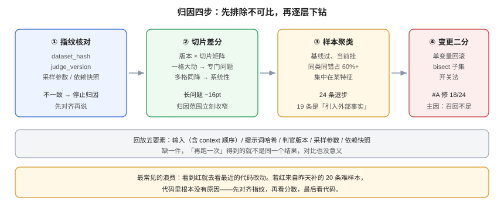

# 变红归因：从分数到样本

**门禁红了之后，团队最常做的两件事是「重跑」和「调阈值」，而不是「找出是哪 12 条样本退步了」。** 归因是可以工程化的：固定三条线索、按顺序走，多数问题在十分钟内能定位到样本级。这一页给出这套顺序、差分矩阵的算法、单样本回放的必备条件，以及一份可直接抄的归因记录模板。

本页判据族 `EVR-A` ~ `EVR-H`，共 8 条。定义表在第七节。



## 一、先确认「它真的红了」

在追查原因之前，先排除三类伪红。这一步不花时间，但能省掉大量无效排查：

| 伪红类型 | 检查 | 判定 |
| --- | --- | --- |
| **噪声** | 与基线的 95% 区间是否重叠；连跑 3 次是否稳定 | 区间大幅重叠 → 噪声，先扩样本或放宽容差 |
| **判官抖动** | 同一批输出重判一次，结果是否一致 | 翻转率 > 5% → 判官问题，不是模型问题 |
| **数据漂移** | `dataset_hash` 与 `judge_version` 是否与基线一致 | 任一不同 → 不可比，先对齐再谈归因 |

::: danger 顺序错了会浪费一整天
最常见的错误是「看到红了就去看最近的代码改动」。如果红是因为评测集昨天被补了 20 条难样本，那么代码里根本没有原因——**先对齐指纹，再看分数，最后看代码**。
:::

## 二、线索一：切片差分矩阵

把「版本 × 切片」排成矩阵，看退步是不是集中在某一行/某一列：

| 切片 | 基线 | 当前 | Δ | 判定 |
| --- | --- | --- | --- | --- |
| 短问题（≤500 字） | 0.86 | 0.86 | 0.0 | 正常 |
| 中问题（500~2k） | 0.79 | 0.78 | −1.0 | 容差内 |
| **长问题（2k~8k）** | **0.71** | **0.55** | **−16.0** | **主因** |
| 中文口语 | 0.74 | 0.73 | −1.0 | 容差内 |
| 多步任务 | 0.63 | 0.62 | −1.0 | 容差内 |
| **整体** | 0.783 | 0.741 | −4.2 | 触发 fail |

矩阵的读法有三条：

1. **只有一格大幅变动** → 大概率是那一类输入的专门问题（如长上下文截断），归因范围立刻收窄。
2. **多格同向小幅下降** → 系统性变化（判官换了、系统提示改了、检索库更新）。
3. **一格上升一格下降、整体持平** → 典型的组成或权衡问题，别当回归处理（见[指标口径](../MetricsDefinition/index.md)）。

## 三、线索二：样本级差分

切片定位后，把该切片内「基线通过、当前失败」的样本列出来。这份清单是归因的核心证据。

```shell
# 生成退步样本清单（regressed.jsonl）
python3 - <<'PY'
import json
base = {json.loads(l)['id']: json.loads(l)['verdict'] for l in open('base.jsonl', encoding='utf-8')}
cur  = {json.loads(l)['id']: json.loads(l)['verdict'] for l in open('cur.jsonl', encoding='utf-8')}
reg  = [i for i in base if base[i] == 'pass' and cur.get(i) == 'fail']
new  = [i for i in base if base[i] == 'fail' and cur.get(i) == 'pass']
print('regressed', len(reg), 'improved', len(new))
open('regressed.jsonl','w').write('\n'.join(reg))
PY
# 期望：regressed 的数量级应与切片 Δ × 该切片条数一致；差太多说明统计口径不一致
```

拿到清单后按三种形态归类，**归类比逐条看快得多**：

| 形态 | 特征 | 常见根因 |
| --- | --- | --- |
| **同类同错** | 20 条里有 15 条都是「引用了 context 外的事实」 | 提示词或检索改动导致幻觉增加 |
| **集中在某个特征** | 全部是 > 4k 字符、或全部含表格 | 截断、序列化、格式解析 |
| **零散无规律** | 每条错法都不同 | 多半是判官抖动，回去看交换一致性 |

## 四、线索三：变更二分

确定「是哪类输入坏了」之后，再定位「是哪次改动」。若一次 PR 里改了检索 + 提示词 + 后处理，就必须拆开验证——否则你只能得到「大概是这三件事之一」。

| 手段 | 做法 | 适用 |
| --- | --- | --- |
| **单变量重跑** | 只回滚其中一项，其余保留 | 改动项少（≤3） |
| **二分（bisect）** | 对提交序列二分，每次跑同一子集 | 改动多、有明确提交序列 |
| **开关法** | 把改动包在配置开关里，逐个关掉 | 已上线的系统，无法回滚代码 |
| **影子对比** | 新旧两版同时跑同一批输入，比对输出 | 无法局部回滚时 |

::: tip 二分要用「子集」而不是全量
定位阶段只需要能区分「红/绿」的**最小子集**（例如那 20 条退步样本 + 20 条对照），跑一次几十秒，比全量快两个数量级。全量留到修复后验收。
:::

## 五、单样本回放：让「再跑一次」得到同一个结果

回放是归因的地基。做不到「同一输入 → 同一输出」，所有对比都在比较噪声。回放需要固定五件事：

| 要素 | 为什么要固定 | 不固定会怎样 |
| --- | --- | --- |
| 输入（含 context 全文与顺序） | 顺序会影响注意力与判官判断 | 同样的题得到不同答案 |
| 提示词哈希 | 系统提示一改，行为全变 | 归因指向错误的版本 |
| 判官版本（模型 + rubric 哈希 + 温度） | 判官换了等于尺子换了 | 退步其实是判官变严 |
| 采样参数（温度、top_p、seed） | 生成本身有随机性 | 单条复现不了 |
| 依赖快照（检索索引版本、工具 mock） | 外部状态会变 | 昨天能复现今天不能 |

```json [replay/case-1042.json]
{
  "case_id": "1042",
  "input": { "question": "...", "context_ref": "ctx/2026-10-18.json#42" },
  "prompt_hash": "sha256:7c1e...",
  "judge_version": "judge-rubric-v3@gpt-x@t0",
  "sampling": { "temperature": 0, "top_p": 1, "seed": 20261019 },
  "deps": { "index": "kb-2026-10-15", "tools": "mock-v2" },
  "expected": { "verdict": "fail", "criteria": [1, 0, 1] }
}
```

## 六、归因记录模板

一份能交接的归因记录，六段就够：

```markdown
## 现象
门禁 fail：整体 0.783 → 0.741（−4.2pt，n=300，CI 不重叠）

## 指纹核对
dataset support-qa@v3（一致）/ judge-rubric-v3@t0（一致）→ 排除数据与判官漂移

## 定位
切片：长问题 0.71 → 0.55（−16pt），其余切片在容差内
样本：24 条退步，其中 19 条为「引用 context 之外的事实」
特征：全部 context > 4k 字符，且集中在含表格的 7 条

## 变更二分
回滚 #A（检索 topk 10→6）：退步消失 18/24 → 主因是召回不足
回滚 #B（提示词加「简洁」指令）：退步减少 4/24 → 次因

## 结论与修复
主因：topk 下调导致长文档召回不全，模型被迫补全 → 幻觉
修复：长文档切片单独走 topk=10；提示词撤回「简洁」指令
验收：long 切片需回到 0.70 以上，且 24 条退步样本全部复测通过

## 遗留
7 条含表格样本另开 issue（表格序列化丢列），与本次改动无关
```

::: warning 「遗留」这一段别省
不写遗留，同样的问题三周后会以新 issue 的形式重新查一遍。**遗留项必须带 id 与负责人**，否则它只是一句感想。
:::

## 七、验证方式

```shell
# ① 切片差分矩阵（从两份报告里抽）
python3 - <<'PY'
import json
b = json.load(open('reports/base.json'))['slices']
c = json.load(open('reports/cur.json'))['slices']
for k in b:
    d = (c[k]['point'] - b[k]['point']) * 100
    flag = '  <== 主因' if abs(d) >= 10 else ''
    print(f'{k:12s} {b[k]["point"]:.3f} -> {c[k]["point"]:.3f}  {d:+.1f}pt{flag}')
PY
# 期望：能直接看出「一格大幅变动」还是「多格同向小幅下降」
```

```shell
# ② 样本级退步清单与形态聚类
python3 - <<'PY'
import json, collections
base = {json.loads(l)['id']: json.loads(l) for l in open('base.jsonl', encoding='utf-8')}
cur  = {json.loads(l)['id']: json.loads(l) for l in open('cur.jsonl', encoding='utf-8')}
reg = [(i, cur[i]) for i in base if base[i]['verdict']=='pass' and cur[i]['verdict']=='fail']
print('regressed', len(reg))
reason = collections.Counter(r[1].get('reason','unknown') for r in reg)
for k, v in reason.most_common():
    print(f'  {v:3d}  {k}')
PY
# 期望：某一类 reason 占比 > 60% 就是主因形态；均匀分散则怀疑判官抖动
```

```shell
# ③ 回放可复现性：同一 case 跑 3 次，结论必须一致
for i in 1 2 3; do python -m eval.replay --case replay/case-1042.json --out /tmp/r$i.json; done
python3 - <<'PY'
import json
vs = [json.load(open(f'/tmp/r{i}.json'))['verdict'] for i in (1,2,3)]
print(vs, 'stable' if len(set(vs)) == 1 else 'UNSTABLE')
PY
# 期望：stable。UNSTABLE 说明采样参数或依赖没固定，归因结论不可信
```

```shell
# ④ 指纹核对：不可比就别归因
python3 - <<'PY'
import json
b = json.load(open('reports/base.json')); c = json.load(open('reports/cur.json'))
for k in ('dataset', 'judge_version'):
    print(k, b[k], c[k], 'OK' if b[k] == c[k] else 'MISMATCH')
PY
# 期望：两行都 OK。任一 MISMATCH，先对齐再谈归因
```

## 八、判据族 `EVR`

| 判据 | 内容 | 怎么验证 |
| --- | --- | --- |
| `EVR-A` | 归因前必须核对数据与判官指纹，不一致时禁止归因 | 归因记录第一段含指纹核对结论 |
| `EVR-B` | 必须先做切片差分，再进入样本级 | 记录里有切片矩阵与「主因」标注 |
| `EVR-C` | 退步样本必须按形态聚类，不得只给条数 | 记录里有 reason 计数与占比 |
| `EVR-D` | 一次改动多项时，必须做单变量或二分验证 | 记录里有回滚实验与对应条数变化 |
| `EVR-E` | 回放必须固定五要素（输入/提示词/判官/采样/依赖） | 存在 `replay/*.json` 且含五字段 |
| `EVR-F` | 回放必须可复现：同一 case 三次结论一致 | 执行第 ③ 条验证得到 `stable` |
| `EVR-G` | 归因记录必须含结论、修复动作与验收标准 | 记录六段齐全，验收标准是可量化的 |
| `EVR-H` | 未解决项必须单独列出并带负责人，不得混在结论里 | 记录里有「遗留」段，且每项有 id 与 owner |

## 九、与相邻专题的分工

| 你想知道 | 去哪 |
| --- | --- |
| 红绿判定与阈值 | [回归门禁](../RegressionGate/index.md) |
| 区间与显著性 | [区间、检验与样本量](../Statistics/index.md) |
| 线上 trace 怎么查（不是离线归因） | [链路追踪](../../LLMObservability/Tracing/index.md) |
| 故障复盘怎么写（生产事故） | [故障应急体系](../../../Ops/IncidentResponse/Overview/index.md) |
| 变更怎么分级、怎么留痕 | [变更管理与发布工程](../../../Ops/ChangeManagement/index.md) |

## 参考资料

- Zeller, A., *Why Programs Fail: A Guide to Systematic Debugging*：二分定位与最小复现的方法论
- Google SRE Book：[*Postmortem Culture*](https://sre.google/sre-book/postmortem-culture/)（现象/影响/根因/行动项的记录结构）
- 本站：[回归门禁](../RegressionGate/index.md)、[指标口径](../MetricsDefinition/index.md)
