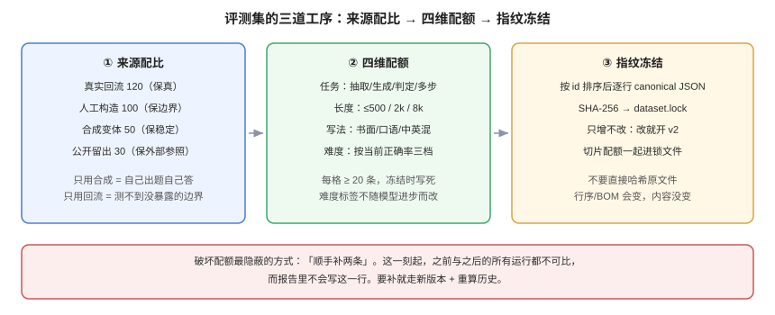

# 评测集构建与冻结

**评测集不是「攒够 300 条」，而是一份带配额的、可冻结的、能证明自己没被污染的数据契约。** 这一页解决四件事：样本从哪来、怎么保证有区分力、怎么防污染、怎么冻结到「两次运行之间只变了模型」这一个变量。

本页判据族 `EVD-A` ~ `EVD-H`，共 8 条。定义表在第八节。



## 一、样本从哪来：四种来源，四种偏差

| 来源 | 怎么来 | 天然偏差 | 适合回答 |
| --- | --- | --- | --- |
| **真实流量回流** | 从观测平台导出低分、负反馈、长尾会话 | 只覆盖「已经出问题」的部分，缺少正常样本 | 「线上那类问题修好了吗」 |
| **人工构造** | 按需求文档与已知边界手写 | 太干净、太正式，缺少口语与错别字 | 「某个明确规则是否被遵守」 |
| **合成扩增** | 用强模型改写、变体、加干扰 | 与生成模型同分布，容易「互相押题」 | 「同一意图的不同说法是否稳定」 |
| **公开基准留出** | 从公开集里切一份不参与训练的留出 | 污染风险最高 | 「和外界比大致在什么位置」 |

四条来源不能互相替代。**只用合成数据，评出来的是「模型会不会做自己出的题」；只用真实回流，评出来的是「历史问题修没修」，永远测不到没暴露过的边界。**

一个可用的配比（按样本量 300 举例，推演值，按业务调整）：

| 来源 | 条数 | 作用 |
| --- | --- | --- |
| 真实回流 | 120 | 保真：都是真实说法的分布 |
| 人工构造（含边界与反例） | 100 | 保边界：明确该拒答、该追问的情形 |
| 合成变体 | 50 | 保稳定：同义改写后不应翻转 |
| 公开留出 | 30 | 保外部参照 |

## 二、配额：四个切片维度，缺一个就会被掩盖

切片不是「分组看数」，而是**在造数据时就按配额填**。事后切分经常会发现某个切片只有 3 条，统计上等于没有。

| 维度 | 建议档位 | 为什么必须有 |
| --- | --- | --- |
| **任务类型** | 抽取 / 生成 / 判定 / 多步 | 不同任务的失败模式完全不同 |
| **长度** | ≤ 500 / 500~2k / 2k~8k 字符 | 长上下文退化是最常见的隐性回归 |
| **语言与写法** | 中文书面 / 中文口语 / 中英混 | 口语与错别字是线上主战场 |
| **难度** | 简单 / 中等 / 困难（按当前模型正确率三档切） | 只有全对的题测不出差异 |

难度档位不要凭感觉，用**当前线上模型的正确率**分：正确率 > 0.9 记简单、0.5~0.9 记中等、< 0.5 记困难。这样难度会随模型进步而漂移——所以**难度标签只在冻结时写死一次**，之后不再改，否则历史对比全废。

::: danger 配额最容易被破坏的一种方式
「顺手补两条」。某次发现某类问题没覆盖，于是往正在用的评测集里加了 20 条。这一刻起，**之前所有运行与之后所有运行都不可比了**，而报告里不会写这一行。
:::

## 三、区分力：评测集也必须「能考出分」

一套样本如果当前模型全部通过，它对「这次改动好不好」没有任何信息量——这不是模型强，是样本失效。

三个可算的指标：

| 指标 | 算法 | 参考区间 | 说明 |
| --- | --- | --- | --- |
| **通过率** | 通过条数 / 总条数 | 0.55~0.90 | 接近 1.0 说明太简单；低于 0.3 说明太难，噪声占主导 |
| **区分度** | 高分组与低分组通过率之差 | > 0.3 | 用「两次不同版本运行」的成绩分组，比较每条样本的通过情况 |
| **翻转率** | 同一输入重复 N 次结论不一致的比例 | < 5% | 高于 5% 的样本应移入「不稳定集」，单独统计 |

通过率接近天花板时，正确做法是**造更难的题**（加干扰、加多跳、加边界），而不是把阈值调高。阈值调高只是把噪声放大。

## 四、污染与泄漏：三种检测，成本从低到高

| 检测 | 做法 | 能发现什么 | 成本 |
| --- | --- | --- | --- |
| **n-gram 重叠** | 评测样本与训练语料做 13-gram 精确匹配 | 直接抄进训练集的题 | 低（可离线批跑） |
| **Canary 串** | 在私有集里插入唯一无意义字符串，训练后问模型能否复述 | 数据被抓取进训练 | 低 |
| **时间切分** | 只用「模型训练截止日之后」新产生的数据 | 时效性污染 | 中（需要时间戳） |

n-gram 重叠的实现只要 30 行（见第七节验证方式）。经验上，**13-gram 命中率超过 1% 就应当把那批样本标记为「疑似污染」并从主分数里剔除**，而不是整体不用——整体弃用会让评测集瞬间缩水，反而失去区分力。

::: warning Canary 串的一个坑
Canary 必须放在**语义无关但格式自然**的位置（比如一条样本的「来源编号」字段），且每次冻结换一个新串。把 canary 写成显眼的 `CANARY_DO_NOT_TRAIN`，清洗脚本第一个删的就是它。
:::

## 五、冻结：让两次运行之间只变一个变量

冻结不是「不再动文件」，而是**让内容可被证明没动**。四件事：

1. **内容指纹**：按固定顺序（例如按 `id` 排序）逐行序列化后算 SHA-256。**不要直接哈希原文件**——行序、空行、BOM 都会让哈希变，而内容其实没变（第 165 天的踩坑记录里有完整案例：同一个 `pg_dump` 两次哈希不同）。
2. **冻结标签**：指纹 + 样本数 + 冻结日期写进 `dataset.lock`，并进版本库。
3. **只增不改**：要改就开 `v2`，`v1` 永久保留。运行记录里引用的是 `dataset_id@version`，不是「最新版」。
4. **切片快照**：切片配额也进锁文件。否则切片规则一改，分项分数立刻不可比。

```json [datasets/support-qa/dataset.lock]
{
  "dataset_id": "support-qa",
  "version": "v3",
  "frozen_at": "2026-10-01",
  "samples": 300,
  "sha256": "9f2c...c41a",
  "slices": {
    "task": { "extract": 80, "generate": 110, "judge": 70, "multi_step": 40 },
    "length": { "short": 150, "medium": 110, "long": 40 },
    "language": { "zh_written": 180, "zh_spoken": 90, "mixed": 30 },
    "difficulty": { "easy": 90, "medium": 140, "hard": 70 }
  }
}
```

## 六、样本量：先算误差棒，再决定要不要扩

95% 置信区间的半宽（本机 bootstrap，p=0.78，2000 次重采样，固定种子）：

| 样本量 | 95% CI | 半宽 | 能分辨的最小差距 |
| --- | --- | --- | --- |
| 50 | [0.660, 0.880] | **±11.0pt** | 只能看出「崩了」 |
| 100 | [0.690, 0.860] | ±8.5pt | 看不出 5pt 以内的改动 |
| 300 | [0.733, 0.823] | **±4.5pt** | 能分辨 5pt 以上 |
| 1000 | [0.754, 0.806] | ±2.6pt | 能分辨 3pt 左右 |

读法：**300 条是「能卡门禁」的起点，50 条只够做冒烟。** 如果一次改动预期只提升 2 个点，用 300 条去测，得到的结论是「没变化」——不是改动无效，是尺子不够细。

::: tip 想要更细的尺子，先加样本而不是加指标
把 300 条扩到 1000 条，成本是判官调用费 × 3.3；把指标从 1 个加到 6 个，成本是**口径解释与误报治理**，而且不会让区间变窄。先扩样本。
:::

## 七、验证方式

以下命令都只读、都可复现。把样本存成 `samples.jsonl`（每行 `{"id","question","answer","slice":{...}}`）。

```shell
# ① 算内容指纹（按 id 排序，逐行 canonical JSON 后哈希）
python3 - <<'PY'
import hashlib, json
rows = [json.loads(l) for l in open('samples.jsonl', encoding='utf-8')]
rows.sort(key=lambda r: r['id'])
h = hashlib.sha256()
for r in rows:
    h.update(json.dumps(r, ensure_ascii=False, sort_keys=True).encode())
print(len(rows), h.hexdigest())
PY
# 期望：输出「300 9f2c...c41a」，与 dataset.lock 里的 samples / sha256 完全一致
```

```shell
# ② 检查配额是否与锁文件一致
python3 - <<'PY'
import json, collections
rows = [json.loads(l) for l in open('samples.jsonl', encoding='utf-8')]
for dim in ('task', 'length', 'language', 'difficulty'):
    c = collections.Counter(r['slice'][dim] for r in rows)
    print(dim, dict(sorted(c.items())))
PY
# 期望：四个维度的分项计数与 dataset.lock 的 slices 逐项相等；多一条或少一条都要重冻结
```

```shell
# ③ 13-gram 污染检测（需要训练语料 corpora.txt）
python3 - <<'PY'
import json, re
def grams(t, n=13):
    w = re.findall(r'\w+', t.lower())
    return {tuple(w[i:i+n]) for i in range(max(0, len(w)-n+1))}
corpus = open('corpora.txt', encoding='utf-8').read()
cg = grams(corpus)
hit = 0
for l in open('samples.jsonl', encoding='utf-8'):
    r = json.loads(l)
    if grams(r['question']) & cg:
        hit += 1
        print('SUSPECT', r['id'])
print('hit_rate', round(hit/300, 4))
PY
# 期望：hit_rate < 0.01；命中样本标记为 suspected_contamination 并从主分数剔除
```

```shell
# ④ 用当前模型跑一遍，确认通过率不贴天花板
python3 - <<'PY'
# 假设 results.jsonl 每行 {"id","pass":true|false}
import json
rows = [json.loads(l) for l in open('results.jsonl', encoding='utf-8')]
p = sum(r['pass'] for r in rows) / len(rows)
print('pass_rate', round(p, 3), 'n', len(rows))
PY
# 期望：0.55 <= pass_rate <= 0.90。0.97 以上的样本集对「小改动」没有区分力
```

## 八、判据族 `EVD`

| 判据 | 内容 | 怎么验证 |
| --- | --- | --- |
| `EVD-A` | 评测集必须声明四种来源的配比，且实际条数符合配比 | 按 `source` 字段计数，与文档声明一致 |
| `EVD-B` | 必须有四个切片维度（任务/长度/语言/难度）且每格至少 20 条 | 交叉计数，存在空格或 < 20 的格子即不合格 |
| `EVD-C` | 难度标签必须在冻结时写死，之后不得随模型变化而改 | `dataset.lock` 的 `slices.difficulty` 与运行记录一致 |
| `EVD-D` | 内容指纹必须按固定顺序序列化后计算，不得直接哈希原文件 | 两次「仅改行序」的副本应得到同一指纹 |
| `EVD-E` | 评测集只增不改：任何内容变更必须开新版本号 | 旧版本目录仍在，且运行记录引用具体版本 |
| `EVD-F` | 必须有污染检测，并给出命中率 | 能跑出 `hit_rate`；无检测即不合格 |
| `EVD-G` | 通过率必须落在 0.55~0.90，否则样本失效 | 跑一次得到 `pass_rate` 读数 |
| `EVD-H` | 样本量必须与「要分辨的最小差距」匹配 | 报告里能给出 CI 半宽，且小于目标差距 |

## 九、与相邻专题的分工

| 你想知道 | 去哪 |
| --- | --- |
| 数据集版本化在数据库侧怎么做（表结构、迁移） | [测试数据与版本](../../../Tools/TestDataSimulation/DatasetVersioning/index.md) |
| 数据脱敏与仿真环境 | [测试数据与仿真环境](../../../Tools/TestDataSimulation/Overview/index.md) |
| 训练集怎么切、SFT 数据怎么造 | [微调数据集](../../FineTuning/Dataset/index.md) |
| 检索语料怎么建、chunk 怎么切 | [分块策略](../../RAG/Chunking/index.md) |
| 区间怎么算、差几个点才显著 | [区间、检验与样本量](../Statistics/index.md) |

## 参考资料

- Sainz et al., *NLP Evaluation in Trouble: On the Desirability of LLM Benchmarks*（[arXiv:2310.18018](https://arxiv.org/abs/2310.18018)）：污染与失效的系统讨论
- HELM 文档：[Data Contamination](https://crfm.stanford.edu/helm/)（污染检测的公开实践）
- Efron & Tibshirani, *An Introduction to the Bootstrap*（区间估计的重采样基础）
- 本站：[评测工程全景](../Overview/index.md)、[人工基线](../HumanAlignment/index.md)、[区间与检验](../Statistics/index.md)
