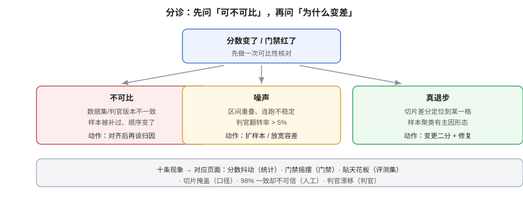

# 常见问题与最佳实践

**这一页是前九页的分诊台。** 遇到现象先查表定位到页面，再动手；十二个高频问题给短答（每条都指向能验证的动作），最后一节是可以直接抄进 PR 模板的上线自查清单。

本页判据族 `EVQ-A` ~ `EVQ-H`，共 8 条。定义表在第五节。

## 一、十类现象的分诊表

| 现象 | 最可能的原因 | 先查什么 | 去哪 |
| --- | --- | --- | --- |
| 分数每次运行都不一样，差 3~5 个点 | 样本量不足 / 判官抖动 | 连跑 5 次的 `spread_pt` 与 CI 半宽 | [统计](../Statistics/index.md) |
| 门禁时红时绿 | 阈值落在噪声带内 | 容差是否 ≥ 2×抖动 | [门禁](../RegressionGate/index.md) |
| 分数一直很高，改动看不出差别 | 样本贴天花板（无区分力） | `pass_rate` 是否 > 0.9 | [评测集](../DatasetDesign/index.md) |
| 整体持平，但用户投诉变多 | 切片掩盖 | 长问题/口语/多步三个切片 | [指标口径](../MetricsDefinition/index.md) |
| 判官与人工「98% 一致」却不可信 | 原始一致率虚高 | κ 与标签分布 | [人工基线](../HumanAlignment/index.md) |
| 判官换了模型后分数整体上移 | 判官漂移（尺子换了） | `judge_version` 是否变了 | [判官校准](../JudgeCalibration/index.md) |
| 长答案总是赢 | 长度偏差 | 受控对的 `longer_wins` | [判官校准](../JudgeCalibration/index.md) |
| 成对比较的胜率每次都不一样 | 位置偏差 | 交换一致性 SC | [判官校准](../JudgeCalibration/index.md) |
| 门禁红了但找不到原因 | 缺归因流程 | 指纹是否一致 → 切片差分 | [变红归因](../Attribution/index.md) |
| 评测跑挂了，流水线却是绿的 | `error` 被当成 `pass` | 退出码与空结果处理 | [门禁](../RegressionGate/index.md) |

::: tip 分诊的第一条纪律
**先确认「是不是可比」**（指纹、样本量、判官版本），再讨论「为什么变差」。不可比的两次运行之间做归因，得到的结论 90% 是错的。
:::

## 二、十二个高频问题

**Q1：评测集要多少条才够？**
300 条是门禁的起点（CI 半宽约 ±4.5pt），50 条只够冒烟，想分辨 2~3pt 要 1000 条。先定「要分辨多大差距」，再定条数。

**Q2：没有人工标注能不能做评测？**
能做「排序参考」，不能做「门禁」。门禁需要知道判官离人有多远，这必须有金标集（200 条起）。

**Q3：能不能用同一个模型既生成又评判？**
可以，但必须做家族交叉并单独报「同族胜率」，且不能用于最终决策。

**Q4：判官用 0/1 还是 1~5？**
门禁用 0/1 条目化（可复算）；需要画趋势时用条目加权得分，但**不要用一个笼统的 1~10**。

**Q5：多次采样取平均还是投票？**
分类结论用投票（多数票），连续分数用平均。两者都只降方差、不降偏差——先校准偏差。

**Q6：为什么加了样本量，分数反而降了？**
可能是新样本更难（组成变了），也可能是原来那批里有被污染的简单题。用固定配额 + 切片对比确认。

**Q7：A/B 两版差 2 个点，能发吗？**
先看 CI：区间大幅重叠就是分不出。再看切片：主指标持平但关键切片退化，不该发。

**Q8：门禁阈值定多少合适？**
基线（固定版本）+ 容差（≥2×抖动，且 ≥ MDE）。**阈值不是拍出来的，是从历史分布算出来的。**

**Q9：评测太贵，怎么省？**
三层分流（L1 规则覆盖全量、L2 判官抽样、L3 人工只校准）、判分缓存、按需跑切片。省钱的顺序是先降覆盖范围，再降判官强度——反过来会让结论失去意义。

**Q10：线上指标和离线指标对不上，信哪个？**
两个都信，但回答的问题不同：离线回答「这批固定样本上有没有退步」，线上回答「真实流量里体验有没有变差」。对不上通常意味着离线样本不覆盖线上分布。

**Q11：模型供应商悄悄更新了模型怎么办？**
在 `judge_version` 与 `model_version` 里记录可识别的版本号；对关键集做「固定输入重跑」的周检，分数跳变超过容差就告警。

**Q12：小团队（1~2 人）要不要做这么细？**
要，但只做四件事：**冻结一份 100~300 条的样本、算一次区间、写一个能证伪的门禁、留一份归因记录。** 其余可以后补。

## 三、八个常见反模式

| 反模式 | 表现 | 后果 |
| --- | --- | --- |
| **恒真门禁** | 从未红过 | 等于没有门禁 |
| **重跑到绿** | 红了就重跑 | 假阳性被系统性忽略 |
| **基线滚动** | 基线 = 上次分数 | 缓慢退步永远不被发现 |
| **只报总分** | 没有切片 | 局部崩塌被平均掉 |
| **unknown 折叠** | 解析失败算 fail/pass | 口径被污染 |
| **阈值手调** | 每次红就调低 | 门禁退化成装饰 |
| **判官自证** | 同族同模型 | 分数只反映偏好 |
| **报告不落盘** | 只看 CI 日志 | 无法归因、无法审计 |

## 四、上线自查清单

复制到 PR 模板里，逐条勾：

- [ ] 数据集指纹与配额已核对（`dataset.lock` 与运行报告一致）
- [ ] 判官版本含模型名 + rubric 哈希 + 温度 + 采样策略
- [ ] 报告含 `n`、`point`、`ci95`、`unknown_rate`
- [ ] 报告含至少 4 个固定切片
- [ ] 与基线的比较是**配对**检验，且报告了 b/c
- [ ] 门禁跑过「注入退步必须红」的验证
- [ ] 空结果 / 超时返回 `error`，不返回 `pass`
- [ ] 豁免（如有）含范围、期限、补偿动作，且未过期
- [ ] 归因记录（如本次为修复）含现象、定位、结论、遗留
- [ ] 报告已落盘到 `reports/`，文件名带时间戳

## 五、判据族 `EVQ`

| 判据 | 内容 | 怎么验证 |
| --- | --- | --- |
| `EVQ-A` | 分诊必须先做「可比性核对」，再讨论原因 | 排障记录第一行是指纹核对 |
| `EVQ-B` | 「重跑到绿」必须被记录并计入统计 | 报告里有 `rerun` 字段；月度能看到重跑率 |
| `EVQ-C` | 阈值调整必须走配置评审并留原因 | `configs/gate.yaml` 的变更历史含理由 |
| `EVQ-D` | `unknown` 不得被折叠进 pass/fail | 结果里三种 verdict 都可计数 |
| `EVQ-E` | 报告必须落盘且可追溯（时间戳命名） | `reports/` 有历史文件，且与 CI 运行一一对应 |
| `EVQ-F` | 线上与离线结论不一致时，必须能说出「样本分布差异」 | 有不一致案例的分析记录 |
| `EVQ-G` | 小团队最低配置（冻结集 / 区间 / 可证伪门禁 / 归因记录）四项齐全 | 四项都有对应文件或章节 |
| `EVQ-H` | PR 模板必须含上线自查清单 | 模板文件里能 `grep` 到清单条目 |

## 六、与相邻专题的分工

| 你想知道 | 去哪 |
| --- | --- |
| 体系与三种有效性 | [评测工程全景](../Overview/index.md) |
| 样本、判官、口径、统计、门禁、归因 | [评测集](../DatasetDesign/index.md) / [判官](../JudgeCalibration/index.md) / [口径](../MetricsDefinition/index.md) / [统计](../Statistics/index.md) / [门禁](../RegressionGate/index.md) / [归因](../Attribution/index.md) |
| 从零搭流水线 | [实战](../Practice/index.md) |
| 线上评估与 trace | [LLM 可观测性](../../LLMObservability/Overview/index.md) |

## 参考资料

- Google SRE Book：[*Postmortem Culture*](https://sre.google/sre-book/postmortem-culture/)（不留责、可执行行动项）
- Martin Fowler：[*Test Pyramid*](https://martinfowler.com/articles/practical-test-pyramid.html)（分层测试的同构思路：便宜的覆盖全量，贵的覆盖关键）
- 本站：[回归门禁](../RegressionGate/index.md)、[变红归因](../Attribution/index.md)、[实战](../Practice/index.md)
